# enzopt 안내서

> 속도 상수를 몰라도, 효소 반응 조건은 정할 수 있습니다.

이 문서는 enzopt가 무엇을 하고, 결과를 어떻게 읽는지 설명합니다. 설치·명령·설정 항목의 전체 목록은 [`README.md`](../README.md), 설계 결정의 근거는 [`PROJECT_SPEC.md`](../PROJECT_SPEC.md)와 [`PROGRESS.md`](../PROGRESS.md)에 있습니다.

- 처음이면 1~3절(무엇을, 왜, 어떤 순서로)을 읽고 4절로 예제를 한 번 돌려 봅니다.
- 결과를 받았으면 5절(그림 읽기)이 본론입니다. 그림마다 **무엇을 그렸나 → 어떻게 읽나 → 예제에서 읽은 값 → 정상과 이상 신호 → 이상할 때 할 일** 순서로 적었습니다.
- 6절은 피펫 표, 7절은 결과 폴더의 파일, 8절은 실측 데이터로 시험한 결과, 9절은 문제 해결, 10절은 용어집입니다.

5절의 그림은 합성 예제 `projects/example_ldh_synth`를 전체 모드로 돌린 실행 `runs/example_ldh_synth/2026-10-10_0821`에서 가져왔습니다(`docs/guide/`에 사본). GPU float32로 학습하므로 다시 돌리면 숫자가 조금씩 다를 수 있습니다. 1~3·6·8절의 보조 그림(그림 A~H)은 `scripts/guide_figures.py`가 같은 실행과 Holmes 실행 `runs/ldh_holmes1988/2026-10-09_2311`에서 그렸습니다. 8절의 그림 I는 `scripts/inactivation_demo.py`가, 그림 J는 `enzopt suggest`가 그렸습니다. 그림 A·D·K(흐름도)는 손으로 그린 SVG입니다. 그림을 넣은 HTML 판은 [`GUIDE.html`](GUIDE.html)입니다(`uv run python scripts/build_guide_html.py`로 다시 만듦).

---

## 1. 한눈에 보기

효소 반응의 진행 곡선(분광광도계로 잰 NADH 흡광도 A340의 시간 변화)을 몇 개 재면, 속도식에 들어가는 속도 상수를 맞출 수 있습니다. 그런데 LDH처럼 단계가 여러 개인 메커니즘에서는 **데이터에 똑같이 잘 맞는 속도 상수 조합이 여러 개** 있습니다. 상수 하나하나는 정해지지 않습니다(식별 불가능).

enzopt는 이 사실을 숨기지 않고 설계에 씁니다.

1. 반응식의 **구조**만으로 보장되는 것을 먼저 확인합니다(CRNT 판정). LDH 반응망이 조건을 만족하면 속도 상수가 무엇이든 "보존량이 같은 실험은 같은 평형 하나로 간다"는 것이 수학적으로 보장됩니다.
2. 데이터에 맞는 속도 상수 조합을 **여러 개(표본)** 만듭니다(PINN 식별).
3. 각 표본으로 반응을 다시 풀어 1의 보장이 실제로 지켜지는지 자동 검증합니다(scipy·Hopsan 해석).
4. **모든 표본에서** 목표(예: 300초 안에 NADH 99% 전환)를 만족하는 최소 효소량과 기질 비를 찾고, 그대로 실험할 수 있는 **피펫 표**를 만듭니다(강건 설계).

최종 결과물은 `5_design/pipette.csv`(피펫 표)입니다. 나머지 그림과 표는 그 피펫 표를 믿어도 되는지 판단하는 근거입니다.

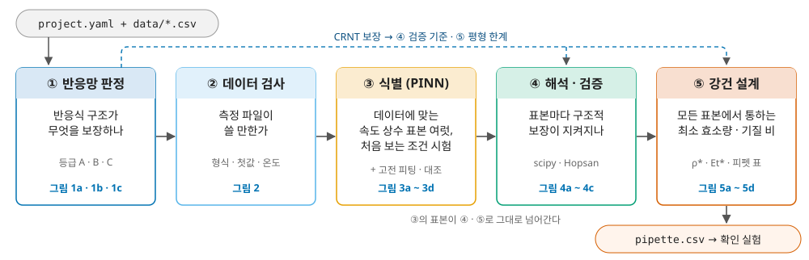

## 2. 왜 이렇게 하나

### 2.1 식별 불가능을 받아들이기

예제(합성 데이터)에서 PINN 표본 4개는 학습 데이터에 거의 똑같이 맞습니다(그림 3a). 그런데 속도 상수를 보면 k₊₁은 10⁷ 근처, 고전 피팅은 10⁴~10⁵로 수백~수천 배 다릅니다(그림 3c). 이런 상황에서 "가장 잘 맞는 한 조합"으로 설계하면, 실제 효소가 다른 조합처럼 행동할 때 설계가 실패합니다. 그림 5b가 그 실패를 보여 줍니다. 공칭 설계(표본 하나로 정한 효소량)는 다른 표본에서 목표에 못 미칩니다.

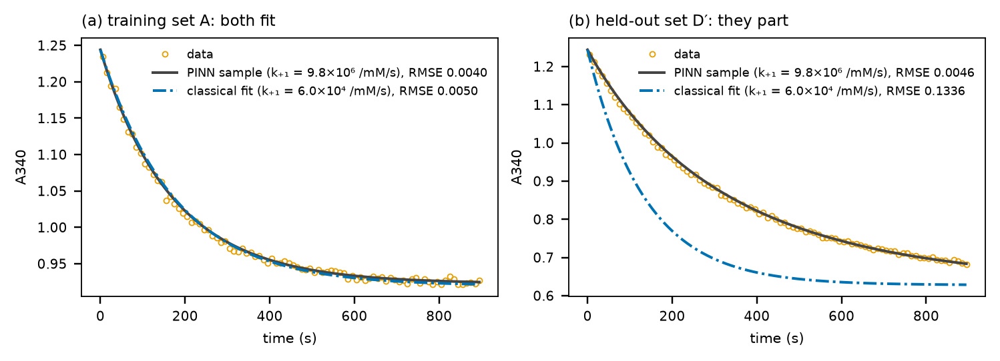

### 2.2 구조가 주는 보장 (CRNT, 정리 149)

화학 반응망 이론(CRNT)은 반응식의 모양만 보고 동역학의 성질을 말해 줍니다. enzopt가 쓰는 결과는 하나입니다.

> 반응망이 **약가역**(weakly reversible)이고 **결핍**(deficiency)이 0이면, 질량작용 동역학에서 속도 상수가 무엇이든 (1) 어떤 종도 0으로 사라지거나 발산하지 않고(영속성), (2) 보존량이 같은 초기 상태(같은 적합류)는 모두 같은 양의 평형 하나로 간다.

이 보장 덕분에 두 가지를 할 수 있습니다.

- **평형 한계를 속도 상수 없이 계산합니다.** 평형 상수 K′ 하나로 "기질 비 ρ에서 최대 몇 %까지 전환되는가"가 정해집니다(그림 5d). 효소를 아무리 넣어도 이 한계는 못 넘습니다.
- **해석 결과를 자동으로 검증합니다.** 표본마다 같은 적합류의 무작위 초기 상태 12개가 한 점으로 모이는지 봅니다(그림 4a). 모이지 않으면 수치 오류이거나 반응식 입력이 틀린 것입니다.

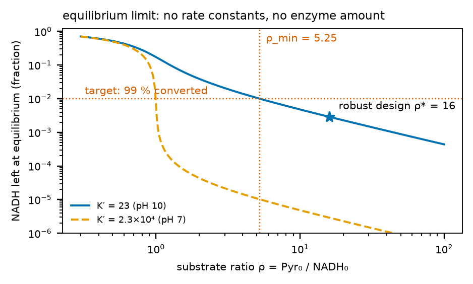

### 2.3 이 도구가 하지 않는 것

- 속도 상수의 "참값"을 알려 주지 않습니다. 표본의 퍼짐이 곧 결과입니다.
- 반응식(메커니즘)을 찾아 주지 않습니다. 사용자가 적은 반응식이 맞다고 가정합니다. 맞지 않으면 그림 3a·3b에서 체계적인 어긋남으로 드러납니다.
- 온도가 변하는 실험, 효소가 실활하는 실험은 모델 밖입니다(그림 2b로 온도를 확인합니다).

## 3. 다섯 단계


| 단계 | 입력 | 계산 | 결과 파일 | 그림 |
|---|---|---|---|---|
| ① 반응망 판정 | `network.steps` | 복합체·연결 성분·강연결 성분·약가역성·결핍·보존 법칙. 식별용·비약가역 대조·설계용(막다른 복합체 포함) 반응망 셋을 판정 | `1_verdict/report.txt`, `verdict.json` | 1a·1b·1c |
| ② 데이터 검사 | `data/*.csv`, 실험 항목 | 형식 검사(시간 역행·빈 값·숫자·A340 > 2), 첫값과 예상 초기값, 온도 범위 | `2_data/exp_*.csv`, `data.json` | 2 |
| ③ 식별 | 학습 실험(`role: train`) | PINN으로 속도 상수 표본(시드마다 하나, 시드마다 8번 재시작해 ODE로 가장 잘 맞는 해). 같은 데이터로 고전 피팅과 비약가역 대조도 함께 | `3_fit/samples/*.json`, `holdout_comparison.csv` | 3a~3d |
| ④ 해석·검증 | 표본 | 표본 × (같은 적합류 12개 + 다른 적합류 1개)를 scipy로 풀고 CRNT 검증. Hopsan으로 독립 대조 | `4_sim/validation.csv`, `hopsan/` | 4a~4c |
| ⑤ 강건 설계 | 표본, `design` 설정 | 평형 한계 ρ_min, ρ 격자마다 최소 효소량(공칭·강건), 강건 최적 ρ*·Et*, 피펫 표 | `5_design/pipette.csv`, `design_table.csv` | 5a~5d |

단계별 계산을 조금 더 풀면 다음과 같습니다.

**③ 식별: PINN이 하는 일.** 실험마다 NADH(t)를 그리는 작은 신경망을 두고, 신경망 곡선이 (a) 측정점을 지나고 (b) 반응식(질량작용 미분방정식)을 만족하도록 속도 상수와 신경망을 함께 학습합니다. 효소 형태(E, EN, ENP, EQL, EQ)의 분포는 준정상 근사(King–Altman)로 계산하고, 보존 법칙 4개와 Haldane 관계(K′로 k₋₅를 정함)는 식에 박아 둡니다. 학습이 끝나면 **학습된 속도 상수로 미분방정식을 처음부터 다시 풀어** 데이터와 비교합니다. 그림 3의 곡선은 모두 이 재해석 곡선입니다. 재해석 학습 RMSE가 3σ(σ = `noise_sigma`)를 넘는 시드는 표본에서 뺍니다.

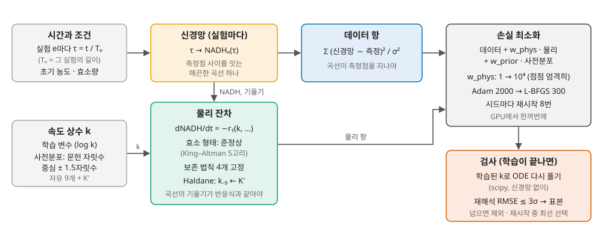

진행 곡선에서 속도 상수를 찾는 과정 전체(정문제 → 역문제 → 재시작 → 식별 불가능 → 설계 → 확인 실험을 넣은 재학습)는 그림 9장으로 따라가는 레퍼런스 [docs/identification/README.md](identification/README.md)에 있습니다. 그림을 넣은 HTML 판은 [IDENTIFICATION.html](IDENTIFICATION.html)입니다.

**③ 비교 모델 둘.** 같은 데이터·사전분포·시작점으로 (1) 고전 피팅(다중 시작점 최소제곱)과 (2) 비약가역 대조(5단계를 한 방향으로 바꾼 반응망의 PINN)를 돌려 홀드아웃 예측을 한 표에 둡니다. 대조는 "약가역 구조가 정말 필요한가"를 보여 주는 음성 대조입니다.

**⑤ 설계 대상.** 예제는 NADH 정량(assay)입니다. 시료의 NADH(100 µM)를 피루브산 과량과 LDH로 300초 안에 99% 소모시키는 조건을 찾습니다. ρ = 피루브산₀/NADH₀입니다. 설계용 반응망에는 피루브산이 많을 때 생기는 막다른 복합체 EQ·Pyr(Ki = 5 mM, 가정값)를 더합니다. 그래서 피루브산을 무작정 늘리면 오히려 느려집니다.

### 반응식 쓰기: 직접 적거나 목록에서 고르기

반응식(메커니즘)은 사용자가 정합니다. enzopt는 이름을 기호로만 읽고, "어떤 분자가 화살표의 어느 쪽에 몇 개 있나"에서 미분방정식·반응 그래프·보존 법칙을 만듭니다. 두 가지 방법이 있습니다.

**① 직접 적기** — `network.species`·`enzyme_species`·`steps`에 한 줄에 한 단계씩(붙기·바뀌기·떨어지기) 적습니다. 이름은 영문자나 `_`로 시작하고 영문자·숫자·`_`·`'`만 씁니다(`NAD⁺`·한글·하이픈은 안 됨, 숫자로 시작하면 계수로 읽힘).

**② 목록에서 고르기** — `network.mechanism`에 유형과 분자 이름만 적으면 단계가 만들어지고 `overall`·`haldane_step`도 채워집니다.

```yaml
network:
  mechanism:
    type: ordered_bibi                 # 아래 표
    substrates: [NADH, Pyr]            # 붙는 순서
    products: [Lac, NAD]               # 떨어지는 순서
    letters: {NADH: N, Pyr: P, Lac: L, NAD: Q}   # 효소 형태 이름 글자 → EN, ENP, EQL, EQ
    add:                               # 곁가지(선택)
      - dead_end: {form: EQ, ligand: Pyr}         # 막다른 복합체·저해제·기질 저해
  thermodynamics: {Kp: 23.0}
  prior: ...                           # 개수는 만들어진 단계에 맞게
```

| 유형 (`type`) | 메커니즘 | 등급 |
|---|---|---|
| `uni_irreversible` | 기질 1개, 비가역(교과서 Michaelis–Menten) | C |
| `uni` · `uni_iso` | 기질 1개, 가역 (· 효소 위 변환 단계 포함) | A |
| `uni_bi_ordered` | 기질 1개 → 생성물 2개, 순서형 | A |
| `ordered_bibi` | 기질 2개, 순서형 (LDH) | A |
| `theorell_chance` | 기질 2개, 가운데 복합체가 안 쌓임 | A |
| `random_bibi` | 기질 2개, 무작위형 | B |
| `ping_pong` | 기질 2개, 핑퐁형 | A |
| `ordered_terter` | 기질 3개, 순서형 | A |

곁가지는 `dead_end`(막다른 복합체·저해제), `step`(손으로 적은 한 줄 + `enzyme_forms`), `background`(효소 없는 배경 반응)입니다. `uv run enzopt mechanisms`가 목록을, `uv run enzopt mechanisms ordered_bibi --substrates NADH,Pyr --products Lac,NAD --letters NADH=N,Pyr=P,Lac=L,NAD=Q`가 만들어지는 반응식·판정·보존 법칙과 붙여 넣을 YAML을 보여 줍니다. LDH 글자로 `ordered_bibi`를 고르면 손으로 적은 다섯 단계와 똑같습니다. 다른 메커니즘도 ③ PINN을 포함해 ①~⑤가 돕니다(F-13): 단계마다 효소 형태가 양쪽에 하나씩이면 되고, 전체 반응이 둘 이상(경쟁 기질, 효소 없는 배경 반응)이면 `thermodynamics.reactions`에 반응마다 K′를 적습니다. 열역학 제약(Haldane·Wegscheider)은 반응망의 순환에서 자동으로 걸리고, 종속으로 둔 k₋ 단계는 판정 보고(`1_verdict/report.txt`)에 나옵니다. 신호가 여럿이면(예: A340과 HPLC 생성물 농도) `network.signals`와 실험의 `signal_files`에 적습니다.

주의: 학습 세트가 정하지 못하는 조건은 표본들이 서로 다르게 예측합니다. 합성 시험 11개 반응망에서 학습 세트가 2개(정·역방향)일 때는 학습 데이터에는 모두 잡음 수준으로 맞았지만, 짝 기질을 학습 범위 밖으로 올린 조건에서는 학습에 똑같이 맞는 상수들이 크게 갈렸습니다(고전 피팅도 같음). 그 조건을 감싸는 학습 세트를 하나 더 넣자 11개 모두 홀드아웃이 맞았습니다. 설계에 쓸 범위의 농도는 학습 세트에 넣어 재세요. 실험마다 효소량이 조금씩 다른 것(피펫 오차)도 최소제곱이 농도 의존성으로 흡수하므로, 같은 조건의 반복이나 효소량을 맞춘 세트가 외삽을 돕습니다.

어느 쪽이든 맞는 메커니즘을 고르는 것은 사용자의 몫입니다. 틀렸는지는 결과에서 드러납니다(9절, `enzopt suggest`).

## 4. 실행하기

```
uv sync
uv run enzopt doctor                                   # 환경 점검
uv run enzopt run projects/example_ldh_synth --quick   # 짧은 모드 ≈ 30 s
uv run enzopt run projects/example_ldh_synth           # 전체 모드 ≈ 3분 (이 문서의 그림)
uv run enzopt run projects/example_ldh_inactivation    # 효소 실활 예제 ≈ 2분 (8절)
uv run enzopt dashboard                                # http://localhost:8501
```

- 실행마다 `runs/<프로젝트>/<YYYY-MM-DD_HHMM>/`이 새로 생깁니다. 이전 실행은 지우지 않습니다.
- 대시보드는 왼쪽에서 프로젝트와 실행을 고르고, 단계별 탭에서 요약과 그림을 봅니다. [새 실행]은 별도 프로세스로 돌아가므로 창을 닫아도 계산은 계속됩니다. 실패한 실행은 "<단계>부터 다시", 중단된 실행은 "이어서 실행"으로 재개합니다.
- 실측 데이터는 `projects/ldh_ph10/`(측정 기록지 포함)을 채우고, 측정 직후 `uv run enzopt check projects/ldh_ph10`으로 파일·끝값을 먼저 확인합니다.

## 5. 그림 읽기

### 5.0 공통 규칙

- 그림마다 파일이 세 개 있습니다. `이름.pdf`(벡터, 논문용), `이름.png`(300 dpi), `이름.csv`(그림에 그린 값 그대로)입니다. 그림의 숫자를 인용하거나 다른 도구로 다시 그릴 때는 CSV를 씁니다.
- 축과 범례는 영어입니다. 단위는 축 이름 괄호 안에 있습니다. 농도는 mM 또는 µM, 시간은 s, 효소는 nM입니다.
- 색은 색각 이상에도 구분되는 Okabe–Ito 팔레트를 씁니다. 같은 색이라도 선 모양(실선·점선·쇄선)과 표지(○ □ △ ◇)를 함께 바꿔, 흑백으로 인쇄해도 구분됩니다.
- 여러 그림에서 같은 뜻의 표시는 같습니다.

| 표시 | 뜻 |
|---|---|
| 속 빈 동그라미 등 표지 | 측정 데이터 |
| 진한 회색 실선 "WR" | PINN 표본(약가역 반응망)을 미분방정식으로 다시 푼 곡선. 표본마다 한 줄 |
| 연회색 점선 "WR-excluded" | 3σ 기준으로 제외된 시드 |
| 주황 짧은 점선 "nonWR" | 비약가역 대조 반응망 |
| 파란 쇄선(−·−) "classical" | 고전 피팅(시작점마다 한 줄) |
| 주황 파선 / 파란 실선 (⑤) | 공칭 설계 / 강건 설계 |

- 그림 이름의 숫자는 단계 번호입니다(1 = ① 판정, …, 5 = ⑤ 설계). 대시보드에서는 단계 탭마다 같은 그림이 두 열로 나옵니다.

---

### 그림 1a — 복합체 그래프 (`1_verdict/fig1a_network`)

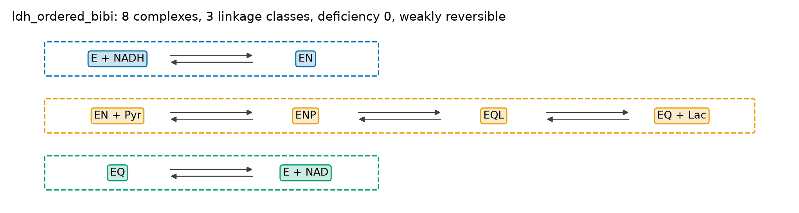

**무엇을 그렸나.** 반응식을 CRNT가 보는 방식으로 다시 그린 것입니다.

- **점(상자 안 글자):** 반응 화살표의 양 끝에 오는 화학종 묶음, 곧 **복합체**입니다. "E + NADH"가 점 하나이고 "EN"이 또 하나입니다. EN이 두 번 나오는 것은 "EN"과 "EN + Pyr"가 서로 다른 복합체이기 때문입니다.
- **화살표:** 반응입니다. 가는 회색 쌍화살표는 가역 반응(`<=>`), 굵은 주황 화살표는 한 방향 반응(`->`)입니다.
- **점선 상자 한 줄:** 화살표로 이어진 복합체 묶음, 곧 **연결 성분**(linkage class)입니다. 상자 색은 연결 성분의 번호입니다.
- **점의 색:** **강연결 성분**입니다. 화살표 방향을 따라 서로 오갈 수 있는 복합체끼리 같은 색입니다.
- **제목:** 반응망 이름, 복합체 수, 연결 성분 수, 결핍, 약가역 여부입니다.

**어떻게 읽나.** 상자마다 안의 점이 모두 상자와 같은 색이면, 연결 성분마다 강연결 성분이 하나라는 뜻입니다. 그러면 **약가역**입니다. 결핍은 제목의 숫자로 봅니다.

**예제에서 읽은 값.** LDH 순서 bi-bi 5단계는 복합체 8개, 연결 성분 3개입니다.

1. E + NADH ⇌ EN
2. EN + Pyr ⇌ ENP ⇌ EQL ⇌ EQ + Lac
3. EQ ⇌ E + NAD

모든 점이 자기 상자와 같은 색이므로 약가역입니다. 결핍 = 8 − 3 − 5(랭크) = 0입니다.

**이상 신호.** 어떤 점의 색이 상자 색과 다르면, 그 근처에 되돌아오는 경로가 없는 한 방향 반응이 있다는 뜻입니다(그림 1c).

**이상할 때.** 의도한 한 방향 단계가 아니면 `project.yaml`의 `network.steps`에서 `->`를 `<=>`로 고칩니다.

**CSV 열:** `kind`(node/edge), `complex`, `to`, `linkage_class`, `scc`, `x`, `y`, `direction`.

---

### 그림 1c — 비약가역 대조 반응망 (`1_verdict/fig1c_network_control`)

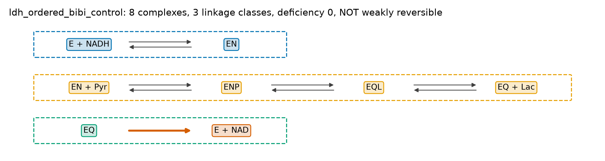

**무엇을 그렸나.** 그림 1a와 같은 그래프입니다. 다만 `control.one_way_steps`(예제는 5단계)를 한 방향으로 바꾼 **대조 반응망**입니다. 이 반응망은 ③에서 "약가역 구조가 없으면 어떻게 되나"를 보여 주는 음성 대조로 학습됩니다.

**어떻게 읽나.**

- 셋째 줄의 EQ → E + NAD가 굵은 주황 화살표로 바뀌었습니다.
- E + NAD 점의 색이 상자(초록)와 달라졌습니다. EQ에서 E + NAD로는 갈 수 있지만 돌아올 수 없으므로, 두 점이 서로 다른 강연결 성분입니다.
- 제목에 "NOT weakly reversible"이 붙습니다.

**의미.** 이 반응망에서는 E + NAD에서 EQ로 가는 길이 없습니다. 그래서 NAD⁺와 젖산에서 출발하는 역반응(세트 B·C)을 원리적으로 그릴 수 없습니다. 그림 3b의 주황 점선이 거의 수평인 이유입니다.

---

### 그림 1b — 판정 표 (`1_verdict/fig1b_verdict_table`)

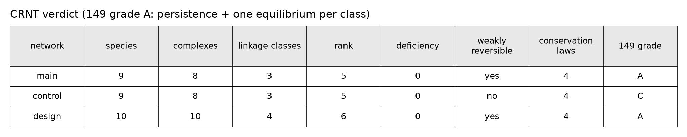

**무엇을 그렸나.** 반응망 세 개의 CRNT 판정 결과입니다.

| 행 | 반응망 |
|---|---|
| `main` | 식별용. `network.steps` 그대로 |
| `control` | 비약가역 대조(그림 1c) |
| `design` | 설계용. 막다른 복합체 단계 `EQ + Pyr <=> EQP`를 더한 것 |

| 열 | 뜻 |
|---|---|
| species | 화학종 수 |
| complexes | 복합체 수 *n* |
| linkage classes | 연결 성분 수 *ℓ* |
| rank | 화학량론 부분공간의 차원 *s*(독립인 반응 방향 수) |
| deficiency | 결핍 δ = *n* − *ℓ* − *s* |
| weakly reversible | 약가역 여부 |
| conservation laws | 보존 법칙 수 = 화학종 수 − 랭크. 식은 `report.txt`에 있음 |
| 149 grade | 아래 등급 |

| 등급 | 조건 | 보장 |
|---|---|---|
| A | 약가역, 결핍 0 | 영속성(멸종·발산 없음) + 적합류마다 양의 평형 하나 |
| B | 약가역, 결핍 > 0 | 영속성만 |
| C | 약가역 아님 | 보장 없음. 모든 결과에 "149 보장 없음: 멸종 가능" 띠를 남기고 계속 진행 |

**예제에서 읽은 값.**

- main: 9 · 8 · 3 · 5 · 0 · yes · 4 → **A**
- control: 같은 수치에 약가역 no → **C**
- design: 10 · 10 · 4 · 6 · 0 · yes · 4 → **A**

보존 법칙 4개의 식은 `1_verdict/report.txt`에 있습니다. 첫째 줄이 효소 총량(E + EN + ENP + EQ + EQL)입니다.

**왜 중요한가.** ⑤의 평형 한계 대수식(그림 5a의 ρ_min, 그림 5d)은 **design 행이 A일 때만** 씁니다. 막다른 복합체를 더해도 A가 유지되는지가 여기서 확인됩니다. A가 아니면 설계는 정방향 해석만으로 탐색하고, 대시보드에 그 사실을 적습니다.

**CSV:** 표와 같은 열.

---

### 그림 2 — 진행 곡선과 큐벳 온도 (`2_data/fig2_data`)

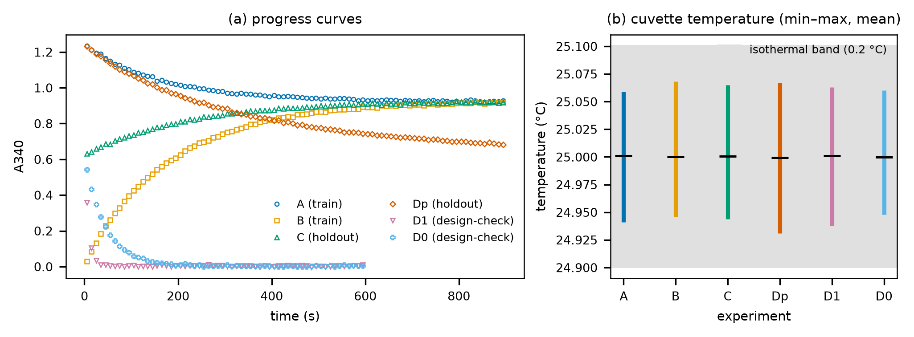

#### (a) 진행 곡선

**무엇을 그렸나.** 모든 실험의 측정값을 시간에 따라 그렸습니다. 실험마다 색과 표지가 다르고, 범례 괄호 안에 역할(train/holdout/design-check)이 있습니다. 세로축은 관측값입니다. 예제는 A340이고, Holmes 프로젝트처럼 농도를 직접 넣으면 `NADH_mM`입니다.

**예제에서 읽은 값.**

| 세트 | 출발 | 내용 | A340 |
|---|---|---|---|
| A (학습) | NADH + 피루브산 | 정반응, NADH가 줄어 A340이 내려감 | 1.23 → 0.93 |
| B (학습) | NAD⁺ + 젖산 | 역반응, NADH가 생겨 올라감 | 0.03 → 0.92 |
| C (홀드아웃) | 둘을 반씩 | 올라감 | 0.63 → 0.92 |
| D′ (홀드아웃) | 피루브산 0.5 mM | 정반응, 900 s에도 아직 내려가는 중 | 0.68에서 계속 하강 |
| D1·D0 (설계 확인) | 젖산 없음, 효소 많음 | 수십 초 만에 0 근처 | — |

- **A·B·C가 같은 값(≈ 0.92)으로 모이는 것이 핵심입니다.** 세 세트는 출발점이 달라도 보존량이 같은 **같은 적합류**입니다. 그래서 등급 A의 보장대로 같은 평형으로 갑니다. 예상 평형은 K′로 계산하면 6.22 × 0.1485 = 0.924입니다.
- D′는 보존량이 다른 **다른 적합류**라서 다른 평형(6.22 × 0.102 = 0.634)으로 갑니다.

**확인할 것.**

1. **첫값과 예상 초기값.** 예상 초기값은 관측식 × 초기 농도이고, A는 6.22 × 0.2 = 1.244입니다. 첫 측정(5 s)이 1.234로 조금 낮은 것은 효소를 넣고 첫 측정까지의 사점 동안 반응이 진행되었기 때문입니다. 차이가 크면 초기 농도나 사점 시간(`time_offset_s`)을 의심합니다.
2. **같은 적합류의 끝값이 서로 맞는가.** `enzopt check`가 예상 평형·차이·끝 기울기를 표로 보여 줍니다.
3. **튀는 점이나 계단이 없는가.** 기포, 큐벳 뚜껑, 기기 자동 범위 전환이 흔한 원인입니다.

#### (b) 큐벳 온도

**무엇을 그렸나.** 실험마다 측정 중 온도의 최저~최고를 색 막대로, 평균을 검은 가로 눈금으로 그렸습니다. 회색 띠는 전체 평균 ±0.1 ℃(폭 0.2 ℃)의 **등온 띠**입니다.

**어떻게 읽나.** 막대가 모두 띠 안에 있으면 "속도 상수가 실험 중 변하지 않는다"는 전제를 받아들일 수 있습니다.
- 예제는 모든 실험이 약 0.12 ℃ 범위, 평균 25.00 ℃입니다.
- 범위가 0.2 ℃를 넘으면 경고("온도 변동 ≥ 0.2 ℃")가 manifest와 대시보드에 남습니다. 온도 파일이 없으면 이 칸은 비어 있습니다.

**CSV 열:** `experiment`, `quantity`(관측값 이름, T_C_min/mean/max), `time_s`, `value`.

---

### 그림 3a — 학습 세트 맞춤 (`3_fit/fig3a_train_fit`)

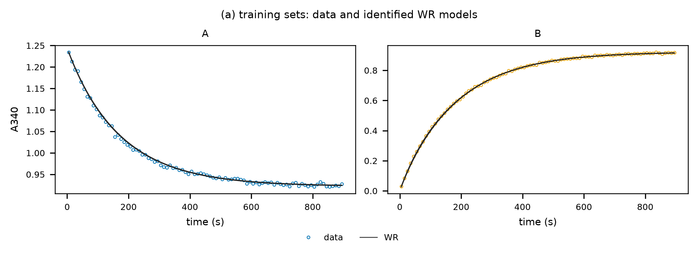

**무엇을 그렸나.**

- **배치:** 학습 세트마다 칸 하나입니다. 한 줄에 4칸까지 놓이고, 범례는 그림 아래에 하나만 있습니다.
- **표시:** 동그라미는 측정값입니다. 진한 회색 실선은 PINN 표본마다 **학습된 속도 상수로 미분방정식을 처음부터 다시 푼 곡선**입니다. 신경망 출력이 아닙니다. 연회색 점선은 제외된 시드입니다.

**어떻게 읽나.**

- 선이 점 구름의 한가운데를 지나고, 점이 선 위아래로 고르게 흩어져 있으면 됩니다.
- 표본 선 여러 개가 거의 겹치는 것이 정상입니다. 서로 다른 속도 상수(그림 3c)가 같은 곡선을 그린다는 것이 이 문제의 본질입니다.

**예제에서 읽은 값.** 표본 4개 모두 남았습니다. 재해석 학습 RMSE는 0.0038~0.0048 A340으로, σ = 0.003의 1.3~1.6배이고 제외 기준 3σ = 0.009보다 작습니다.

**이상 신호.**

| 증상 | 의심할 것 |
|---|---|
| 초반만 어긋남 | 사점 시간(`time_offset_s`) 또는 초기 농도 |
| 끝값만 어긋남 | K′(pH), 초기 농도 |
| 중간이 체계적으로 휘어 있음 | 반응식에 빠진 단계(예: 기질 저해) |
| 회색 점선(제외 시드)이 많음 | σ가 실제 잡음보다 작게 적혔거나 위의 원인 |

**이상할 때.** σ를 억지로 키우지 않습니다. 실험 설정부터 확인합니다. 제외 사유는 `3_fit/fit_summary.json`의 `excluded`에 시드별로 있습니다.

**CSV 열:** `model`(data / WR seedN / WR-excluded seedN), `experiment`, `time_s`, 관측값.

---

### 그림 3b — 홀드아웃 세트 예측 (`3_fit/fig3b_holdout`)

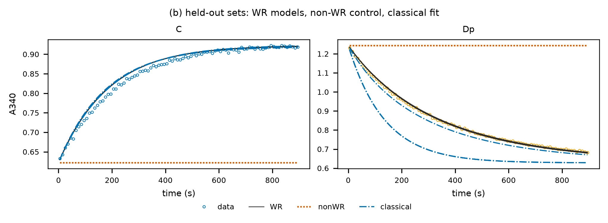

**무엇을 그렸나.** 학습에 **쓰지 않은** 세트에 대한 예측입니다. 측정값 위에 세 종류의 모델 곡선을 겹쳤습니다.

| 곡선 | 모델 |
|---|---|
| 진한 회색 실선 | PINN 표본(약가역 반응망) |
| 주황 점선 | 비약가역 대조 PINN |
| 파란 쇄선 | 고전 피팅, 시작점마다 한 줄 |

세 모델 모두 학습 세트(A·B)만 보고 만든 것이므로, 이 그림이 **처음 보는 조건을 맞히는가**에 대한 정직한 시험입니다.

**예제에서 읽은 값.**

- **세트 C(반반 혼합):** 약가역 모델 둘 다 데이터를 따라갑니다. 대조(주황)는 수평선입니다. 역반응을 그릴 수 없기 때문입니다(그림 1c).
- **세트 D′(피루브산 0.5 mM, 학습 범위 밖):** PINN 표본이 데이터 위에 놓입니다. 고전 피팅은 갈립니다.
  - 시작점 3은 조금 빠릅니다.
  - 시작점 0~2는 반응을 훨씬 빠르게 예측해 400 s 무렵 이미 평형(0.634) 근처에 닿습니다.

고전 피팅 시작점 0~2는 학습 세트에는 PINN만큼 잘 맞습니다. 학습 오차가 작다고 외삽이 맞는 것은 아닙니다.

**이상 신호.**

- **모든 모델이 같은 방향으로 빗나감:** 데이터나 조건 쪽 문제입니다. 홀드아웃 초기 농도와 효소량을 확인합니다.
- **PINN 표본끼리 크게 갈림:** 이 조건은 학습 데이터로 정해지지 않는다는 뜻입니다. 이런 조건을 학습에 하나 더하면 좋습니다.

**CSV 열:** 그림 3a와 같음. 모델 이름에 `nonWR seedN`, `classical startN`이 더해집니다.

---

### 그림 3c — 식별된 속도 상수 (`3_fit/fig3c_rate_constants`)

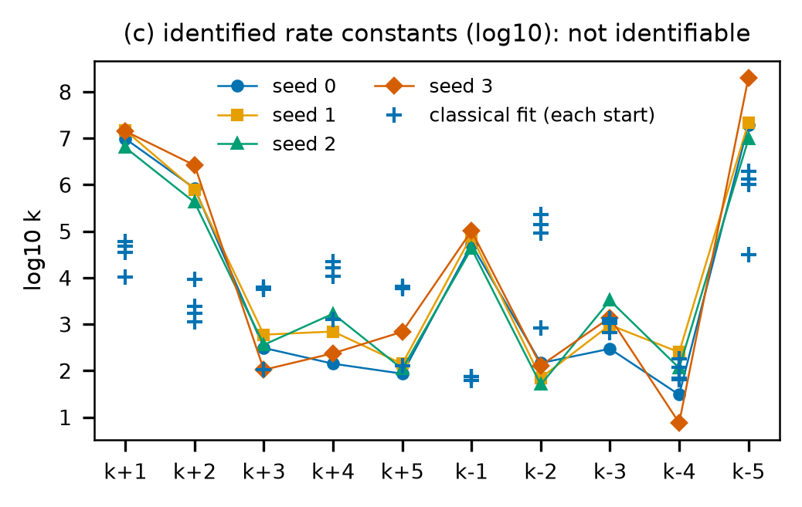

**무엇을 그렸나.**

- **가로축:** 속도 상수 10개입니다. k₊₁…k₊₅는 정방향, k₋₁…k₋₅는 역방향입니다. 이분자 단계(k₊₁, k₊₂, k₋₄, k₋₅)는 /mM/s, 나머지는 /s입니다.
- **세로축:** log₁₀ k입니다. 한 칸이 10배입니다.
- **선과 표지:** 색 있는 선은 PINN 시드 하나(남은 표본)입니다. 회색 × 선은 제외된 시드, 파란 +는 고전 피팅의 시작점별 결과입니다.
- **k₋₅:** 자유 변수가 아닙니다. 나머지 9개와 K′에서 Haldane 관계로 계산합니다.

**어떻게 읽나.** 제목 그대로 "식별되지 않음"을 보여 주는 그림입니다.

- **시드끼리 모이는 상수:** 데이터가 어느 정도 정합니다. 예제에서는 k₋₁(10⁴·⁷~10⁵), k₋₂(≈ 10²)가 그렇습니다.
- **시드끼리 1자릿수 안팎으로 흩어지는 상수:** 데이터가 정하지 못합니다. 예제에서는 k₊₃, k₊₄, k₊₅, k₋₃, k₋₄가 그렇습니다.
- **고전 피팅은 다른 해에 있습니다.** k₊₁(10⁴~10⁵ vs PINN 10⁷)과 k₊₂, k₋₁, k₋₂가 PINN과 2~3자릿수 다릅니다.
- **정답과 비교하면:** 예제의 합성 정답은 k₊₁이 10⁴ 자릿수입니다(사전분포 중심 = 정답을 10의 거듭제곱으로 반올림한 값). PINN 표본은 정답과 3자릿수 다른 곳에서 데이터에 맞습니다. 반대로 고전 피팅은 k₊₁이 정답 근처지만 세트 D′ 예측은 더 나빴습니다(그림 3b). 상수가 정답에 가깝다고 예측이 좋은 것도, 그 반대도 아닙니다.

이 모든 조합이 그림 3a의 학습 데이터에는 거의 똑같이 맞습니다. 그래서 설계는 이 퍼짐을 그대로 견뎌야 하고, 그것이 강건 설계(그림 5a·5b)입니다.

**이상 신호.**

- **표본이 모두 같은 값:** 사전분포가 너무 좁거나(`sd_decades`) 학습이 시작점을 벗어나지 못한 것일 수 있습니다.
- **값이 사전분포 중심(`network.prior`)에서 3자릿수 이상 떨어짐:** 표준편차(1.5자릿수)의 두 배입니다. 그 상수는 데이터가 아니라 다른 상수와의 상쇄로 밀려난 것일 수 있습니다. 상수 하나의 값을 결과로 보고하지 않습니다.

**CSV 열:** `model`, `status`(kept/excluded/classical), `constant`, `log10_k`. 실제 값은 `3_fit/samples/sample_seedN.json`의 `kf`, `kr`, `Kp`에 있습니다.

---

### 그림 3d — 홀드아웃 예측 오차 표 (`3_fit/fig3d_holdout_table`)

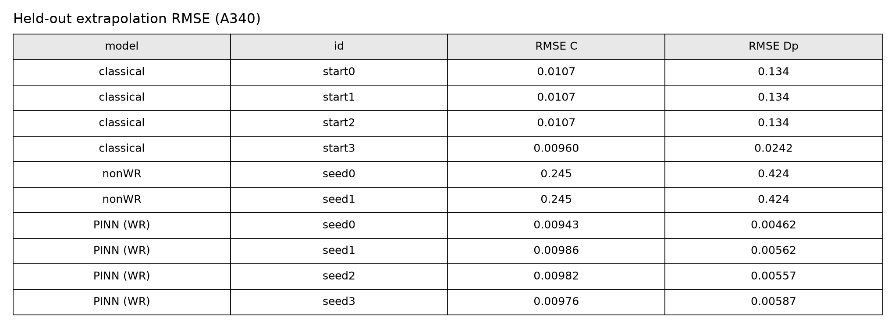

**무엇을 그렸나.** 그림 3b의 곡선과 측정값 사이 RMSE(관측값 단위)를 모델·표본마다 적은 표입니다. 행은 고전 피팅 시작점, 비약가역 대조 시드, PINN 시드이고, 열은 홀드아웃 세트입니다.

**예제에서 읽은 값** (A340, σ = 0.003):

| 모델 | C | D′ |
|---|---|---|
| PINN (WR) 4개 | 0.0094~0.0099 | **0.0046~0.0059** |
| 고전 피팅 시작점 3 | 0.0096 | 0.024 |
| 고전 피팅 시작점 0~2 | 0.0107 | 0.134 |
| 비약가역 대조 | 0.245 | 0.424 |

**어떻게 읽나.**

- **문턱:** 홀드아웃 RMSE ≤ max(2σ, 기준 모델 RMSE × 1.5)입니다(평가 기준 AC-05). 예제 문턱은 C 0.0142, D′ 0.0368이고, PINN 표본은 모두 통과합니다.
- **C에서 모든 모델이 0.01 안팎인 이유:** 합성 데이터에 실험마다 효소량 ±10% 오차를 넣었기 때문입니다. 정답 속도 상수로 풀어도 이 정도 오차가 납니다.
- **σ와 비교하기:** RMSE가 σ의 몇 배인지 보면 쉽습니다. 1~2배면 잡음 수준이고, 10배 이상이면 모델이 그 조건을 모르는 것입니다.
- **비약가역 대조의 큰 오차:** 약가역 구조가 이 데이터에 필요하다는 증거입니다.

**CSV:** 표와 같은 값. 학습·설계 확인 세트까지 포함한 전체 표는 `3_fit/holdout_comparison.csv`(열 `model`, `id`, `experiment`, `role`, `rmse_A340`)에 있습니다.

---

### 그림 3e — 효소 활성 a(t) (`3_fit/fig3e_activity`, 실활 옵션을 켰을 때만)

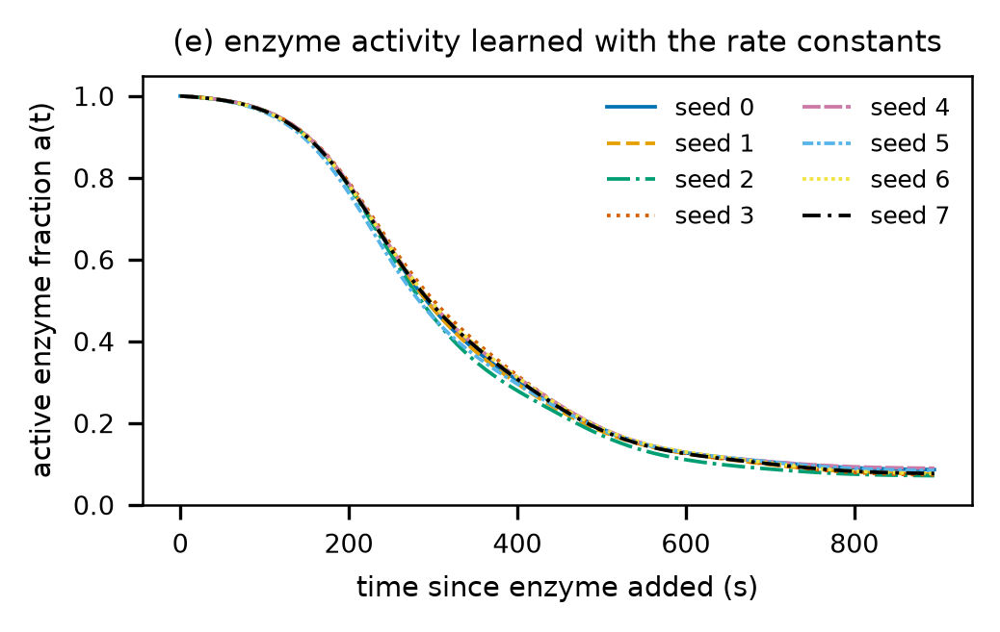

**무엇을 그렸나.** `identification.pinn.inactivation: shared`를 켜면 PINN이 속도 상수와 함께 효소 활성 곡선 a(t)를 학습합니다. a(t)는 효소를 넣은 뒤 남아 있는 활성 효소의 비율입니다. 표본마다 한 줄이고, 회색 점선은 제외된 표본입니다. 위 그림은 예제 `projects/example_ldh_inactivation`의 실행 결과입니다. 정답은 1/(1 + (t/300 s)³)입니다.

**어떻게 읽나.**

- 1에서 시작해 내려가기만 합니다. 모양(지연, 급락, 꼬리)은 데이터가 정합니다.
- 표본들이 겹치면 a(t)는 데이터로 정해진 것입니다. 이 예제에서는 300 s에서 0.46~0.50입니다.
- 끝 무렵에 거의 0이면, 그 뒤의 측정점은 반응에 대해 알려 주는 것이 없습니다.

**이상 신호.**

- 거의 평평하게 1 근처: 실활이 없다는 뜻입니다. 이 옵션이 필요 없습니다.
- 표본마다 모양이 크게 다름: a(t)와 속도 상수가 서로 대신 설명하고 있다는 뜻입니다. 조건(농도)이 다른 실험을 학습에 더합니다.

**확인 실험.** 실활은 반응망 밖의 일이므로 실험으로 확인합니다. 반응이 멈춘 뒤 효소를 더 넣었을 때 다시 진행하면 실활입니다. 같은 적합류의 끝값이 서로 다른 것도 같은 신호입니다.

**CSV 열:** `model`, `status`, `time_s`, `activity`. 표본별 a(t)의 매개변수는 `3_fit/samples/sample_seedN.json`의 `activity`에 있습니다.

---

### 그림 4a — 같은 적합류는 같은 평형으로 (`4_sim/fig4a_classes`)

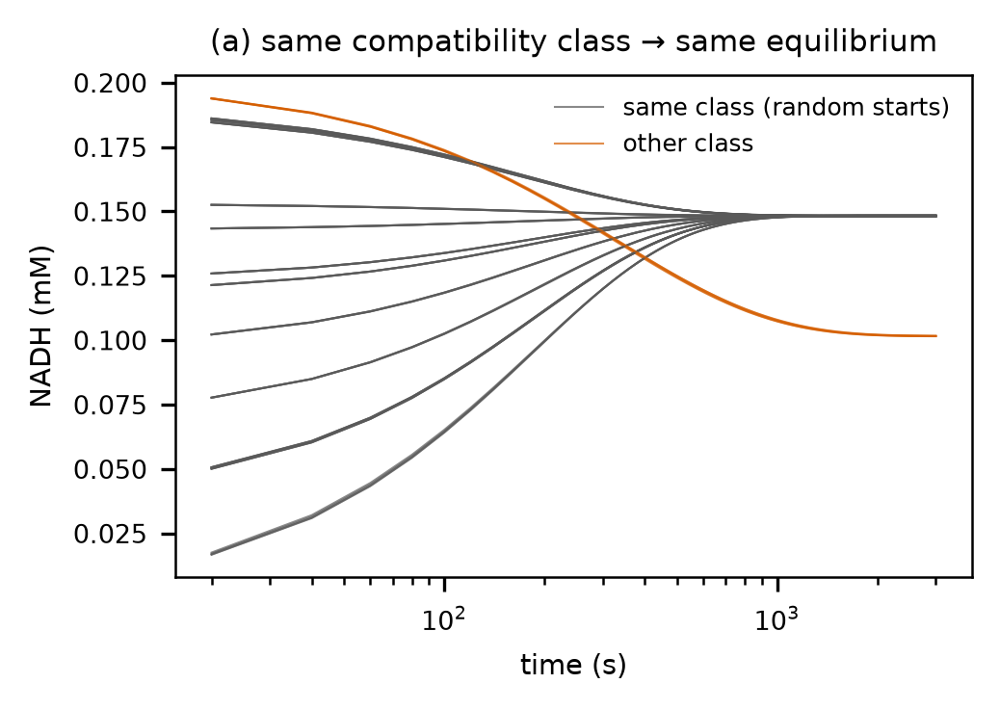

**무엇을 그렸나.** 표본마다 반응을 3000 s까지 다시 푼 NADH 농도입니다(가로축은 로그 시간).

- **회색 선:** 학습 세트 A와 **같은 적합류**의 무작위 초기 상태 12개입니다. 보존량은 그대로 두고, 피루브산 + NADH 쪽과 젖산 + NAD⁺ 쪽에 나눈 양만 바꿨습니다. 표본 4개 × 12개 = 48줄이 겹쳐 있습니다.
- **주황 선:** **다른 적합류**(세트 D′의 초기 상태)입니다. 표본마다 하나씩 그렸습니다.

**어떻게 읽나.** 등급 A의 약속, 곧 "보존량이 같으면 속도 상수와 상관없이 같은 평형 하나"를 표본마다 수치로 확인하는 그림입니다.

- 회색 선은 출발점이 달라도 모두 한 점으로 모여야 합니다.
- 주황 선은 다른 점으로 가야 합니다.

**예제에서 읽은 값.**

- 회색 선은 모두 0.1482~0.1483 mM로 모입니다. 표본 안의 끝값 차이는 약 10⁻⁸ mM입니다(`4_sim/sim_summary.json`의 `class_spread`).
- 주황 선은 0.102 mM로 갑니다.
- 이 두 값은 표본마다 자기 K′(23.1~23.2)로 계산한 평형과 소수 넷째 자리까지 같습니다(K′ = 23이면 0.1485·0.1019). 끝값은 K′만으로 정해진다는 뜻입니다. 그래서 ⑤에서 평형 한계를 속도 상수 없이 쓸 수 있습니다.
- 출발 직후 곡선 모양이 표본마다 조금씩 다른 것은 속도 상수가 다르기 때문입니다. 끝값은 같습니다.

**이상 신호.**

- **회색 선 끝이 여러 값으로 갈림:** 수치 오류이거나, 반응식 입력이 판정과 다르거나, 등급이 A가 아닙니다. 그림 4b의 `max |ln Q/K|` 열을 봅니다.
- **3000 s에도 수평에 닿지 않음:** `simulation.t_long_s`를 늘립니다.

**CSV 열:** `sample`, `run`(same00…same11, other_Dp), `class`(same/other), `time_s`, `NADH_mM`.

---

### 그림 4b — CRNT 자동 검증 표 (`4_sim/fig4b_validation`)

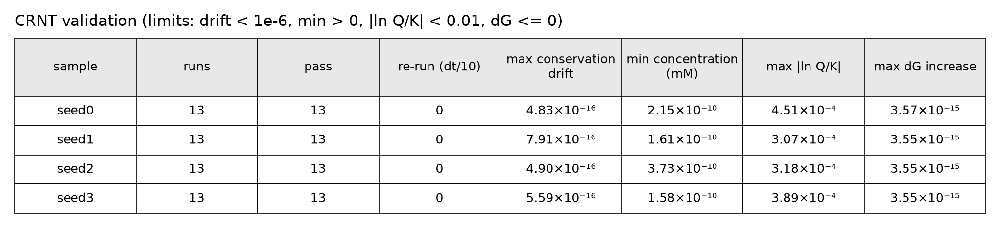

**무엇을 그렸나.** 그림 4a의 해석(표본마다 13번)이 CRNT가 요구하는 성질을 지키는지 표본별로 요약했습니다.

| 열 | 검사 | 통과 기준 |
|---|---|---|
| runs / pass | 해석 수 / 통과 수 | 같아야 함 |
| re-run (dt/10) | 처음 실패해 시간 간격을 1/10로 줄여 다시 푼 수("수치 오류 의심") | 0이 정상 |
| max conservation drift | 보존량(효소 총량 등 4개)의 최대 상대 변화 | < 10⁻⁶ |
| min concentration (mM) | 모든 시점·모든 종의 최소 농도 | > 0 (영속성) |
| max \|ln Q/K\| | 끝 시점에서 각 가역 단계의 반응 지수 Q와 평형 상수 K = k₊/k₋의 로그 차이 | < 0.01 (평형 도달) |
| max dG increase | 리아푸노프 함수 G = Σ x ln(x/x*) − x + x*의 최대 증가량 | ≤ 0 (수치 오차 범위) |

**예제에서 읽은 값.** 표본 4개 모두 13/13, 합계 52/52 통과입니다. 다시 푼 해석은 0개입니다. 기준 대비 여유도 큽니다.

| 열 | 값 | 판단 |
|---|---|---|
| 보존 표류 | ≈ 6×10⁻¹⁶ | 기계 정밀도 |
| 최소 농도 | ≈ 10⁻¹⁰ mM | 양수 |
| \|ln Q/K\| | ≈ 4×10⁻⁴ | 기준의 1/25 |
| G 증가 | ≈ 3.5×10⁻¹⁵ | 수치 0 |

**이상 신호.**

- **pass < runs:** 해당 표본·해석의 상세는 `4_sim/validation.csv`에 있습니다.
- **re-run만 있고 모두 통과:** 강성이 큰 표본이라 처음 간격이 거칠었던 것이고, 괜찮습니다.
- **다시 풀어도 실패:** 그 표본은 설계에 쓰기 전에 의심해야 합니다.

**CSV:** 표와 같은 열.

---

### 그림 4c — Hopsan과 scipy 대조 (`4_sim/fig4c_hopsan_vs_scipy`)

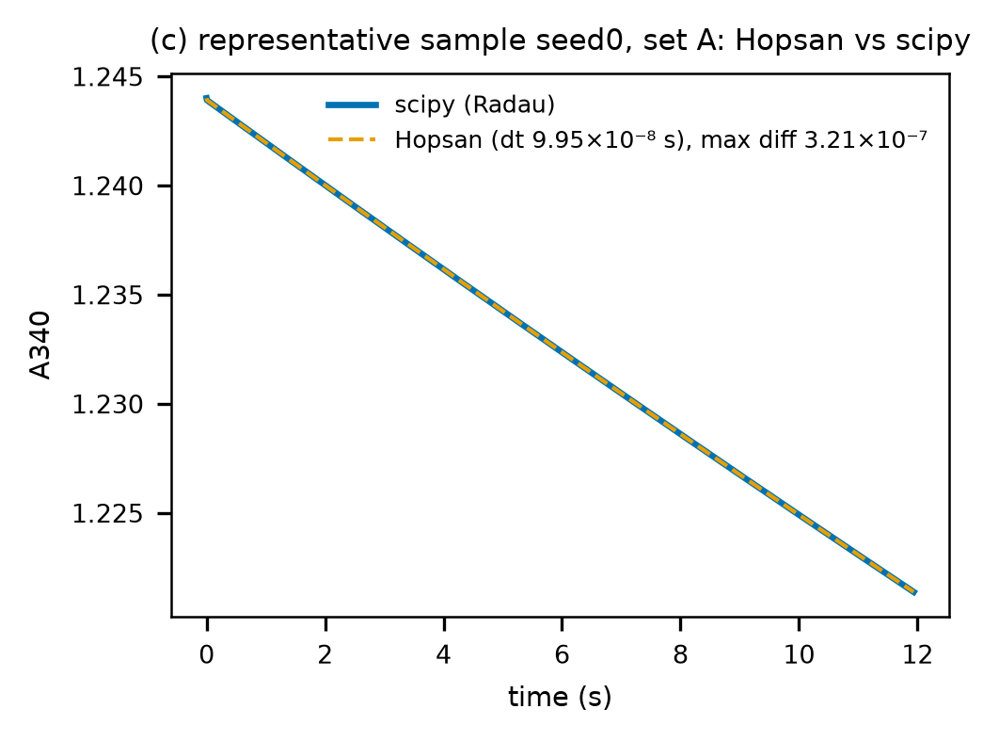

**무엇을 그렸나.** 대표 표본(첫 시드) 하나의 완전 메커니즘을 학습 세트 A의 조건에서 두 프로그램으로 따로 풀어 겹쳤습니다.

- **파란 실선:** scipy(Radau, 가변 간격 음해법)입니다.
- **주황 파선:** Hopsan(고정 간격, Δt = 0.2/λ_max)입니다. λ_max는 야코비안의 가장 큰 고윳값으로, 가장 빠른 반응의 속도입니다.
- **범례:** Hopsan의 Δt와 두 곡선의 최대 차이가 적혀 있습니다.

**어떻게 읽나.** 두 선이 겹치면 Hopsan 모델 파일(`4_sim/hopsan/full_representative.hmf`)에 내보낸 방정식이 scipy가 푼 방정식과 같다는 뜻입니다. 이것은 독립 프로그램으로 한 교차 확인입니다.

**예제에서 읽은 값.**

- λ_max ≈ 2×10⁶ /s라서 Δt ≈ 10⁻⁷ s입니다.
- 단계 수 상한(10⁸) 때문에 **처음 11.9 s만** 풀었습니다. 짧은 것은 정상이고, `sim_summary.json`의 `note`에 사유가 적혀 있습니다. 효소 결합 단계가 매우 빠른(강성) 표본에서는 고정 간격 해법이 이렇게 됩니다.
- 최대 차이는 3.2×10⁻⁷ A340입니다.
- 이 짧은 구간은 평형에 닿지 않았으므로, 이 대조의 `|ln Q/K|` 검사가 실패로 기록되는 것도 정상입니다. 이 그림은 **궤적 일치**만 봅니다.

**그림에 없는 Hopsan 결과.** 겉보기 1단계 반응 Pyr + NADH ⇌ Lac + NAD(k₁은 대표 표본의 초기 속도에서 계산)로 그림 4a와 같은 적합류 배치 13개를 Hopsan으로 풀었습니다. 결과는 `4_sim/hopsan/one_step_*.csv`와 `sim_summary.json`의 `hopsan.one_step`에 있습니다. 예제는 13/13 통과, scipy와의 최대 차이 9×10⁻⁶ mM입니다.

**Hopsan이 없을 때.** 제목이 "scipy only (Hopsan not used)"로 바뀌고 scipy 선만 그립니다. 나머지 계산은 그대로입니다.

**CSV 열:** `backend`, `time_s`, 관측값.

---

### 그림 5a — U자 곡선: 기질 비와 최소 효소량 (`5_design/fig5a_u_curve`)

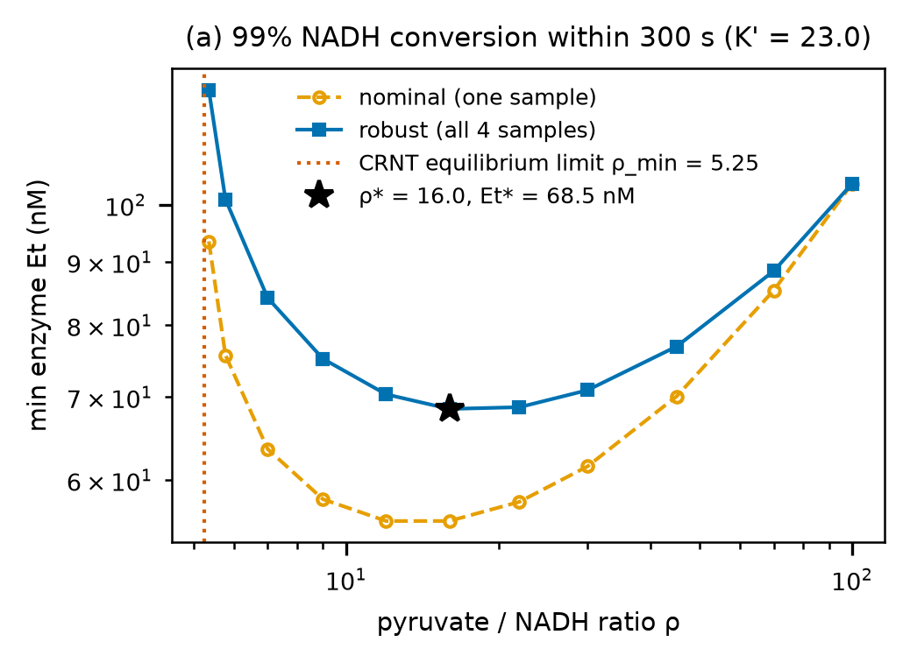

**무엇을 그렸나.** 목표는 "NADH 100 µM을 **300 s 안에 99%** 전환"입니다(`design.conversion`, `time_s`, `analyte0_mM`).

- **가로축:** 기질 비 ρ = 피루브산₀/NADH₀입니다.
- **세로축:** 그 ρ에서 목표를 만족하는 **최소 효소량** Et(nM)입니다. 두 축 모두 로그입니다.
- **주황 ○ 파선(공칭):** 표본 **하나**(첫 시드)만 보고 정한 최소 효소량입니다.
- **파란 □ 실선(강건):** 표본 **전부**가 목표를 만족하는 최소 효소량입니다. 표본마다의 최소값 중 최댓값입니다.
- **붉은 세로 점선:** CRNT 평형 한계 ρ_min = c + c²/((1 − c)·K′)입니다(c = 0.99). 이 왼쪽에서는 효소를 아무리 넣어도 평형이 99%를 허락하지 않습니다. 속도 상수와 무관하게 K′만으로 정해집니다.
- **★:** 강건 곡선의 최저점, 곧 강건 최적 ρ*와 Et*입니다.
- **최소 효소량 계산:** ρ마다 효소량을 로그 이분법으로 찾고, 표본마다 설계용 반응망(막다른 복합체 포함)을 300 s까지 풀어 판정합니다.

**왜 U자인가.**

- **ρ_min 근처:** 평형에 바짝 다가가야 하므로 반응의 구동력이 작아 느립니다. 효소가 많이 듭니다.
- **ρ가 크면:** 피루브산이 EQ와 막다른 복합체(EQ·Pyr)를 만들어 효소를 붙잡습니다. 그래서 다시 효소가 많이 듭니다.
- **사이:** 효소가 가장 적게 드는 ρ가 있습니다.

**예제에서 읽은 값.**

- K′ = 23에서 ρ_min = 5.25입니다.
- 강건 최적은 **ρ* = 16, Et* = 68.5 nM**입니다. 학습 실험 효소량 E₀ = 24.2 nM의 2.83배입니다.
- 같은 ρ에서 공칭은 55.6 nM입니다. 두 곡선의 차이가 **속도 상수 불확실성의 비용**입니다.
- ρ = 100에서는 두 곡선이 만납니다(104 nM). 거기서는 공칭 설계에 쓴 첫 표본이 가장 느린 표본이라서, 강건 효소량도 그 표본이 정합니다.
- ρ_min 바로 옆(5.36)에서는 강건 124 nM로 급히 올라갑니다.

**어떻게 쓰나.** 곡선 바닥이 평평하면(예제의 ρ 12~22) 그 범위에서 피펫으로 다루기 편한 ρ를 골라도 효소는 거의 늘지 않습니다. 피펫 표는 ★ 값을 씁니다.

**이상 신호.**

- **강건 곡선에 빠진 점:** 효소 상한(`Et_bounds_mM`)으로도 목표에 못 미친 ρ입니다.
- **공칭과 강건이 몇 배 이상 벌어짐:** 표본의 퍼짐이 크다는 뜻이니, 학습 실험을 늘릴 가치가 있습니다.

**CSV 열:** `rho`, `Et_nominal_nM`, `Et_robust_nM`. mM 단위까지 담은 같은 표는 `5_design/design_table.csv`, 표본별 전환율은 `design_check.csv`에 있습니다.

---

### 그림 5b — 두 설계를 모든 표본에 넣어 보기 (`5_design/fig5b_conversion`)

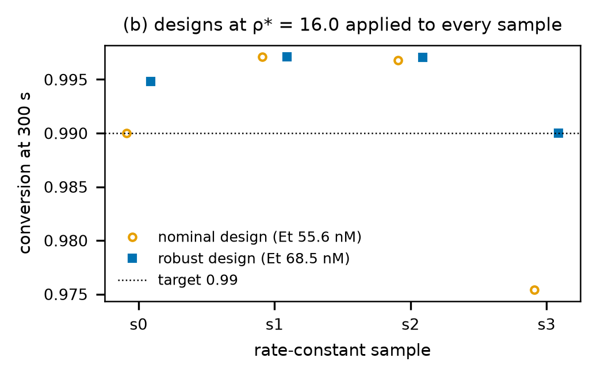

**무엇을 그렸나.** ρ*에서 공칭 효소량(주황 ○)과 강건 효소량(파란 ■)을 각 표본에 넣고 300 s 시점의 전환율을 찍었습니다. 가로축은 표본(s0 = 시드 0 …), 점선은 목표 0.99입니다.

**어떻게 읽나.** "가장 잘 맞는 한 조합으로 설계하면 무엇이 잘못되나"를 보여 주는 그림입니다.

- 공칭 설계는 자기를 만든 표본(s0)에서는 정확히 0.990이지만, 다른 표본에서는 목표 아래로 떨어질 수 있습니다.
- 강건 설계는 모든 표본에서 0.99 이상입니다. 가장 느린 표본이 정확히 0.990에 걸립니다. 그 표본이 강건 효소량을 정했다는 뜻입니다.

**예제에서 읽은 값.**

- **공칭 55.6 nM:** s3에서 0.975로 미달합니다(4개 중 1개).
- **강건 68.5 nM:** s3에서 0.990, 나머지는 0.995~0.997입니다.
- 실제 효소가 s3처럼 행동한다면 공칭 설계로는 NADH가 2.5 µM 남습니다. 목표는 1 µM입니다.

**CSV 열:** `design`, `sample`, `Et_mM`, `conversion`.

---

### 그림 5c — 설계 조건의 예측 곡선과 확인 실험 (`5_design/fig5c_design_check`)

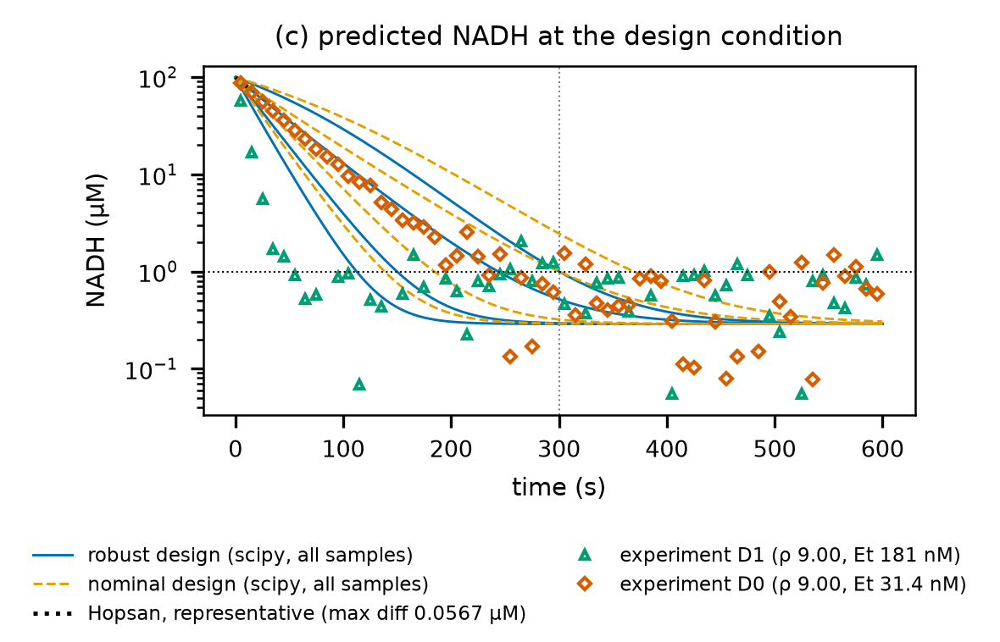

**무엇을 그렸나.** ρ*에서 두 설계의 NADH(µM, 로그 축)를 600 s(`design.check_t_end_s`)까지 예측했습니다.

| 표시 | 내용 |
|---|---|
| 파란 실선 | 강건 설계, 표본마다 한 줄(scipy) |
| 주황 파선 | 공칭 설계, 표본마다 한 줄 |
| 검은 점선 | Hopsan으로 푼 대표 표본의 강건 설계. 범례에 scipy와의 최대 차이 |
| 가로 점선 | 목표 잔량. (1 − 0.99) × 100 µM = 1 µM |
| 세로 점선 | 목표 시간 300 s |
| 표지(△ ◇) | `role: design-check`로 등록한 실험. A340을 관측식 계수(6.22)로 나눠 NADH로 바꿈. 범례에 그 실험의 ρ와 Et |

**어떻게 읽나.**

- 300 s 세로선에서 **파란 선은 모두 가로선 아래**에 있어야 합니다. 주황 선은 일부가 위에 있을 수 있고, 그것이 공칭 설계의 위험입니다.
- 곡선이 0.29 µM 근처에서 수평이 되는 것은 ρ = 16의 평형 잔량입니다(그림 5d의 계산과 같은 식).

**확인 실험을 겹칠 때.**

- 피펫 표의 D1·D0를 **그 ρ*와 Et*로** 실험한 뒤, `project.yaml`에 같은 초기 농도·효소량으로 `role: design-check` 항목을 넣고 다시 실행합니다.
- 측정점이 파란 선 다발 안에 놓이면 설계가 확인된 것입니다.
- 1 µM 아래에서는 분광광도계 잡음이 큽니다. σ = 0.003 A340은 NADH로 약 0.5 µM입니다. 로그 축에서는 점이 위아래로 크게 흩어져 보입니다. 판정은 2 µM 위의 구간과 끝 평탄부의 평균으로 합니다.

**예제에서 주의할 점.** 예제의 D1·D0 측정점은 이전 설계값(CADKIMM: ρ 9, Et 181 nM / 31.4 nM)으로 만든 합성 데이터입니다. 이 실행의 설계(ρ* 16, 68.5 nM / 55.6 nM)와 조건이 다르므로 곡선과 직접 비교하는 대상이 아닙니다. 범례의 ρ·Et로 조건이 맞는지 먼저 봅니다.

**CSV 열:** `model`(scipy robust / scipy nominal / hopsan robust / experiment 이름), `id`, `time_s`, `NADH_uM`.

---

### 그림 5d — CRNT 평형 한계 표 (`5_design/fig5d_equilibrium_limit`)

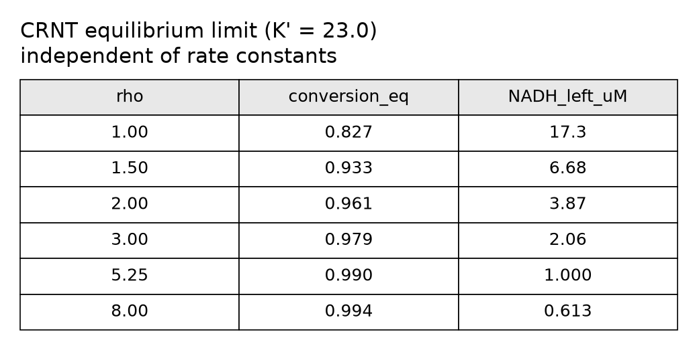

**무엇을 그렸나.** 생성물이 없는 상태에서 출발할 때, 기질 비 ρ마다 평형에서 도달할 수 있는 **최대 전환율**과 그때 남는 NADH(µM)입니다.

- K′ = f² / ((ρ − f)(1 − f))를 f에 대해 푼 값입니다.
- **속도 상수와 효소량에 무관합니다.** 설계용 반응망이 등급 A일 때만 이 표를 만듭니다.

**예제에서 읽은 값** (K′ = 23, NADH₀ = 100 µM):

| ρ | 최대 전환율 | 남는 NADH |
|---|---|---|
| 1 | 82.7% | 17.3 µM |
| 1.5 | 93.3% | 6.68 µM |
| 3 | 97.9% | 2.06 µM |
| 5.25 (= ρ_min) | 99.0% | 1.00 µM |

**어떻게 쓰나.**

- 피펫 표의 L1·L2 세트가 이 표를 실험으로 확인합니다(6절). 효소를 10배·20배 넣어도 끝값이 같아야 합니다.
- 끝값이 효소량에 따라 달라지면 평형이 아닌 다른 이유로 멈춘 것입니다. 효소 실활, 생성물 저해, K′(pH) 오차를 의심합니다.

**CSV 열:** `rho`, `conversion_eq`, `NADH_left_uM`.

---

### 결과를 판단하는 순서

실행 하나를 받으면 다음 순서로 봅니다. 앞에서 걸리면 뒤의 그림은 믿지 않습니다.

1. **그림 1b:** main·design이 A인가. C면 붉은 띠가 왜 생겼는지부터 확인합니다.
2. **그림 2:** 첫값·끝값이 예상과 맞고, 온도 막대가 띠 안에 있는가.
3. **그림 3a:** 표본이 2개 이상 남았고 곡선이 데이터를 지나는가.
4. **그림 3b·3d:** 홀드아웃 RMSE가 문턱 안인가. 대조(nonWR)보다 확실히 나은가.
5. **그림 4b:** 모든 해석이 통과했는가. **그림 4a:** 회색 선이 한 점으로 모이는가.
6. **그림 5a·5b:** ρ*·Et*가 실험할 수 있는 범위인가. 강건 설계가 모든 표본에서 목표 이상인가.
7. **피펫 표(6절)로 실험 → 그림 5c:** 확인 실험이 예측 다발 안에 놓이는가.

## 6. 피펫 표 읽기 (`5_design/pipette.csv`, `pipette.txt`)

⑤의 최종 결과물입니다. 반응량 1000 µL에 무엇을 몇 µL 넣는지 세트별로 적었습니다. 효소는 항상 마지막에 넣습니다. 대시보드 ⑤ 탭에서 [피펫 표 내려받기(CSV)]로 받을 수 있습니다.

예제(`runs/example_ldh_synth/2026-10-10_0821`)의 강건 최적은 ρ* = 16, Et* = 68.47 nM(E₀의 2.83배)이고, 공칭 Et는 55.59 nM입니다.

| set | purpose | rho | NADH_stock_uL | Pyr_stock_uL | buffer_uL | enzyme_uL | Et_final_nM | Et_over_E0 | enzyme_working_uM | record | repeats | predicted |
|---|---|---|---|---|---|---|---|---|---|---|---|---|
| L1 | 평형 한계 시험 ρ = 1.5 (E₀×10) | 1.5 | 50 | 15 | 925 | 10 | 242.3 | 10 | 24.23 | 평평해진 뒤 5분 | 2 | 평형 전환율 0.9332 (남는 6.68 µM), 효소량과 무관 |
| L1 | 평형 한계 시험 ρ = 1.5 (E₀×20) | 1.5 | 50 | 15 | 925 | 10 | 484.6 | 20 | 48.46 | 평평해진 뒤 5분 | 2 | 평형 전환율 0.9332 (남는 6.68 µM), 효소량과 무관 |
| L2 | 평형 한계 시험 ρ = 3 (E₀×10) | 3 | 50 | 30 | 910 | 10 | 242.3 | 10 | 24.23 | 평평해진 뒤 5분 | 2 | 평형 전환율 0.9794 (남는 2.06 µM), 효소량과 무관 |
| D1 | 강건 설계 | 16 | 50 | 160 | 780 | 10 | 68.47 | 2.826 | 6.847 | 300 s 끝값 + 5분 | 3 | 표본 4개 최악 전환율 0.9900 |
| D0 | 공칭 설계 | 16 | 50 | 160 | 780 | 10 | 55.59 | 2.294 | 5.559 | 300 s 끝값 + 5분 | 3 | 표본 4개 중 미달 1개, 최악 전환율 0.9754 |
| Z | 효소 없음(대조) | 16 | 50 | 160 | 790 | 0 | 0 | 0 | 0 | 10분 | 1 | 변화 없음 |

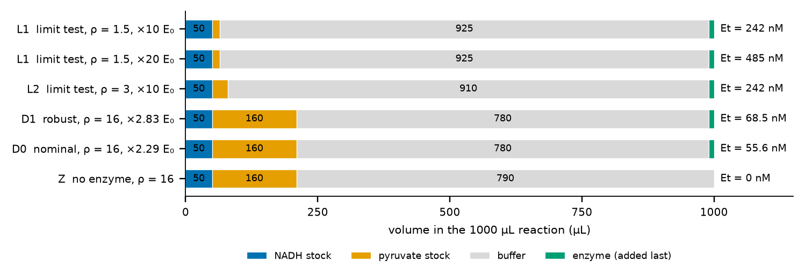

### 열의 뜻

| 열 | 뜻 |
|---|---|
| `set`, `purpose` | 세트 이름과 목적 |
| `rho` | 피루브산₀/NADH₀ |
| `NADH_stock_uL`, `Pyr_stock_uL` | 저장액 부피. 저장액 농도는 `design.pipette.stocks_mM`(예제 NADH 2 mM, 피루브산 10 mM). NADH 50 µL → 최종 0.1 mM, 피루브산 ρ × 0.1 mM × 1000 µL / 10 mM |
| `buffer_uL` | 완충액. 1000 µL에서 나머지를 뺀 양 |
| `enzyme_uL` | 효소 작업액 부피(`enzyme_uL`, 예제 10 µL). 마지막에 넣고 섞는 순간이 t = 0 |
| `Et_final_nM` | 반응액 안의 최종 효소 농도 |
| `Et_over_E0` | 학습 실험의 효소량 E₀(예제 24.23 nM)의 몇 배인가. 효소 저장액의 절대 농도가 불확실해도, 학습 실험과 같은 저장액을 쓰면 이 배수는 정확하다 |
| `enzyme_working_uM` | 10 µL로 그 최종 농도를 만들려면 필요한 작업액 농도(= 최종 × 1000/10) |
| `record` | 얼마나 기록할지 |
| `repeats` | 반복 수 |
| `predicted` | 이 세트에서 기대하는 결과 |

### 세트별 목적과 판정

| 세트 | 무엇을 확인하나 | 통과로 보는 결과 |
|---|---|---|
| **L1** (ρ 1.5, 효소 E₀×10과 ×20) | CRNT 평형 한계(그림 5d). 효소량을 두 배로 해도 끝값이 같은가 | 두 효소량의 끝 평탄부 NADH가 서로 같고, 예측 6.68 µM 근처 |
| **L2** (ρ 3, E₀×10) | 다른 ρ에서 같은 확인 | 끝값 2.06 µM 근처 |
| **D1** (강건 설계) | ρ*·Et*로 300 s 안에 99% 전환 | 300 s 시점 NADH ≤ 1 µM. 측정점이 그림 5c의 파란 다발 안 |
| **D0** (공칭 설계) | 표본 하나로 정한 설계는 위험하다는 대조 | 1 µM을 넘는 경우가 있어도 이상하지 않다(예측: 4개 중 1개 표본에서 미달) |
| **Z** (효소 없음) | 효소 없는 NADH 감소(비효소 분해, 광표백, 기준선 표류) | 10분 동안 변화 없음. 변화가 있으면 기준선 표류나 비효소 분해가 있다는 뜻이므로 D1·D0 판정 때 감안 |

- 측정한 파일은 `role: design-check`로 `project.yaml`에 넣고 다시 실행합니다. 그러면 그림 5c에 겹쳐집니다. 실측 프로젝트 틀(`projects/ldh_ph10/project.yaml`)에 주석으로 자리가 있습니다.
- L1·L2는 평형 한계 대수식을 쓸 수 있을 때(설계용 반응망 등급 A)만 표에 나옵니다. ρ와 효소 배수는 `design.pipette.limit_test_rhos`, `limit_test_enzyme_multiples`로 바꿉니다.
- 어느 세트든 `buffer_uL`이 음수가 되면 예측 열에 "부피 초과(저장액 농도를 높일 것)"가 붙습니다.

## 7. 결과 폴더의 파일

```
runs/<프로젝트>/<YYYY-MM-DD_HHMM>/
├─ manifest.json          설정 사본, 입력 파일 해시, 코드 버전(git 커밋·소스 해시), uv.lock 해시, 시드, 장치(GPU/CPU·정밀도),
│                         단계별 상태·시간·재사용 여부, 경고 목록, 실패 시 오류(단계·메시지)
├─ progress.json          진행 중 상태(대시보드 진행 막대)
├─ project.yaml, inputs/  설정과 입력 데이터 사본(이어서 실행·묶음용)
├─ 1_verdict/  report.txt(판정 보고, 보존 법칙 식), verdict.json, 그림 1a·1b·1c
├─ 2_data/     exp_<실험>.csv(검사·변환된 진행 곡선), temp_<실험>.csv, data.json(실험별 점 수·처음/끝값·예상 초기값·온도), 그림 2
├─ 3_fit/      samples/sample_seed<N>.json  표본: kf, kr, Kp, 재해석 RMSE(실험별), kept/excluded_reason, 재시작 기록
│              baseline/fit_start<N>.json   고전 피팅 결과
│              control/control_seed<N>.json 비약가역 대조 결과
│              fit_summary.json  장치, 남은 시드, 제외 사유, 홀드아웃 요약, 비교 모델 요약
│              holdout_comparison.csv  모델 × 실험 RMSE(학습·홀드아웃·설계 확인 모두)
│              predictions.csv  표본별 예측값과 측정값(측정 시점마다), 그림 3a~3d
├─ 4_sim/      validation.csv(해석마다 검증 항목), trajectories.csv, sim_summary.json(적합류 퍼짐, Hopsan 정보)
│              hopsan/  *.hmf(Hopsan 모델, Hopsan GUI로 열 수 있음), *.csv(Hopsan 결과), 그림 4a·4b·4c
└─ 5_design/   design_table.csv(ρ마다 공칭·강건 최소 효소량), design_check.csv(두 설계 × 표본 전환율), equilibrium_limit.csv,
               design_summary.json(ρ_min, ρ*, Et*, 공칭·강건 결과), pipette.csv·pipette.txt, hopsan/, 그림 5a~5d
```

- **재현:** 같은 `project.yaml`과 데이터, 같은 코드 버전이면 scipy·설계 계산은 같은 숫자를 냅니다. PINN을 GPU float32로 학습하면 실행마다 표본이 조금 다를 수 있고, 그만큼 설계 숫자도 움직입니다(예제의 최근 두 실행에서 Et*는 68.5 nM로 같았고 공칭 Et는 40.9 nM와 55.6 nM로 달랐음). 차이를 줄이려면 `--device cpu --precision float64`를 씁니다.
- **제출·보관:** `uv run enzopt pack <실행 폴더>`가 입력·설정·그림·CSV·Hopsan 파일·검증 보고를 zip 하나로 묶습니다. `runs/`는 git에 들어가지 않습니다.

## 8. 실측 데이터로 시험한 결과 (Holmes 1988)

합성 데이터만으로는 실제 효소에서도 통하는지 알 수 없습니다. 그래서 공개된 실측 데이터로 먼저 시험했습니다. 자세한 내용은 [`projects/ldh_holmes1988/README.md`](../projects/ldh_holmes1988/README.md)에 있습니다.

- **데이터:** Holmes(1988) 학위논문의 토끼 근육 LDH, pH 7.0, 25 ℃. 진행 곡선 21개(생성물이 처음부터 들어 있는 조건 포함)와 그림의 원시 측정점 2세트입니다. 논문에 실린 적분 속도식 계수로 곡선을 복원했고, 관측값은 NADH 농도(mM)입니다.
- **나누기:** 15세트로 학습하고, 학습에 쓰지 않은 6세트와 원시 점 2세트로 예측을 시험했습니다.

50% 반응 시점에서의 예측 오차(%):

| 홀드아웃 | 조건 | Holmes 1988 | PINN | 고전 피팅 |
|---|---|---|---|---|
| 172 | 젖산 35.7 mM | 33 | +5.1 | +2.3 |
| 408 | 묽음, 생성물 없음 | 3 | +2.1 | +2.7 |
| 422 | NAD⁺ 4.9 mM | 7 | +7.3 | +6.9 |
| 465 | 묽음 | −4 | +1.5 | +3.0 |
| 251 | 고농도, 젖산 40 mM | −1.5 | −5.2 | −7.4 |
| 457 | 고농도 | 3 | −1.1 | −2.4 |

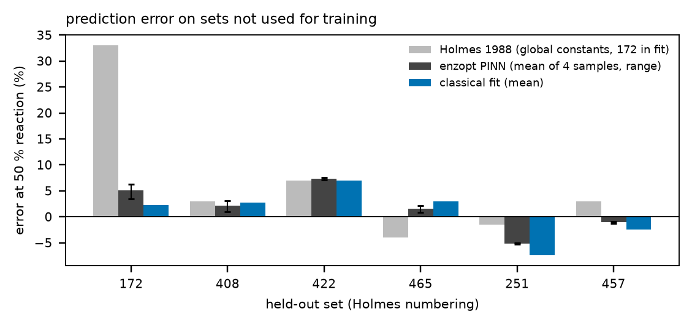

Holmes 값은 세트 172까지 넣어 맞춘 전역 상수의 오차입니다. enzopt는 172를 학습에 쓰지 않았습니다. 그 밖의 결과는 다음과 같습니다.

- CRNT 검증 52/52 통과
- 식별된 K′ 3.7~4.1×10⁴ (문헌 범위 1~4.3×10⁴)

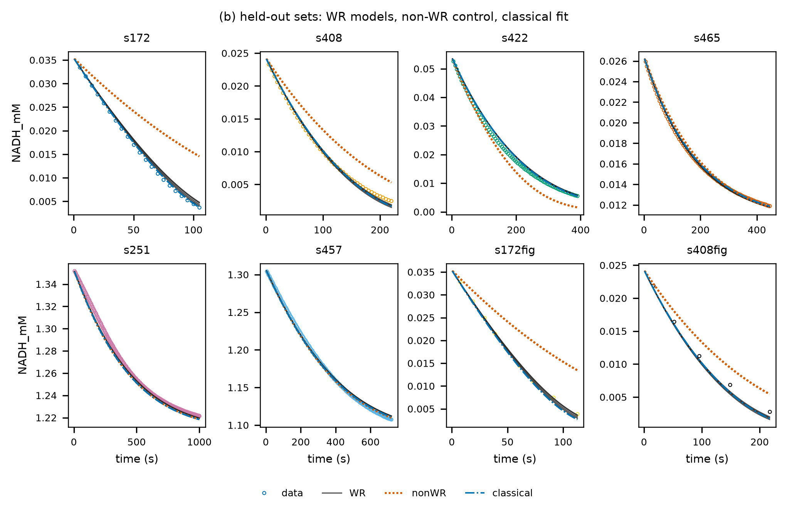

### PINN과 고전 피팅, 어느 쪽이 나은가

어느 쪽도 항상 낫지 않습니다.

| 데이터 | 고전 피팅이 나은 곳 | PINN이 나은 곳 |
|---|---|---|
| Holmes 실측 | 학습 RMSE (0.00143 vs 0.00161 mM)<br>세트 172·422 | 홀드아웃 평균 RMSE (0.00125 vs 0.00131 mM)<br>세트 408·465·251·457 |
| 합성 예제 | 학습 범위 밖의 피루브산 과량 세트(D0·D1) | 세트 D′ (그림 3d, 수십 배 차이) |

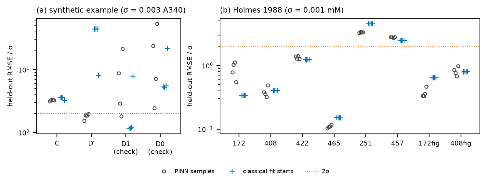

- Holmes의 차이는 측정 잡음(0.001 mM)보다 작습니다.
- 속도 상수가 데이터로 다 정해지지 않으면, 학습 데이터에 똑같이 맞는 해가 여러 개 있습니다. 어느 해에 도착하느냐에 따라 외삽이 갈립니다.
- 그래서 enzopt는 한 해 대신 표본 여러 개로 설계합니다.

PINN이 확실히 유리해지는 경우도 있습니다.

- 정방향 계산이 비쌀 때입니다. 예를 들어 확산이 들어간 편미분방정식입니다.
- 시간에 따라 변하는 미지 함수(효소 실활, 온도 표류)를 함께 추정해야 할 때입니다. 아래에서 시험했습니다.
- 적합을 수백 개씩 GPU에서 한꺼번에 돌려야 할 때입니다. 합성 예제에서 표본 64개를 만드는 데 PINN은 52 s, 고전 피팅은 CPU 22코어로 192 s가 걸렸습니다.

### PINN이 실용적으로 혼자 하는 일: 모양을 모르는 효소 실활

효소가 측정 중에 활성을 잃으면(pH 10 같은 조건에서 흔합니다), 같은 적합류의 곡선이 평형에 닿기 전에 서로 다른 값에서 멈춥니다. 지금의 반응식으로는 이것을 설명할 수 없어서, 모든 표본이 3σ 검증에서 빠지고 설계가 멈춥니다. 이때 필요한 것은 속도 상수와 함께 활성 곡선 a(t)를 찾는 것입니다. 그런데 a(t)의 모양은 미리 모릅니다.

PINN 옵션 `inactivation: shared`는 a(t)를 모양을 정하지 않고 학습합니다. a(0) = 1에서 시작해 다시 오르지 않는다는 것만 정하고, 모든 실험이 같은 a(t)를 공유한다고 봅니다. 물리 항에서는 효소 형태에 a(t)를 곱하기만 하므로 미분방정식을 풀 필요가 없습니다. 같은 일을 고전 피팅에 시키면 a(t)의 계수를 바꿀 때마다 미분방정식을 다시 풀어야 합니다.


| | PINN, a(t) 학습 | 고전, 같은 기저 | 고전, 지수 감소 |
|---|---|---|---|
| 걸린 시간 | 64회 10 s (GPU) | 1회 659 s (ODE 풀이 약 3,100번) | 1회 231 s |
| a(t) 복원 | 8개 모두 (오차 0.02) | 4개 정확 (0.014) · 4개 틀림 (0.064) | 모양 틀림 (0.14) |
| 강건 효소량 → 실제 전환율 | 55 nM → 99.6% | 121 nM → 99.7% | 86 nM → 99.7% |

- 고전 피팅으로도 같은 함수를 배울 수는 있습니다. 가장 좋은 고전 해는 PINN보다 정확했습니다. 그러나 시작점 하나에 11분이 들었고, 절반은 틀린 곡선에 빠졌습니다. 그 표본으로 정한 26 nM은 실제로 96.7%에서 멈춥니다.
- 그래서 정확한 표현은 "PINN만 할 수 있다"가 아니라 **"측정하는 날 그 자리에서 답할 수 있는 것은 PINN이다"**입니다.
- 한계도 있습니다. 합성 데이터이고, 모든 실험이 같은 a(t)를 공유한다고 가정했습니다. a(t)를 맞혀도 학습 범위 밖인 세트 D′ 예측은 가장 좋은 고전 해보다 나빴습니다(0.035 vs 0.009). 자세한 내용은 [`docs/inactivation/README.md`](inactivation/README.md)에 있습니다.
- **켜는 법:** `project.yaml`에 `identification.pinn.inactivation: shared`를 적습니다. 예제는 `uv run enzopt run projects/example_ldh_inactivation`입니다.
  - ③ 식별과 ⑤ 설계는 표본마다 a(t)를 넣어 풉니다. ④ CRNT 검증은 반응망 자체(활성 효소 일정)에 대해 합니다.
  - 결과는 그림 3e로 나옵니다.
  - 예제에서 표본 4개로 정한 강건 효소량(33.5 nM)은 실제 필요량(36.9 nM)보다 작았습니다. 그래서 예제는 표본 8개를 씁니다(57.6 nM → 실제 99.7%).

### 반응식이 맞는지 의심될 때: 빠진 단계 제안

반응식(메커니즘)은 사람이 적습니다. 그런데 학습 세트에서 체계적으로 어긋나는 구간이 있으면(그림 3a), 단계가 빠졌을 수 있습니다. `uv run enzopt suggest projects/<이름>`이 다음 순서로 확인합니다.

1. PINN에 보정 항을 붙여 어디서 어긋나는지 봅니다.
2. 후보 단계(막다른 복합체 4종)를 하나씩 넣어 PINN으로 맞추고 순위를 매깁니다.
3. 다섯 단계와 상위 후보를 고전 피팅으로 다시 맞춰 판단합니다.

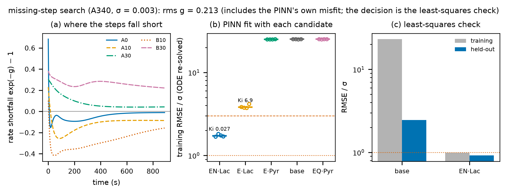

| 데이터 | 결론 |
|---|---|
| 숨은 단계가 있는 예제 (`projects/example_ldh_missing_step`) | `EN + Lac <=> ENL` 제안, K_i ≈ 4.1 mM (정답 5 mM) |
| 같은 조건, 숨은 단계 없음 (음성 대조) | 다섯 단계로 설명됨, 제안 없음 |
| Holmes 1988 | 다섯 단계로는 세트 321(5.8σ)을 설명 못 하지만, 후보 넷 중 맞는 단계 없음. 앞서 의심한 E·NADH·Lac은 지지되지 않음 |

- 후보 목록 밖(비효소 반응, 다른 결합 단계, 측정 문제)은 이름을 붙이지 못합니다.
- K_i는 고전 피팅 값을 씁니다. PINN만으로는 φ/K_i 비만 정해집니다.
- 판정 문턱(2σ·3σ·절반)은 임시값입니다.
- 자세한 내용은 [`docs/suggest/README.md`](suggest/README.md)에 있습니다.

**실험 계획이 결과를 정합니다.** 같은 숨은 단계(K_i 5 mM)라도, 그 리간드의 농도를 바꾼 실험이 없으면 찾지 못합니다.

| 숨은 단계 | 지금 계획(젖산 ≈ 10 mM 일정) | + 젖산 0·30 mM 세트 | + 피루브산 5·10 mM 세트 |
|---|---|---|---|
| EN·Lac | 놓침 | 찾음 (K_i 4.8 mM) | — |
| EQ·Pyr | 놓침 | 놓침 (피루브산 1.6 mM까지는 흡수) | 찾음 (K_i 4.9 mM) |

그래서 `projects/ldh_ph10/README.md`에 선택 세트 R30·F0·P50·P100을 권장으로 적어 두었습니다. P50·P100은 설계가 가정한 EQ·Pyr의 K_i(5 mM)를 데이터로 확인하는 세트이기도 합니다.

## 9. 문제 해결

| 증상 | 어디서 보이나 | 원인과 할 일 |
|---|---|---|
| ② 단계에서 멈춤, 파일 이름과 줄 번호 | 대시보드 상단 오류, manifest `error` | 그 줄의 시간 역행·빈 값·숫자가 아닌 값·A340 > 2를 고친다. 기기 내보내기 형식이면 실험에 `format:`을 적는다 |
| "온도 변동 ≥ 0.2 ℃" 경고 | 그림 2b 막대가 회색 띠 밖, 경고 목록 | 큐벳 온도 조절 확인. 그 실험은 학습에서 빼는 것을 고려 |
| 시드가 제외되어 멈춤(남은 표본 1개면 ⑤, 0개면 ④에서) | 그림 3a의 회색 점선, `fit_summary.json`의 `excluded` | σ(`noise_sigma`)가 실제 잡음보다 작게 적혔거나, 반응식·초기 농도·사점 시간이 틀렸다. 그림 3a에서 어긋나는 구간을 본다. σ를 억지로 키우지 말 것 |
| 홀드아웃만 크게 빗나감 | 그림 3b·3d | 학습 조건이 홀드아웃 조건을 덮지 못한다(예: 피루브산 범위). 홀드아웃과 비슷한 조건을 학습에 하나 더한다 |
| 판정 등급 C, 붉은 띠 "149 보장 없음" | 그림 1b, 모든 단계 상단 | 반응식에 한 방향(`->`) 단계가 있다. 의도한 것이 아니면 `<=>`로. 등급 C면 평형 한계 대수식을 쓰지 않는다 |
| "수치 오류 의심", 재해석 횟수 > 0 | 그림 4b `re-run (dt/10)` 열 | 매우 강성인 표본. 다시 풀어 통과하면 괜찮다. 계속 실패하면 그 표본의 속도 상수를 의심한다 |
| 그림 4a 회색 선 끝이 갈라짐 | 그림 4a | 같은 적합류인데 평형이 다르다 → 수치 문제거나 반응식 입력 오류. 4b의 `max |ln Q/K|`를 본다 |
| 학습 세트가 체계적으로 어긋남, 특정 조건에서만 | 그림 3a·3d | 반응식에 단계가 빠졌을 수 있다. `enzopt suggest`로 후보를 확인. 그 리간드 농도를 바꾼 실험이 학습에 있어야 보인다 |
| "Hopsan 미사용" | 그림 4c 제목, 판정 보고 끝줄 | `enzopt doctor --hopsan`. 없어도 scipy로 모두 계산된다 |
| U자 곡선 일부 점이 없음 | 그림 5a | 그 ρ에서는 효소 상한(`Et_bounds_mM`)으로도 목표 미달. 상한을 올리거나 목표 시간을 늘린다 |
| 피펫 표에 "부피 초과" | `pipette.txt` 예측 열 | 저장액이 묽어 1000 µL를 넘는다. `stocks_mM`을 높인다 |

## 10. 용어집

| 용어 | 뜻 |
|---|---|
| 진행 곡선 | 반응 혼합물의 관측값(A340 또는 NADH 농도)을 시간에 따라 잰 곡선 |
| A340 | 340 nm 흡광도. NADH(ε = 6.22 /mM/cm)와 효소에 붙은 NADH(EN, ENP)가 흡수한다 |
| 속도 상수 k₊ᵢ, k₋ᵢ | i번째 단계의 정방향·역방향 질량작용 상수. 이분자 단계(k₊₁, k₊₂, k₋₄, k₋₅)는 /mM/s, 나머지는 /s |
| K′ | 전체 반응 Pyr + NADH ⇌ Lac + NAD⁺의 겉보기 평형 상수(pH·온도에 따라 다름, pH 10에서 약 23) |
| Haldane 관계 | 단계별 상수의 곱이 K′와 같아야 한다는 제약: Πk₊ / Πk₋ = K′. enzopt는 k₋₅를 이것으로 정한다 |
| 식별 불가능 | 데이터에 똑같이 맞는 매개변수 조합이 여러 개라 하나로 정할 수 없음 |
| 표본(시드) | 데이터에 맞는 속도 상수 조합 하나. 시드(난수 시작점)마다 하나씩 만든다 |
| σ (`noise_sigma`) | 측정 잡음의 표준편차. 표본 제외(3σ)와 홀드아웃 문턱(2σ)의 기준 |
| 학습 / 홀드아웃 / 설계 확인 | 실험의 역할. 학습은 식별에 쓰고, 홀드아웃은 예측 시험에만, 설계 확인은 설계대로 한 실험을 그림 5c에 겹쳐 보는 데 쓴다 |
| PINN | 물리 정보 신경망. 신경망 곡선이 데이터와 미분방정식을 함께 만족하도록 학습 |
| 고전 피팅 | 미분방정식을 풀어 데이터와의 잔차 제곱합을 최소화(여러 시작점) |
| 복합체 | 반응 화살표 양 끝의 화학종 묶음(예: E + NADH, EN) |
| 연결 성분 | 화살표로 이어진 복합체 묶음 |
| 강연결 성분 | 화살표 방향을 따라 서로 오갈 수 있는 복합체 묶음 |
| 약가역 | 모든 연결 성분이 강연결 성분이다(한 방향 반응이 있어도 돌아오는 경로가 있으면 됨) |
| 결핍 δ | 복합체 수 − 연결 성분 수 − 화학량론 랭크. 0이면 구조가 단순하다는 뜻 |
| 보존 법칙 | 반응이 일어나도 변하지 않는 농도의 선형 결합(예: 효소 총량 E + EN + ENP + EQL + EQ) |
| 적합류(호환류) | 보존량이 같은 상태들의 집합. 같은 적합류의 실험은 같은 평형으로 간다(등급 A) |
| 정리 149 | 판정 등급의 근거인 CRNT 결과를 이 프로젝트(명세)에서 부르는 이름. 약가역이면 영속성, 여기에 결핍 0이면 적합류마다 양의 평형 하나 |
| 리아푸노프 함수 | 시간에 따라 늘지 않아야 하는 양. 여기서는 G = Σ x ln(x/x*) − x + x* (x* = 평형) |
| ρ, ρ_min, ρ* | 피루브산₀/NADH₀ 비, 평형 한계 최소 비, 강건 최적 비 |
| Et, E₀, Et* | 최종 효소 농도, 학습 실험의 효소량, 강건 최적 효소량 |
| 공칭 설계 / 강건 설계 | 표본 하나로 정한 설계 / 모든 표본을 만족하는 설계 |
| 막다른 복합체 | 반응을 진행하지 못하는 효소 복합체. 설계용 반응망의 EQ·Pyr(Ki = 5 mM, 가정값) |
