# 대시보드 레퍼런스: 탭과 그림 읽기

> 공개 LDH 데이터 프로젝트 `ldh_wang2025` 하나로, 대시보드의 탭 다섯 개와 그림 15장이 무엇을 뜻하는지 처음부터 끝까지 읽어 봅니다.

이 문서는 대시보드 화면의 각 부분(지표, 표, 그림, 펼침 상자)이 무엇을 보여 주고, 무엇을 보고 판단하면 되는지 정리한 레퍼런스입니다. 그림마다 **무엇을 그렸나 → 어떻게 읽나 → 이 예제에서 읽은 것 → 정상과 이상 신호** 순서로 적었습니다.

- 예제 실행: `runs/ldh_wang2025/2026-10-12_1738`(전체 모드, Hopsan 켬). 그림 사본은 `docs/dashboard/`에 있고, 그림을 넣은 HTML 판은 [`DASHBOARD.html`](../DASHBOARD.html)입니다(`uv run python scripts/build_guide_html.py --page dashboard`로 다시 만듦).
- 직접 보기: `uv run enzopt dashboard` → 왼쪽 **프로젝트**에서 `ldh_wang2025` → **실행 (최신순)**에서 `2026-10-12_1738`.
- 함께 읽을 문서: 같은 그림을 합성 예제로 설명하고 피펫 표·용어를 다룬 [안내서](../GUIDE.md), 배경지식부터 설명하는 [속도 상수 찾기](../IDENTIFICATION.html), 이 데이터의 처리와 결과를 적은 [`projects/ldh_wang2025/README.md`](../../projects/ldh_wang2025/README.md), 탭마다 안에서 하는 계산과 그림이 무엇에서 그려지는지를 적은 [시스템 흐름](../FLOW.html).
- PINN은 GPU float32로 학습하므로 다시 돌리면 숫자가 조금씩 다를 수 있습니다.

---

## 1. 이 예제

| 항목 | 내용 |
|---|---|
| 데이터 | Wang 외(2025, ChemBioChem)의 원 측정값, figshare doi:10.6084/m9.figshare.26961733, CC BY 4.0 |
| 효소·반응 | 토끼 근육 젖산 탈수소효소(LDH): 피루브산(Pyr) + NADH → 젖산(Lac) + NAD⁺ |
| 측정 | 플레이트 리더 340 nm, 10초 간격 0~490초, PBS, 23 ℃. 흡광을 NADH 농도(mM)로 바꿔 씀 |
| 실험 | 실행 5번 × 피루브산 12농도(0.023~2 mM) × 3반복 = 웰 179개 |
| 나눔 | 학습 108개(실행 2·3·4: NADH 0.5·0.4·0.6 mM, 효소 3.42 nM), 홀드아웃 71개(실행 1·5: 효소 2.73·4.27 nM) |
| 반응식 | 순서형 bi-bi 5단계(NADH가 먼저 붙음), 모두 가역 |
| 잡음 σ | 9 µM(같은 조건 3반복 웰끼리의 곡선 차이) |
| 설계 목표 | 피루브산 정량: 0.1 mM의 99 %를 600초 안에. ρ = NADH ÷ 피루브산 |

**웰(well)**은 마이크로플레이트(가로 12 × 세로 8 = 96칸)의 작은 홈 하나입니다. 웰마다 반응액 약 100 µL가 들어가고, 플레이트 리더가 모든 웰의 흡광을 10초마다 함께 읽으므로 웰 하나가 진행 곡선 하나입니다. 실험 이름 `r2_c05_A`는 실행 2, 열 5(피루브산 0.395 mM), 행 A의 웰입니다. 열은 피루브산 농도, 행 A~C 또는 D~F는 같은 조건의 3반복, 행 G·H는 배경을 재는 빈 웰입니다.

이 데이터에는 알려진 문제가 하나 있습니다. **피루브산이 적은 웰에서 넣은 피루브산보다 NADH가 더 쓰입니다.** 아래 그림 여러 곳에 이 흔적이 보입니다(그림 3a·3b, 9절).

## 2. 화면 구성

```
┌ 사이드바 ───────────────────┐ ┌ 본문 ─────────────────────────────────────────────────┐
│ enzopt                      │ │ ldh_wang2025 · 2026-10-12_1738                                  │
│ 프로젝트 [ldh_wang2025   ▾] │ │ 상태 완료 · 전체 모드 · 시작 … · enzopt 0.1.0 · 커밋 … │
│ □ 짧은 모드(시험용)         │ │ (상태 패널: 진행 막대 / 실패 줄 / 경고 n건 ▸)          │
│ □ Hopsan 끄기               │ │ [① 반응망][② 데이터][③ 식별][④ 해석][⑤ 설계]          │
│ [ 새 실행 ]                 │ │  ┌ 탭 ────────────────────────────────────────────┐   │
│ 실행 (최신순)               │ │  │ (빨간 띠: 149 보장 없음 — 약가역 아닐 때만)   │   │
│ ◉ …_1738 · 완료       │ │  │ 지표 상자 → 표 → 그림(두 열) → 펼침 상자       │   │
│ ○ …_1720 · 완료             │ │  └────────────────────────────────────────────────┘   │
│ ○ …_1627 · 실패             │ │                                                       │
└─────────────────────────────┘ └───────────────────────────────────────────────────────┘
```

**사이드바**

- **프로젝트:** `projects/` 아래 `project.yaml`이 있는 폴더 목록입니다.
- **짧은 모드(시험용):** 시드·반복을 줄여 빨리 돌립니다. 결과를 판단할 때는 쓰지 않습니다.
- **Hopsan 끄기:** 체크하면 ④에서 Hopsan 대조를 건너뜁니다(기본은 켬).
- **새 실행:** 같은 엔진(`enzopt run`)을 별도 프로세스로 시작합니다. 페이지를 닫아도 계산은 계속됩니다.
- **실행 (최신순):** `날짜_시각 · 상태`. 상태는 완료·실패·진행 중·중단됨·취소 가운데 하나이고, 짧은 모드면 `· 짧은`이 붙습니다.

**본문 머리와 상태 패널**

- 머리: `프로젝트 · 실행`, 그 아래 상태·모드·시작 시각·버전·커밋.
- 진행 중이면 진행 막대(단계·메시지·남은 시간)와 **취소** 단추가 나옵니다.
- 실패한 실행은 빨간 줄로 어느 단계가 왜 실패했는지 보여 주고, **그 단계부터 다시** 단추를 줍니다. 예: 실행 `2026-10-12_1627`(σ 2 µM)은 "④ 해석 단계 실패: 남은 표본이 없음(③ 식별 결과 확인)"(5.6절).
- 중단된 실행은 **이어서 실행** 단추가 나옵니다. 끝난 단계는 저장되어 있습니다.
- **경고 n건:** 실행 중에 나온 경고(예: 온도 변동, 남은 표본 부족)를 펼쳐 봅니다.

**탭 공통**

- 반응망이 약가역이 아니면 모든 탭 맨 위에 빨간 띠 "⚠ 149 보장 없음: 멸종 가능"이 나옵니다. 이 예제는 약가역이라 띠가 없습니다.
- 앞 실행의 결과를 그대로 가져온 단계는 "이전 실행 결과 재사용(실행 이름)"이라고 적힙니다(입력·설정·코드가 같을 때).
- 그림은 두 열로 나오고 캡션은 파일 이름입니다. 원본은 실행 폴더의 `<단계>/<이름>.png`(PDF·CSV 함께)입니다.
- 표의 숫자는 네 자리로 줄여 보여 줍니다. 전체 정밀도는 같은 이름의 CSV에 있습니다.

## 3. ① 반응망 탭

반응식의 **구조만으로** 무엇이 보장되는지 판정합니다. 속도 상수나 데이터는 쓰지 않습니다.

**화면 내용**

| 위치 | 이 예제에서 |
|---|---|
| 굵은 제목(판정 한 줄) | 약가역 ✔ 결핍 0 → 멸종·발산 없음, 적합류마다 평형 하나 |
| 파란 상자 "보장하는 것 / 전제" | 속도 상수가 무엇이든 어떤 종도 0으로 사라지거나 무한히 커지지 않고, 보존량이 같은 실험은 같은 평형 하나로 간다. 전제: 질량작용, 일정한 속도 상수(등온), 닫힌 계, 양의 초기 농도 |
| 표 | 아래 |
| 해석 백엔드 | Hopsan 사용(경로) |
| 그림 | 1a 반응망, 1c 대조 반응망, 1b 판정 표 |
| 펼침 "판정 보고 전문" | 단계 목록, 보존량 식, 열역학 제약(아래) |

| 반응망 | 복합체 | 연결 성분 | 랭크 | 결핍 | 약가역 | 보존 법칙 | 등급 |
|---|---|---|---|---|---|---|---|
| 식별 (ldh_ordered_bibi) | 8 | 3 | 5 | 0 | 예 | 4 | A |
| 비약가역 대조 (ldh_ordered_bibi_control) | 8 | 3 | 5 | 0 | 아니오 | 4 | C |

**표의 낱말**

- **복합체:** 화살표 양 끝에 오는 물질 묶음입니다(예: `E + NADH`, `EN`, `EQ + Lac`).
- **연결 성분:** 화살표로 이어진 복합체 묶음입니다. 그림 1a의 점선 상자 하나가 하나입니다.
- **랭크:** 서로 독립인 반응 방향의 수입니다. 종 9개 − 보존 법칙 4개 = 5.
- **결핍:** 복합체 − 연결 성분 − 랭크 = 8 − 3 − 5 = 0. 0이면 반응망이 "남는 자유도 없이" 맞물려 있다는 뜻입니다.
- **약가역:** 모든 화살표에 돌아오는 길이 있습니다(같은 상자 안에서 출발점으로 되돌아갈 수 있음).
- **등급:** A = 약가역 + 결핍 0(멸종·발산 없음, 적합류마다 평형 하나), B = 약가역 + 결핍 1 이상(멸종·발산 없음, 평형 개수는 보장 밖), C = 약가역 아님(보장 없음).
- **보존 법칙:** 반응이 어떻게 흘러도 변하지 않는 조합입니다. 이 예제의 네 개 가운데 첫째 `E + EN + ENP + EQ + EQL`은 효소 총량입니다. 나머지 셋은 NADH·NAD⁺·피루브산·젖산 쪽 총량을 섞은 꼴입니다.
- **열역학 제약**(판정 보고): "종속 k₋: 단계 5 (순환 1개에서 계산)" — 단계 5의 역반응 속도 상수는 맞추지 않고, 평형 상수 K′ = 9200과 나머지 상수에서 계산합니다(Haldane 관계).

### 그림 1a — 반응망

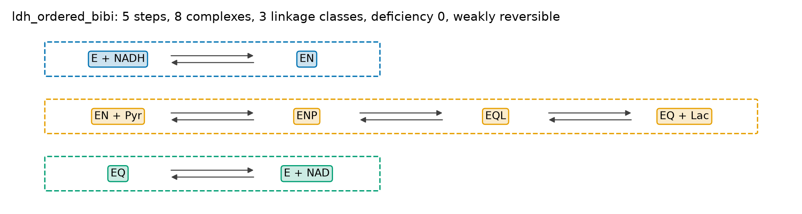

- **무엇을 그렸나:** 복합체(둥근 상자)와 단계(화살표). 연결 성분마다 한 줄, 점선 상자 하나.
- **어떻게 읽나:**
  - 가는 회색 화살표 한 쌍 = 가역(⇌), 굵은 빨간 화살표 = 한 방향.
  - 복합체 상자의 색 = 화살표를 따라 서로 오갈 수 있는 묶음. **한 점선 상자 안의 색이 모두 같으면 약가역**입니다.
  - 같은 줄에서 다른 상자를 건너뛰는 단계는 꺾은선으로 위(가역 쌍의 반대 방향은 아래)를 돌아갑니다.
  - 제목: 단계 수, 복합체 수, 연결 성분 수, 결핍, 약가역 여부.
- **이 예제:** 상자 셋(`E + NADH ⇌ EN`, `EN + Pyr ⇌ ENP ⇌ EQL ⇌ EQ + Lac`, `EQ ⇌ E + NAD`), 모두 회색 쌍, 상자마다 한 색 → 약가역.
- **정상과 이상:** 생각한 반응식과 단계·화살표 방향이 다르면 `project.yaml`의 `steps`를 고칩니다. 빨간 화살표가 있으면 그 단계 때문에 보장이 사라집니다(의도한 것인지 확인).

### 그림 1c — 대조 반응망

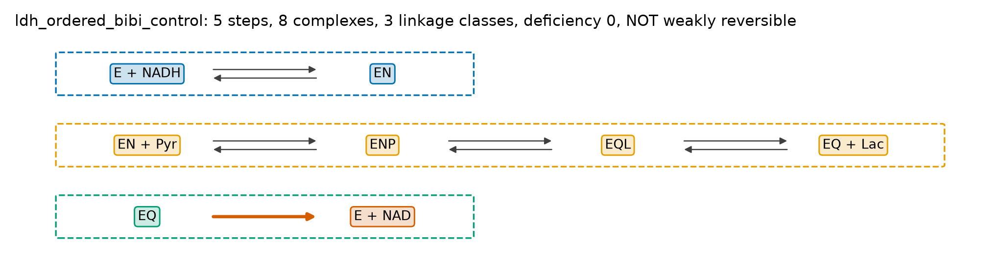

- **무엇을 그렸나:** `control.one_way_steps`로 지정한 단계를 한 방향으로 바꾼 반응망입니다. ③에서 같은 데이터로 따로 학습해 비교합니다.
- **지금은:** 대조는 설계에 쓰이지 않아 2026-10-13부터 `ldh_wang2025`를 포함한 실측 프로젝트에서 뺐습니다(조건만 필요, 사용자 결정). 다시 돌리면 이 그림과 ③ 그림의 대조 선, 비교 표의 대조 줄이 없습니다. 이 문서의 그림은 그 전 실행입니다.
- **이 예제:** 단계 5가 빨갛고, 셋째 상자 안 색이 둘(EQ 초록, E + NAD 주황)이라 약가역이 아닙니다(등급 C).
- **왜 있나:** "이 단계가 가역이어야 하나?"를 데이터로 묻는 비교입니다. 대조가 홀드아웃에서 뚜렷이 나쁘면 데이터가 가역성을 요구한다는 뜻입니다. 본 반응망이 약가역일 때는 "비약가역 대조", 본 반응망이 이미 약가역이 아니면 "대조(단계 N 한 방향)"라고 부릅니다.

### 그림 1b — 판정 표

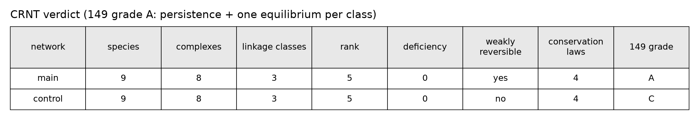

- 화면의 표와 같은 수치를 논문용 그림으로 만든 것입니다. 종(species) 수가 함께 나옵니다(9).
- 제목의 "149 grade A: persistence + one equilibrium per class"가 식별 반응망의 등급입니다.

## 4. ② 데이터 탭

측정 파일을 읽어 처음 값·끝 값·시간 범위·온도를 확인합니다. 모델은 아직 쓰지 않습니다.

**표** (실험마다 한 줄, 179줄)

| 열 | 뜻 | 예: `r1_c01_D` |
|---|---|---|
| 실험 | `project.yaml`의 실험 이름 | r1_c01_D(실행 1, 열 1 = 피루브산 2 mM, 행 D) |
| 역할 | train(학습) / holdout(홀드아웃) / design-check | holdout |
| 점 수 | 읽은 시점 수 | 50 |
| 시간(s) | 첫 시점–끝 시점 | 0–489 |
| NADH_mM 처음 / 끝 | 관측값의 첫 값·끝 값(관측값 이름이 열 이름) | 0.3856 / 0.1514 |
| Et (nM) | 효소량 | 2.732 |
| 온도 평균·범위(℃) | 데이터에 온도 열이 있을 때만 | (없음) |

### 그림 2 — 진행 곡선과 온도

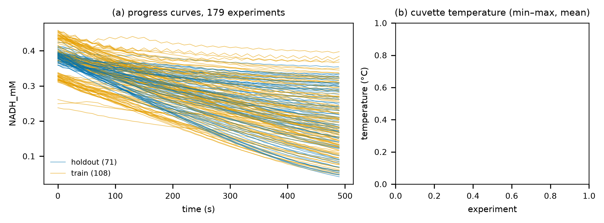

- **(a) 무엇을 그렸나:** 모든 실험의 관측값(여기서는 NADH, mM) 대 시간. 실험이 12개 이하이면 실험마다 다른 표식과 범례, 많으면 역할별 색 두 개입니다.
- **(a) 이 예제:**
  - 시작 높이가 세 무리입니다. 약 0.32 mM(실행 3, NADH 명목 0.4), 약 0.39 mM(실행 1·2·5, 명목 0.5), 약 0.45 mM(실행 4, 명목 0.6). 모두 명목보다 약 20 % 낮습니다(저장액·광로 차이로 보임, 첫 읽기를 그대로 처음 조건으로 씀).
  - 맨 아래 0.24~0.26 mM에서 시작하는 곡선 셋(`r3_c11_D`, `r3_c11_E`, `r4_c12_A`)은 같은 조건의 다른 웰보다 낮게 시작합니다. 피펫 오차로 보입니다.
  - 위쪽에 톱니처럼 흔들리는 곡선 몇 개는 읽기 잡음이 큰 웰입니다.
- **(b) 무엇을 그렸나:** 실험마다 측정 온도의 최소–최대 막대와 평균, 회색 띠는 등온 범위(±0.1 ℃). 데이터 파일에 `T_C` 열이 있을 때만 그려집니다(예: SLAC 프로젝트).
- **정상과 이상:** 처음 값이 명목 농도와 크게 다르거나, 같은 조건 반복끼리 처음 값이 크게 다르면 데이터 처리(배경·환산)를 먼저 의심합니다. 온도 막대가 띠를 벗어나면 등온 전제가 깨진 것이라 ②가 경고를 냅니다.

## 5. ③ 식별 탭

데이터에 맞는 속도 상수 조합을 **여러 개(표본)** 찾습니다. PINN 시드마다 표본 하나, 비교용으로 고전 피팅(최소제곱, 시작점 여러 개)과 대조 반응망을 함께 맞춥니다.

### 5.1 지표와 펼침 표

| 지표 | 이 예제 | 뜻 |
|---|---|---|
| 표본(남음/시드) | 4/4 | 학습 RMSE가 3σ(27 µM) 안인 표본 수 / 학습한 시드 수. 2개 미만이면 ④부터 멈춤 |
| 장치 | cuda float32 | PINN을 돌린 장치와 정밀도 |
| 학습 시간 | 199 s | PINN 학습만의 시간(고전 피팅·대조는 따로) |
| 홀드아웃 RMSE(표본 평균, 71개) | 평균 0.0164 · 최대 0.0361 | 홀드아웃 실험마다 남은 표본의 RMSE 평균을 낸 뒤, 그 71개의 평균과 최댓값(관측값 단위, mM). 홀드아웃이 4개 이하면 실험마다 나열 |

- 빠진 시드가 있으면 "시드 N 제외: 학습 데이터 RMSE … > 3σ = …"가 지표 아래에 나옵니다.
- **펼침 "홀드아웃 외삽 비교(PINN · 고전 피팅 · 대조)":** `holdout_comparison.csv` 그대로입니다. 모델(classical·nonWR·PINN), 시작점·시드, 실험, 역할(train/holdout)마다 한 줄이고, `rmse_A340`은 관측값 단위의 RMSE(이름은 처음 LDH A340 프로젝트에서 온 것, 여기서는 mM), `rmse_all_sigma`는 그것을 σ로 나눈 값입니다.

### 5.2 그림 3a — 학습 세트 맞춤

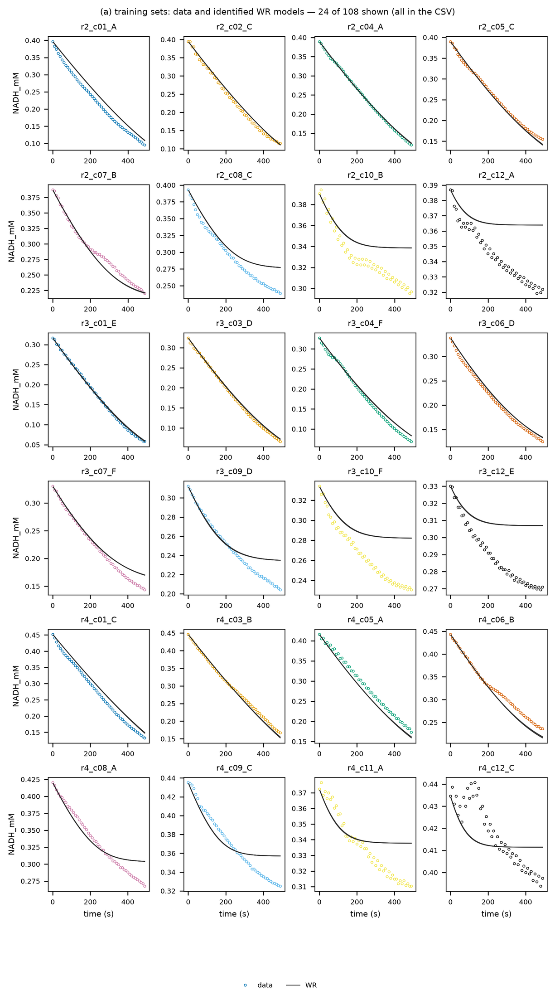

- **무엇을 그렸나:** 학습 실험마다 한 칸, 데이터(점)와 남은 표본(약가역 모델)의 곡선. 실험이 24개를 넘으면 고르게 24개만 그리고 제목에 "24 of 108 shown"이라 적습니다(CSV에는 전부).
- **어떻게 읽나:** 점이 선 둘레에 고르게 흩어지면 잘 맞은 것입니다. 한쪽으로 계속 벗어나면(체계적인 어긋남) 반응식이나 데이터 처리에 빠진 것이 있습니다.
- **이 예제:**
  - 피루브산이 많은 열(c01~c07)은 잘 맞습니다.
  - 피루브산이 적은 열(c10~c12)은 모델이 넣은 피루브산을 다 쓰면 평평해지는데, 데이터는 계속 내려갑니다(예: `r2_c12_A`, `r3_c12_E`, `r4_c11_A`). 9절의 데이터 문제입니다.
  - `r2_c10_B`, `r4_c12_C`처럼 처음 몇 읽기가 튀는 웰도 있습니다.

### 5.3 그림 3b — 홀드아웃 외삽

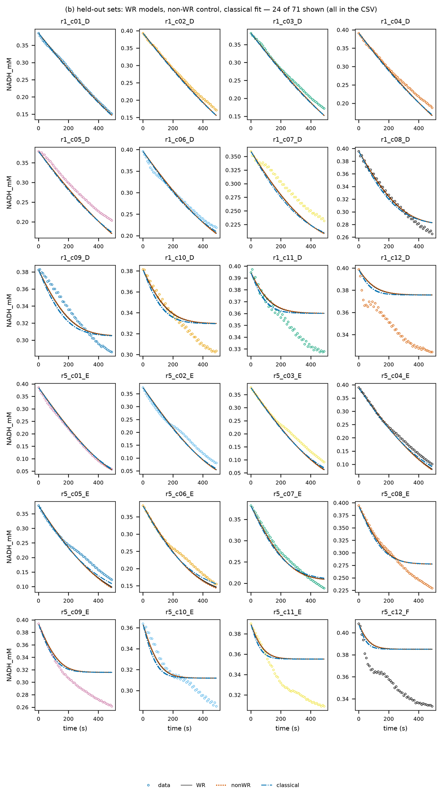

- **무엇을 그렸나:** 학습에 쓰지 않은 실험에서 세 모델(약가역 표본, 대조, 고전 피팅)의 예측과 데이터.
- **어떻게 읽나:** 홀드아웃은 "학습 밖 조건에서도 맞는가"를 봅니다. 세 모델이 갈리면 그 조건이 모델을 가르는 실험입니다.
- **이 예제:**
  - 학습에 없던 효소량에서도 피루브산이 많은 열은 학습만큼 맞습니다(효소량에 대한 외삽은 됨).
  - 세 모델의 선이 거의 겹칩니다. 생성물을 넣지 않은 정방향 데이터라 NAD⁺ 방출의 가역성(대조와의 차이)을 가를 수 없습니다.
  - 피루브산이 적은 열(`r1_c09`~`r1_c12`, `r5_c08`~`r5_c12`)은 학습 때와 같은 모습으로 어긋납니다.

### 5.4 그림 3c — 속도 상수

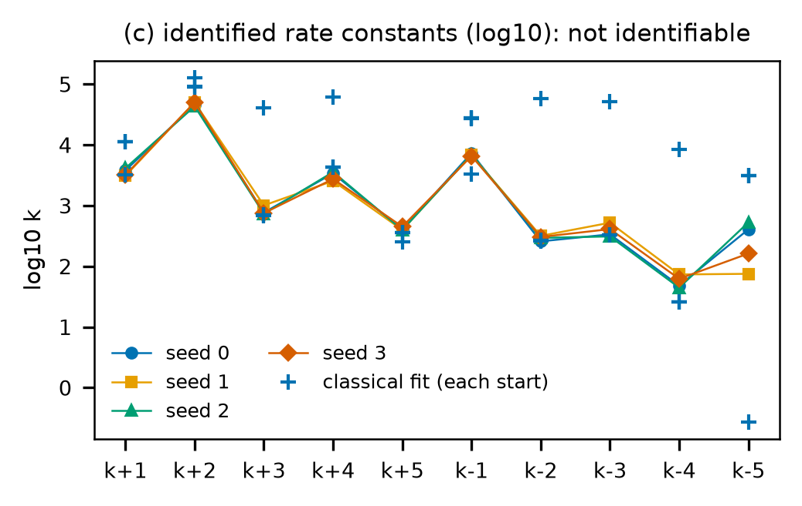

- **무엇을 그렸나:** 표본마다 모든 속도 상수의 log10(선으로 이은 점), 고전 피팅 시작점마다의 값(+).
- **어떻게 읽나:** 곡선은 똑같이 잘 맞는데 상수가 수십~수백 배 다르면, 그 상수는 데이터로 정해지지 않은 것입니다(제목 "not identifiable"). 상수 하나하나보다 kcat·Km 같은 조합이 더 잘 정해집니다.
- **이 예제:**
  - PINN 시드 4개는 서로 가깝게 모였습니다(k−5만 10^1.9~10^2.7로 퍼짐).
  - 고전 피팅은 시작점에 따라 k+3·k+4·k−2·k−3 등이 두 자릿수까지 다른 곳에 떨어지지만, 학습 RMSE는 거의 같습니다(17.6~17.8 µM). 같은 곡선, 다른 상수입니다.
  - 조합으로 바꾸면 kcat 234~244 /s(활성 자리당), Km(NADH) 57~79 µM, Km(피루브산) 7~8 µM(NADH 포화). Km(피루브산)은 9절의 데이터 문제로 낮게 치우쳤습니다.

### 5.5 그림 3d — 홀드아웃 비교 표

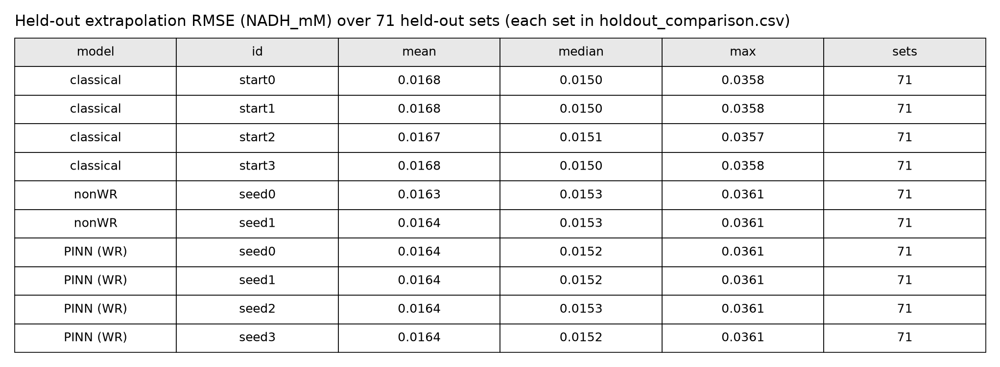

- **무엇을 그렸나:** 홀드아웃 외삽 RMSE를 모델별로. 홀드아웃이 12개 이하이면 실험마다 한 열입니다.
- **이 예제:** 모든 모델이 평균 약 0.016 mM(≈ 1.8σ), 중앙값 약 0.015, 최대 약 0.036 mM로 비슷합니다. 최댓값은 피루브산이 적은 웰에서 나옵니다.
- **정상과 이상:** 약가역 모델이 고전 피팅보다 크게 나쁘면 PINN이 덜 수렴한 것입니다(재시작 수를 늘림). 대조가 크게 나쁘면 데이터가 그 단계의 가역성을 요구한다는 뜻입니다.

### 5.6 실패한 실행에서는 (실행 `2026-10-12_1627`, σ 2 µM)

같은 데이터를 σ = 2 µM(읽기 잡음만)으로 돌린 실행입니다. ③ 탭에는 이렇게 나옵니다.

- 지표 "표본(남음/시드)" **0/4**.
- 그 아래 "시드 0 제외: 학습 데이터 RMSE 0.0182 > 3σ = 0.0060 (ode)"가 네 줄.
- 빨간 상자 "남은 표본 < 2: 설계 단계에서 멈춤", 상태 패널에 "④ 해석 단계 실패: 남은 표본이 없음(③ 식별 결과 확인)".

모델이 18 µM보다 잘 맞을 수 없는 이유가 반응식이 아니라 웰끼리의 차이(9 µM)라면 σ를 그에 맞게 정합니다. 반응식이 틀린 것이라면 `enzopt suggest`로 빠진 단계를 찾습니다.

## 6. ④ 해석 탭

남은 표본마다 반응을 다시 풀어, ①의 구조적 보장이 수치로도 지켜지는지 자동으로 검증합니다(scipy Radau). Hopsan으로 같은 계산을 한 번 더 해 대조합니다.

**지표**

| 지표 | 이 예제 | 뜻 |
|---|---|---|
| CRNT 검증 | 52/52 통과 | 표본 4개 × 13번 해석 가운데 통과 수 |
| 수치 오류 의심 재실행 | 0 | 기준에 걸려 시간 간격을 1/10로 줄여 다시 푼 수 |
| Hopsan vs scipy 최대 차이(관측값) | 1.29×10⁻⁷ | 대표 표본의 완전 메커니즘을 두 백엔드로 풀어 비교한 관측값 차이(mM) |

- 지표 아래 회색 글씨 "Δt 1.99e-06 s에서 단계 수 상한(1e+08) 때문에 238.7 s까지만 풂": 완전 메커니즘이 뻣뻣해 Hopsan이 처음 239초만 풀었다는 뜻입니다.
- 펼침 "검증 표(실행별)": `validation.csv`, 해석 한 번마다 한 줄(통과 여부, 보존량 표류, 최소 농도, |ln Q/K|, 리아푸노프 증가, 백엔드).
- Hopsan의 겉보기 1단계 적합류 배치(13번, 모두 통과)는 그림이 아니라 `4_sim/sim_summary.json`과 `4_sim/hopsan/`의 모델 파일(.hmf)에 있습니다. 이 예제는 해석 시간 12시간(`simulation.t_long_s: 43200`)으로 돌렸습니다. 1시간이면 평형에 못 닿아 0/13이었습니다.

### 그림 4a — 같은 적합류는 같은 평형으로

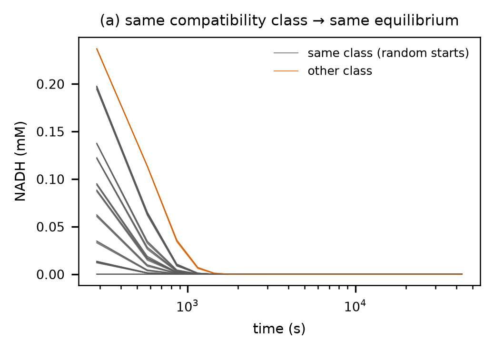

- **무엇을 그렸나:** 같은 보존량을 갖는 서로 다른 처음 상태 12개와, 보존량이 다른 처음 상태 하나를 길게(여기서는 12시간) 푼 곡선.
- **어떻게 읽나:** 결핍 0 정리대로라면 회색 곡선은 모두 한 점(그 적합류의 평형 하나)으로 모입니다. 주황은 다른 평형으로 갑니다.
- **이 예제:** 모두 약 1,500초 안에 0 근처로 모입니다. K′가 9200으로 커서 평형의 NADH가 10⁻⁵ mM 수준이라, 이 그림에서는 같은 적합류와 다른 적합류가 모두 0으로 보입니다. 정말 한 평형인지는 그림 4b의 |ln Q/K|로 확인합니다.

### 그림 4b — 검증 표

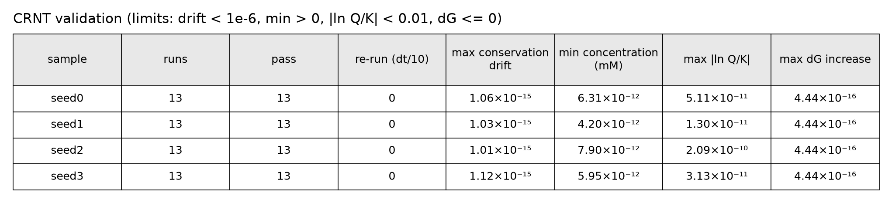

| 열 | 기준 | 이 예제의 최악값 | 뜻 |
|---|---|---|---|
| runs / pass | — | 13 / 13 | 같은 적합류 12번 + 다른 적합류 1번 |
| re-run (dt/10) | — | 0 | 다시 푼 수 |
| max conservation drift | < 10⁻⁶ | 약 10⁻¹⁵ | 보존량이 처음 값에서 벗어난 최대 상대 크기 |
| min concentration | > 0 | 약 4~8×10⁻¹² mM | 어떤 종도 음수가 되지 않음(영속성) |
| max \|ln Q/K\| | < 0.01 | 2×10⁻¹⁰ | 끝에서 반응 몫 Q가 평형 상수 K′와 같음 |
| max dG increase | ≤ 0 | 4×10⁻¹⁶(기계 오차) | 자유 에너지(리아푸노프 함수)가 늘지 않음 |

- **정상과 이상:** 한 기준이라도 걸리면 해석을 Δt/10으로 다시 풀고, 그래도 걸리면 그 실행이 실패로 남습니다. |ln Q/K|만 걸리고 값이 줄어드는 중이면 해석 시간이 짧은 것입니다(`simulation.t_long_s`를 늘림).

### 그림 4c — Hopsan과 scipy

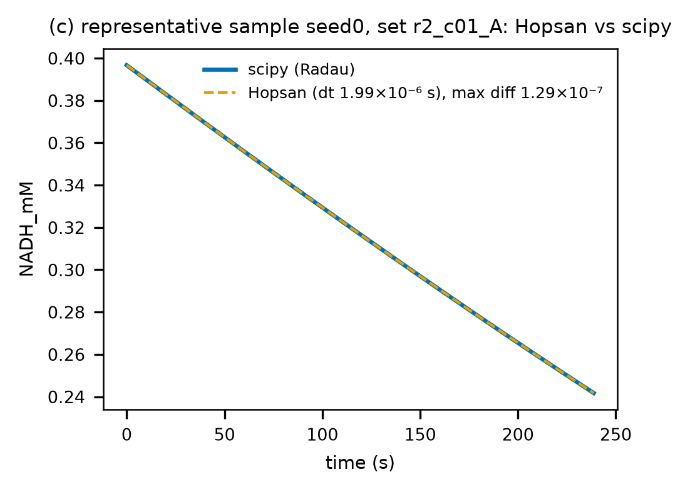

- **무엇을 그렸나:** 같은 속도 상수·처음 조건을 scipy(Radau)와 Hopsan(고정 시간 간격)으로 푼 관측값.
- **이 예제:** 최대 차이 1.29×10⁻⁷ mM. Hopsan은 Δt 2×10⁻⁶ s로 처음 239초만 풀었습니다.
- **정상과 이상:** 차이가 데이터 잡음(여기서는 9 µM)에 가까우면 어느 백엔드에 문제가 있는지 살펴봅니다. 판정에는 쓰지 않는 대조입니다.

## 7. ⑤ 설계 탭

남은 표본 **모두에서** 목표를 지키는 기질 비 ρ와 최소 효소량을 찾고, 그대로 실험할 피펫 표를 만듭니다.

이 예제의 목표는 **피루브산 정량**입니다. 피루브산 0.1 mM의 99 %를 600초 안에 NADH로 바꾸며, ρ = NADH ÷ 피루브산입니다(`project.yaml`의 `design`: analyte Pyr, partner NADH).

**지표**

| 지표 | 이 예제 | 뜻 |
|---|---|---|
| 강건 ρ* | 100 | 표본 모두에서 목표를 지키는 효소량이 가장 작은 ρ |
| 강건 Et* | 1.01 nM | 그 ρ에서 표본 모두가 목표를 지키는 최소 효소량(활성 자리) |
| E₀ 배수 | 0.297 | Et* ÷ 기준 효소량 E₀(첫 학습 실험의 효소 3.42 nM) |
| 공칭 Et(미달 표본) | 1.00 nM (1) | 표본 하나로만 정한 효소량과, 그 효소량으로 목표에 못 미치는 표본 수 |

- 회색 글씨 "CRNT 평형 한계 ρ_min = 1.00 (K' = 9200): 이보다 작으면 효소를 아무리 넣어도 불가능": 평형만으로 정해지는 하한입니다(그림 5d).
- **피펫 표**와 **피펫 표 내려받기(CSV)** 단추: 아래 "피펫 표 읽기".

### 그림 5a — ρ에 따른 최소 효소량

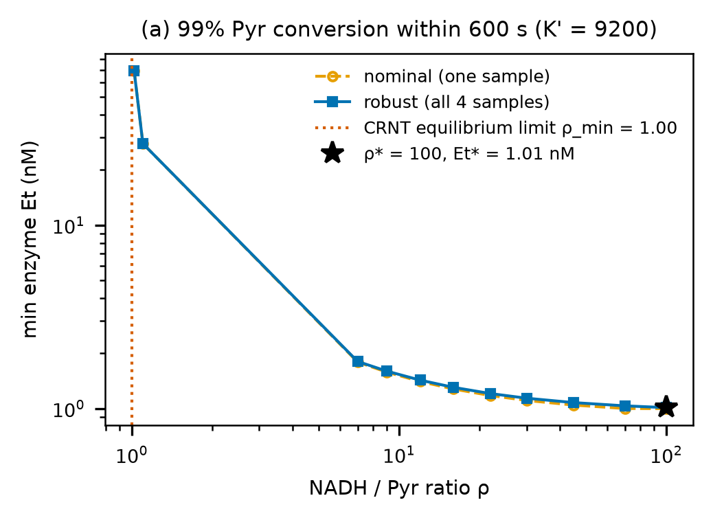

- **무엇을 그렸나:** ρ 격자마다 목표를 지키는 최소 효소량(로그-로그). 공칭과 강건 두 곡선.
- **어떻게 읽나:** ρ_min 가까이에서는 평형 한계 때문에 효소가 많이 필요하고, ρ가 커질수록 줄어듭니다. 기질이 서로 경쟁·저해하는 반응이면 다시 올라가 U자가 되고, 그 바닥이 ρ*입니다.
- **이 예제:**
  - ρ = 1.02에서 69 nM, 1.1에서 28 nM, 7에서 1.8 nM, 그 뒤로 완만히 줄어 100에서 1.01 nM입니다. U자 바닥이 격자 안에 없어 ρ* = 100이 격자 끝입니다.
  - 곡선이 평평해진 뒤(ρ 약 20~30 이상)는 ρ를 늘려도 효소가 거의 줄지 않습니다(ρ 22에서 1.21 nM, 30에서 1.14 nM). 저장액·부피 제약이 있으면 더 작은 ρ를 고르고 그 ρ의 강건 효소량(`5_design/design_table.csv`)을 쓸 수 있습니다.
  - 공칭과 강건이 거의 겹칩니다. 표본 4개가 서로 가까워(그림 3c) 강건 설계의 여유가 작습니다.

### 그림 5b — 두 설계를 모든 표본에 적용

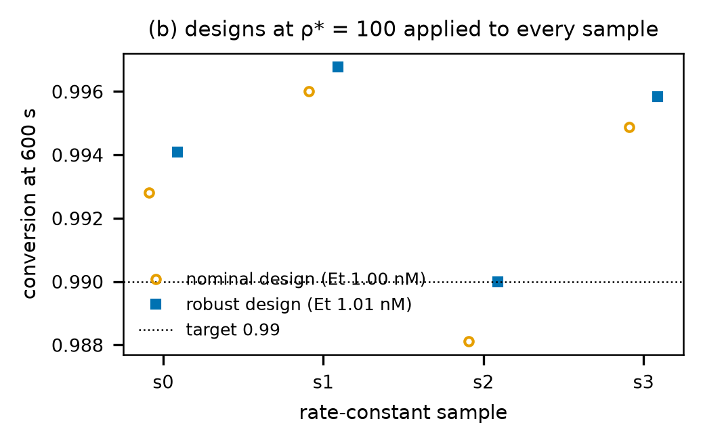

- **무엇을 그렸나:** 같은 ρ*에서 두 효소량을 표본 4개에 각각 넣었을 때의 전환율.
- **어떻게 읽나:** 공칭 설계는 자기를 정한 표본에서는 목표를 지키지만 다른 표본에서 못 미칠 수 있습니다. 강건 설계는 가장 느린 표본에서 정확히 목표에 닿도록 정합니다.
- **이 예제:** 공칭(1.00 nM)은 표본 s2에서 0.9881로 목표에 못 미칩니다. 강건(1.01 nM)은 s2에서 정확히 0.990, 나머지는 0.994~0.997입니다.

### 그림 5c — 설계 조건의 예측 곡선

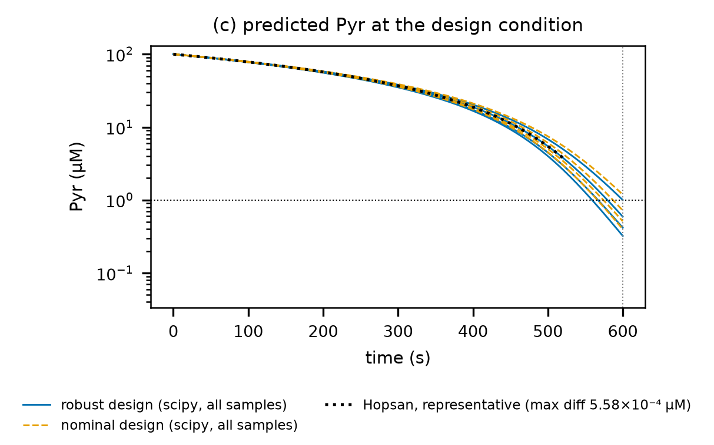

- **무엇을 그렸나:** 피펫 표대로 섞었을 때 표본마다 분석 대상(여기서는 피루브산)이 줄어드는 예측. 확인 실험(`role: design-check`)이 있으면 그 측정값도 함께 그립니다.
- **어떻게 읽나:** 600초에서 모든 파란 실선이 가로 점선(남은 1 %) 아래면 강건 설계가 표본 모두에서 목표를 지킨다는 뜻입니다. 확인 실험을 하면 측정값이 이 다발 안에 들어오는지 봅니다.
- **이 예제:** 파란 실선은 600초에 0.3~1.0 µM, 주황 파선 하나는 1 µM 위입니다(그림 5b의 s2). Hopsan 곡선은 scipy와 5.6×10⁻⁴ µM 안에서 겹치고, 약 520초까지만 그려집니다.

### 그림 5d — 평형 한계 표

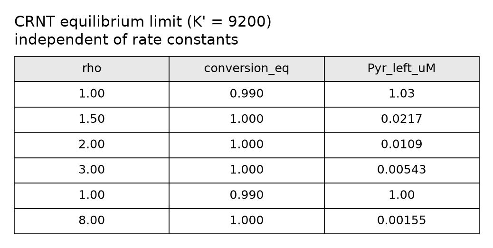

- **무엇을 그렸나:** ρ마다 평형에서 도달할 수 있는 최대 전환율(`conversion_eq`)과 남는 분석 대상(µM).
- **어떻게 읽나:** 약가역·결핍 0이라 평형이 하나뿐이므로, 이 값은 효소량이나 속도 상수와 상관없는 상한입니다. 목표 전환율(99 %)을 처음 넘는 ρ가 ρ_min입니다.
- **이 예제:** K′ = 9200이 커서 ρ = 1이면 이미 99.0 %(1.03 µM 남음), ρ ≥ 1.5면 사실상 100 %입니다. 다섯째 줄의 "1.00"은 ρ_min(1.0007)을 세 자리로 줄여 쓴 것이고, 이 줄의 남는 양이 정확히 목표(1.00 µM)입니다.

### 피펫 표 읽기

| 줄 | 뜻 | 이 예제 |
|---|---|---|
| D1 | 강건 설계(ρ*, Et*) | ρ 100, Et 1.01 nM, 3반복, 600초 끝값 + 5분 기록 |
| D0 | 공칭 설계(비교용) | Et 1.00 nM, 표본 4개 중 1개 미달 |
| Z | 효소 없음(대조) | 바탕 변화 확인 |

열: `Pyr_stock_uL`·`NADH_stock_uL`(저장액 부피), `buffer_uL`(나머지를 채우는 완충액), `enzyme_uL`(마지막에 넣는 효소), `Et_final_nM`, `Et_over_E0`, `enzyme_working_uM`(효소 작업액 농도), `record`(기록 시간), `repeats`(반복), `predicted`(표본으로 예측한 결과와 경고).

- **이 예제:** NADH 10 mM(ρ 100 × 0.1 mM)을 200 µL에 만들려면 5 mM 저장액이 400 µL 필요해 `buffer_uL`이 −212 µL이고, `predicted`에 "부피 초과(저장액 농도를 높일 것)"가 붙습니다. 부피만 보면 NADH 저장액을 약 11 mM 이상으로 올리면 됩니다.
- **실제로는 더 작은 ρ를 고릅니다.** NADH 10 mM은 이 플레이트(광로 0.31 cm)에서 340 nm 흡광이 약 19라 잴 수 없습니다. 흡광으로 확인하려면 처음 흡광이 2 아래가 되도록(NADH 약 1 mM 아래, ρ 10 아래) 그림 5a에서 ρ를 고르고, 그 ρ의 강건 효소량(`design_table.csv`, 예: ρ 9에서 1.60 nM)을 씁니다. 도구는 이런 측정 범위 제약을 모르므로 사람이 정해야 합니다.
- **주의:** 이 예제의 설계는 Km(피루브산)이 낮게 치우친 상수로 계산했습니다(9절). 참고용으로만 봅니다.

## 8. 실행 폴더와 탭의 대응

| 탭 | 실행 폴더 | 주요 파일 |
|---|---|---|
| (머리·상태) | `manifest.json`, `progress.json` | 상태, 단계별 상태·경고, 캐시 출처, 플래그(149 보장, 검증 결과) |
| ① 반응망 | `1_verdict/` | `verdict.json`(판정 수치·표시 이름), `report.txt`(판정 보고 전문), 그림 1a·1b·1c |
| ② 데이터 | `2_data/` | `data.json`(표), `exp_<실험>.csv`(읽은 데이터), 그림 2 |
| ③ 식별 | `3_fit/` | `fit_summary.json`(지표·제외 이유), `samples/sample_seed*.json`(속도 상수), `baseline/`(고전 피팅), `control/`(대조), `holdout_comparison.csv`, `predictions.csv`, 그림 3a~3d |
| ④ 해석 | `4_sim/` | `sim_summary.json`(지표·Hopsan), `validation.csv`(검증 표), `trajectories.csv`, `hopsan/`(.hmf 모델과 결과), 그림 4a~4c |
| ⑤ 설계 | `5_design/` | `design_summary.json`(지표), `pipette.csv`·`pipette.txt`(피펫 표), `design_table.csv`(ρ마다 효소량), `design_check.csv`, `equilibrium_limit.csv`, 그림 5a~5d |

그림마다 같은 이름의 PDF(논문용)와 CSV(그린 값 전부)가 함께 있습니다.

## 9. 이 예제에서 기억할 것

- **구조는 깨끗합니다.** 약가역·결핍 0(등급 A)이라 ④의 52번 해석과 Hopsan 배치 13번이 모두 "같은 적합류는 같은 평형 하나"를 수치로 보여 줍니다.
- **데이터에 문제가 하나 있습니다.** 피루브산이 적은 웰에서 넣은 피루브산보다 NADH가 0.03~0.1 mM 더 쓰입니다. 그래서 그림 3a·3b의 낮은 열이 어긋나고, Km(피루브산)이 낮게 나옵니다. 모든 웰에 피루브산 0.03 mM을 더한 민감도 시험에서는 어긋남이 사라지고, 겉보기 Km(NADH 0.4~0.5 mM)이 30~37 → 48~57 µM으로 저자 값(68 µM)에 가까워졌습니다(프로젝트 README).
- **σ는 웰끼리의 차이로 정했습니다.** 읽기 잡음(1.2 µM)으로 정하면 표본이 모두 빠집니다(5.6절).
- **정방향 데이터라 가역성은 시험되지 않습니다.** 그림 3b에서 대조와 겹치는 이유입니다. 역반응까지 가르려면 생성물(NAD⁺·젖산)을 넣은 실험이 필요합니다(`ldh_holmes1988` 참고).
