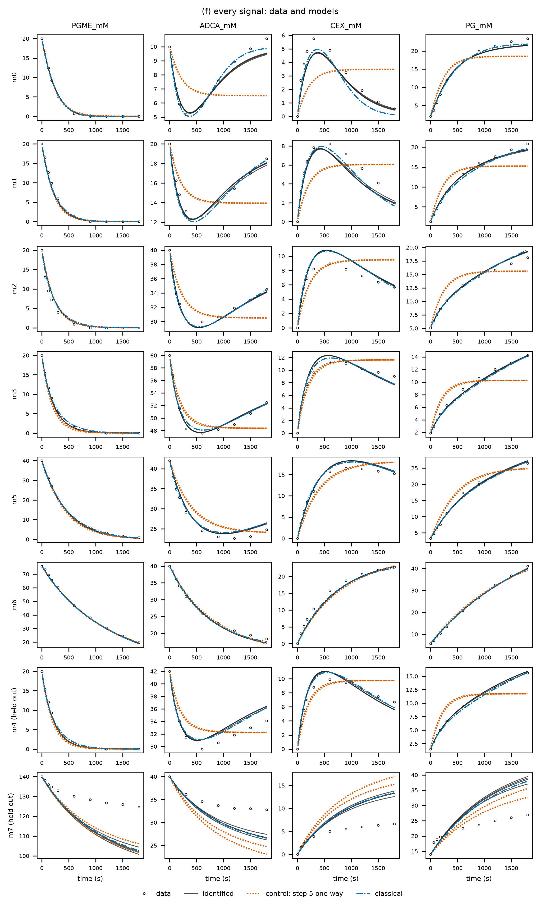
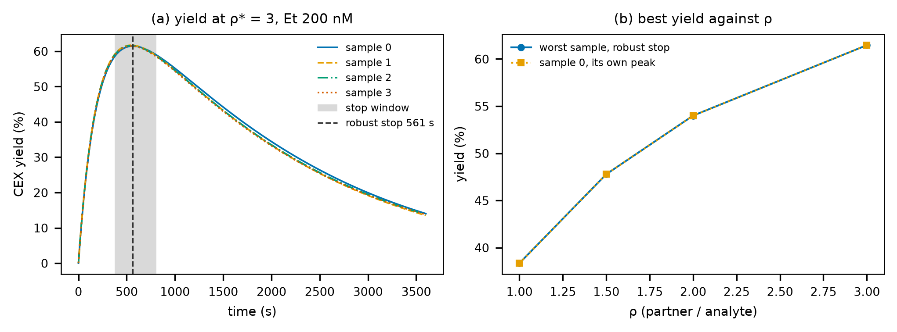

# 시스템 흐름: 각 탭이 하는 계산과 그림의 뜻

> 입력 두 가지(`project.yaml`과 측정 데이터)가 다섯 단계를 지나 피펫 표가 되기까지, 단계마다 안에서 무엇을 계산하고, 무엇을 파일로 남기고, 그 파일이 어떤 탭과 그림이 되는지 따라갑니다.

이 문서는 enzopt의 **계산 흐름** 레퍼런스입니다. 대시보드의 탭 다섯 개(① 반응망 ~ ⑤ 설계)는 실행기의 단계 다섯 개와 하나씩 짝을 이룹니다. 그래서 탭마다 다음 순서로 적었습니다.

1. **하는 일:** 그 단계가 어떤 순서로 무엇을 계산하는지(코드 위치, 기본 설정값 포함)
2. **결과 파일과 뒤 단계:** 실행 폴더에 남기는 파일과, 그 파일을 뒤 단계가 어떻게 쓰는지
3. **탭 화면:** 지표·표·펼침 상자가 어느 파일의 어느 값인지
4. **그림:** 무엇에서 그리나 → 그림 요소 → 뜻 → 이상 신호와 할 일

- 함께 읽을 문서: 이 예제의 화면 값을 하나씩 읽은 [대시보드 레퍼런스](../DASHBOARD.html), 왜 이렇게 하는지와 피펫 표·용어를 다룬 [안내서](../GUIDE.html), 배경지식부터 설명하는 [속도 상수 찾기](../IDENTIFICATION.html). 설정 항목 전체는 [`README.md`](../../README.md)에 있습니다.
- 예시 그림: 공개 LDH 데이터 `ldh_wang2025`의 실행 `runs/ldh_wang2025/2026-10-12_1738`(전체 모드, Hopsan 켬, 대시보드 레퍼런스와 같은 실행)입니다. 이 실행에 없는 그림 둘(3f 신호 여럿, 5a_peak 최고 수율)은 세팔렉신 프로젝트 실행 `runs/aeh_cephalexin_lagerman2021/2026-10-12_1132`에서, 3e(효소 실활)는 안내서의 실활 예제에서 가져왔습니다.
- 그림을 넣은 HTML 판은 [`FLOW.html`](../FLOW.html)입니다(`uv run python scripts/build_guide_html.py --page flow`로 다시 만듦). 그림 S는 `uv run python scripts/flow_diagram.py`, 그림 P1은 `scripts/pinn_ring_diagram.py`, 그림 P2는 `scripts/pinn_ring_figure.py`(GPU로 시드 하나를 다시 학습)로 다시 그립니다.
- PINN은 GPU float32로 학습하므로 다시 돌리면 ③ 이후의 숫자가 조금씩 다를 수 있습니다.

---

## 1. 한눈에 보기

| 단계 = 탭 | 읽는 것 | 하는 일 | 쓰는 것(실행 폴더) | 그림 | 예제 시간 |
|---|---|---|---|---|---|
| ① 반응망 | `project.yaml`의 `network`·`control`·`design.dead_end` | 반응식의 구조 판정(CRNT): 약가역·결핍·보존 법칙·등급 | `1_verdict/verdict.json`, `report.txt`, 플래그 `guarantee_149` | 1a·1b(+1c 대조) | 0.9 s |
| ② 데이터 | `experiments` + `data/*.csv` | 파일 형식 검사, 표준 형식으로 바꿈, 처음 값·온도 정리 | `2_data/exp_*.csv`, `data.json` | 2 | 0.8 s |
| ③ 식별 | `2_data/exp_*.csv`(+ 추가 신호) | PINN(신경망 곡선 + 효소 고리)으로 속도 상수 표본, 재해석으로 고르고 거름, 비교용 고전 피팅·대조(있을 때) | `3_fit/samples/*.json`, `fit_summary.json`, `holdout_comparison.csv` | 3a~3d(3e·3f) | 839 s |
| ④ 해석 | `3_fit/samples/*.json`, 플래그 | 표본 × 처음 상태를 scipy로 풀고 CRNT 검증, Hopsan 대조 | `4_sim/validation.csv`, `sim_summary.json`, `hopsan/` | 4a·4b·4c | 39 s |
| ⑤ 설계 | `3_fit/fit_summary.json`, `samples/*.json` | 평형 한계, ρ마다 최소 효소량(공칭·강건), 피펫 표, 예측 곡선 | `5_design/pipette.csv`, `design_summary.json` 등 | 5a~5d(5a_peak) | 40 s |

예제 시간은 실행 `2026-10-12_1738`(학습 웰 108개)의 단계별 시간입니다. ③ 839초 가운데 PINN 학습이 199초, 고전 피팅이 472초, 대조 PINN이 20초이고, 나머지는 재시작·표본을 미분방정식으로 다시 푸는 시간과 그림입니다.

흐름 전체에 걸린 규칙 세 가지가 있습니다.

1. **단계 사이는 파일로만 넘깁니다.** 각 단계는 앞 단계 결과를 메모리가 아니라 실행 폴더의 파일(`ctx.read_stage_json`, `load_samples` 등)로 읽습니다. 그래서 앞 실행의 단계를 그대로 가져오는 캐시, 중단된 실행 이어 가기, 특정 단계부터 다시 돌리기가 됩니다.
2. **대시보드는 읽기만 합니다.** 탭은 실행 폴더의 JSON·CSV·PNG를 읽어 보여 줄 뿐이고 계산하지 않습니다. [새 실행]은 `enzopt run`과 같은 엔진을 별도 프로세스로 띄우므로, 브라우저나 대시보드 서버를 닫아도 계산은 계속됩니다.
3. **그림은 세 파일입니다.** 그림마다 `이름.pdf`(벡터), `이름.png`(300 dpi), `이름.csv`(그린 값 그대로)가 같은 폴더에 생기고, 단계 폴더의 `figures.json`이 그 목록입니다. 대시보드는 `figures.json`에 적힌 PNG를 두 열로 보여 줍니다. 축·범례는 영어, 색은 색각 이상에도 구분되는 Okabe–Ito 팔레트입니다.

## 2. 실행기: 단계를 돌리는 틀

실행기(`src/enzopt/pipeline/runner.py`의 `run_project`)는 단계 함수 다섯 개(`pipeline/stages.py`의 `stage_*`)를 차례로 부르고, 그 앞뒤의 기록·캐시·멈춤을 맡습니다.

### 2.1 실행 폴더가 생길 때

1. `project.yaml`을 읽어 반응망·실험·설정을 만듭니다(`core/project.py`). 설정은 `DEFAULTS` 위에 `project.yaml`의 값을 덮고, 짧은 모드면 `quick:` 값을 한 번 더 덮습니다.
2. `runs/<프로젝트>/<YYYY-MM-DD_HHMM>/`을 새로 만듭니다(같은 분에 또 만들면 `_2`, `_3`).
3. `project.yaml` 사본(맨 위와 `inputs/`)과 입력 데이터 사본(`inputs/data/…`)을 둡니다. 이어서 실행할 때는 원래 프로젝트 폴더가 아니라 이 사본을 읽으므로, 그 사이에 데이터를 고쳐도 같은 입력으로 이어집니다.
4. `manifest.json`을 씁니다: 설정 사본, 입력 파일마다 SHA-256, 코드 버전(git 커밋, 소스 해시 `code_hash`, `uv.lock` 해시), Python 판, 모드(full/quick), 옵션(장치·정밀도·Hopsan), 단계별 상태, 플래그, 경고, 오류.
5. 표준 출력에 `실행 폴더: <경로>`를 한 줄 찍습니다(테스트·평가 하네스가 이 줄을 읽음).

### 2.2 단계 하나를 돌리는 순서

단계마다 다음을 차례로 봅니다.

1. **캐시 키 계산(`stage_key`).** 그 단계의 설정 + 입력 해시 + 앞 단계들의 키 + `code_hash()`(대시보드·`_vendor`를 뺀 모든 소스)를 묶어 해시합니다.
2. **이 폴더에서 이미 끝났나.** 같은 키로 `done`·`cached`이면 건너뜁니다(이어서 실행).
3. **앞 실행에 같은 키가 있나.** 같은 프로젝트의 다른 실행에서 같은 키로 끝난 단계 폴더가 있으면 통째로 복사하고 상태를 `cached`로 둡니다. 그 단계의 플래그·경고도 함께 옮깁니다(③이면 장치·시드도). 대시보드 탭에는 "이전 실행 결과 재사용(실행 이름)"이 나옵니다. `--no-cache`면 이 단계를 건너뜁니다.
4. **계산.** 상태를 `running`으로 두고 단계 함수를 부릅니다. 단계 함수는 진행 중에 `ctx.progress(비율, 메시지)`를 불러 `progress.json`을 갱신하고(남은 시간 추정 포함), 그때마다 실행 폴더에 `CANCEL` 파일이 있는지 봅니다.
5. **끝.** 성공하면 `done`과 걸린 시간, 실패하면 `failed`와 오류(단계·메시지·형식·traceback 끝 4000자)를 적고 **거기서 멈춥니다**. 뒤 단계는 `pending`으로 남습니다.

단계 함수가 남기는 기록은 세 가지입니다.

| 기록 | 어디에 | 예 |
|---|---|---|
| 경고 `ctx.warn` | `manifest.json`의 `warnings`(+ 단계별 `stages.<단계>.warnings`) | "실험 X: 온도 변동 0.52 ℃ ≥ 0.2 ℃", "남은 표본 1개 < 2" |
| 플래그 `ctx.flag` | `manifest.json`의 `flags` | `guarantee_149`, `banner`, `n_samples`, `validation`, `hopsan_used`, `design` |
| 단계 실패 `StageFailed` | `manifest.json`의 `error`, 상태 `failed` | "남은 표본이 없음(③ 식별 결과 확인)" |

### 2.3 캐시 키에 들어가는 설정

| 단계 | 키에 들어가는 것(공통: 코드 해시·모드·앞 단계 키) |
|---|---|
| ① | `network`, `control`, `design.dead_end`, Hopsan 켬/끔과 HopsanCLI 위치 |
| ② | `experiments`, 데이터 파일마다 SHA-256, `network` |
| ③ | `identification` 전체, 실행 옵션의 장치·정밀도 |
| ④ | `simulation` 전체, HopsanCLI 위치 |
| ⑤ | `design` 전체 |

예를 들어 `design.time_s`만 바꿔 다시 돌리면 ①~④는 앞 실행에서 복사되고 ⑤만 계산합니다. 소스 파일을 하나라도 고치면 코드 해시가 바뀌어 모든 단계를 다시 계산합니다.

### 2.4 상태와 멈춤

| 상태 | 뜻 | 대시보드 |
|---|---|---|
| `completed` 완료 | 다섯 단계 모두 끝 | — |
| `failed` 실패 | 한 단계가 실패해 멈춤 | 빨간 줄 "<단계> 단계 실패: <이유>" + **<단계>부터 다시**(`--resume <폴더> --from-stage <단계>`) |
| `running` 진행 중 | 엔진 프로세스가 살아 있음 | 진행 막대(2초마다 갱신) + **취소**(실행 폴더에 `CANCEL` 파일을 씀) |
| `interrupted` 중단됨 | `running`인데 프로세스가 없음(전원·강제 종료) | **이어서 실행**(`--resume <폴더>`, 끝난 단계는 건너뜀) |
| `cancelled` 취소 | `CANCEL`을 보고 멈춤 | 노란 줄 |

### 2.5 짧은 모드(`--quick`)

시험용입니다. 결과를 판단할 때는 쓰지 않습니다.

| 설정 | 전체 모드(기본) | 짧은 모드 |
|---|---|---|
| PINN 시드 | 4 | 2 |
| PINN 반복(Adam / L-BFGS) | 2000 / 1000 | 같음(줄이면 시드가 수렴하지 못해 빠짐) |
| 고전 피팅 시작점 / 최대 평가 | 4 / 200 | 1 / 3 |
| 대조 PINN 시드 | 2 | 1 |
| ④ 같은 적합류 처음 상태 | 12 | 3 |
| Hopsan | 켬 | 끔 |
| ⑤ ρ 격자 / 이분법 반복 | 11개 / 18번 | 4개 / 10번 |

### 2.6 대시보드와 엔진

- 왼쪽 **프로젝트**는 `projects/` 아래 `project.yaml`이 있는 폴더, **실행 (최신순)**은 `runs/<프로젝트>/` 아래 `manifest.json`이 있는 폴더입니다(`dashboard/data.py`).
- **새 실행**은 실행 폴더를 먼저 만들어 목록에 바로 보이게 한 뒤 `python -m enzopt run <프로젝트> --run-dir <폴더>`(체크에 따라 `--quick`, `--no-hopsan`)를 분리된 프로세스로 띄웁니다(`dashboard/launch.py`). 엔진의 출력은 실행 폴더의 `run.log`에 쌓입니다.
- 탭 하나가 파일을 읽지 못해도 그 탭에 "결과를 표시하지 못함: …"만 나오고 나머지 탭은 그대로 보입니다.

## 3. ① 반응망 탭: 구조 판정

반응식의 **모양만으로** 무엇이 보장되는지 판정합니다. 속도 상수도 데이터도 쓰지 않습니다. 계산은 `core/crnt.py`의 `verdict`, 단계 함수는 `stage_verdict`입니다.

### 3.1 하는 일

1. **판정할 반응망을 만듭니다.**
   - 식별 반응망: `network.steps`(또는 `network.mechanism`을 `core/mechanisms.py`가 펼친 단계). 가역 단계(`<=>`)는 정방향 바로 뒤에 역방향을 두는 반응 목록이 됩니다.
   - 대조 반응망: `control.one_way_steps`의 단계를 한 방향으로 바꾼 것(있을 때만).
   - 설계 반응망: 식별 반응망에 `design.dead_end`의 막다른 단계를 더한 것(있을 때만).
2. **복합체와 화살표.** 반응식 양쪽의 물질 묶음(예: `E + NADH`, `EN`)이 복합체이고, 반응 하나가 복합체 사이의 화살표 하나입니다.
3. **연결 성분(ℓ).** 화살표 방향을 무시하고 이어진 복합체 묶음입니다.
4. **강연결 성분.** 화살표 방향을 따라 서로 오갈 수 있는 묶음입니다(Kosaraju 알고리즘).
5. **약가역.** 모든 연결 성분이 강연결 성분 하나와 같으면 약가역입니다. 화살표마다 화살표를 따라 출발점으로 돌아오는 길이 있다는 뜻입니다.
6. **랭크(s).** 화학량 행렬 N(물질 × 반응)의 랭크, 곧 서로 독립인 반응 방향의 수입니다.
7. **결핍(δ).** δ = 복합체 수 − 연결 성분 수 − 랭크입니다.
8. **보존 법칙.** w·N = 0을 만족하는 정수 벡터 w(N의 왼쪽 영공간)입니다. 반응이 어떻게 흘러도 변하지 않는 물질 조합(예: 효소 총량 `E + EN + ENP + EQ + EQL`)이고, 사람이 읽기 쉽게 정수로 줄여 적습니다.
9. **등급.**

| 등급 | 조건 | 보장(정리 149, 결핍 0 정리) | 뒤 단계에서 |
|---|---|---|---|
| A | 약가역 + 결핍 0 | 속도 상수가 무엇이든 어떤 물질도 0으로 사라지거나 발산하지 않고, 보존량이 같은 처음 상태(같은 적합류)는 같은 평형 하나로 간다 | ④ 네 가지 검증, ⑤ 평형 한계 사용 |
| B | 약가역 + 결핍 ≥ 1 | 사라짐·발산 없음. 평형 개수는 보장 밖 | ④ 네 가지 검증, ⑤ 평형 한계 쓰지 않음 |
| C | 약가역 아님 | 보장 없음(한 방향 단계 때문에 어떤 물질이 0으로 갈 수 있음) | 모든 탭에 빨간 띠, ④ 보존량·음수 없음만 판정, ⑤ 평형 한계 쓰지 않음 |

   전제는 질량작용, 일정한 속도 상수(등온), 닫힌 계, 양의 처음 농도입니다. 판정 규칙과 허용 오차는 명세(E7)로 고정되어 있습니다.
10. **기록.** 판정 보고 `report.txt`에 판정 한 줄, 보장과 전제, 메커니즘 목록에서 만들었으면 그 출처, 전체 반응과 K′, 열역학 제약(예: "종속 k₋: 단계 5 (순환 1개에서 계산)"), 반응망마다 단계·수치·보존량 식·비가역이 걸린 복합체, 해석 백엔드(Hopsan을 찾았는지)를 적습니다.

### 3.2 결과 파일과 뒤 단계

- `1_verdict/verdict.json`: 반응망마다(`main`·`control`·`design`) 물질, 복합체, 화살표, 연결 성분, 강연결 성분, 랭크, 결핍, 약가역, 보존 법칙, 등급, 판정 문구. `labels`는 표시 이름입니다(식별 / "비약가역 대조" 또는 "대조(단계 N 한 방향)" / 설계).
- `1_verdict/report.txt`: 판정 보고 전문.
- `manifest.json` 플래그: `guarantee_149`(약가역인가), `unique_equilibrium`(약가역 + 결핍 0), `verdict_headline`, 약가역이 아니면 `banner`("149 보장 없음: 멸종 가능")와 경고 한 줄.

뒤 단계가 쓰는 곳은 셋입니다.

- **④**는 `guarantee_149`를 읽어 검증 기준을 고릅니다(6.1절).
- **⑤**는 설계 반응망을 같은 방법으로 다시 판정해, 약가역 + 결핍 0 + 전체 반응 하나 + K′가 모두 맞을 때만 평형 한계를 씁니다(7.1절).
- **대시보드**는 `banner`가 있으면 모든 탭 맨 위에 빨간 띠를 띄웁니다.

열역학 제약(Haldane–Wegscheider)은 판정과 별도로 `core/thermo.py`가 반응망의 가역 순환에서 고르고, ③의 매개변수 구성(5.3절)에 쓰입니다.

### 3.3 탭 화면

| 위치 | 내용 | 출처 |
|---|---|---|
| 굵은 제목 | 판정 한 줄(예: "약가역 ✔ 결핍 0 → 멸종·발산 없음, 적합류마다 평형 하나") | `verdict.json` → `networks.main.headline` |
| 파란 상자 | "보장하는 것 / 전제 — …" | `guarantee_line` |
| 표 | 반응망마다 복합체·연결 성분·랭크·결핍·약가역·보존 법칙 수·등급 | `networks.*` |
| 회색 글씨 | 해석 백엔드("Hopsan 사용(경로)" 또는 "Hopsan 미사용(이유)") | 플래그 `hopsan_status` |
| 그림 | 1a, 1c, 1b | `figures.json` |
| 펼침 "판정 보고 전문" | `report.txt` 그대로 | |

### 그림 1a — 반응망 (`1_verdict/fig1a_network`)

**무엇에서 그리나.** `verdict.json`의 식별 반응망(`main`)에서 복합체, 화살표, 연결 성분, 강연결 성분을 그대로 씁니다(`plots.fig_network`).

**그림 요소.**

| 요소 | 뜻 |
|---|---|
| 둥근 상자(글자) | 복합체 하나 |
| 점선 상자, 한 줄 | 연결 성분 하나. 상자 수 = ℓ |
| 복합체 상자의 색 | 강연결 성분. 색은 연결 성분 순서로 매기므로, 약가역이면 점선 상자와 그 안 복합체의 색이 모두 같습니다 |
| 가는 회색 화살표 한 쌍 | 가역 단계(⇌)의 정방향·역방향 |
| 굵은 빨간 화살표 | 한 방향 단계 |
| 꺾은선 화살표 | 같은 줄의 다른 복합체를 건너뛰는 단계. 위로 올라가 건너가서 내려오고, 가역 쌍의 반대 방향은 아래로 돕니다. 겹치면 높이를 달리합니다 |
| 제목 | `이름: 단계 수, 복합체 수, 연결 성분 수, deficiency δ, (NOT) weakly reversible` |

**뜻.** 결핍의 세 항 가운데 둘(복합체 수와 연결 성분 수)을 그림에서 셀 수 있습니다. 랭크는 판정 표(1b)에 있습니다. 약가역은 눈으로 바로 판정합니다. **한 점선 상자 안의 색이 모두 같으면** 그 상자의 모든 화살표에 돌아오는 길이 있습니다. 빨간 화살표가 있어도 같은 상자 안에 돌아오는 길이 따로 있으면 약가역일 수 있고, 이때도 상자 안의 색은 한 가지입니다.

**이상 신호와 할 일.** 생각한 반응식과 복합체·화살표 방향이 다르면 `project.yaml`의 `network.steps`가 틀린 것입니다. 빨간 화살표가 의도하지 않은 것이면 그 단계를 `<=>`로 고칩니다. 의도한 것(예: 효소 실활 `ES -> ED`)이면 등급 C가 되고, 뒤 단계가 그에 맞게 기준을 바꿉니다(위 등급 표). CSV(`kind, complex, to, linkage_class, scc, x, y, direction`)에 화살표마다 가역·한 방향이 적혀 있습니다.

### 그림 1c — 대조 반응망 (`1_verdict/fig1c_network_control`)

**무엇에서 그리나.** `verdict.json`의 `control`, 그리는 방법은 1a와 같습니다. `control.one_way_steps`가 있을 때만 생깁니다. 대조는 설계에 쓰이지 않는 비교 모델이라, 2026-10-13부터 실측·예제 프로젝트에서는 뺐습니다(조건만 필요, 사용자 결정). 지금은 평가용 `example_ldh_synth`·`projects/general/*`에만 있고, 위 그림은 그 전 실행입니다.

**뜻.** ③에서 같은 데이터로 따로 학습하는 비교 모델의 구조입니다. "이 단계가 정말 가역이어야 하나?"를 데이터로 묻는 음성 대조라, 대조가 홀드아웃에서 뚜렷이 나쁘면 데이터가 그 단계의 가역성을 요구한다는 뜻입니다(그림 3b·3d). 본 반응망이 약가역이면 "비약가역 대조", 본 반응망이 이미 약가역이 아니면 "대조(단계 N 한 방향)"라고 부르고, ③ 그림의 범례도 같은 규칙(`nonWR` 또는 `control: step N one-way`)을 따릅니다.

### 그림 1b — 판정 표 (`1_verdict/fig1b_verdict_table`)

**무엇에서 그리나.** `verdict.json`의 반응망마다 한 줄(`plots.fig_verdict_table`). 탭의 표와 같은 수치에 물질 수가 더해진 논문용 판입니다.

| 열 | 뜻 |
|---|---|
| network | `main` 식별, `control` 대조, `design` 설계(막다른 단계 포함, 있을 때만) |
| species | 물질 수 |
| complexes / linkage classes / rank | 결핍의 세 항 |
| deficiency | δ = 복합체 − 연결 성분 − 랭크 |
| weakly reversible | yes / no |
| conservation laws | 보존 법칙 수 = 물질 수 − 랭크 |
| 149 grade | A / B / C |

**뜻.** 식별 반응망이 A면 ④·⑤가 CRNT 보장을 검증 기준과 설계 한계로 씁니다. 설계 반응망이 따로 있으면 그 줄의 등급이 ⑤의 평형 한계 사용 여부를 정합니다. 대조 줄은 대개 C입니다(그게 대조의 목적).

## 4. ② 데이터 탭: 파일 검사

측정 파일을 읽어 형식을 검사하고 모든 단계가 같은 모양으로 읽을 수 있게 바꿉니다. 모델은 아직 쓰지 않습니다. 단계 함수는 `stage_data`, 읽기는 `core/dataio.py`입니다.

### 4.1 하는 일

1. **실험마다 파일을 읽습니다.** 표준 형식은 UTF-8 CSV, 머리글 `time_s,<관측값 이름>`(예: `time_s,A340`, `time_s,NADH_mM`)입니다. `format:`이 있으면 분광광도계 내보내기 파일을 변환기로 먼저 바꿉니다(원본 `data/`에는 쓰지 않음).
2. **검사합니다.** 하나라도 걸리면 파일 이름과 줄 번호를 단 오류로 ②가 실패합니다.
   - 머리글에 `time_s`와 관측값 열이 있는가
   - 빈 값, 숫자가 아닌 값, NaN·무한대가 없는가
   - 시간이 거꾸로 가거나 겹치지 않는가
   - 관측값이 A340이면 2 이하인가(분광기 선형 범위)
   - 데이터 줄이 2개 이상인가
3. **시간을 맞춥니다.** `time_offset_s`가 있으면 모든 시각에 더합니다(효소를 넣은 순간부터의 시간).
4. **표준 파일로 씁니다.** `2_data/exp_<실험>.csv`(두 열). 뒤 단계는 원본이 아니라 이 파일을 읽습니다.
5. **처음 값 예상.** 관측값 계수 × 처음 농도의 합(`A0_expected`)을 `data.json`에 적습니다. 측정 첫 값(`A_first`)과 비교할 수 있게 하는 것이고, ②가 경고하지는 않습니다(측정 직후 `enzopt check`가 끝값과 예상 평형을 비교해 보여 줌).
6. **온도.** `temp_file`, 같은 CSV의 `T_C` 열, 또는 변환기의 `temp_col`에서 읽습니다(−5~95 ℃ 밖이면 실패). 최소·최대·평균·범위를 적고, **범위가 0.2 ℃ 이상이면 경고**합니다(등온 전제 확인). 속도 상수가 온도에 따라 변하면 질량작용 모델과 CRNT 전제가 모두 흔들리기 때문입니다.
7. **추가 신호.** 신호가 여럿인 프로젝트(`network.signals`, 예: HPLC로 잰 물질 넷)면 신호마다 `sig_<실험>__<신호>.csv`를 같은 검사로 씁니다.
8. **학습 실험이 하나도 없으면** ②가 실패합니다(`role: train`).

### 4.2 결과 파일과 뒤 단계

- `exp_<실험>.csv`, `temp_<실험>.csv`, `sig_<실험>__<신호>.csv`: ③이 학습·재해석·그림에, ⑤가 확인 실험(`role: design-check`)을 그림 5c에 쓸 때 읽습니다.
- `data.json`: 관측값 정의와 실험마다 역할·원본 파일·처음 농도·효소량·점 수·첫/끝 시각·첫/끝/최소/최대 값·`A0_expected`·온도 요약·추가 신호 요약.

### 4.3 탭 화면

실험마다 한 줄인 표 하나와 그림 2입니다. 열은 실험, 역할(train·holdout·design-check), 점 수, 시간(s), `<관측값> 처음`·`끝`, Et(nM), 온도 평균·범위(온도 기록이 있을 때만)입니다. 모두 `data.json`의 값입니다.

### 그림 2 — 진행 곡선과 온도 (`2_data/fig2_data`)

**무엇에서 그리나.** (a)는 `exp_*.csv` 전부, (b)는 온도 파일에서 실험마다의 최소·평균·최대입니다(`plots.fig_data`).

**그림 요소.**

| 칸 | 요소 | 뜻 |
|---|---|---|
| (a) | 표지 + 범례 `실험 (역할)` | 실험 12개 이하일 때 실험마다 다른 색·표지 |
| (a) | 가는 선, 범례 `역할 (개수)` | 실험이 12개를 넘으면 역할별 색 하나씩 |
| (b) | 세로 막대 | 한 실험 안 온도의 최소~최대 |
| (b) | 검은 가로 눈금 | 그 실험의 평균 온도 |
| (b) | 회색 띠 | 등온 띠: 실험 평균들의 평균 ± 0.1 ℃(폭 0.2 ℃) |

**뜻.** (a)에서 확인할 것은 셋입니다. 첫 값이 처음 농도에서 예상한 값과 맞는가(환산·배경 차감), 같은 조건 반복끼리 겹치는가(피펫·웰 차이), 곡선이 끝까지 매끄러운가(포화·튐). 이 그림에서 보이는 반복끼리의 차이가 ③의 잡음 σ(`noise_sigma`)를 정하는 근거가 됩니다. (b)는 등온 전제를 봅니다. 막대가 띠 안에 있으면 속도 상수를 실험 동안 일정하다고 봐도 됩니다.

**이상 신호와 할 일.** 첫 값이 명목과 크게 다르면 데이터 처리(`make_data.py`)부터 봅니다. 같은 조건의 곡선이 σ보다 훨씬 벌어지면 σ를 크게 잡거나 이상한 웰을 뺍니다. 온도 막대가 띠를 벗어나면 ②가 경고를 남기고, 그 실험은 등온 모델로 설명되지 않을 수 있습니다.

## 5. ③ 식별 탭: 속도 상수 표본

데이터에 똑같이 잘 맞는 속도 상수 조합을 **여러 개** 찾습니다. 단계 함수는 `pipeline/fit.py`의 `run_fit_stage`, PINN은 `pinn/general.py`, 비교 모델은 `pipeline/compare.py`입니다.

### 5.1 먼저: 표본이란

여기서 **표본**은 "속도 상수 한 벌"(모든 단계의 k₊·k₋)입니다. 데이터에서 일부를 뽑은 것이 아닙니다. 시드(난수 씨앗)마다 다른 시작점에서 학습해 한 벌씩 얻고, 학습 데이터를 3σ 안으로 설명하는 것만 남깁니다. 단계가 여러 개인 메커니즘은 데이터에 똑같이 잘 맞는 상수 조합이 여럿이므로(식별 불가능), 하나만 골라 설계하지 않고 남은 표본 **모두**를 ④·⑤에 넘깁니다.

표본은 베이즈 사후분포에서 뽑은 것이 아니라 "잘 맞는 해 여러 개"입니다. 시작점이 한 골짜기로 모이면 데이터에 똑같이 맞는 다른 골짜기는 표본에 들어오지 않을 수 있고, 고전 피팅의 시작점들이 그런 골짜기를 따로 보여 줄 때가 있습니다(그림 3c, `projects/ldh_wang2025/README.md`의 "시드 시험").

### 5.2 준비

1. **실험 나누기.** 학습(`train`)만 학습에 쓰고, 재해석·비교는 학습·홀드아웃·설계 확인 전부에 합니다.
2. **사전분포.** `network.prior`의 log10 중심(`kf_log10`, `kr_log10`, `Kp_log10`)과 폭 `sd_decades`(기본 1.5 자릿수)입니다. 없으면 ③이 실패합니다.
3. **매개변수 θ.** θ = log10[모든 단계의 k₊, 자유로운 k₋, 순환을 묶는 전체 반응의 K′]. 열역학 제약이 걸린 k₋(LDH면 단계 5, Haldane 관계)는 맞추지 않고 나머지와 K′에서 계산합니다(`core/thermo.py`). 그래서 어떤 표본도 평형 상수와 어긋나지 않습니다.
4. **장치.** `auto`면 GPU가 있으면 CUDA float32, 없으면 CPU float64(경고 한 줄). `--device cpu --precision float64`로 고를 수 있습니다.
5. **시드와 재시작.** 시드 0…(N−1)(기본 4)마다 재시작 R번(기본 8). 내부 시드는 `시드 + 1000 × 재시작`이고, 시드 × 재시작 전부를 GPU에서 한꺼번에 학습합니다.

### 5.3 PINN 학습 한 번

실험마다 작은 신경망을 하나씩 두고, 그 신경망이 그리는 곡선이 (가) 측정점을 지나고 (나) 반응식을 만족하도록 속도 상수와 신경망을 함께 학습합니다.

- **시작점.** θ₀ = 사전분포 중심 + 균등 난수 ±`init_jitter_decades`(기본 ±1 자릿수). 난수는 `default_rng(100 + 내부 시드)`라 같은 시드는 같은 시작점입니다.
- **신경망.** (시드, 학습 실험)마다 tanh 다층 신경망(폭 32, 깊이 3) 하나. 입력은 실험마다 자기 끝 시각으로 나눈 시간 τ = t/T, 출력은 느린 좌표의 진행도 ξ(t)입니다. 느린 좌표는 전체 반응마다 하나, 효소 없이 일어나는 배경 반응마다 하나라서, 전체 반응 하나뿐인 LDH는 1개입니다. 느린 좌표가 하나면 ξ를 기질·생성물이 음수가 되지 않는 범위 안에 시그모이드로 묶고, 범위를 양쪽으로 5 %(`range_margin`) 넓혀 시작점이 범위 끝에 붙지 않게 합니다. 여럿이면 범위 없이 ξ(0) = 0에서 시작하는 꼴로 둡니다.
- **효소 형태는 준정상 분포로.** 작은 분자 농도는 x = x₀ + Vξ(+ 효소에 붙은 양 보정)이고, 효소 형태(E, EN, ENP, …)의 비율 φ는 그 x와 속도 상수에서 준정상 근사(King–Altman 방식, 그래프의 영벡터)로 계산합니다(`core/qss.py`, `representation: qss`). 효소량이 기질보다 훨씬 작아 효소 형태는 빨리 자리를 잡는다는 가정입니다.
- **관측값.** 관측값 = Σ 계수 × 물질 농도(예: NADH_mM = NADH + EN + ENP).
- **손실.** 시드마다 다음의 합을 줄입니다.

| 항 | 식 | 무게 |
|---|---|---|
| 데이터 | 측정점마다 ((측정 − 예측) / σ)²의 평균(신호가 여럿이면 신호마다 자기 σ) | 1 |
| 물리(느린 잔차) | 콜로케이션 점(τ에 고르게 300 + 처음 5 % 안에 로그 간격 60)에서 (dξ/dt − 반응식이 주는 속도)²을 척도로 나눈 평균 | w_phys: 1 → 10⁴ |
| 처음 조건 | ξ(0) = 0 | 1 |
| 사전분포 | Σ (θ − 중심)² / (2 · 1.5²) | `w_prior` 0.01 |
| (실활) | 실활 옵션을 켰을 때만: 활성 손실 h(T)² | 0.01 |

- **학습 순서.** Adam 2000번(물리 무게를 처음 70 % 동안 로그 눈금으로 1 → 10⁴까지 올리고, 절반에서 학습률을 반으로) → L-BFGS 1000번(물리 무게 10⁴). 처음에는 데이터에 맞추고 점점 반응식을 엄격하게 지키게 하는 순서입니다.
- **결과.** 시드마다 θ(→ k₊, k₋, K′), 손실의 각 항, 학습 기록(100번마다).

사전분포 항은 무게가 작아(데이터 항 대비 0.01, 폭 1.5 자릿수) 데이터가 정하는 방향에서는 거의 힘이 없고, 데이터가 정하지 못하는 방향에서만 상수를 사전분포 중심 쪽으로 붙잡는 약한 끈입니다.

**학습 과정을 그림으로.** 아래 그림은 `ldh_wang2025`의 시드 0을 실행과 같은 설정(고른 재시작 3)으로 다시 학습하면서, Adam 100번·L-BFGS 20번마다 상태를 기록한 것입니다(`uv run python scripts/pinn_ring_figure.py`, 1분쯤). 다시 학습한 결과는 실행의 표본과 거의 같습니다(데이터 항 3.753 대 3.748, K′ 1.55×10⁴ 대 1.48×10⁴).

| 칸 | 보이는 것 | 뜻 |
|---|---|---|
| (a) | 0번째는 아무 곡선(평평한 선), 100번째는 대충 내려가는 곡선, 400번째부터 데이터를 따라감 | 처음에는 물리 무게가 작아(1~2) 신경망이 데이터부터 맞춥니다 |
| (b) | 100번째: 곡선 기울기(점선)는 크게 출렁이는데 고리 속도(점)는 거의 평평. 400번째: 가까워짐. 끝: 둘이 겹침 | 물리 항이 "곡선의 기울기 = 지금 상수로 계산한 고리 속도"를 강제합니다. 겹친다는 것은 곡선과 속도 상수가 서로 맞는 한 쌍이 되었다는 뜻입니다 |
| (c) | 데이터 항이 처음 300번에 약 64 → 4로 떨어지고 그 뒤로는 3~4. 물리 잔차는 잠깐 오르다가 무게가 커지면서 10⁻⁵까지 떨어짐 | 데이터 항이 조금 오르는 것(3 → 4)이 반응식을 지키는 대가입니다. 곡선이 데이터를 마음대로 지나가지 못하고, 반응식이 허락하는 모양 안에서만 맞춥니다 |
| (d) | 처음 1000번 동안 상수가 크게 움직이고 자리를 잡음. L-BFGS(2000번 이후)에서 k₊₂·k₋₁·k₋₅가 다시 0.6~1.4 자릿수 움직이는데, 데이터 항은 4.03 → 3.75로 조금만 줄어듦 | 손실을 거의 바꾸지 않고도 상수가 크게 미끄러지는 방향이 있습니다. 데이터가 정하지 못하는 방향이고, 그림 3c에서 표본끼리 상수가 퍼지는 이유입니다. K′는 사전분포 중심(10⁴) 근처에 머뭅니다 |
| (e) | EQ 48 → 39 %, ENP 29 → 19 %, E는 NADH가 줄면서 16 → 38 % | 고리가 매 순간 계산하는 값입니다. 효소가 EQ에서 가장 오래 기다리므로 NAD⁺ 방출(k₊₅)이 가장 느린 단계입니다 |
| (f) | 피루브산이 많을수록 속도가 커지다가 포화. 선(고리)은 동그라미(데이터) 무리의 가운데를 지남 | 속도 상수가 실제로 맞춰지는 대상은 이 "농도 → 속도" 관계입니다. 동그라미의 흩어짐은 50초 기울기에 섞인 잡음(σ = 9 µM)입니다 |

### 5.4 재시작 가운데 고르기

같은 시드의 재시작 R개마다 학습된 속도 상수로 **미분방정식을 처음부터 다시 풉니다**(scipy Radau, 신경망 없이). 학습 실험 전부에서 신호마다 RMSE ÷ σ를 구하고 그 제곱평균이 가장 작은 재시작을 그 시드의 표본으로 고릅니다(`best_restarts`, 기본 판단 기준 `exclusion_rmse: ode`). 재시작마다의 값은 `fit_summary.json`의 `restart_selection`에 남습니다. 예제의 시드 0은 재시작 8개가 17.90~17.98 µM로 거의 같았고 재시작 3을 골랐습니다.

### 5.5 표본 판정

1. 고른 표본으로 **모든 실험**(학습·홀드아웃·설계 확인)을 다시 풀어 실험마다 RMSE를 적습니다(`rmse_ode`). 측정 시점마다의 예측은 `predictions.csv`에 들어갑니다.
2. **학습 RMSE(재해석) > 3σ면 제외**합니다(`exclusion_sigma` 3, 사유를 표본 파일에 적음). 미분방정식 풀이가 실패해도 제외입니다.
3. 재해석 RMSE가 PINN 자체 RMSE의 2배를 넘으면 "물리 불일치" 경고를 남깁니다. 신경망 곡선은 맞는데 그 상수로 반응식을 풀면 안 맞는다는 뜻입니다.
4. **남은 표본이 2개보다 적으면** 설계가 막힙니다(`design_blocked`). 0개면 ④가 "남은 표본이 없음"으로 실패하고, 1개면 ④는 돌지만 ⑤가 실패합니다.

### 5.6 비교 모델 둘

PINN이 고른 해를 같은 조건의 다른 방법과 나란히 놓기 위한 것입니다. 결과는 표본으로 쓰지 않습니다.

- **고전 피팅(`baseline_fit`).** 같은 반응식(같은 열역학 제약)·같은 데이터(신호마다 σ 단위)·같은 사전분포(잔차 하나로 붙임)·같은 시작점 규칙으로, 미분방정식을 직접 풀며 최소제곱(scipy `least_squares`, trf)을 합니다. 시작점 4개(기본), 시작점마다 함수 평가 최대 200번(기본), CPU 여러 프로세스로 나눠 돌립니다. 효소 실활은 모델에 넣지 않습니다.
- **대조 PINN(`control`, `control:`이 있을 때만).** 1c의 대조 반응망으로 PINN을 시드 2개(기본) 학습합니다. 2026-10-13부터 평가용 프로젝트에만 둡니다. 대조가 끊은 순환의 제약과 그 K′는 빠지고, 사전분포 중심은 본 반응망과 같은 값(종속 k₋는 중심에서 계산한 값)입니다.
- **비교 표.** 세 모델(고전 피팅 시작점마다, 대조 시드마다, 남은 PINN 표본마다) × 모든 실험의 RMSE를 `holdout_comparison.csv` 한 파일에 둡니다. 열은 `model, id, experiment, role, rmse_A340, rmse_all_sigma`이고, `rmse_A340`은 주 관측값 단위의 RMSE(이름은 첫 LDH A340 프로젝트에서 온 것), `rmse_all_sigma`는 모든 신호의 RMSE ÷ σ 제곱평균입니다. 모델 이름 `PINN (WR)`·`nonWR`·`classical`은 테스트와 대시보드가 읽으므로 그대로 두고, 그림에서만 반응망에 맞는 이름으로 바꿉니다.

### 5.7 결과 파일과 뒤 단계

| 파일 | 내용 | 읽는 곳 |
|---|---|---|
| `samples/sample_seed<N>.json` | k₊·k₋·K′, θ, 손실 항, 재해석 RMSE(실험마다), 남음/제외와 사유, 고른 재시작, 활성 a(t), 학습 기록 | ④(남은 것), ⑤(남은 것), 그림 |
| `fit_summary.json` | 장치, 시드, 남은 시드, 제외 사유, σ, 학습 시간, 재시작 기록, 홀드아웃 RMSE(표본마다·실험마다 평균·최악), `design_blocked`, 열역학 정보, 비교 모델 요약 | ⑤(`design_blocked`), 탭 |
| `baseline/fit_start<N>.json` | 고전 피팅 시작점마다 θ·k₊·k₋·K′·비용·평가 수·상태·실험마다 RMSE | 그림 3b·3c·3d |
| `control/control_seed<N>.json` | 대조 PINN 시드마다 k₊·k₋·실험마다 RMSE | 그림 3b·3d |
| `holdout_comparison.csv` | 모델 × 실험 RMSE(모든 역할) | 탭 펼침, 그림 3d |
| `predictions.csv` | 표본마다 측정 시점의 예측·측정 | (보관·다른 도구로 그리기) |

### 5.8 탭 화면

| 위치 | 내용 | 출처 |
|---|---|---|
| 지표 "표본(남음/시드)" | 남은 표본 수 / 학습한 시드 수 | `kept`, `seeds` |
| 지표 "장치" | 예: `cuda float32` | `device` |
| 지표 "학습 시간" | PINN 학습만의 시간(고전 피팅·대조 제외) | `train_seconds` |
| 지표 "홀드아웃 RMSE" | 홀드아웃 실험마다 남은 표본 RMSE의 평균. 4개 이하면 실험마다, 많으면 그 평균의 평균·최댓값 한 줄 | `holdout_rmse.summary` |
| 노란 상자 | GPU를 못 써 CPU로 바꿨을 때 | `device.fallback` |
| 회색 글씨 | "시드 N 제외: 학습 데이터 RMSE … > 3σ = … (ode)" | `excluded` |
| 빨간 상자 | "남은 표본 < 2: 설계 단계에서 멈춤" | `design_blocked` |
| 펼침 "홀드아웃 외삽 비교" | `holdout_comparison.csv` 그대로 | |
| 그림 | 3a·3b·3c·3d(+3e·3f) | `figures.json` |

### 그림 3 공통: 곡선은 모두 "다시 푼" 곡선

그림 3a·3b·3f의 모델 곡선은 신경망의 출력이 아니라 **표본의 속도 상수로 미분방정식을 처음부터 다시 푼 곡선**입니다. 실험마다 0부터 마지막 측정 시각까지 180점에서 풉니다(`_model_curves`). 그래서 그림에 보이는 맞음이 곧 ④·⑤가 쓰는 모델의 맞음입니다. 표시는 그림마다 같습니다.

| 표시 | 뜻 |
|---|---|
| 속 빈 동그라미 | 측정 데이터 |
| 진한 회색 실선 `WR`(약가역 아닌 반응망은 `identified`) | 남은 PINN 표본, 표본마다 한 줄 |
| 연회색 점선 `WR-excluded`(`excluded`) | 3σ로 제외된 표본 |
| 주황 짧은 점선 `nonWR`(`control: step N one-way`) | 대조 PINN, 시드마다 한 줄 |
| 파란 일점쇄선 `classical` | 고전 피팅, 시작점마다 한 줄 |

### 그림 3a — 학습 세트 맞춤 (`3_fit/fig3a_train_fit`)

**무엇에서 그리나.** 학습 실험마다 한 칸, 측정 데이터와 PINN 표본(남은 것과 제외된 것)의 재해석 곡선. 비교 모델은 그리지 않습니다. 칸은 최대 24개이고, 실험이 더 많으면 고르게 24개를 뽑고 제목에 "24 of 108 shown"을 붙입니다. CSV에는 모든 실험이 들어 있습니다.

**뜻.** 표본을 남길지 정하는 기준(학습 RMSE ≤ 3σ)을 눈으로 보는 그림입니다. 점이 선 둘레에 위아래로 고르게 흩어지면 반응식과 σ로 설명되는 맞음이고, 선들이 겹쳐 보이면 표본들이 학습 조건에서 같은 곡선을 낸다는 뜻입니다(그런데도 상수는 다를 수 있음, 3c).

**이상 신호와 할 일.** 같은 방향으로 계속 벗어나는 구간(예: 끝에서 모델은 평평한데 데이터는 계속 내려감)은 반응식이나 데이터 처리에 빠진 것이 있다는 신호입니다. 여러 칸에서 같은 모양이면 `enzopt suggest`로 빠진 단계를 찾습니다. 표본이 모두 제외되었는데 곡선 모양은 맞으면 σ가 너무 작은 것입니다(예: 읽기 잡음만으로 σ를 잡은 경우).

### 그림 3b — 홀드아웃 외삽 (`3_fit/fig3b_holdout`)

**무엇에서 그리나.** 홀드아웃 실험마다 한 칸, 측정 데이터와 세 모델 모두(PINN 표본, 대조, 고전 피팅)의 재해석 곡선. 칸 수 규칙은 3a와 같습니다.

**뜻.** 학습에 쓰지 않은 조건(다른 효소량, 다른 기질 농도, 생성물을 넣은 실험 등)에서도 모델이 맞는지 보는 그림이고, 설계가 학습 밖 조건을 쓰는 만큼 가장 중요한 검사입니다. 읽는 법은 셋입니다.

- 약가역 표본들이 서로 갈라지면, 그 조건이 학습 데이터로 정해지지 않은 상수에 민감하다는 뜻입니다. 이 퍼짐이 ⑤ 강건 설계가 감당하는 불확실성입니다.
- 약가역 표본은 맞는데 대조가 빗나가면, 데이터가 그 단계의 가역성을 요구한다는 뜻입니다. 둘이 겹치면 이 데이터로는 가역성을 가를 수 없습니다(예: 생성물 없이 정방향만 잰 데이터).
- 세 모델이 함께 같은 방향으로 빗나가면, 방법이 아니라 반응식이나 데이터의 문제입니다.

**이상 신호와 할 일.** 약가역 표본이 고전 피팅보다 뚜렷이 나쁘면 PINN이 덜 수렴한 것이라 `identification.pinn.restarts`를 늘립니다. 홀드아웃 하나만 크게 빗나가면 그 실험의 데이터 처리부터 확인합니다.

### 그림 3c — 속도 상수 (`3_fit/fig3c_rate_constants`)

**무엇에서 그리나.** 표본 파일과 고전 피팅 파일의 k₊·k₋. 가로축은 `k+1 … k+n`(모든 단계)과 `k-i`(가역 단계만, 열역학 제약으로 계산한 종속 k₋ 포함), 세로축은 log10 k입니다.

| 표시 | 뜻 |
|---|---|
| 색 있는 선 + 표지 | 남은 표본 하나의 상수들(선은 눈으로 따라가기 위한 것) |
| 회색 × | 제외된 표본 |
| 파란 + | 고전 피팅 시작점 하나 |

**뜻.** 학습 곡선은 똑같이 잘 맞는데(3a) 어떤 상수의 점들이 수십~수백 배 벌어져 있으면, 그 상수는 데이터로 정해지지 않은 것입니다. 제목의 "not identifiable"은 이 사실을 늘 상기시키는 고정 문구이지 판정 결과가 아닙니다. 점들이 모인 상수는 데이터가 정한 것이고, 개별 상수보다 kcat·Km 같은 조합이 더 좁게 정해지는 일이 많습니다. 정해지지 않은 상수가 어디에 떨어지는지는 시작점과 약한 사전분포가 정하므로, 그 값 자체에 뜻을 두지 않습니다.

**이상 신호와 할 일.** 고전 피팅의 + 가운데 PINN 표본들과 멀리 떨어진 곳에 있으면서 학습 비용이 비슷한 것이 있으면, 데이터에 똑같이 맞는 다른 골짜기입니다. PINN 표본이 그 골짜기를 담지 못했다는 뜻이므로, 그 상수로 설계를 확인해 볼 만합니다(예제에서 확인한 결과는 `projects/ldh_wang2025/README.md`의 "시드 시험").

### 그림 3d — 홀드아웃 비교 표 (`3_fit/fig3d_holdout_table`)

**무엇에서 그리나.** `holdout_comparison.csv`의 홀드아웃 줄. 행은 모델 × 시작점(시드), 열은 홀드아웃 실험마다의 RMSE입니다. 홀드아웃이 12개를 넘으면 열 대신 평균·중앙값·최댓값·실험 수를 씁니다. 신호가 여럿이면 값은 모든 신호의 RMSE ÷ σ이고, 아니면 주 관측값 단위의 RMSE입니다(제목에 적힘).

**뜻.** 3b를 숫자로 줄인 것입니다. σ와 비교해 읽습니다. RMSE가 σ 근처면 잡음 수준의 예측, 2~3σ면 쓸 만하나 어긋남이 있음, 그 위면 그 조건을 모델이 설명하지 못하는 것입니다. 모델끼리의 차이가 σ보다 작으면 그 차이는 의미가 없습니다.

### 그림 3e — 효소 활성 a(t), 실활 옵션일 때 (`3_fit/fig3e_activity`)

**무엇에서 그리나.** `identification.pinn.inactivation: shared`일 때 표본마다 함께 학습된 활성 곡선 a(t)(효소를 넣은 뒤 시간, 0~1). 모든 실험이 한 곡선을 나눠 씁니다. 반응식에 실활 단계(`X -> ED`)를 직접 적은 프로젝트는 이 그림 대신 그 단계의 속도 상수로 나옵니다.

**뜻.** 시간이 지나며 효소가 얼마나 남는지입니다. 1에 붙어 있으면 실활이 없고, 표본끼리 모양이 같으면 데이터가 실활을 분명히 요구하는 것입니다. ⑤는 a(t)를 학습 실험 길이까지만 믿을 수 있으므로, 설계 시간이 그보다 길면 "외삽" 경고를 남깁니다.

### 그림 3f — 모든 신호, 신호가 여럿일 때 (`3_fit/fig3f_signals`)

**무엇에서 그리나.** 행은 학습·홀드아웃·설계 확인 실험 전부, 열은 신호(주 관측값 + `network.signals`)입니다. 칸마다 그 신호의 측정값과 모델 재해석 곡선(제외된 표본은 뺌)을 그립니다. 3a·3b는 주 신호만 그리므로 나머지 신호는 이 그림에서 봅니다.

**뜻.** 신호마다 맞음이 다를 수 있습니다. 주 신호는 맞는데 다른 신호가 빗나가면 반응식의 그 물질 쪽 단계가 의심스럽습니다. 예시에서 대조(단계 5 한 방향)는 생성물(CEX)이 쌓였다가 줄어드는 모양을 전혀 그리지 못해, 그 단계의 가역성이 필요하다는 것을 보여 줍니다. 홀드아웃 m7(기질 140 mM)은 모든 모델이 함께 빗나가 반응식에 빠진 것(조건에 따른 실활 등)이 있다는 신호였습니다.

## 6. ④ 해석 탭: 다시 풀고 자동 검증

남은 표본마다 반응을 길게 다시 풀어, ①의 구조적 보장이 수치로도 지켜지는지 **자동으로** 검사합니다. 같은 계산을 다른 해석 도구(Hopsan)로도 해 봅니다. 단계 함수는 `pipeline/sim.py`의 `run_sim_stage`, 검사는 `core/validate.py`와 `core/simval.py`입니다.

### 6.1 하는 일

1. **표본을 읽습니다.** `3_fit/samples`에서 남은 표본. 없으면 실패합니다. 전체 반응식(`network.thermodynamics.overall`)이 없으면 적합류를 만들 수 없어 실패합니다.
2. **처음 상태를 만듭니다.**
   - 기준 실험: 첫 학습 실험.
   - 같은 적합류 처음 상태 12개(`same_class_runs`): 기준 실험의 처음 농도에 전체 반응을 ξ만큼 앞뒤로 진행시킨 상태 x = x_기준 + ξ·ν(ν는 전체 반응의 화학량)입니다. ξ는 모든 물질이 1e-4 mM 이상 남는 범위에서 균등 난수(`class_seed` 5)로 고릅니다. 전체 반응을 진행시켜도 보존량은 그대로이므로, 이 12개는 농도는 서로 다르지만 보존량이 모두 같습니다(같은 적합류).
   - 다른 적합류 하나: 실험 가운데 기준 실험과 보존량이 다른 첫 실험의 처음 상태.
   - 효소는 모두 자유 형태(Et)로 시작합니다.
3. **표본 × 처음 상태 13개를 풉니다.** scipy Radau(상대 허용 오차 1e-8)로 0~`t_long_s`(기본 3000 s, 예제 43200 s)를 601점에서 풉니다.
4. **풀 때마다 검증합니다.** 반응망이 약가역(`guarantee_149`)이면 네 가지를 모두 보고, 아니면 1과 "음수 없음"만 판정에 씁니다(2~4는 기록만).

| 검사 | 계산 | 기준 | CRNT와의 관계 |
|---|---|---|---|
| 1. 보존 | 보존 법칙 w마다 w·x(t)가 처음 값에서 벗어난 최대 상대 크기 | < 10⁻⁶ | 반응식의 대수로 정확히 성립해야 함. 벗어나면 적분 오차 |
| 2. 양수 | 둘째 시점부터 모든 물질의 최솟값 | > 0 | 약가역이면 어떤 물질도 0으로 가지 않음(영속성) |
| 3. 평형 관계 | 마지막 상태에서 가역 단계마다 \|ln(Q/K)\|, Q = 생성물/반응물 농도 곱, K = k₊/k₋ | < 0.01 | 결핍 0이면 평형이 하나이고 거기서 모든 가역 단계가 균형 |
| 4. 리아푸노프 | G(t) = Σ x(ln(x/c*) − 1) + c*(c* = 마지막 상태)의 증가량 | 늘지 않음 | 질량작용 계의 자유 에너지형 함수는 시간에 따라 줄기만 함 |
| (음수 없음) | 최솟값 ≥ −10⁻⁶ × 최대 농도 | 보장 없는 반응망에서 2 대신 | 멸종은 허용, 음수는 수치 오류 |

5. **걸리면 한 번 더.** 하나라도 걸리면 "수치 오류 의심"으로 표시하고 허용 오차와 최대 시간 간격을 1/10로 줄여 다시 풉니다. 두 번째 결과를 남기고, 그래도 걸리면 실패로 셉니다. 다시 푼 것이 있거나 실패가 있으면 경고를 남깁니다.
6. **같은 적합류의 끝 상태를 비교합니다.** 보존량이 같은(소수 넷째 자리까지) 실행끼리 끝 상태의 최대 차이를 `sim_summary.json`의 `per_sample.class_spread`에 적습니다. 결핍 0 정리대로면 같은 적합류의 차이는 0에 가깝습니다.

### 6.2 Hopsan 대조

Hopsan(시스템 해석 도구, 고정 시간 간격의 명시적 풀이)으로 같은 계산을 독립적으로 해 봅니다. 판정에는 쓰지 않는 교차 확인입니다.

- **겉보기 1단계 적합류 배치.** 효소를 빼고 전체 반응 하나(예: `Pyr + NADH <=> Lac + NAD`)를 질량작용 단계로 둔 모델입니다. k₁은 첫 표본의 완전 모델이 섞은 직후 1~2초에 보이는 속도에서 구하고(`one_step_k1: auto`), k₋₁ = k₁/K′입니다. 6.1의 처음 상태 13개(작은 분자만)를 Hopsan으로 풀어(Δt = min(0.01/λ, t_long/10⁵)) 같은 검증을 하고 scipy와 비교합니다. 이 모델의 `.hmf` 파일은 Hopsan이 없어도 항상 씁니다(제출용).
- **대표 표본의 완전 메커니즘.** 첫 표본, 대표 실험(기본은 기준 실험)을 효소 형태까지 모두 넣어 Hopsan으로 풉니다. Δt는 처음 상태 야코비안의 가장 큰 고윳값 λ_max로 0.2/λ_max(명시적 풀이가 안정한 범위), 끝 시각은 기본 900 s이고 단계 수가 상한(`max_steps` 1.2×10⁸)을 넘으면 그만큼만 풉니다. 예제는 λ_max가 약 10⁵ /s라 Δt 2×10⁻⁶ s, 239초까지만 풀었습니다.
- Hopsan을 찾지 못하거나 끄면 같은 계산을 scipy로만 하고 "Hopsan 미사용(이유)"을 남깁니다.

### 6.3 결과 파일

- `validation.csv`: 풀이마다 한 줄(표본, 처음 상태 이름, 같은/다른 적합류, 통과, 다시 풀었는지, 네 검사의 값과 통과 여부, 시간 간격, 보장 검사 여부, 백엔드).
- `trajectories.csv`: 풀이마다 네 점 간격으로 분석 대상 농도와 관측값(그림 4a의 자료).
- `sim_summary.json`: 풀이 수·통과 수·다시 푼 수, 검사 종류(`crnt149` 또는 `conservation_nonnegative`), 기준·다른 적합류 실험, 표본마다 끝 상태 퍼짐, Hopsan 정보(1단계 배치의 k₁·Δt·통과 수·scipy와의 최대 차이, 대표 표본의 λ_max·Δt·끝 시각·최대 차이·검증).
- `hopsan/`: `*.hmf`(Hopsan GUI로 열 수 있는 모델), `*.csv`(Hopsan 결과), `hopsan_logfile.txt`.
- 플래그 `validation`("통과/전체"), `hopsan_used`.

### 6.4 탭 화면

| 위치 | 내용 | 출처 |
|---|---|---|
| 지표 "CRNT 검증" | 통과/전체(예: 52/52 = 표본 4 × 13) | `n_pass`, `n_runs` |
| 지표 "수치 오류 의심 재실행" | Δt/10으로 다시 푼 수 | `n_retried` |
| 지표 "Hopsan vs scipy 최대 차이(관측값)" | 대표 표본 완전 메커니즘의 관측값 차이, 또는 "Hopsan 미사용" | `hopsan.full_representative.max_abs_diff_A340` |
| 노란 상자 / 회색 글씨 | Hopsan을 쓰지 않은 이유 / 단계 수 상한 때문에 짧게 푼 사실 | `hopsan.note`, `full_representative.note` |
| 그림 | 4a·4b·4c | `figures.json` |
| 펼침 "검증 표(실행별)" | `validation.csv` 그대로 | |

### 그림 4a — 같은 적합류는 같은 평형으로 (`4_sim/fig4a_classes`)

**무엇에서 그리나.** `trajectories.csv`. 모든 표본의 모든 풀이를 겹쳐 그립니다. 세로축은 분석 대상(전체 반응 왼쪽 물질 가운데 관측값 계수가 가장 큰 것, LDH면 NADH)의 농도, 가로축은 로그 눈금의 시간(t > 0)입니다.

| 표시 | 뜻 |
|---|---|
| 회색 선 | 같은 적합류의 무작위 처음 상태(표본마다 12개) |
| 주황 선 | 다른 적합류의 처음 상태(표본마다 1개) |

**뜻.** 결핍 0 정리를 눈으로 보는 그림입니다. 회색 선들은 서로 다른 높이에서 출발해도 모두 **한 점**(그 적합류의 평형)으로 모여야 하고, 주황 선은 보존량이 다르므로 **다른 점**으로 갑니다. 속도 상수가 다른 표본들도 같은 적합류면 같은 평형으로 갑니다. 평형은 K′와 보존량만으로 정해지기 때문입니다. 이것이 ⑤가 속도 상수 없이 평형 한계를 계산할 수 있는 근거입니다.

**이상 신호와 할 일.** 회색 선이 끝까지 모이지 않으면 해석 시간이 짧거나(`simulation.t_long_s`를 늘림) 반응식 입력이 틀린 것입니다. K′가 매우 크면(예제 9200) 평형 농도가 거의 0이라 두 무리가 구분되지 않습니다. 이때 같은 평형인지는 4b의 \|ln Q/K\|와 `class_spread`로 확인합니다.

### 그림 4b — 검증 표 (`4_sim/fig4b_validation`)

**무엇에서 그리나.** `validation.csv`를 표본마다 묶은 것입니다.

| 열 | 뜻 |
|---|---|
| sample / runs / pass | 표본, 풀이 수(같은 적합류 + 다른 적합류), 통과 수 |
| re-run (dt/10) | 다시 푼 수 |
| max conservation drift | 보존량 상대 표류의 최댓값(기준 < 10⁻⁶) |
| min concentration (mM) | 모든 풀이·물질·시점의 최솟값(기준 > 0) |
| max \|ln Q/K\| | 끝 상태 평형 관계의 최악값(기준 < 0.01) |
| max dG increase | 리아푸노프 함수 증가의 최댓값(기준 ≤ 0, 기계 오차 수준 허용) |

**뜻.** 모든 행의 pass가 runs와 같으면, ③의 표본 모두가 반응식의 구조적 성질을 수치로도 지킨다는 뜻이고, ⑤의 계산을 그 해석 위에 올려도 됩니다. 기준은 명세로 고정되어 있습니다. 반응망이 약가역이 아니면 \|ln Q/K\|·dG 열은 기록만 하고 판정에는 쓰지 않습니다(평형 관계 자체가 보장되지 않으므로).

**이상 신호와 할 일.** 표류가 기준 근처면 허용 오차 문제, 최솟값이 음수면 적분 오차입니다(둘 다 다시 풀기로 대개 해결). \|ln Q/K\|만 걸리고 값이 시간에 따라 줄어드는 중이면 해석 시간이 짧은 것입니다(`t_long_s`). 다시 풀어도 실패가 남으면 그 표본의 상수가 극단적인지(3c) 봅니다.

### 그림 4c — Hopsan과 scipy (`4_sim/fig4c_hopsan_vs_scipy`)

**무엇에서 그리나.** `sim_summary.json`의 대표 표본 풀이. 파란 실선은 scipy(Radau, 암시적·가변 간격), 주황 파선은 Hopsan(명시적·고정 간격 Δt)이고, 범례에 Δt와 최대 차이가 적힙니다. Hopsan을 쓰지 않았으면 제목이 "scipy only"이고 파란 선만 있습니다.

**뜻.** 풀이 방식이 전혀 다른 두 도구가 같은 곡선을 내면, 해석 결과가 특정 도구의 수치 문제에서 나온 것이 아니라는 뜻입니다. 대회 결과 파일에 Hopsan 결과가 필요해서 두는 대조이기도 합니다. 판정(4b)에는 쓰지 않습니다.

**이상 신호와 할 일.** 차이가 데이터 잡음 σ에 가까우면 어느 쪽에 문제가 있는지 봅니다. Hopsan 곡선이 중간에 끝나면 단계 수 상한 때문이고(탭의 회색 글씨), 반응망이 뻣뻣할수록(λ_max가 클수록) 짧아집니다.

## 7. ⑤ 설계 탭: 표본 모두에서 지키는 조건

남은 표본 **모두에서** 목표를 지키는 기질 비 ρ와 최소 효소량을 찾고, 그대로 실험할 수 있는 피펫 표를 만듭니다. 단계 함수는 `pipeline/design.py`의 `run_design_stage`, 계산은 `core/design.py`입니다. 기본 목표(`design.target: assay`)를 먼저 설명하고 다른 목표는 7.2절에 적습니다.

### 7.1 하는 일 (목표 assay: 정량)

목표는 "분석 대상(`design.analyte`, 처음 `analyte0_mM`)의 `conversion`(예: 99 %)을 `time_s` 안에 소모"입니다. ρ = 짝 기질(`design.partner`) 처음 농도 ÷ 분석 대상 처음 농도입니다.

1. **막힘 확인.** `design.enabled: false`면 건너뜁니다. ③의 `design_blocked`가 참이면(남은 표본 < 2) 실패합니다.
2. **설계 반응망과 속도 상수.** 설계 반응망(막다른 단계 `design.dead_end`가 있으면 그 단계 포함)에 표본마다 속도 상수를 놓습니다(`design_rates`). 막다른 단계는 k₊과 k₋ = k₊ × Ki를 붙이고, 열역학 제약으로 정해지는 k₋는 **설계 조건의 K′**(`design.Kp`, 없으면 분석 대상이 든 전체 반응의 K′)로 다시 계산합니다. 측정과 다른 pH의 설계도 이렇게 같은 표본으로 할 수 있습니다.
3. **평형 한계를 쓸 수 있나(`limit_reason`).** 설계 반응망을 ①과 같은 방법으로 판정해, 약가역 + 결핍 0 + 전체 반응 하나 + K′가 있으면 씁니다. 하나라도 빠지면 쓰지 않고 그 이유를 경고합니다.
4. **ρ 격자.**
   - 짝 기질이 없으면(기질 하나) ρ = 1 하나이고 효소량만 정합니다.
   - 평형 한계를 쓰면: 평형 전환율이 목표에 닿는 가장 작은 ρ인 ρ_min을 구합니다. 생성물 없이 시작하는 1:1 반응이면 평형 전환율 f가 K′ = f² / ((ρ − f)(1 − f))를 풀므로 ρ_min = c + c² / ((1 − c)K′)(c = 목표 전환율)이고, 화학량이 다른 반응은 같은 평형식을 수치로 풉니다. 격자는 ρ_min × 1.02, × 1.1, 7, 9, 12, 16, 22, 30, 45, 70, 100입니다.
   - 평형 한계를 못 쓰면: 1.5, 3, 5, 7, 9, 12, 16, 22, 30, 45, 70, 100.
   - `design.rho_grid`에 목록을 주면 그것을 씁니다.
5. **ρ마다 최소 효소량(이분법).** 효소량 Et를 `Et_bounds_mM`(기본 10⁻⁶~10⁻² mM = 1 nM~10 µM) 안에서 로그 눈금으로 18번 반으로 나눕니다. 시험은 "`time_s`에서 남은 분석 대상 ≤ (1 − conversion) × analyte0"이고, 미분방정식을 그 시각까지 풀어 판정합니다.
   - **공칭**: 남은 표본 가운데 첫째(시드 번호가 가장 작은 것) 하나만 만족시키는 최소 Et.
   - **강건**: 남은 표본 **모두**가 만족하는 최소 Et.
   - 18번이면 마지막 간격이 약 0.0035 %로 충분히 촘촘합니다. 이분법은 "되는 쪽 끝"을 돌려주므로, **하한(1 nM)에서도 이미 되면 약 1.000035 nM가 나옵니다**(하한에 걸림). 상한(10 µM)에서도 안 되면 그 ρ는 값이 없고, 모든 ρ에서 없으면 실패합니다.
6. **최적점과 확인.** 강건 Et가 가장 작은 ρ가 ρ*, 그때의 강건 Et가 Et*입니다. 같은 ρ*에서 공칭 Et와 강건 Et를 **모든 표본**에 넣어 `time_s`의 전환율과 미달 여부를 적습니다(`design_check.csv`, 그림 5b).
7. **피펫 표**(7.3절)와 **설계 조건 예측 곡선**: ρ*에서 강건·공칭 Et로 표본마다 0~`check_t_end_s`(기본 600 s)를 301점에서 풉니다. Hopsan을 썼으면 첫 표본의 강건 설계를 Hopsan으로도 풀고(효소 실활이 있으면 생략), 확인 실험(`role: design-check`)이 있으면 그 측정값을 분석 대상 농도로 바꿔 함께 둡니다(그림 5c).
8. 효소 활성 a(t)가 있는 표본이면, 설계 시간이 학습 실험 길이를 넘을 때 "외삽" 경고를 남깁니다.

### 7.2 다른 목표

| `design.target` | 정하는 것 | 계산 | 결과 | 그림 |
|---|---|---|---|---|
| `assay` (기본) | ρ, 최소 Et | 7.1 | `design_table.csv` 등 | 5a~5c(+5d) |
| `yield` | ρ, 최소 Et | 7.1과 같고, 시험이 "생성물 ≥ yield × analyte0"(전체 반응의 화학량 반영) | 같음 | 5a~5c(+5d) |
| `selectivity` | ρ, 최소 Et | 시험이 "생성물/(생성물 + 부산물) ≥ s, 그리고 수율" | 같음 | 5a~5c(+5d) |
| `time` | ρ(효소량 `Et_max_nM` 고정) | 표본마다 목표에 처음 닿는 시각(2000점 보간), 최악 표본이 가장 빨리 닿는 ρ | `time_table.csv`, 피펫 D1·Z | 없음 |
| `peak` | ρ와 멈출 시각(효소량 `Et_nM` 고정, 없으면 첫 학습 실험의 양) | ρ마다 표본별 수율 곡선(1201점, `t_max_s`까지), 최악 표본 수율이 가장 큰 멈출 시각과 그 95 % 창, 최악 수율이 가장 큰 ρ | `peak_table.csv`, 피펫 D1·Z | 5a_peak |

5d는 평형 한계를 쓸 수 있을 때만 생깁니다. 평형 한계를 쓸 수 없을 때 `yield`·`selectivity`는 ρ 격자를 직접 주면 경고 없이 기록만 하고(전환율 상한이 수율 목표를 직접 정하지 않으므로), 자동 격자면 `assay`처럼 경고합니다.

### 7.3 피펫 표 만드는 법

반응 부피 V(`pipette.volume_uL`)와 저장액 농도(`pipette.stocks_mM`)로 넣을 부피를 계산합니다.

- 분석 대상 저장액 = analyte0 × V ÷ 저장액 농도
- 짝 기질 저장액 = ρ × analyte0 × V ÷ 저장액 농도
- 고정 배수 물질(`fixed_ratio`) = 배수 × analyte0 × V ÷ 저장액 농도
- 효소 = `pipette.enzyme_uL`(마지막에 넣음), 효소 작업액 농도 = Et × V ÷ 효소 부피
- 완충액 = 나머지. **음수면 "부피 초과(저장액 농도를 높일 것)"**를 `predicted`에 붙입니다

| 세트 | 목적 | 조건 | 기록·반복 |
|---|---|---|---|
| L1, L2 | 평형 한계 시험(평형 한계를 쓸 때만) | ρ_min × 0.3, × 0.6에서 E₀의 10·20배, 10배 | 평평해진 뒤 5분, 2반복. 예측: 평형 전환율(효소량과 무관) |
| D1 | 강건 설계 | ρ*, Et* | `time_s` 끝값 + 5분, 3반복. 예측: 표본 최악 전환율 |
| D0 | 공칭 설계(비교) | ρ*, 공칭 Et | 같음. 예측: 미달 표본 수, 최악 전환율 |
| Z | 효소 없음(대조) | ρ*, 효소 0 | 10분, 1반복. 예측: 변화 없음 |

E₀은 첫 학습 실험의 효소량이고, `Et_over_E0`는 "학습 때보다 몇 배의 효소인가"입니다. 도구는 측정 범위(흡광 2 이하 등)를 모르므로, 피펫 표의 ρ가 측정할 수 없는 농도면 그림 5a에서 더 작은 ρ를 골라 `design_table.csv`의 그 ρ 강건 효소량을 씁니다.

### 7.4 결과 파일

| 파일 | 내용 |
|---|---|
| `design_summary.json` | 목표, ρ_min, ρ*, 강건 Et*(mM·nM), 공칭 Et, 미달 수, 최악 전환율, E₀ 배수, 평형 한계 사용 여부와 이유, K′, 피펫 표, 설계 확인 곡선 요약 |
| `design_table.csv` | ρ마다 공칭·강건 최소 효소량 |
| `design_check.csv` | (공칭·강건) × 표본의 효소량·남은 분석 대상·전환율·미달 |
| `equilibrium_limit.csv` | ρ = 1, 1.5, 2, 3, ρ_min, 8의 평형 전환율과 남는 분석 대상(µM) |
| `pipette.csv`, `pipette.txt` | 피펫 표(CSV, 사람이 읽는 판) |
| `hopsan/` | 강건 설계 대표 표본의 Hopsan 모델·결과 |
| `time_table.csv`, `peak_table.csv` | 목표 time·peak일 때 |

### 7.5 탭 화면

| 위치 | 내용(목표 assay) | 출처 |
|---|---|---|
| 지표 "강건 ρ*" | 강건 최적 기질 비 | `rho_star` |
| 지표 "강건 Et*" | 표본 모두가 목표를 지키는 최소 효소량(nM) | `robust_Et_star_nM` |
| 지표 "E₀ 배수" | Et* ÷ E₀ | `robust_Et_over_E0` |
| 지표 "공칭 Et(미달 표본)" | 공칭 효소량과 그것으로 목표에 못 미치는 표본 수 | `nominal_Et_at_rho_star_nM`, `nominal_fail` |
| 회색 글씨 | "CRNT 평형 한계 ρ_min = … (K' = …): 이보다 작으면 효소를 아무리 넣어도 불가능", 또는 "평형 한계 대수식 미사용 …" | `rho_min`, `use_equilibrium_limit` |
| 피펫 표 + 내려받기 | `pipette.csv` | |
| 그림 | 5a·5b·5c·5d | `figures.json` |

목표가 `peak`이면 지표가 강건 ρ*·효소량·멈출 시각·최악 표본 수율과 "95 % 이상 유지 구간"으로, `time`이면 강건 ρ*·효소량·최악 표본 도달 시간으로 바뀝니다.

### 그림 5a — ρ에 따른 최소 효소량 (`5_design/fig5a_u_curve`)

**무엇에서 그리나.** `design_table.csv`. 가로축은 ρ, 세로축은 최소 효소량(nM), 둘 다 로그입니다.

| 표시 | 뜻 |
|---|---|
| 주황 ○ 파선 | 공칭(표본 하나) |
| 파란 □ 실선 | 강건(표본 모두) |
| 빨간 세로 점선 | CRNT 평형 한계 ρ_min(쓸 수 있을 때만) |
| 검은 별 | ρ*, Et* |
| 제목 | 목표(전환율, 시간)와 K′ |

**뜻.** 곡선의 모양은 세 부분으로 읽습니다.

- **왼쪽 벽**: ρ가 ρ_min에 가까워질수록 평형이 목표 바로 위에 있어 효소가 아주 많이 필요합니다. ρ_min 왼쪽은 효소를 아무리 넣어도 불가능합니다(그림 5d).
- **바닥**: 짝 기질이 많아질수록 반응이 빨라져 효소가 줄어듭니다.
- **오른쪽 오르막**: 짝 기질이 효소를 붙잡는 막다른 복합체(`design.dead_end`)나 기질 저해가 있으면 ρ를 더 늘릴 때 다시 느려져 U자가 됩니다. 그런 단계가 없으면 평평해지고, ρ*는 격자 끝(100)이 됩니다.

파랑과 주황의 간격이 강건 설계의 "보험료"입니다. 표본들이 서로 비슷하면(3c에서 모여 있으면) 두 곡선이 겹치고, 표본이 갈라질수록 강건 곡선이 위로 뜹니다.

**이상 신호와 할 일.** 값이 약 1.00 nM에서 평평하게 붙어 있으면 이분법 하한에 걸린 것이라 실제 최소 효소량은 더 작을 수 있습니다(`design.Et_bounds_mM`의 하한을 낮춤). 예제의 ρ = 100 공칭값(1.000035 nM)이 그렇습니다. 점이 빠진 ρ는 상한(10 µM)으로도 목표에 못 미친 곳입니다. 평평한 구간에서는 ρ를 줄여도 효소가 거의 늘지 않으므로, 저장액·측정 범위에 맞는 작은 ρ를 고르는 것이 실용적입니다.

### 그림 5b — 두 설계를 모든 표본에 (`5_design/fig5b_conversion`)

**무엇에서 그리나.** `design_check.csv`. 가로축은 표본(s<시드>), 세로축은 `time_s`의 전환율입니다. 범례에 두 설계의 효소량이 적힙니다.

**뜻.** 강건 설계가 왜 필요한지 보여 주는 그림입니다. 공칭 설계는 자기를 정한 표본(첫째)에서는 목표를 정확히 지키지만, 다른 표본이 더 느리면 그 표본에서 점선 아래로 떨어집니다. 강건 설계는 가장 느린 표본이 정확히 점선에 닿도록 정하므로 모든 네모가 점선 위에 있고, 그중 하나는 점선에 붙어 있습니다(그 표본이 설계를 정한 표본).

**이상 신호와 할 일.** 강건 네모가 점선 아래에 있으면 안 됩니다(계산 오류). 공칭 미달 표본 수(탭의 괄호)가 많을수록 상수의 불확실성이 설계에 크게 영향을 준다는 뜻입니다.

### 그림 5c — 설계 조건의 예측 곡선 (`5_design/fig5c_design_check`)

**무엇에서 그리나.** 7.1의 7단계에서 푼 곡선들입니다. 세로축은 분석 대상(µM, 로그), 가로축은 시간(0~`check_t_end_s`)입니다.

| 표시 | 뜻 |
|---|---|
| 파란 실선 | 강건 설계(ρ*, Et*)를 표본마다 |
| 주황 파선 | 공칭 설계(ρ*, 공칭 Et)를 표본마다 |
| 검은 점선 | Hopsan으로 푼 대표 표본의 강건 설계(범례에 scipy와의 최대 차이) |
| 색 표지 | 확인 실험(`role: design-check`)의 측정값(관측값 ÷ 분석 대상 계수) |
| 가로 점선 | 목표 남은 양 (1 − conversion) × analyte0 |
| 세로 점선 | `time_s` |

**뜻.** 피펫 표대로 섞었을 때 반응이 어떻게 진행될지의 예측 다발입니다. 세로 점선에서 모든 파란 선이 가로 점선 아래에 있으면 강건 설계가 표본 모두에서 목표를 지킵니다. 다발의 폭이 그 시각 예측의 불확실성입니다. 확인 실험을 하면 측정점이 다발 안에 들어오는지 봅니다. 들어오면 표본이 그 조건을 설명하는 것이고, 벗어나면 그 실험을 학습에 넣어 다시 돌립니다(안내서의 확인 실험 고리).

### 그림 5d — 평형 한계 표, 평형 한계를 쓸 때 (`5_design/fig5d_equilibrium_limit`)

**무엇에서 그리나.** `equilibrium_limit.csv`. ρ = 1, 1.5, 2, 3, ρ_min, 8에서 평형 전환율(`conversion_eq`)과 남는 분석 대상(µM, 열 이름은 `<분석 대상>_left_uM`)입니다.

**뜻.** 약가역 + 결핍 0이면 적합류마다 평형이 하나뿐이고, 그 평형은 K′와 처음 농도만으로 정해집니다. 그래서 이 값은 효소량·속도 상수와 상관없는 **상한**입니다. ρ_min 줄의 남는 양이 정확히 목표(예: 1 µM)입니다. K′가 크면(예제 9200) ρ = 1에서도 거의 다 전환되어 평형 한계가 설계를 거의 제약하지 않고, K′가 작으면(예: 23) ρ_min이 커져 왼쪽 벽이 설계를 좌우합니다.

### 그림 5a_peak — 최고 수율에서 멈추기, 목표 peak일 때 (`5_design/fig5a_peak`)

**무엇에서 그리나.** 7.2의 `peak` 계산. (a)는 ρ*에서 표본마다 생성물 수율(%) 대 시간, (b)는 ρ마다 두 수율입니다.

| 칸 | 표시 | 뜻 |
|---|---|---|
| (a) | 색 선 | 표본 하나의 수율 곡선 |
| (a) | 검은 파선 | 강건 멈출 시각: 그 시각의 최악 표본 수율이 가장 큼 |
| (a) | 회색 띠 | 최악 표본 수율이 최고치의 95 % 이상인 연속 구간(멈출 시각의 여유) |
| (b) | 파란 ○ | 최악 표본의 강건 멈출 시각 수율 |
| (b) | 주황 □ | 표본 0이 자기 꼭대기에서 멈출 때의 수율(공칭) |

**뜻.** 생성물이 만들어졌다가 다시 분해되는 반응(예: 효소로 항생제를 합성하면 같은 효소가 그것을 다시 가수분해)에서는 "언제 멈추느냐"가 수율을 정합니다. 표본마다 꼭대기 시각이 다르므로, 모든 표본에서 가장 나쁜 경우가 가장 좋은 시각을 고릅니다. 회색 띠가 넓으면 멈출 시각을 정확히 맞추지 않아도 됩니다. (b)에서 두 선이 겹치면 표본 불확실성이 수율에 거의 영향을 주지 않는 것입니다.

## 8. 파일 지도: 누가 쓰고 누가 읽나

| 파일 | 쓰는 곳 | 읽는 곳 |
|---|---|---|
| `manifest.json` | 실행기(상태·키·캐시 출처), 모든 단계(플래그·경고) | 실행기(이어서 실행·캐시 찾기), ④(`guarantee_149`), ⑤(`hopsan_used`), 대시보드(머리·상태·띠·경고) |
| `progress.json` | 단계 함수의 `ctx.progress` | 대시보드 진행 막대 |
| `project.yaml`, `inputs/` | 실행기(처음 한 번) | 이어서 실행(`--resume`), `enzopt pack` |
| `CANCEL` | 대시보드 [취소] | 단계 함수(진행을 알릴 때마다 확인) |
| `1_verdict/verdict.json`, `report.txt` | ① | 대시보드 ①, `enzopt check` |
| `2_data/exp_*.csv`, `sig_*.csv` | ② | ③(학습·재해석·그림), ⑤(확인 실험) |
| `2_data/data.json` | ② | 대시보드 ②, `enzopt check` |
| `3_fit/samples/*.json` | ③ | ③ 비교 표·그림, ④, ⑤ |
| `3_fit/fit_summary.json` | ③ | ⑤(`design_blocked`), 대시보드 ③, `enzopt suggest`(비용이 가장 작은 고전 피팅을 출발점으로) |
| `3_fit/baseline/*.json`, `control/*.json` | ③ | ③ 그림 |
| `3_fit/holdout_comparison.csv` | ③ | 대시보드 ③ 펼침, 그림 3d |
| `4_sim/validation.csv`, `sim_summary.json` | ④ | 대시보드 ④ |
| `5_design/design_summary.json`, `pipette.csv` | ⑤ | 대시보드 ⑤ |
| `<단계>/figures.json` + 그림 PDF·PNG·CSV | 각 단계 | 대시보드(PNG), `enzopt pack` |

## 9. 멈춤과 경고 모음

| 조건 | 단계 | 결과 | 어디에 보이나 |
|---|---|---|---|
| 반응망이 약가역 아님 | ① | 계속 진행, 경고 + 띠 | 모든 탭 빨간 띠 "149 보장 없음: 멸종 가능" |
| 파일 형식 오류(머리글·숫자·시간 역행·A340 > 2 등) | ② | **실패** | 상태 패널 빨간 줄(파일·줄 번호) |
| 학습 실험 없음 | ② | **실패** | 상태 패널 |
| 온도 변동 ≥ 0.2 ℃ | ② | 경고 | 경고 펼침, ② 표의 온도 범위 |
| 사전분포 없음, PINN이 표현할 수 없는 반응망 | ③ | **실패** | 상태 패널 |
| GPU를 못 씀 | ③ | CPU float64로 계속, 경고 | ③ 노란 상자 |
| 표본이 3σ 초과 | ③ | 그 표본 제외 | ③ 회색 글씨 |
| 재해석 RMSE > PINN RMSE × 2 | ③ | 경고(물리 불일치) | 경고 펼침 |
| 남은 표본 < 2 | ③ | 경고, 0개면 ④ 실패·1개면 ⑤ 실패 | ③ 빨간 상자, 상태 패널 |
| 전체 반응식 없음 | ④ | **실패** | 상태 패널 |
| CRNT 검사 걸림 | ④ | Δt/10으로 다시, 남으면 실패로 셈 + 경고 | ④ 지표, 그림 4b |
| HopsanCLI 없음 | ④ | scipy로 대신, 경고 | ④ 노란 상자, 그림 4c 제목 |
| 설계 반응망이 평형 한계 조건을 못 맞춤 | ⑤ | 정방향 해석만으로 계속, 경고(assay·time·자동 격자일 때) | ⑤ 회색 글씨 |
| 어떤 ρ에서도 평형이 목표에 안 닿음, 모든 ρ에서 상한 효소로도 못 미침 | ⑤ | **실패** | 상태 패널 |
| 저장액 부피가 반응 부피를 넘음 | ⑤ | 계속, 피펫 표에 표시 | 피펫 표 `predicted` |
| 설계 시간이 효소 활성 a(t)의 근거보다 김 | ⑤ | 경고(외삽) | 경고 펼침 |

## 10. 실행 밖의 명령

| 명령 | 하는 일 | 실행 흐름과의 관계 |
|---|---|---|
| `enzopt check projects/<이름>` | 측정 직후 ①②만 임시 폴더에서 돌리고, 실험마다 처음/끝 값, K′로 푼 예상 평형과의 차이, 끝 기울기, 온도를 표로 | 같은 엔진(`stop_after="2_data"`), 결과는 남기지 않음 |
| `enzopt suggest projects/<이름>` | 반응식에 빠진 단계 후보를 만들어 맞춰 보고 순위를 매김(일반 방식: 구조에서 후보 + 미분방정식 최소제곱) | 같은 반응망의 가장 최근 완료 실행(`--run`으로 고름)의 `fit_summary.json`에서 비용이 가장 작은 고전 피팅을 출발점으로 읽음 |
| `enzopt mechanisms` | 메커니즘 목록(반응식 고르기) | `network.mechanism`이 ①에서 펼쳐짐 |
| `enzopt pack <실행 폴더>` | 입력·설정·그림·CSV·Hopsan 파일·검증 보고를 zip 하나로 | 실행 폴더를 읽기만 함 |
| `enzopt doctor` | 환경 점검(Python 3.12, 패키지, GPU, Hopsan, 디스크 여유) | `enzopt run`도 시작할 때 같은 점검을 해서 필수 구성 요소가 빠졌으면 실행하지 않음 |
| `enzopt dashboard` | 대시보드 서버 | 2.6절 |
