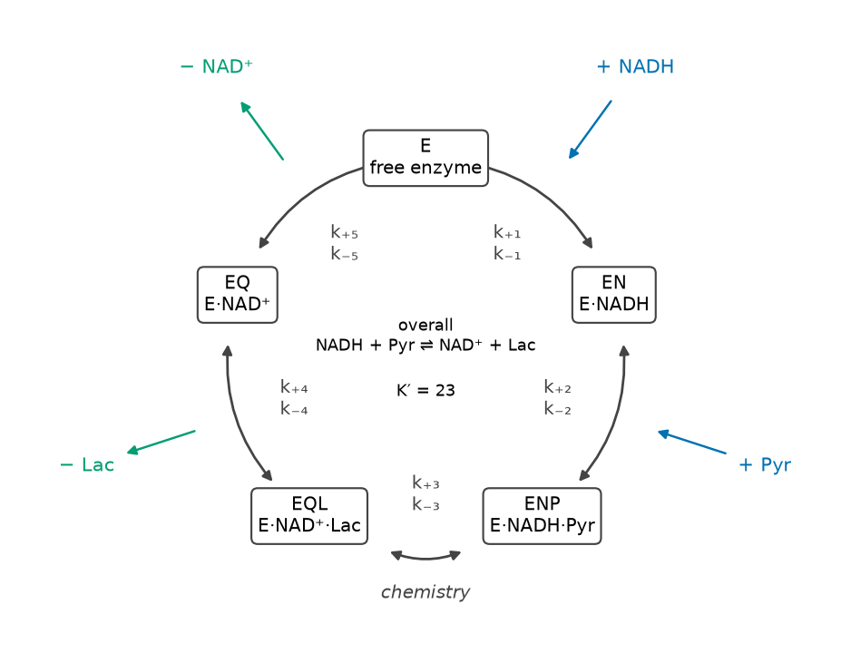
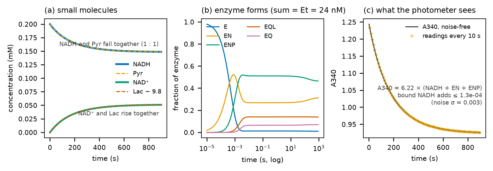
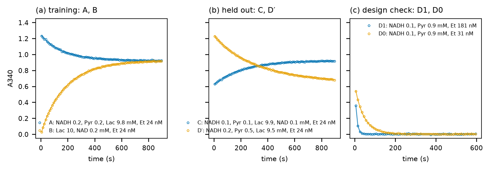
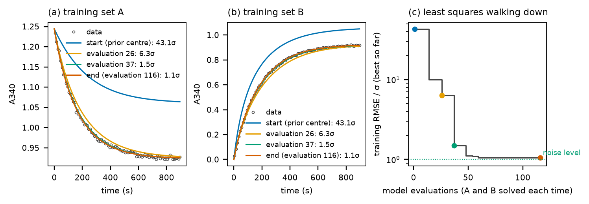
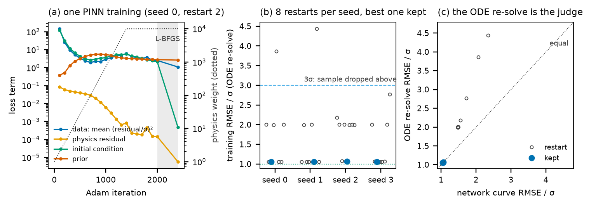
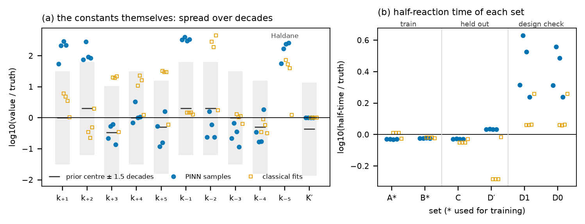
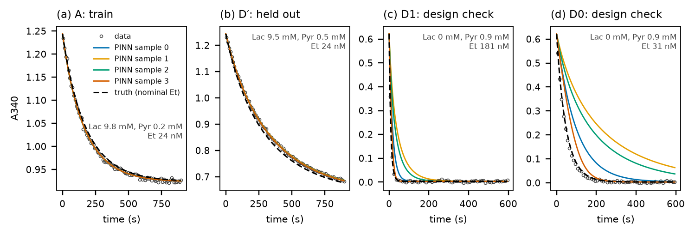
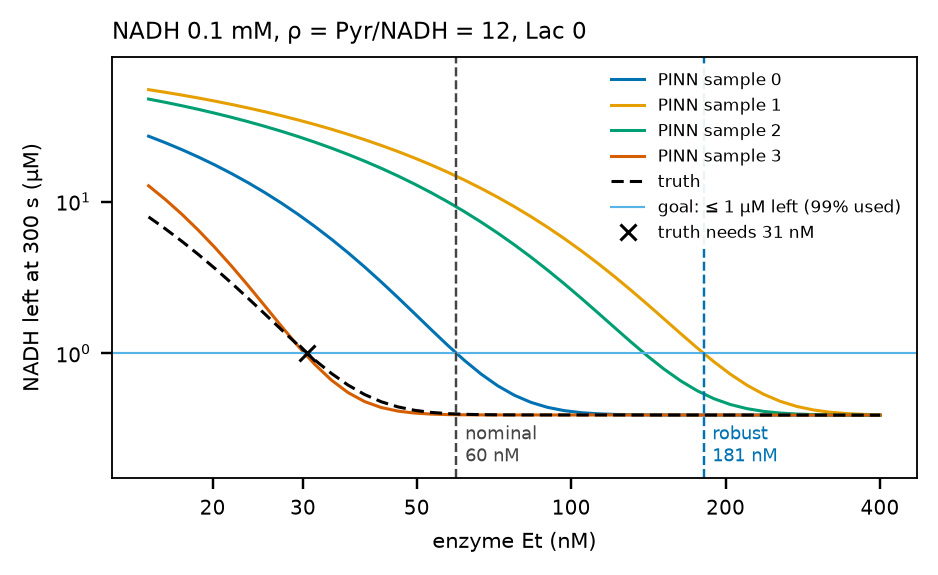
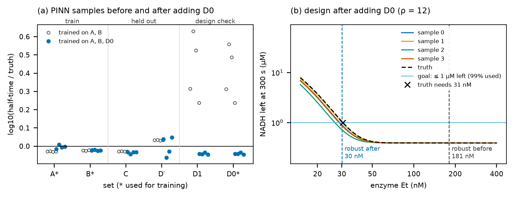

# 속도 상수 식별: 진행 곡선과 반응식에서 속도 상수 표본까지

enzopt의 ③ 식별 단계는 반응식과 A340 진행 곡선으로 속도 상수를 찾습니다. 이 문서는 그 과정을 합성 LDH 예제(`projects/example_ldh_synth`)로 한 단계씩 보여 줍니다.

합성 예제는 정답 상수를 정해 놓고 만든 데이터입니다. 정답은 `data/truth.json`에 있고 파이프라인은 이 파일을 읽지 않습니다. 그래서 도구가 찾은 값을 정답과 나란히 놓아 볼 수 있습니다.

그림은 `scripts/identification_figures.py`가 실행 폴더 하나에서 그립니다(맨 끝 "다시 그리기" 참고). 그림 속 글자는 도구의 다른 그림처럼 영어입니다. 숫자는 이 문서를 쓸 때의 실행 `runs/example_ldh_synth/2026-10-11_1041` 기준입니다.

그림을 넣은 HTML 판은 `docs/IDENTIFICATION.html`입니다. 파일 하나에 그림이 모두 들어 있어 브라우저로 바로 열 수 있습니다. 원본은 이 Markdown 파일이고, `scripts/build_guide_html.py --page identification`이 HTML로 바꿉니다.

| 절 | 질문 | 그림 |
|---|---|---|
| 1 | 반응식은 무엇을 정하나 | 1 |
| 2 | 상수를 알면 곡선은 어떻게 되나(정문제) | 2 |
| 3 | 무엇을 재나 | 3 |
| 4 | 곡선에서 상수로(역문제) | 4 |
| 5 | PINN은 이 문제를 어떻게 푸나 | 5 |
| 6 | 데이터가 정하는 것과 못 정하는 것 | 6, 7 |
| 7 | 표본에서 설계로 | 8 |
| 8 | 설계 조건을 재서 다시 학습하기 | 9 |

---

## 1. 반응식: 무엇을 찾는가



반응식은 효소가 어떤 순서로 무엇과 붙고 떨어지는지를 정합니다. 예제의 반응식은 5단계입니다(`project.yaml`의 `network.steps`).

```
1  E   + NADH ⇌ EN          v₁ = k₊₁[E][NADH] − k₋₁[EN]
2  EN  + Pyr  ⇌ ENP         v₂ = k₊₂[EN][Pyr] − k₋₂[ENP]
3  ENP        ⇌ EQL         v₃ = k₊₃[ENP]     − k₋₃[EQL]
4  EQL        ⇌ EQ  + Lac   v₄ = k₊₄[EQL]     − k₋₄[EQ][Lac]
5  EQ         ⇌ E   + NAD   v₅ = k₊₅[EQ]      − k₋₅[E][NAD]
```

- **단계 속도:** 각 단계의 속도는 질량 작용 법칙을 따릅니다. 정방향 상수 × 왼쪽 농도의 곱에서 역방향 상수 × 오른쪽 농도의 곱을 뺍니다.
- **농도 변화:** 각 물질의 농도 변화는 단계 속도의 합입니다. 예를 들어 d[NADH]/dt = −v₁, d[EN]/dt = v₁ − v₂, d[E]/dt = v₅ − v₁입니다. 물질 9개에 대한 미분방정식 9개가 생깁니다.
- **열역학 제약:** 고리를 한 바퀴 돌면 전체 반응 NADH + Pyr ⇌ NAD⁺ + Lac이 됩니다. 그 평형 상수 K′ = [Lac][NAD⁺]/([Pyr][NADH])가 상수들을 묶습니다(Haldane 관계).
  - k₋₅ = k₊₁k₊₂k₊₃k₊₄k₊₅ / (k₋₁k₋₂k₋₃k₋₄ · K′)
  - 그래서 k₋₅는 따로 찾지 않습니다.
- **찾을 값:** k₊₁~k₊₅, k₋₁~k₋₄, K′의 10개입니다. 계산은 log10 값으로 합니다.
- **사전분포:** 문헌 자릿수를 중심으로 둡니다(k₊: 10⁴, 10⁴, 10², 10³, 10², k₋: 10², 10³, 10³, 10², K′: 10). 표준편차는 1.5 자릿수입니다.
- **관측식:** 분광광도계가 보는 것은 A340 = 6.22 × ([NADH] + [EN] + [ENP])입니다. 340 nm 흡광 계수가 6.22 /mM/cm이고 큐벳 길이가 1 cm입니다. NADH는 효소에 붙어 있어도 빛을 흡수합니다.

코드 위치: 반응망과 질량 작용 식은 `core/network.py`·`core/massaction.py`, 열역학 제약은 `core/thermo.py`입니다.

## 2. 정문제: 상수를 알면 곡선이 정해진다



속도 상수 10개와 처음 농도를 정하면 미분방정식의 해가 하나로 정해집니다. 그림 2는 세트 A(NADH 0.2, Pyr 0.2, 젖산 9.8 mM, 효소 24 nM)를 정답 상수로 scipy(Radau)로 푼 결과입니다.

- **(a) 작은 분자:** NADH와 Pyr은 1 : 1로 0.2에서 0.149 mM까지 줄고 거기서 멈춥니다. 젖산이 이미 많아 평형에 닿았기 때문입니다. (9.851 × 0.051)/(0.149 × 0.149) ≈ 23 = K′입니다.
- **(b) 효소 형태:** 0.01초 안에 효소 형태의 비율이 정해지고, 그 뒤에는 기질이 줄어드는 만큼만 천천히 바뀝니다(준정상 상태). 효소 형태는 이렇게 빨리 정해지는데 전체 반응은 수백 초에 걸쳐 진행됩니다. 이 시간 척도 차이 때문에 효소 형태까지 신경망으로 배우게 하면 문제가 강성해져 학습이 되지 않습니다. 그래서 PINN은 효소 형태를 준정상 식으로 계산합니다(근거: `docs/pinn_representation/`).
- **(c) 광도계가 보는 것:** 물질 9개 가운데 A340 하나만 보입니다. 효소에 붙은 NADH의 기여는 1.3×10⁻⁴ 이하로, 측정 잡음 σ = 0.003보다 20배 작습니다. 사실상 자유 NADH 곡선 하나를 보는 셈입니다. 상수 10개를 곡선 하나로 정해야 한다는 점이 6절에서 보는 식별 불가능의 뿌리입니다.

## 3. 측정 데이터



세트마다 역할이 있습니다(`project.yaml`의 `role`).

| 세트 | 처음 농도(mM) | 효소(nM) | 역할 |
|---|---|---|---|
| A | NADH 0.2, Pyr 0.2, 젖산 9.8 | 24 | 학습: 상수를 찾는 데 씀 |
| B | NAD⁺ 0.2, 젖산 10 | 24 | 학습: 역방향 반응 |
| C | NADH 0.1, Pyr 0.1, 젖산 9.9, NAD⁺ 0.1 | 24 | 홀드아웃: 학습에 안 쓰고 예측을 시험 |
| D′ | NADH 0.2, Pyr 0.5, 젖산 9.5 | 24 | 홀드아웃: 학습 범위 밖 피루브산 |
| D1 | NADH 0.1, Pyr 0.9, 젖산 0 | 181 | 설계 확인: 설계 조건에서 잰 확인 실험 |
| D0 | NADH 0.1, Pyr 0.9, 젖산 0 | 31 | 설계 확인 |

합성 데이터에는 실제 실험에서 생기는 오차를 넣었습니다(`evals/synthetic.yaml`).

- 측정 잡음 σ = 0.003
- 세트마다 실제 효소량이 명목값과 다릅니다. 배율은 A 1.07, B 1.06, C 0.93, D′ 0.91, D1 1.04, D0 1.08입니다.
- 시작 시각이 ±1초 어긋나 있고, 기준선이 조금씩 표류합니다.

**눈여겨볼 점:** 학습 세트 A·B는 젖산이 모두 약 10 mM입니다. 반면 설계 확인 세트와 설계 조건은 젖산이 0 mM입니다. 이 차이가 6~8절의 결과를 좌우합니다.

## 4. 역문제: 곡선에서 상수로



정문제는 상수 → 곡선입니다. 식별은 그 반대인 곡선 → 상수입니다. 먼저 가장 단순한 방법인 고전 피팅으로 원리를 봅니다.

1. 상수를 추측합니다. 그림에서는 사전분포 중심에서 출발합니다.
2. 그 상수로 미분방정식을 풀어 학습 세트의 A340을 계산합니다.
3. 계산값과 측정값의 차이를 σ 단위로 잽니다.
4. 차이가 줄어드는 방향으로 상수를 고칩니다(scipy `least_squares`, 신뢰 영역법). 사전분포에서 멀어지면 작은 벌점이 붙습니다.
5. 더 줄지 않을 때까지 2~4를 되풀이합니다.

그림 4에서는 학습 RMSE가 다음과 같이 줄었습니다. 평가 한 번은 A와 B를 각각 한 번씩 푸는 것이고, 미분 계산용 평가도 셉니다.

| 평가 | 학습 RMSE |
|---|---|
| 1 (출발) | 43σ |
| 26 | 6.3σ |
| 37 | 1.5σ |
| 116 | 1.06σ |

모두 153번 평가했습니다.

- **곡선은 맞지만 상수는 다릅니다.** 찾은 상수는 정답과 0.33~2배 다릅니다(k₊₂ 2.0배, k₊₃ 0.35배, k₋₄ 0.33배 등). 곡선은 잡음 수준으로 맞았는데도 그렇습니다. 6절에서 이유를 봅니다.
- **1.0σ가 아니라 1.06σ인 이유:** 세트마다 다른 효소량 오차와 시작 시각 오차는 상수로 완전히 흡수할 수 없습니다.
- **파이프라인에서의 쓰임:** 파이프라인은 같은 피팅을 시작점 4개로 돌려 PINN과 비교하는 기준선으로 씁니다(`pipeline/compare.py`의 `classical_fit`). 이번 실행에서는 4개 중 3개가 다른 지역 최소에 멈췄습니다. 학습 RMSE는 1.7~2.0σ였습니다.

## 5. PINN은 이 문제를 어떻게 푸나



고전 피팅은 상수를 바꿀 때마다 미분방정식을 다시 풉니다. PINN(physics-informed neural network)은 곡선을 신경망으로 직접 그립니다.

- **신경망이 그리는 것:** 실험마다 작은 신경망(폭 32, 깊이 3)이 반응 진행도 ξ(t)를 그립니다.
  - 작은 분자 농도 = 처음 농도 + 화학량론 × ξ입니다. 보존 법칙이 식 안에 들어 있습니다.
  - 효소 형태는 2절의 준정상 식으로 계산합니다.
- **손실 = 데이터 항 + w × 물리 항 + 초기 조건 항 + 사전분포 항:**
  - **데이터 항:** 신경망 곡선의 A340이 측정점을 지나는가. 평균 (잔차/σ)²입니다.
  - **물리 항:** 신경망 곡선의 기울기 dξ/dt가 반응식과 지금의 속도 상수가 주는 속도와 같은가. 시간 축의 배치점마다 잽니다.
  - **초기 조건 항:** ξ(0) = 0인가.
  - **사전분포 항:** 상수가 문헌 자릿수에서 얼마나 떨어졌나.
- **학습 순서:** 신경망과 속도 상수를 함께 학습합니다. Adam 2000회 동안 물리 가중치 w를 1에서 10⁴까지 올리고(처음 70% 동안), 이어서 L-BFGS 300회를 돌립니다.

그림 읽기:

- **(a) 학습 한 번:** 처음에는 데이터에 맞추고(데이터 항 150 → 3), 물리 가중치가 오르면서 물리 잔차를 10⁻⁵까지 줄입니다. 끝에서 데이터 항이 1.1이므로 학습 RMSE ≈ 1.05σ입니다.
- **(b) 재시작:** 시드마다 출발점을 바꿔 8번 학습합니다. 각 해의 상수로 미분방정식을 다시 풀어 학습 RMSE를 재고, 가장 낮은 해를 그 시드의 표본으로 고릅니다.
  - 재시작의 상당수가 2.0σ 지역 최소에 멈춥니다. 재시작이 필요한 이유입니다.
  - 고른 해도 3σ를 넘으면 표본에서 뺍니다.
- **(c) 판정은 미분방정식으로:** 점이 대각선 위에 있으면 신경망이 반응식을 정확히 따른 것입니다.
  - 2σ 무리는 신경망 곡선으로는 1.5σ인데, 그 상수로 다시 풀면 2.0σ입니다. 신경망 곡선만 보면 실제보다 잘 맞는 것처럼 보일 수 있습니다.
  - 그래서 표본 선택과 제외는 항상 미분방정식 재해석으로 합니다.

시드 4 × 재시작 8 = 32회를 GPU에서 한꺼번에 학습하며, 이 실행에서 7.8초 걸렸습니다.

코드 위치: `pinn/general.py`(`GeneralPinn.loss`, `train_pinn`), `pipeline/fit.py`(`best_restarts`). 구조 그림은 안내서 그림 D(`../guide/pinn_scheme.svg`)에 있습니다.

## 6. 데이터가 정하는 것과 못 정하는 것



**(a) 상수 자체는 자릿수 단위로 흩어집니다.**

- **k₊₁·k₋₁:** PINN 표본 4개 모두 k₊₁이 정답의 54~291배, k₋₁이 300~400배입니다. 그런데도 학습 데이터에 1.06σ로 맞습니다.
- **비율은 가깝습니다:** 둘의 비율 k₋₁/k₊₁(NADH 해리 상수)은 정답 0.005 mM의 1~6배입니다. 결합이 충분히 빠르면 결합·해리 속도 각각은 곡선에 드러나지 않고, 비율만 드러납니다.
- **고전 피팅:** 4개 중 3개는 PINN과 다른 영역에 모였습니다.
- **K′:** 모든 모델이 23.0~23.5로 맞췄습니다. 평형 위치는 곡선의 끝값으로 직접 보이기 때문입니다.
- **사전분포 밖 표본:** 사전분포는 부드러운 벌점이라, 데이터가 원하면 막대 밖으로 나갑니다.

**(b) 곡선으로 보이는 양은 학습 조건 근처에서만 모입니다.**

여기서는 반응 절반 시간(A340 변화가 절반에 이르는 시간)을 봅니다. 0선은 명목 효소량으로 계산한 정답입니다.

- **학습 A·B:** PINN 표본은 모두 같은 값(−0.03 자릿수, 절반 시간 7% 짧음)을 냅니다. 실제 데이터의 효소량이 명목보다 6~7% 많아 정답 곡선보다 빨랐기 때문입니다. 지역 최소에 멈춘 고전 피팅 3개는 A에서 +0.01로 조금 어긋납니다.
- **홀드아웃 C·D′:** PINN 표본은 모여 있습니다. 고전 피팅 3개는 D′의 절반 시간을 48% 짧게 예측해 D′ RMSE가 0.13입니다.
- **설계 확인 D1·D0(젖산 0):** PINN 표본이 절반 시간을 정답의 1.7~4.3배로 예측합니다. 표본이 갈립니다.



곡선으로 봐도 같습니다. A와 D′에서는 네 표본이 겹치고, 젖산 0인 D1·D0에서는 갈립니다. 표본 3만 D0에 가깝습니다.

학습 세트는 모두 젖산이 약 10 mM입니다. 그래서 젖산이 없을 때의 거동은 학습 데이터가 정하지 못하고, 표본마다 다르게 정해집니다.

**표본의 뜻:** 표본은 "데이터에 맞는 상수 묶음"의 예이고, 표본들의 퍼짐이 곧 불확실성입니다. PINN 설정(예: 범위 여유 0%와 5%)을 바꾸면 어느 표본이 뽑히는지는 바뀌지만 이 퍼짐은 사라지지 않습니다. 여유 0%에서도 표본 하나는 D0를 0.19만큼 빗나갔습니다.

## 7. 표본에서 설계로



⑤ 설계의 목표는 NADH 0.1 mM을 300초 안에 99% 소모하는 것, 곧 1 µM 이하로 남기는 것입니다.

- **표본별 최소 효소량:** 표본마다 효소량을 바꿔 가며 300초 뒤 남는 NADH를 계산합니다. 곡선이 목표선을 지나는 효소량이 그 표본이 요구하는 최소 효소량입니다.
- **공칭 설계(첫 표본만 만족):** 60 nM입니다. 이 양에서는 표본 2개가 목표에 못 미칩니다(최악 전환율 85%).
- **강건 설계(모든 표본 만족):** 181 nM입니다. 표본 1이 이 값을 정합니다.
- **정답이 필요로 하는 양:** 31 nM입니다. 강건 설계는 안전하지만 6배 많이 씁니다. 6절에서 본 퍼짐의 값입니다.
- **바닥 0.38~0.4 µM:** 효소를 늘려도 줄지 않는 값입니다. ρ = 12에서 평형 때문에 남는 NADH입니다(평형 한계, 안내서 그림 5d).

코드 위치: `core/design.py`(`AssayDesign`, `min_Et`), `pipeline/design.py`.

## 8. 설계 조건을 재서 다시 학습하기



6절의 퍼짐을 줄이는 방법은 설계에 쓸 조건을 직접 재서 학습에 넣는 것입니다. 그림 9는 D0(젖산 0, Pyr 0.9 mM, 효소 31 nM)를 학습에 넣고 같은 설정으로 PINN을 다시 학습한 결과입니다.

- **(a) 젖산 0 조건이 좁아졌습니다.** D1·D0의 절반 시간이 정답의 1.7~4.3배(+0.24~+0.63 자릿수)였는데, 이제 네 표본 모두 8~10% 짧은 값(−0.03~−0.05 자릿수)으로 모였습니다.
  - 대신 D′는 −0.06~+0.05 자릿수로 조금 벌어졌습니다.
  - 학습 재현도 A·B 1.1~1.6σ로 조금 나빠졌습니다(전에는 1.06σ). 세 세트를 한꺼번에 맞추느라 생긴 일입니다.
- **(b) 강건 효소량이 181 nM에서 30.2 nM로 내려갔습니다.**

**주의: 30.2 nM는 정답이 필요로 하는 30.6 nM보다 1% 적습니다.**

- **이유:** D0를 잴 때 실제 효소량이 명목보다 8% 많았습니다. 모든 표본이 이 차이를 "반응이 빠르다"로 흡수해서, D1·D0의 절반 시간을 9% 짧게 봅니다.
- **강건 설계가 덮지 못하는 것:** 강건 설계는 표본 사이의 퍼짐은 덮지만, 모든 표본이 같은 방향으로 치우친 오차는 덮지 못합니다. 피펫 오차 같은 효소량 오차가 그렇습니다.
- **실제 실험에서는:** 효소량 오차만큼 여유를 두거나, 확인 실험으로 확인해야 합니다.

**파이프라인에서 하는 법:** 확인 실험 결과를 `project.yaml`에서 `role: train`으로 바꾸고 `enzopt run`을 다시 실행합니다(안내서 흐름도의 확인 실험 고리). 설계에 쓸 조건은 학습 세트에 넣어 재야 그 조건에서 표본이 좁아진다는 점은 README의 일반 반응망 시험 결과와 같은 결론입니다.

## 용어와 코드 위치

| 용어 | 뜻 | 코드 |
|---|---|---|
| 정문제 | 상수와 처음 농도로 곡선을 계산 | `core/massaction.py` `simulate` |
| 역문제(식별) | 곡선에 맞는 상수를 찾기 | `pipeline/fit.py`, `pipeline/compare.py` |
| 학습 RMSE / σ | 학습 세트의 측정과 계산의 차이를 잡음 σ로 나눈 값. 1이면 잡음 수준 | `pipeline/common.py` `rmse` |
| ODE 재해석 | PINN이 찾은 상수로 미분방정식을 다시 풀어 검사 | `pipeline/fit.py` |
| 재시작 | 같은 시드를 다른 출발점에서 다시 학습해 가장 잘 맞는 해를 고름 | `pipeline/fit.py` `best_restarts` |
| 표본 | 데이터에 맞는 상수 묶음 하나(시드마다 하나) | `runs/.../3_fit/samples/` |
| 식별 불가능 | 데이터에 똑같이 맞는 상수 묶음이 여럿 있음 | 안내서 2.1절 |
| 공칭·강건 설계 | 첫 표본만 / 모든 표본이 목표를 만족하는 최소 효소량 | `core/design.py` `min_Et` |

## 다시 그리기

```
uv run enzopt run projects/example_ldh_synth
uv run python scripts/identification_figures.py --run runs/example_ldh_synth/<실행 폴더>
uv run python scripts/build_guide_html.py --page identification
```

- 그림 1~3, 5~8은 실행 폴더와 정답 파일에서 바로 그립니다.
- 그림 4는 고전 피팅을 한 번 다시 돌립니다(약 1분).
- 그림 9는 PINN을 한 번 더 학습합니다(GPU 약 10초, CPU 약 2분).
- `--only inverse loop`처럼 일부만 그릴 수 있습니다.
- 두 번째 명령이 그림을 넣은 HTML 판 `docs/IDENTIFICATION.html`을 다시 만듭니다.

같은 GPU에서는 다시 실행해도 숫자가 같았습니다. 다른 장치나 정밀도(CPU float64)에서는 표본이 달라질 수 있고, 그러면 6~8절의 숫자도 달라집니다.
