# 효소의 숨은 속도 찾기: 처음부터 차근차근

> 빛으로 잰 곡선과 반응식만으로 효소 반응의 숨은 속도(속도 상수)를 찾고, 그 답으로 실험 조건을 정하는 과정을 배경지식부터 설명합니다.

## 이 글에서 하는 일

효소는 아주 작은 일꾼입니다. 너무 작아서 일하는 모습을 직접 볼 수 없습니다. 볼 수 있는 것은 컵 속 물질의 양이 시간에 따라 바뀌는 모습뿐입니다. 그것도 눈이 아니라 빛으로 잽니다.

이 글은 그 모습에서 거꾸로 일꾼이 얼마나 빠르게 일하는지 알아내는 과정을 설명합니다. 그리고 그 답으로 "일꾼을 몇 명 넣어야 5분 안에 일이 끝날까"를 정하는 데까지 갑니다.

| 순서 | 하는 일 | 비유 |
|---|---|---|
| 1 | 반응식 쓰기: 효소가 어떤 순서로 일하는지 적기 | 요리 순서 적기 |
| 2 | 빛으로 재기: 10초마다 NADH 양을 잼 | 10초마다 사진 찍기 |
| 3 | 정문제: 속도를 알 때 곡선 계산하기 | 레시피대로 케이크 굽기 |
| 4 | 역문제: 곡선에서 속도 찾기 | 케이크를 보고 레시피 맞히기 |
| 5 | 표본: 답이 여럿이면 여러 개를 모두 남기기 | 탐정 여럿의 추리를 다 들어 보기 |
| 6 | 설계: 모든 답에서 성공하도록 조건 정하기 | 예보 하나라도 비가 오면 우산 챙기기 |

**읽는 순서**

- **1부 배경지식(그림 B1~B9):** 필요한 기초를 하나씩 설명합니다. 이미 아는 부분은 건너뛰어도 됩니다.
- **2부 예제로 따라가기(그림 1~9):** 실제 예제로 위의 여섯 순서를 따라갑니다.
- **3부 실제 데이터로 해 보기(그림 10~13):** 논문에 공개된 실제 측정(효소로 항생제 만들기)으로 같은 순서를 밟습니다. 정답이 없는 데이터, 일하다 망가지는 효소, 맞는지 모르는 반응식을 다루고, 반응식에 빠진 단계를 데이터로 찾는 법과 "언제 멈추나"를 정하는 설계를 봅니다.
- **4부 정리**, **용어 사전**, **부록**(코드 위치와 수식)이 이어집니다.

그림 속 글자는 이 도구의 다른 그림처럼 영어로 되어 있습니다. 그 뜻은 그림 아래 글에서 모두 풀어 씁니다.

2부의 예제는 `projects/example_ldh_synth`입니다. 정답을 정해 놓고 컴퓨터로 만든 데이터라서, 찾은 답을 정답과 비교해 볼 수 있습니다. 정답은 `data/truth.json`에 있고, 도구는 이 파일을 읽지 않습니다. 3부의 예제는 `projects/aeh_cephalexin_lagerman2021`(실제 측정)입니다.

---

## 1부. 배경지식

### 1. 분자와 농도

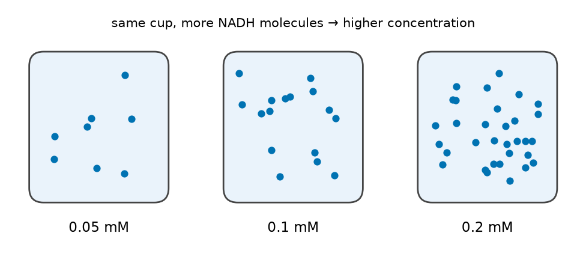

모든 물질은 눈에 보이지 않을 만큼 작은 알갱이인 **분자**로 되어 있습니다. 설탕물을 생각해 보세요. 설탕 분자가 물속에 골고루 흩어져 있습니다.

**농도**는 같은 양의 물에 분자가 얼마나 많이 들어 있는지를 나타냅니다. 설탕을 많이 넣으면 "진하다", 적게 넣으면 "연하다"고 하지요. 그림 B1처럼 컵 크기는 같고 점(분자)이 많을수록 농도가 높습니다.

**단위 mM(밀리몰 농도)**

- 분자는 너무 작아서, 물 1 L에 들어 있는 개수가 엄청나게 큽니다. 1 mM이면 물 1 L에 약 6×10²⁰개(6 뒤에 0이 20개)가 들어 있습니다.
- 그래서 연필 12자루를 "1다스"로 묶어 세듯, 분자도 큰 묶음 단위(몰)로 셉니다.
- **nM(나노몰 농도)**은 mM의 100만분의 1입니다.

예제에서 NADH는 0.2 mM이고 효소는 24 nM입니다. NADH가 효소보다 약 8,000배 많습니다. 효소는 한 번 일하고 사라지지 않고 같은 일을 계속 되풀이하기 때문에, 이렇게 적어도 됩니다. 예제에서 효소 분자 하나는 15분 동안 약 2,000번 일합니다.

### 2. 화학 반응

**화학 반응**은 분자끼리 만나 원자를 주고받아 다른 분자로 바뀌는 일입니다. 이 글의 반응은 다음과 같습니다.

```
NADH + 피루브산  →  NAD⁺ + 젖산
```

- **피루브산(Pyr):** 우리 몸이 포도당(당)을 쪼갤 때 생기는 물질입니다.
- **젖산(Lac):** 격하게 운동할 때 근육에 생기는 물질입니다.
- **NADH와 NAD⁺:** 세포 안에서 수소를 나르는 "배달 트럭"입니다. NADH는 짐(수소)을 실은 트럭이고, NAD⁺는 빈 트럭입니다. NADH가 피루브산에 수소를 건네면 NADH는 빈 트럭(NAD⁺)이 되고, 피루브산은 젖산이 됩니다.

이 반응은 거꾸로도 일어납니다. 젖산과 NAD⁺가 만나 피루브산과 NADH가 될 수도 있습니다. 그래서 화살표를 양쪽으로 그립니다(⇌).

### 3. 효소: 반응을 돕는 일꾼

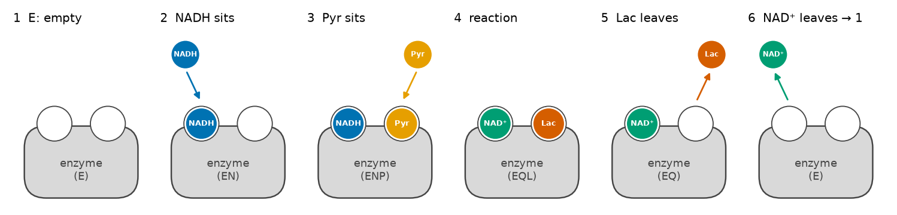

**효소**는 단백질로 된 아주 작은 기계입니다. 혼자 두면 아주 느린 반응을 엄청나게 빠르게 해 줍니다. 이 반응을 돕는 효소의 이름은 **LDH**(젖산 탈수소효소)입니다.

효소는 정해진 순서로 일합니다(그림 B2).

1. **빈 효소(E):** 두 자리가 비어 있습니다.
2. **NADH가 앉습니다(EN).**
3. **피루브산이 앉습니다(ENP).**
4. **효소 위에서 반응합니다(EQL).** NADH의 수소가 피루브산으로 옮겨 가서, NAD⁺와 젖산이 됩니다.
5. **젖산이 떠납니다(EQ).**
6. **NAD⁺가 떠납니다.** 효소는 다시 1번(빈 효소)으로 돌아가 다음 일을 시작합니다.

괄호 속 이름은 효소가 무엇을 붙잡고 있는지 나타냅니다. E는 효소(enzyme), N은 NADH, P는 피루브산, L은 젖산, Q는 NAD⁺를 뜻하는 기호입니다. 이 다섯 장면이 한 바퀴 도는 고리라서 "반응 고리"라고 부릅니다. 각 장면은 거꾸로도 갈 수 있습니다. 예를 들어 앉았던 NADH가 그냥 다시 떨어질 수도 있습니다.

> **한 줄 정리:** 반응식은 효소가 "무엇을, 어떤 순서로" 붙잡고 놓는지 적은 일의 순서표입니다.

### 4. 반응 속도와 속도 상수

**반응 속도**는 1초 동안 물질이 얼마나 바뀌는지입니다.

> **비유:** 운동장에 아이들이 많을수록 짝을 짓는 일이 자주 일어납니다. 그런데 아이 수가 같아도, 짝을 잘 짓는 성격인지에 따라 짝 짓는 횟수가 다릅니다. 이 "짝을 잘 짓는 성격"에 해당하는 숫자가 **속도 상수**입니다.

반응 고리의 각 단계도 같습니다.

```
1단계 속도 = k₊₁ × [빈 효소 농도] × [NADH 농도]  −  k₋₁ × [EN 농도]
              (앉는 쪽)                              (떨어지는 쪽)
```

- **k₊(앞으로 가는 상수):** 앉거나 반응하는 쪽의 속도 상수입니다.
- **k₋(거꾸로 가는 상수):** 떨어지거나 되돌아가는 쪽의 속도 상수입니다.
- **개수:** 단계가 5개이고 단계마다 둘씩 있어서, 모두 10개입니다(k₊₁~k₊₅, k₋₁~k₋₅).
- **단위:** 단위는 몰라도 괜찮습니다. **숫자가 클수록 그 일이 빨리 일어난다**는 것만 기억하면 됩니다.

속도 상수를 모두 알면 반응이 어떻게 진행될지 미리 계산할 수 있습니다. 문제는 **속도 상수를 직접 잴 수 없다**는 것입니다. 이 글 전체가 "그러면 어떻게 알아내나"에 관한 이야기입니다.

### 5. 평형: 겉보기에 멈춘 상태

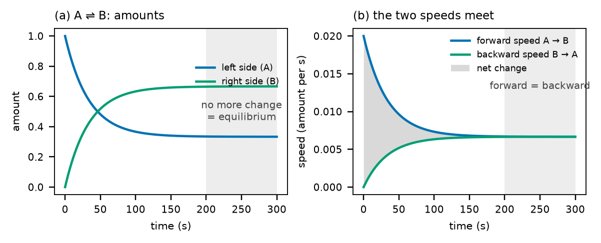

처음에 A만 있으면 A → B만 일어납니다. B가 생기기 시작하면 B → A도 일어납니다.

- **앞으로 가는 속도:** A가 줄어드니 점점 느려집니다.
- **거꾸로 가는 속도:** B가 늘어나니 점점 빨라집니다.
- **평형:** 두 속도가 같아지면 양이 더 바뀌지 않습니다. 이 상태가 **평형**입니다.

> **비유:** 팽팽한 줄다리기입니다. 양쪽 모두 힘을 주고 있지만 줄은 움직이지 않습니다. 평형에서도 반응은 멈춘 것이 아니라, 양쪽으로 같은 속도로 오가고 있습니다.

**평형 상수 K**는 평형에 닿았을 때 오른쪽 물질과 왼쪽 물질의 비율입니다.

- 이 글의 반응에서는 K′ = [젖산]×[NAD⁺] ÷ ([피루브산]×[NADH]) = 23입니다.
- 1보다 훨씬 크므로, 이 반응은 오른쪽(젖산 쪽)을 좋아합니다.

평형 상수는 속도 상수들과 묶여 있습니다. 반응 고리를 한 바퀴 돌면 전체 반응이 되기 때문입니다. 그래서 속도 상수 10개 가운데 하나(k₋₅)는 나머지 9개와 K′로 저절로 정해집니다(이를 "Haldane 관계"라고 부릅니다). 실제로 찾아야 하는 것은 속도 상수 9개와 K′, 모두 10개입니다.

### 6. 빛으로 NADH 재기

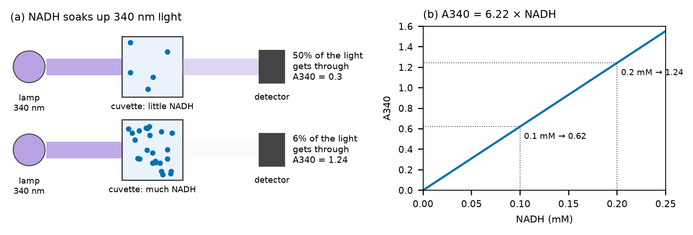

NADH는 눈에 보이지 않는 **340 nm 빛**(자외선)을 빨아들입니다. NAD⁺는 이 빛을 빨아들이지 않습니다. 그래서 340 nm 빛으로 재면 NADH만 골라 잴 수 있습니다.

**분광광도계**는 시료에 빛을 비추고, 반대편으로 통과한 빛이 얼마나 되는지 재는 기계입니다.

> **비유:** 선글라스 렌즈가 진할수록 빛이 덜 통과하는 것과 같습니다. NADH가 많을수록 340 nm 빛이 덜 통과합니다.

**흡광도 A340**은 빛이 얼마나 막혔는지를 나타내는 숫자입니다.

- A340이 1 커질 때마다 통과하는 빛이 10분의 1로 줄어듭니다.
- 길이 1 cm인 큐벳에서는 **A340 = 6.22 × NADH 농도(mM)**입니다(그림 B4 (b)).
- 그래서 A340을 6.22로 나누면 NADH 농도가 나옵니다. 예를 들어 0.2 mM이면 A340은 1.24입니다.

효소에 앉아 있는 NADH(EN, ENP)도 빛을 빨아들이지만, 효소 양이 아주 적어서 그 몫은 무시할 만큼 작습니다.

### 7. 그래프 읽기: 진행 곡선

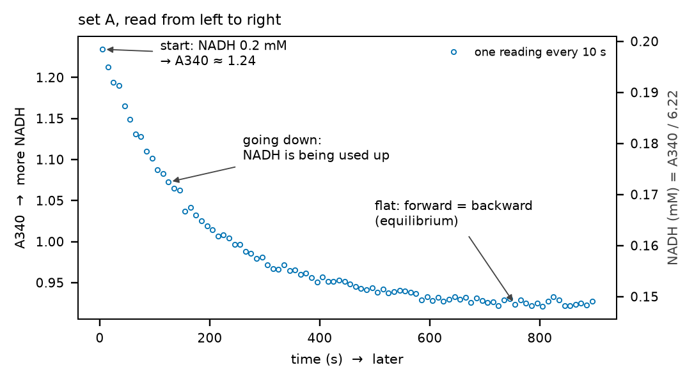

**진행 곡선**은 반응이 진행되는 모습을 그린 그래프입니다.

- **가로축(시간):** 오른쪽으로 갈수록 나중입니다.
- **세로축(A340):** 위로 갈수록 NADH가 많습니다. 오른쪽 세로축에는 같은 값을 NADH 농도(mM)로 바꿔 적었습니다.
- **점:** 10초마다 한 번씩 잰 값입니다.

그림 B5는 왼쪽에서 오른쪽으로 이렇게 읽습니다.

1. **처음:** NADH 0.2 mM이라 A340이 약 1.24입니다.
2. **내려감:** 효소가 NADH를 쓰고 있습니다.
3. **평평해짐:** 앞으로 가는 속도와 거꾸로 가는 속도가 같아졌습니다(평형). NADH가 0까지 내려가지 않고 0.15 mM에서 멈춘 이유는, 컵에 젖산이 이미 많이(9.8 mM) 있어서 거꾸로 가는 반응도 세기 때문입니다.

**곡선의 기울기**(얼마나 가파른지)가 그 순간의 반응 속도입니다. 처음에 가장 가파르고, 점점 완만해집니다.

### 8. 측정에는 흔들림이 있다: 잡음, σ, RMSE

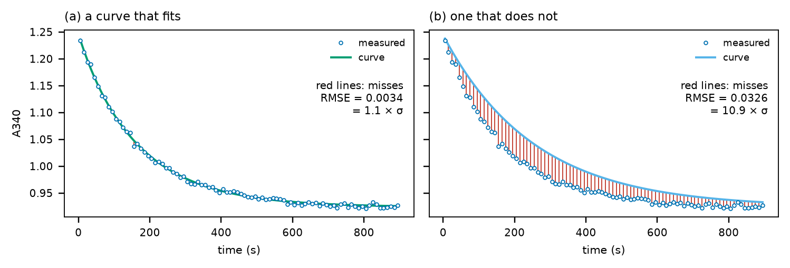

같은 것을 여러 번 재도 값이 조금씩 다르게 나옵니다. 키를 여러 번 재면 조금씩 다른 것과 같습니다. 이 흔들림을 **잡음**이라고 합니다.

- **σ(시그마):** 잡음의 보통 크기입니다. 예제에서는 0.003입니다. A340 1.24에 비하면 0.2% 정도의 흔들림입니다.
- **RMSE:** 곡선이 측정점에서 평균적으로 얼마나 빗나가는지입니다(그림의 빨간 선 길이의 평균과 비슷합니다).
- **RMSE ÷ σ:** "잡음 몇 개만큼 빗나갔나"를 나타냅니다.
  - **1 근처:** 잡음만큼만 빗나간 것입니다. 이보다 더 잘 맞출 수는 없습니다. 실제로 정답 곡선도 1.1입니다(그림 B6 (a)).
  - **10 이상:** 확실히 틀린 곡선입니다(그림 B6 (b)).

이 글에서 "1.06σ로 맞았다"는 말은 "잡음 수준으로 거의 완벽하게 맞았다"는 뜻입니다.

### 9. 계산으로 미래 예측하기: 미분방정식과 시뮬레이션

지금 각 물질의 양과 속도 상수를 알면 **지금의 속도**를 알 수 있습니다(4절의 식). 속도를 알면 아주 잠깐 뒤의 양도 알 수 있습니다.

```
0.001초 뒤의 양 = 지금 양 + 지금 속도 × 0.001초
```

이 계산을 아주 작은 걸음으로 수없이 되풀이하면 몇 분 뒤의 모습까지 알 수 있습니다. 이렇게 계산으로 미래를 그려 보는 것을 **시뮬레이션**이라고 합니다. 이런 규칙을 수학으로 적은 것이 **미분방정식**입니다.

> **비유:** 저금통에 매일 넣는 돈과 꺼내는 돈을 알면, 오늘 금액에서 시작해 하루씩 더해 가며 100일 뒤의 금액을 계산할 수 있습니다.

컴퓨터 프로그램(scipy)이 이 계산을 1초도 안 걸려 해 줍니다.

### 10. 정문제와 역문제

- **정문제:** 속도 상수를 알 때 곡선을 계산합니다. 레시피를 알면 어떤 케이크가 나올지 아는 것과 같습니다. 답이 하나로 정해지고 쉽습니다.
- **역문제:** 곡선을 보고 속도 상수를 알아냅니다. 케이크를 맛보고 레시피를 맞히는 것과 같습니다. 어렵고, 답이 여러 개일 수 있습니다.

이 도구가 하는 일, 곧 **식별**은 역문제입니다. 탐정이 남은 흔적(곡선)을 보고 무슨 일이 있었는지(속도 상수) 추리하는 것과 같습니다.

### 11. 답이 여러 개일 수 있는 이유

**첫째, 합만 보이면 각각은 모릅니다.**

> **비유:** 두 수를 더해 8이 되었다는 것만 알면, 두 수가 3과 5인지, 2와 6인지, 1과 7인지 알 수 없습니다.

곡선은 여러 속도 상수가 함께 만든 결과입니다. 그래서 곡선이 같아도 속도 상수 묶음은 여러 가지일 수 있습니다. 그림 B7은 예제에서 실제로 찾은 두 묶음입니다. 상수 몇 개가 수십~수백 배 다른데도 곡선은 거의 같습니다.

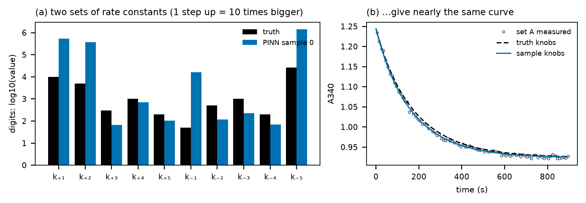

**둘째, 이미 빠른 단계는 얼마나 빠른지 보이지 않습니다.**

> **비유:** 놀이공원 줄을 떠올려 보세요. 입구에서 표를 확인하는 사람이 빠르든 아주 빠르든, 줄의 속도는 가장 느린 놀이기구 탑승이 정합니다(병목). 그래서 줄이 줄어드는 속도만 보고는 입구가 얼마나 빠른지 알 수 없습니다.

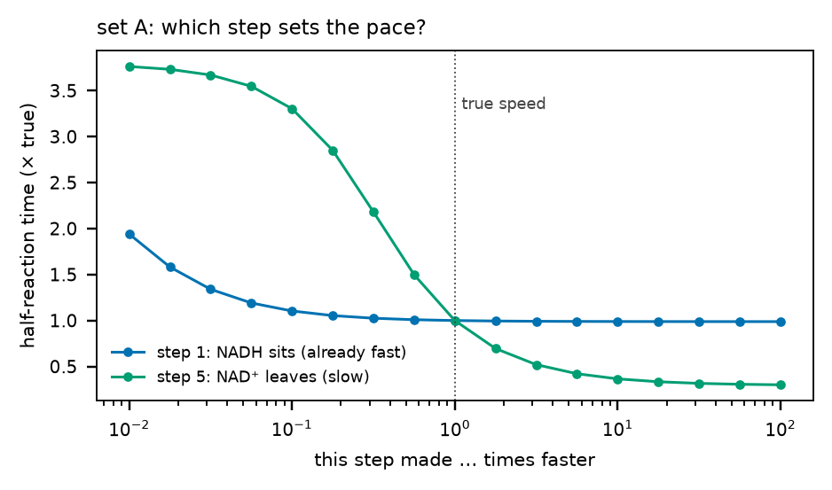

- **1단계(NADH가 앉기):** 10배 빠르게 해도 반응 절반 시간이 0.99배로 거의 그대로입니다. 이미 충분히 빠르기 때문입니다. 그래서 곡선만 보고는 1단계가 실제로 얼마나 빠른지 알 수 없습니다.
- **5단계(NAD⁺가 떠나기):** 10배 빠르게 하면 절반 시간이 0.37배로 줄어듭니다. 병목이기 때문입니다.

이렇게 데이터만으로 답을 하나로 정할 수 없는 상황을 **식별 불가능**이라고 부릅니다. 이 도구는 이것을 숨기지 않고 받아들입니다. 그 방법이 14절의 "표본"입니다.

### 12. 컴퓨터가 답을 찾는 법: 맞추기(피팅)

역문제를 푸는 기본 방법은 **맞추기(피팅)**입니다.

1. 속도 상수를 아무렇게나 하나 정합니다.
2. 그 상수로 시뮬레이션해서 곡선을 그립니다.
3. 측정점과 얼마나 빗나가는지(RMSE) 잽니다.
4. 상수를 조금 바꿔서 빗나감이 줄어드는 쪽으로 옮깁니다.
5. 더 줄지 않을 때까지 되풀이합니다.

> **비유:** 눈을 가리고 산을 내려가는 것과 같습니다. 발밑이 기울어진 쪽으로 한 걸음씩 내려가다 보면 골짜기 바닥에서 멈춥니다. 여기서 "높이"는 빗나감(RMSE)이고, "위치"는 속도 상수입니다.

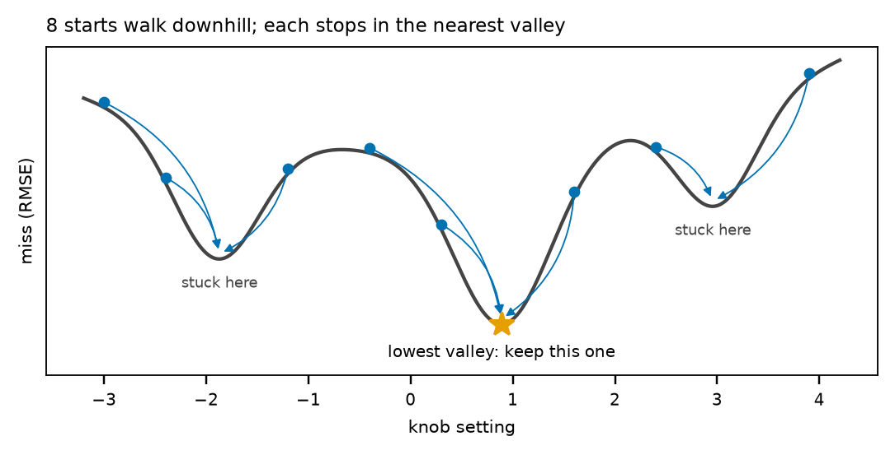

**골짜기가 여러 개면** 처음 선 곳에 따라 다른 골짜기에서 멈춥니다. 가장 낮은 곳이 아닌데도 거기서 더 내려갈 수 없는 골짜기를 **지역 최소**라고 합니다. 그래서 여러 곳에서 출발해 보고 가장 낮은 곳을 고릅니다. 이것을 **재시작**이라고 합니다(그림 B9).

**상식도 함께 씁니다.** 효소의 속도 상수가 보통 어느 정도인지는 그동안의 연구로 대강 알려져 있습니다. 이 상식을 **사전분포**라고 합니다. 찾는 답이 상식에서 너무 멀어지면 작은 벌점을 줍니다. 예제에서는 "상식의 중심에서 자릿수로 1.5 정도까지는 흔하다"고 둡니다. 자릿수 1은 10배, 자릿수 2는 100배입니다.

### 13. 신경망과 PINN

**신경망**은 손잡이가 수천 개 달린 "모양을 마음대로 바꾸는 자"라고 생각하면 됩니다. 손잡이를 잘 맞추면 어떤 모양의 곡선이든 그릴 수 있습니다.

그냥 신경망은 측정점만 지나면 아무 곡선이나 그립니다. 반응의 규칙은 신경 쓰지 않습니다.

**PINN**(물리 정보 신경망, physics-informed neural network)은 곡선이 반응의 규칙(미분방정식)까지 지키도록 채점표에 넣은 신경망입니다. 채점표에는 네 가지가 있습니다.

| 채점 항목 | 묻는 것 |
|---|---|
| 데이터 | 곡선이 측정점 가까이 지나가는가 |
| 물리 | 곡선의 기울기(변하는 속도)가 반응식과 속도 상수가 주는 속도와 같은가 |
| 출발점 | 곡선이 처음 농도에서 출발하는가 |
| 상식(사전분포) | 속도 상수가 상식에서 너무 멀지 않은가 |

**학습**은 이 점수를 낮추도록 신경망의 손잡이와 속도 상수를 함께 조금씩 돌리는 일입니다. 수천 번 되풀이합니다.

**왜 PINN을 쓰나**

- **빠릅니다:** 상수를 바꿀 때마다 시뮬레이션을 처음부터 다시 하지 않아도 되고, 그래픽 카드(GPU)에서 수십 개를 한꺼번에 학습할 수 있습니다.
- **모양을 모르는 것도 배울 수 있습니다:** 예를 들어 효소가 시간이 지나며 지치는 정도처럼, 식으로 정해 두기 어려운 것도 함께 배울 수 있습니다.

다만 신경망 곡선이 데이터에 잘 맞아 보여도 속을 수 있습니다. 그래서 **마지막 확인은 언제나 찾은 속도 상수로 시뮬레이션을 다시 해서** 합니다.

### 14. 표본과 불확실성

데이터에 똑같이 잘 맞는 답이 여러 개면, 하나만 골라 믿지 않고 여러 개를 남깁니다. 이 답들을 **표본**이라고 합니다.

> **비유:** 일기예보를 여러 방법으로 계산하면, 내일 날씨는 모두 비슷하게 예측하지만 일주일 뒤 날씨는 서로 갈립니다. 갈리는 곳이 "아직 잘 모르는 곳"입니다.

표본들이 서로 같은 말을 하는 조건은 믿을 수 있고, 서로 다른 말을 하는 조건은 불확실합니다. 이 퍼짐이 바로 **불확실성**입니다.

데이터 세트도 역할을 나눠 씁니다.

- **학습 세트:** 답을 보며 공부하는 연습 문제입니다. 속도 상수를 찾는 데 씁니다.
- **홀드아웃 세트:** 공부할 때 보지 않은 시험 문제입니다. 찾은 답이 처음 보는 조건에서도 맞는지 확인합니다.
- **설계 확인 세트:** 실전입니다. 실제로 쓰려는 조건에서 잰 데이터입니다.

### 15. 강건 설계

이 예제의 목표는 이것입니다. **NADH 0.1 mM을 300초(5분) 안에 99% 써 버리려면 효소를 얼마나 넣어야 할까?**

- **공칭 설계:** 표본 하나만 믿고 효소량을 정합니다.
- **강건 설계:** 모든 표본에서 목표를 이루도록, 가장 느리다고 예측한 표본에 맞춰 효소량을 정합니다.

> **비유:** 여러 일기예보 가운데 하나라도 비가 온다고 하면 우산을 챙기는 것입니다. 대신 우산을 들고 다니는 수고(더 많은 효소)를 치릅니다.

---

## 2부. 예제로 따라가기

1부에서는 배경지식을 하나씩 배웠습니다. 2부에서는 그 지식을 **실제 예제 하나**에 적용합니다. 1부 앞머리 표의 여섯 순서(반응식 쓰기 → 빛으로 재기 → 정문제 → 역문제 → 표본 → 설계)를 처음부터 끝까지 따라갑니다. 1부가 "부엌 도구 하나하나의 사용법"이었다면, 2부는 "그 도구들로 요리를 처음부터 끝까지 해 보는 시간"입니다.

**2부에서 다루는 예제**

- 예제의 이름은 `example_ldh_synth`입니다. 낱말을 나누면 example(이그잼플, "예제") + ldh(효소 이름 LDH) + synth(신스, synthetic의 줄임말로 "합성한, 만들어 낸")입니다. 곧 "LDH 효소로 만든 합성 예제"라는 뜻입니다.
- **합성**이라는 말은 실험실에서 잰 데이터가 아니라는 뜻입니다. 정답 속도 상수를 먼저 정해 놓고, 그 상수로 컴퓨터가 "이렇게 재졌을 것"이라는 데이터를 만들었습니다. 그래서 도구가 찾은 답을 정답과 맞대어 볼 수 있습니다. 진짜 실험에서는 정답을 아무도 모르니 이런 비교를 할 수 없습니다.
- 정답은 `projects/example_ldh_synth/data/truth.json` 파일에 적혀 있지만, 도구는 이 파일을 읽지 않습니다. 시험 감독이 답안지를 서랍에 넣어 두고, 학생(도구)이 문제를 다 푼 뒤에만 꺼내 채점하는 것과 같습니다.

**숫자는 어디서 왔나**

- 2부의 숫자는 모두 이 글을 쓸 때 도구를 한 번 실행한 결과에서 나왔습니다. 결과는 `runs/example_ldh_synth/2026-10-11_1041` 폴더에 있습니다.
- 폴더 이름은 이렇게 읽습니다. `runs`(런스, "실행 결과들") / `example_ldh_synth`(예제 이름) / `2026-10-11_1041`(2026년 10월 11일 10시 41분에 실행한 것).
- 그림 9장은 `scripts/identification_figures.py`가 이 폴더의 결과를 읽어서 그렸습니다. 그림 4(고전 피팅이 내려가는 모습)와 그림 9(D0를 넣고 다시 학습)는 그림을 그릴 때 계산을 한 번 더 했습니다(부록의 "그림 다시 그리기").
- 같은 그래픽 카드에서는 다시 실행해도 숫자가 같았습니다. 다른 컴퓨터에서는 표본이 달라질 수 있고, 그러면 2부의 숫자도 달라집니다.
- 글과 그림의 숫자는 대부분 반올림한 값입니다. 예를 들어 그림에는 "Et 24 nM"이라고 적혀 있지만, 설정 파일에 적힌 값은 24.23 nM입니다. 반올림은 2-0의 11번에서 설명합니다.

**2부 지도**

| 절 | 제목 | 무엇을 하나 | 그림 |
|---|---|---|---|
| 2-0 | 그림 읽기의 기본 | 축, 단위, 점과 선, 10배 눈금, 거듭제곱, log10, σ처럼 그림을 읽는 데 필요한 도구를 모았습니다. 다른 절을 읽다 막히면 여기로 돌아오면 됩니다. | 연습용으로 그림 3을 미리 한 번 봄 |
| 2-1 | 반응식: 무엇을 찾는가 | 효소의 다섯 모습이 이루는 반응 고리와, 찾아야 하는 숫자 10개를 봅니다. | 그림 1 |
| 2-2 | 정문제: 정답을 알면 곡선이 정해진다 | 정답 상수를 안다면 컵 속에서 무슨 일이 일어나고, 분광광도계에 어떤 곡선이 보일지 계산합니다. | 그림 2 |
| 2-3 | 측정 데이터 | 여섯 세트의 진행 곡선과, 세트마다 맡은 역할(연습 문제, 시험 문제, 실전)을 봅니다. | 그림 3 |
| 2-4 | 역문제: 맞추기로 상수 찾기 | 고전 피팅이 상수를 고쳐 가며 곡선을 측정점에 붙여 가는 과정을 봅니다. 곡선이 맞아도 상수는 정답과 다를 수 있습니다. | 그림 4 |
| 2-5 | PINN으로 상수 찾기 | PINN 학습 한 번 동안 점수가 바뀌는 모습, 8번 다시 학습해 하나를 고르는 법, 다시 한 시뮬레이션으로 판정하는 법을 봅니다. | 그림 5 |
| 2-6 | 정해지는 것과 안 정해지는 것 | 표본의 상수를 정답과 비교합니다. 표본들이 어떤 조건에서 같은 말을 하고, 어떤 조건에서 다른 말을 하는지 봅니다. | 그림 6, 그림 7 |
| 2-7 | 표본에서 설계로 | 표본마다 다른 예측을 모두 만족하는 효소량(강건 설계)을 정합니다. | 그림 8 |
| 2-8 | 실전 조건을 재서 다시 공부하기 | 표본이 갈린 조건을 직접 재서 학습에 넣으면 무엇이 달라지는지 봅니다. | 그림 9 |

**각 절의 짜임**

2-1부터 2-8까지는 모든 절이 같은 순서로 되어 있습니다. 순서가 같으니 한 절을 읽어 보면 나머지 절에서도 무엇이 어디에 있는지 알 수 있습니다.

1. **알고 싶은 것:** 이 절이 답하려는 질문 하나입니다. 이 질문을 마음에 품고 읽으면 그림에서 무엇을 찾아야 할지 분명해집니다.
2. **그림 속 영어 풀이:** 그림에 적힌 영어 글자를 하나도 빠짐없이 우리말로 옮긴 표입니다. 그림 글자가 영어인 것은 이 도구의 그림이 모두 논문에도 그대로 쓸 수 있도록 영어로 그려지기 때문입니다.
3. **그림 보는 순서:** 칸마다 어디부터 보고 무엇을 읽어 내는지, 번호를 매겨 한 걸음씩 설명합니다.
4. **숫자 따라 계산해 보기:** 글에 나온 숫자가 어떻게 나왔는지 직접 계산해 봅니다. 더하기, 빼기, 곱하기, 나누기만 할 줄 알면 됩니다. 계산기를 옆에 두면 편합니다.
5. **스스로 확인하기:** 짧은 문제와, 바로 아래에 답이 있습니다. 답을 보기 전에 그림을 보며 먼저 맞혀 보세요.
6. **새로 나온 말:** 이 절에서 처음 나온 말의 뜻입니다. 같은 말은 글 끝의 용어 사전에도 있습니다.
7. **한 줄 정리:** 절 전체를 한 문장으로 줄인 것입니다. 시간이 없으면 각 절의 한 줄 정리만 이어 읽어도 2부의 줄거리를 알 수 있습니다.

**화면에서 읽는 법**

- **그림 크게 보기:** 그림을 누르면(클릭하면) 화면 가득 커집니다. 다시 누르거나 키보드의 Esc 키를 누르면 원래대로 돌아갑니다. 그림 속 글씨가 작으니 이렇게 키워서 읽는 것이 좋습니다.
- **목차:** 화면이 넓으면 왼쪽에 목차가 늘 떠 있고, 지금 읽는 절이 색으로 표시됩니다. 휴대폰처럼 화면이 좁으면 글 맨 위의 "목차"를 눌러 펼칩니다.
- **밝기:** 오른쪽 위의 "테마" 단추를 누를 때마다 자동 → 밝게 → 어둡게 → 다시 자동으로 바뀝니다. 화면을 어둡게 해도 그림은 흰 바탕 그대로입니다.
- **그림과 글을 나란히:** 설명을 읽는 동안 그림을 계속 다시 보게 됩니다. 같은 파일을 창 두 개로 열어 한쪽에는 그림을, 다른 쪽에는 설명을 띄워 두면 편합니다.
- **절 번호 읽는 법:** "2-3"은 "2부의 3번째 절"입니다. "1부 8절"은 1부의 8번째 절입니다. "그림 3 (b)"는 그림 3의 두 번째 칸입니다.

### 2-0. 그림 읽기의 기본

2부의 그림은 연구용 그림이라 처음 보면 복잡합니다. 하지만 그림은 몇 가지 정해진 부품(칸, 제목, 축, 눈금, 점, 선, 범례)을 조립한 것이고, 부품마다 읽는 법이 정해져 있습니다. 레고 설명서의 기호를 한 번 익히면 어떤 설명서든 읽을 수 있는 것과 같습니다. 이 절에서는 그 부품을 하나씩 뜯어봅니다.

이 절은 길지만 처음부터 다 외울 필요는 없습니다. 한 번 훑어본 뒤, 다른 절을 읽다가 "10⁻³이 뭐였지?", "log10이 뭐였지?" 싶을 때 돌아와서 찾아보는 사전처럼 써도 됩니다.

| 번호 | 내용 |
|---|---|
| 1 | 그림 한 장의 생김새: 칸과 제목 |
| 2 | 축과 눈금 |
| 3 | 단위: 초, mM·µM·nM, nm, 단위가 없는 A340 |
| 4 | 점, 선, 색, 모양 |
| 5 | 범례, 그림 속 글씨, 색칠된 영역 |
| 6 | 10배 눈금(로그 눈금) |
| 7 | 10의 거듭제곱과 e 표기 |
| 8 | log10: 몇 자릿수 다른가 |
| 9 | σ와 "÷ σ" |
| 10 | 퍼센트와 "배" |
| 11 | 소수, 반올림, 범위 |
| 12 | 기호와 그리스 문자 |
| 13 | 2부에 자주 나오는 영어 |
| 14 | 연습: 실제 그림 한 칸 읽기 |
| 15 | 그림을 읽는 순서 요약, 스스로 확인하기 |

#### 1. 그림 한 장의 생김새: 칸과 제목

**칸(작은 그림)**

- 그림 하나에는 작은 그림이 여러 개 들어 있습니다. 이 글에서는 작은 그림 하나를 **칸**이라고 부릅니다.
- 칸의 개수는 그림마다 다릅니다. 그림 7은 4칸, 그림 2·3·4·5는 3칸, 그림 6·9는 2칸, 그림 8은 1칸입니다. 그림 1은 축이 없는 그림(도식)으로, 효소가 일하는 순서를 동그랗게 그린 것입니다.
- 칸 이름은 (a), (b), (c), (d)입니다. 영어 알파벳의 첫 네 글자로, 우리말의 "가, 나, 다, 라"처럼 순서를 나타냅니다. 왼쪽 칸부터 (a)이고 오른쪽으로 갈수록 (b), (c), (d)입니다.
- 글에서 "그림 3 (b)"라고 하면 "그림 3의 두 번째 칸"입니다.
- 칸이 하나뿐인 그림 8에는 (a) 같은 글자가 없습니다. 가리킬 칸이 하나뿐이라 이름을 붙일 필요가 없기 때문입니다.

**칸 제목**

- 칸마다 왼쪽 위에 한 줄짜리 제목이 있습니다. 제목은 (a) 같은 칸 이름 바로 뒤에 붙어 있습니다.
- 제목은 "이 칸이 보여 주는 것"을 한 줄로 줄인 것입니다. 예를 들어 그림 2 (c)의 제목 "what the photometer sees"는 "분광광도계가 보는 것"입니다. 칸을 보기 전에 제목부터 읽으면, 무엇을 찾아야 할지 알 수 있습니다.

**칸 크기**

- 칸의 크기가 서로 다를 수 있습니다. 그림 6은 (a) 칸이 (b) 칸보다 넓습니다. (a) 칸에 상수 11개를 나란히 놓아야 해서 자리를 더 준 것입니다.

**칸끼리 축을 함께 쓰는 경우**

- 그림 3은 세 칸이 세로축을 함께 씁니다. 그래서 세로축 숫자(0.0, 0.2, …, 1.4)는 맨 왼쪽 (a) 칸에만 적혀 있고, (b)와 (c)에는 짧은 눈금 표시만 있습니다.
- (b)나 (c)에서 점의 높이를 읽을 때는, (a)의 숫자를 옆으로 그대로 옮겨 와서 읽습니다. 같은 높이면 같은 값입니다.
- **왜 이렇게 그렸나:** 세 칸의 높이를 한눈에 비교하라는 뜻입니다. 칸마다 세로축이 다르면 "같은 높이 = 같은 값"이 성립하지 않아 비교하기 어렵습니다.

**칸마다 가로축 범위가 다를 수 있는 경우**

- 같은 그림 3에서도 가로축은 칸마다 다릅니다. (a)와 (b)는 0초부터 900초 가까이까지 그렸는데, (c)는 600초 가까이까지만 그렸습니다. 세트 D1과 D0는 600초 동안만 쟀기 때문입니다.
- **헷갈리기 쉬운 점:** (a)의 맨 오른쪽과 (c)의 맨 오른쪽은 같은 시각이 아닙니다. 칸마다 가로축 숫자를 따로 확인해야 합니다.

**그림 아래 설명(캡션)**

- HTML에서는 그림 바로 아래에 회색 글씨로 "그림 N — …" 설명이 붙어 있습니다. 이것을 **캡션**이라고 합니다.
- 캡션에는 칸마다 무엇을 그렸는지가 짧게 적혀 있습니다. 그림을 보기 전에 캡션부터 읽으면 길을 잃지 않습니다.

#### 2. 축과 눈금

**가로축과 세로축**

- **가로축**은 칸 아래쪽의 눈금 막대입니다. 왼쪽에서 오른쪽으로 갈수록 값이 커집니다. 진행 곡선 그림에서는 가로축이 시간이라서, 오른쪽으로 갈수록 나중입니다.
- **세로축**은 칸 왼쪽의 눈금 막대입니다. 아래에서 위로 갈수록 값이 커집니다.
- 점 하나는 "가로축으로 읽은 값"과 "세로축으로 읽은 값"을 한 쌍으로 나타냅니다. 예를 들어 그림 3 (a)의 파란 점 하나는 "몇 초에 A340이 얼마였다"는 한 쌍입니다.

**축 이름**

- 축 옆에 적힌 글자가 **축 이름**입니다. 가로축 이름은 가로축 아래 가운데에, 세로축 이름은 세로축 왼쪽에 옆으로 누워서 적혀 있습니다. 세로축 이름은 고개를 왼쪽으로 기울이면 읽힙니다.
- 축 이름 뒤 괄호 속은 단위입니다. "time (s)"는 "시간, 단위는 초"입니다. 단위는 3번에서 자세히 봅니다.

**눈금과 눈금 숫자**

- 축에 붙은 짧은 막대가 **눈금**이고, 그 옆의 숫자가 **눈금 숫자**입니다.
- 보통 눈금은 간격이 일정하고, 한 칸마다 같은 양이 더해집니다. 그림 3의 세로축은 0.0, 0.2, 0.4, …, 1.4라서 한 칸이 0.2입니다. 그림 2 (c)의 세로축은 0.95, 1.00, 1.05, …, 1.25라서 한 칸이 0.05입니다. 칸마다 한 칸의 크기가 다르니 꼭 숫자를 확인합니다.
- 눈금 사이의 값은 비례로 읽습니다. 한 칸이 0.2인 축에서 두 눈금의 딱 가운데는 0.1을 더한 값입니다. 0.6 눈금과 0.8 눈금의 가운데면 0.7입니다.
- 10배 눈금 축에는 숫자가 없는 짧은 눈금도 있습니다(6번).

**모눈은 없습니다**

- 학교 수학책의 그래프에는 바둑판 같은 모눈(격자선)이 있지만, 2부의 그림에는 모눈이 없습니다.
- 점의 값을 읽을 때는 점에서 왼쪽 세로축까지 눈으로 수평선을 그어 봅니다. 화면에 종이나 자의 모서리를 대 보면 더 정확합니다.

**오른쪽에 있는 두 번째 세로축**

- 그림 5 (a)에는 세로축이 두 개 있습니다. 왼쪽 축(loss term, 점수)은 아래가 10⁻⁵(0.00001), 위가 10²(100)이고, 오른쪽 축(physics weight, 물리 점수의 무게)은 아래가 10⁰(1), 위가 10⁴(10,000)입니다.
- 같은 칸에 단위나 크기가 전혀 다른 두 가지를 함께 그리려고 축을 하나 더 붙인 것입니다.
- 어느 선을 어느 축으로 읽는지는 축 이름에 적혀 있습니다. 오른쪽 축 이름이 "physics weight (dotted)"이니, 점선(dotted)을 오른쪽 축으로 읽으라는 뜻입니다. 오른쪽 축 이름은 회색 글씨이고, 그 점선도 회색입니다. 나머지 색 선은 왼쪽 축으로 읽습니다.
- 1부 그림 B5에도 오른쪽 축이 있습니다. 거기서는 같은 점을 왼쪽 축으로 읽으면 A340, 오른쪽 축으로 읽으면 NADH 농도(mM)입니다.

**그래프 안에 그어진 기준선과 칸막이**

그래프 안에 가로나 세로로 쭉 그어진 선은 대개 데이터가 아니라 "비교의 기준"입니다.

- 그림 6의 검은 가로선(0): 정답과 같은 자리입니다.
- 그림 4 (c)의 초록 점선(1): 잡음 수준입니다.
- 그림 5 (b)의 하늘색 파선(3): 이보다 위면 표본에서 빼는 문턱입니다.
- 그림 8의 하늘색 가로선(1 µM): 목표입니다.
- 그림 8의 세로 파선 두 개: 도구가 고른 효소량입니다.
- 그림 6 (b)와 그림 9 (a)의 옅은 회색 세로선: 구역(train, held out, design check)을 나누는 칸막이입니다.

**축이 0에서 시작하지 않는 경우**

- 그림 3 (a)의 세로축은 0부터 1.4까지입니다. 그런데 그림 2 (c), 그림 4 (a), 그림 7 (a)의 세로축은 맨 아래 눈금 숫자가 0.95입니다. 0은 그림 밖, 훨씬 아래에 있습니다.
- 그래서 같은 세트 A의 곡선이 그림 3 (a)에서는 완만하게 조금 내려가는 것처럼 보이고, 그림 4 (a)에서는 칸 꼭대기에서 바닥까지 가파르게 떨어지는 것처럼 보입니다. 실제로 변한 양은 같습니다. 두 그림 모두 A340이 약 1.23에서 약 0.92까지 내려갑니다.
- **왜 이렇게 그렸나:** 그림 4 (a)는 곡선 여러 개의 작은 차이를 보여 주려는 그림이라, 곡선이 있는 부분만 크게 확대했습니다. 돋보기를 댄 것과 같습니다.
- **헷갈리기 쉬운 점:** 그림 속 "높이 차이"만 보고 많이 변했다, 적게 변했다고 판단하면 안 됩니다. 반드시 눈금 숫자를 읽습니다.
- **만약 그림 4 (a)를 0부터 그렸다면?** 곡선이 그림 3 (a)처럼 위쪽에 납작하게 모여서, 곡선 네 개의 차이가 거의 보이지 않았을 것입니다.

**그림 틀과 눈금이 딱 맞지 않는 경우**

- 그림 3의 세로축은 −0.05부터 1.45까지 그렸습니다. 그래서 0.0 눈금이 칸 맨 아래 테두리보다 조금 위에 있습니다.
- 가로축도 0 눈금이 칸 왼쪽 테두리에서 조금 안쪽에 있습니다.
- 점이 테두리에 붙어서 가려지지 않도록 그림을 그리는 프로그램(matplotlib)이 둘레에 여백을 조금 둔 것입니다. 테두리가 곧 0이라고 생각하면 안 됩니다.

#### 3. 단위

**괄호 속은 단위**

- 축 이름 뒤 괄호 속이 단위입니다. "time (s)"는 시간을 초로 쟀다는 뜻이고, "enzyme Et (nM)"은 효소량을 nM(나노몰)로 쟀다는 뜻입니다.
- 같은 양이라도 단위가 다르면 숫자가 달라집니다. 1분과 60초는 같은 시간이지만 숫자는 1과 60입니다. 그래서 숫자를 읽을 때는 언제나 단위를 함께 읽습니다.

**시간: s(초)**

- s는 second(세컨드, 초)의 머리글자입니다.
- 900초 = 15분(900 ÷ 60 = 15), 600초 = 10분, 300초 = 5분입니다. 예제의 실험은 대부분 15분 동안 쟀고, 설계 목표는 5분입니다.
- 그림 2 (b)에는 아주 짧은 시간도 나옵니다. 왼쪽 끝 10⁻⁵초는 0.00001초, 곧 10만분의 1초입니다(7번).

**농도: M(몰 농도)과 앞 글자 m, µ, n**

- M은 몰 농도(molar, 몰라)로, 물 1 L에 분자가 몇 몰(분자를 세는 큰 묶음, 1부 1절) 들어 있는지입니다.
- M 앞의 작은 글자는 "얼마나 작게 나눴나"를 뜻합니다. 길이 단위 mm(밀리미터)의 앞 글자 m이 "1 m의 1000분의 1"을 뜻하는 것과 같습니다.
  - **m(밀리):** 1000분의 1
  - **µ(마이크로):** 100만분의 1. µ는 그리스 문자 "뮤"입니다.
  - **n(나노):** 10억분의 1

| 단위 | 읽는 법 | mM로 바꾸면 | µM로 바꾸면 | nM로 바꾸면 |
|---|---|---|---|---|
| 1 mM | 밀리몰 | 1 | 1,000 | 1,000,000 |
| 1 µM | 마이크로몰 | 0.001 | 1 | 1,000 |
| 1 nM | 나노몰 | 0.000001 | 0.001 | 1 |

- **바꾸는 법:** 큰 단위에서 작은 단위로 갈 때는 × 1000, 작은 단위에서 큰 단위로 갈 때는 ÷ 1000입니다. mM → µM → nM 순서로 한 계단 내려갈 때마다 숫자가 1000배 커집니다.
- **비유:** 1 mM를 1 km라고 하면, 1 µM는 1 m, 1 nM는 1 mm입니다. km에서 m로, m에서 mm로 갈 때 모두 1000배 차이가 나는 것과 같습니다.

**예제의 실제 숫자로 바꿔 보기**

- NADH 0.2 mM = 0.2 × 1000 = 200 µM = 200 × 1000 = 200,000 nM입니다.
- 효소 24 nM = 24 ÷ 1000 = 0.024 µM = 0.024 ÷ 1000 = 0.000024 mM입니다.
- 두 값을 같은 단위(nM)로 놓으면 200,000 ÷ 24 ≈ 8,333입니다. NADH 분자가 효소 분자보다 약 8천 배 많습니다. 1부 1절의 "약 8,000배"가 이 계산입니다.
- 설계 목표 "NADH를 1 µM 이하로 남기기"는 이렇게 계산합니다. 처음 NADH 0.1 mM = 100 µM입니다. 1 µM가 남으면 100 − 1 = 99 µM를 쓴 것이고, 99 ÷ 100 = 0.99 = 99%입니다.
- 이 도구는 작은 분자의 농도는 mM로, 효소는 nM로 적습니다. 효소는 아주 적어서 mM로 쓰면 0.000024처럼 0이 너무 많아지기 때문입니다. 2부에서 µM가 축에 나오는 그림은 그림 8과 그림 9 (b)의 세로축(300초 뒤 남은 NADH)입니다.

**헷갈리기 쉬운 점: nM와 nm**

- **nM(대문자 M):** 나노몰. 농도의 단위입니다. "효소 24 nM"
- **nm(소문자 m):** 나노미터. 길이의 단위로, 1 m의 10억분의 1입니다. "340 nm 빛"
- 빛의 색은 빛의 파장(물결 하나의 길이)으로 나타냅니다. 340 nm은 파장이 340나노미터인 빛으로, 눈에 보이지 않는 자외선입니다(1부 6절). A340의 340이 바로 이것입니다.
- 대문자와 소문자 하나 차이로 전혀 다른 뜻이 되니, M인지 m인지 꼭 봅니다.

**단위가 없는 A340**

- A340(흡광도)에는 단위가 없습니다. 세로축 이름도 괄호 없이 "A340"이라고만 적혀 있습니다.
- 흡광도는 "들어간 빛이 나온 빛의 몇 배인가"라는 비율에서 계산한 값이기 때문입니다(정확히는 그 비율의 log10, 8번). 비율은 단위가 없습니다. "반 친구 30명 가운데 15명은 절반"이라고 할 때 "명"이 사라지는 것과 같습니다.
- A340과 빛의 관계를 숫자로 보면 이렇습니다(1부 6절, 그림 B4와 같은 숫자).
  - A340 = 1이면 빛의 10분의 1이 통과합니다.
  - A340 = 1.24(NADH 0.2 mM)이면 약 6%가 통과합니다.
  - A340 = 0.3이면 약 절반(50%)이 통과합니다.
- **A340과 NADH 농도 바꾸기:** NADH(mM) = A340 ÷ 6.22, 거꾸로 A340 = 6.22 × NADH(mM)입니다. 예를 들어 그림 3 (a)의 파란 첫 점 1.234는 1.234 ÷ 6.22 ≈ 0.198 mM이고, 끝 무렵의 0.92는 0.92 ÷ 6.22 ≈ 0.148 mM입니다.

#### 4. 점, 선, 색, 모양

**점과 선의 차이**

- **점**은 "따로따로 있는 값 하나하나"입니다. 진행 곡선 그림(그림 3, 그림 4 (a)(b), 그림 7)에서는 점이 측정값입니다. 다른 그림에서는 점 하나가 표본 하나(그림 6), 학습 한 번(그림 5 (b)(c))일 수도 있습니다. 그림마다 범례에서 확인합니다.
- **선**은 컴퓨터가 계산한 값을 아주 촘촘히 이은 것입니다. 계산은 몇 초마다가 아니라 사이사이를 모두 계산할 수 있어서 매끈한 선이 됩니다.

**측정값 점의 시각**

- 측정값은 5초에 처음 재고, 그 뒤로 10초마다 쟀습니다. 5초, 15초, 25초, …, 895초입니다.
- 900초 동안 잰 세트(A, B, C, D′)는 점이 90개, 600초 동안 잰 세트(D1, D0)는 점이 60개입니다. 계산하면 (895 − 5) ÷ 10 + 1 = 90개, (595 − 5) ÷ 10 + 1 = 60개입니다.
- **헷갈리기 쉬운 점:** 첫 점은 0초가 아니라 5초입니다. 그래서 효소가 아주 빠르게 일하는 세트 D1은 첫 점(5초)에서 이미 A340이 0.36까지 내려와 있습니다(2-3).

**선의 모양**

| 모양 | 이름 | 이 글에서 주로 뜻하는 것 | 예 |
|---|---|---|---|
| ──── 끊김 없이 이어진 선 | 실선 | 계산한 곡선 | 그림 7의 표본 곡선 |
| ─ ─ ─ 짧은 막대가 띄엄띄엄 이어진 선 | 파선(dashed, 대시드) | 정답 곡선(검정), 겹친 선 구별, 고른 값 표시 | 그림 7·8·9의 검은 파선 "truth", 그림 8의 세로 파선 |
| ······ 작은 점이 이어진 선 | 점선(dotted, 도티드) | 기준값, 오른쪽 축으로 읽는 선 | 그림 4 (c)의 잡음 수준, 그림 5 (a)의 물리 점수 무게, 그림 5 (c)의 equal |

- 이 글의 다른 절에서는 파선과 점선을 구별하지 않고 둘 다 "점선"이라고 부르기도 합니다. 끊어진 선이면 모두 점선이라고 생각해도 됩니다.
- **점이 찍힌 선:** 그림 5 (a)의 선들은 일정한 간격(그림에서는 100번마다)으로 점수를 기록해 점을 찍고, 점과 점을 직선으로 이은 것입니다. 점 사이의 직선은 계산한 값이 아니라 눈으로 따라가기 쉽게 이은 것입니다.
- **굵은 선 위에 겹친 파선:** 그림 2 (a)에서 NADH(굵은 파란 실선) 위에 피루브산(주황 파선)이 겹쳐 있습니다. 두 값이 똑같아서 그냥 그리면 한 선이 다른 선을 완전히 가립니다. 그래서 하나는 굵게, 하나는 파선으로 그려 두 선이 모두 보이게 했습니다. 겹친 선 사이로 굵은 선의 색이 비쳐 보이면 "두 값이 같다"는 뜻입니다.
- **옅은 가는 선:** 그림 3에서 점 사이를 지나는 같은 색의 가는 선은 "잡음이 없었다면 재졌을 값"입니다. 점보다 덜 눈에 띄게 일부러 가늘고 조금 옅게 그렸습니다.

**점의 모양(표시)**

| 모양 | 이름 | 2부의 예 |
|---|---|---|
| ○ | 속이 빈 동그라미 | 측정값(그림 3, 4, 7), 재시작 한 번의 결과(그림 5 (b)(c)), A·B로만 학습한 표본(그림 9 (a)) |
| ● | 속이 찬 동그라미 | PINN 표본(그림 6), 고른 재시작(그림 5의 kept), A·B·D0로 학습한 표본(그림 9 (a)), 그림 4 (c)의 네 곡선 자리 |
| □ | 속이 빈 네모 | 고전 피팅 결과(그림 6) |
| × | 가위표 | 정답이 필요로 하는 효소량(그림 8, 그림 9 (b)) |
| ▬ | 짧은 가로 막대 | 상식의 중심(그림 6 (a)) |

- 이 글의 그림에서는 대체로 **속이 찬 것은 고른 것이나 최종 결과**, **속이 빈 것은 후보나 비교 대상**입니다. 그림 5에서 고른 재시작은 찬 동그라미, 나머지는 빈 동그라미입니다. 그림 9 (a)에서 D0를 넣은 뒤의 표본은 찬 동그라미, 넣기 전은 빈 동그라미입니다.
- 측정값은 점이 많아서 속이 찬 동그라미로 그리면 서로 뭉쳐 선처럼 보입니다. 속이 빈 작은 동그라미로 그려야 하나하나가 보이고, 그 아래를 지나는 계산 곡선도 비쳐 보입니다.
- **헷갈리기 쉬운 점:** ×는 곱하기 기호이기도 하지만, 그림 8과 그림 9 (b)에서는 점의 모양으로 쓰였습니다. 범례에서 "× truth needs 31 nM"이라고 적힌 것은 "곱하기"가 아니라 "가위표 모양의 점"입니다.

**색**

- 2부의 그림은 대체로 **파랑 → 주황 → 초록 → 빨강 → 분홍 → 하늘색** 순서로 색을 씁니다. 첫 번째 것이 파랑, 두 번째가 주황, 세 번째가 초록, 네 번째가 빨강입니다.
- 이 색 모음은 색을 잘 구별하지 못하는 사람(색각 이상이 있는 사람)도 서로 구별하기 쉽도록 고른 것입니다(Okabe–Ito 색 모음, 오카베–이토).
- 이 글에서 "빨강"이라고 부르는 색은 주황빛이 도는 빨강(주홍)입니다. 그래서 어떤 절에서는 이 색을 "붉은 주황"이라고 부르고, 두 번째 색인 주황을 "노란 주황" 또는 "노란빛 주황"이라고 불러 둘을 구별합니다. 화면에 따라 주황과 헷갈릴 수 있으니, 헷갈리면 그림을 크게 키워 범례와 견주어 봅니다.
- **검정**은 대체로 정답(truth)입니다. **회색**은 측정값(그림 4, 7), 칸 안의 설명 글씨, 보조 표시에 씁니다.
- **헷갈리기 쉬운 점: 색은 "몇 번째인가"를 나타낼 뿐, 그림마다 같은 것을 뜻하지 않습니다.**
  - 그림 3에서 파랑은 (a) 칸에서는 세트 A, (b) 칸에서는 세트 C, (c) 칸에서는 세트 D1입니다.
  - 그림 7과 그림 8에서는 파랑이 표본 0, 주황이 표본 1, 초록이 표본 2, 빨강이 표본 3입니다.
  - 그림 1에서는 파랑이 들어오는 분자, 초록이 나가는 분자입니다.
  - 그러니 칸이 바뀔 때마다 범례를 다시 봐야 합니다.

#### 5. 범례, 그림 속 글씨, 색칠된 영역

**범례**

- **범례**(legend, 레전드)는 칸 안 귀퉁이에 있는 작은 표입니다. 왼쪽에 선 조각이나 점 같은 견본이 있고, 오른쪽에 그 이름이 있습니다. 이 글의 그림에서는 범례에 테두리가 없어서, 그래프 안에 글씨만 떠 있는 것처럼 보입니다.
- 범례는 지도 귀퉁이의 "기호 설명"과 같습니다. 지도에서 파란 선이 강이고 검은 점선이 도 경계라는 것을 알려 주듯, 범례는 "이 색 이 모양은 무엇"을 알려 줍니다.
- **범례 읽는 순서:** ① 견본의 모양(선인가 점인가, 실선인가 파선인가) → ② 색 → ③ 이름. 같은 색이 선과 점으로 두 번 나올 수 있어서 모양까지 맞춰 봐야 합니다. 예를 들어 그림 8에는 검은 파선 "truth"(정답 곡선)와 검은 × "truth needs 31 nM"(정답이 필요한 효소량)이 따로 있습니다.

**범례 속 숫자와 줄임**

- 그림 4의 범례 "start (prior centre): 43.1σ"처럼 쌍점(:) 뒤에 숫자가 붙으면, 그 숫자는 그 곡선의 빗나감입니다(9번).
- 그림 3의 범례 "A: NADH 0.2, Pyr 0.2, Lac 9.8 mM, Et 24 nM"에서 단위 mM은 맨 끝에 한 번만 적혀 있지만, 앞의 세 숫자(0.2, 0.2, 9.8) 모두에 붙습니다. 글자 수를 줄이려고 단위를 한 번만 적었습니다.
- 그림 3의 범례 "B: Lac 10, NAD 0.2 mM"의 NAD는 NAD⁺에서 + 표시를 뺀 것입니다. 같은 물질입니다.

**칸 안의 회색 글씨**

- 범례 말고도 칸 안에 회색 글씨로 짧은 설명이 적혀 있기도 합니다.
  - 그림 2 (a)의 "NADH and Pyr fall together (1 : 1)": 선에 대한 설명
  - 그림 2 (c)의 "A340 = 6.22 × (NADH + EN + ENP)": 계산식
  - 그림 7 칸 오른쪽 위의 "Lac 9.8 mM, Pyr 0.2 mM, Et 24 nM": 그 세트의 처음 조건
  - 그림 8 세로선 옆의 "nominal 60 nM", "robust 181 nM": 그 선의 이름과 값
- 이런 글씨는 "이 부분은 이렇게 읽으라"는 그림 그린 사람의 쪽지라고 생각하면 됩니다.

**색칠된 영역**

- 그림 5 (a)의 오른쪽 회색 띠: 학습의 마무리 단계(L-BFGS)를 나타냅니다. 띠 안의 가로 위치는 Adam 반복 횟수가 아니라, 마무리 단계가 끝난 결과를 보여 주려고 따로 마련한 자리입니다(2-5).
- 그림 6 (a)의 회색 막대: 상식(사전분포)이 "흔하다"고 보는 범위입니다.
- 1부 그림 B3의 회색 띠도 같은 생각입니다. 색칠된 영역은 "이 범위가 특별하다"는 표시입니다.

#### 6. 10배 눈금(로그 눈금)

**보통 눈금과 10배 눈금**

- **보통 눈금:** 한 칸 갈 때마다 같은 양을 **더합니다**. 0, 0.2, 0.4, 0.6처럼 0.2씩 더해집니다.
- **10배 눈금:** 한 칸 갈 때마다 같은 배수를 **곱합니다**. 1, 10, 100, 1000처럼 10씩 곱해집니다. 거꾸로 가면 1, 0.1, 0.01, 0.001처럼 10으로 나눠집니다. 이것을 **로그 눈금**이라고도 부릅니다.
- 축 이름에 "log"가 붙어 있거나(그림 2 (b)의 "time (s, log)"), 눈금 숫자가 10⁰, 10¹, 10²처럼 적혀 있으면 10배 눈금입니다.

**왜 10배 눈금을 쓰나**

- 한 그림에 아주 작은 값과 아주 큰 값을 함께 담아야 할 때 씁니다.
- 그림 2 (b)의 가로축은 0.00001초부터 1000초까지입니다. 1000 ÷ 0.00001 = 100,000,000, 곧 1억 배 차이입니다. 이것을 보통 눈금으로 그려 1000초를 10 cm에 담으면, 0.01초는 왼쪽 끝에서 겨우 0.0001 cm 떨어진 곳에 찍힙니다(10 cm × 0.01 ÷ 1000). 효소가 처음 자리 잡는 모습이 모두 왼쪽 끝 한 점에 뭉개져 보이지 않습니다.
- 그림 5 (a)의 점수는 가장 큰 것이 약 150, 가장 작은 것이 약 0.000006입니다. 2천만 배가 넘게 차이 나서, 보통 눈금으로는 작은 값들이 모두 바닥에 붙어 버립니다.

**10배 눈금의 특징**

1. **같은 간격은 같은 배수입니다.** 그림 8의 가로축에서 100과 200 사이의 간격과 200과 400 사이의 간격은 같습니다. 둘 다 2배이기 때문입니다. 20과 30 사이(1.5배)는 30과 50 사이(약 1.7배)보다 조금 좁습니다.
2. **한 칸이 꼭 10배인 것은 아닙니다.** 그림 2 (b)의 가로축 숫자는 10⁻⁵, 10⁻³, 10⁻¹, 10¹, 10³입니다. 숫자가 적힌 눈금 사이가 100배입니다. 그림 8의 가로축은 20, 30, 50, 100, 200, 400처럼 보통 숫자로 적혀 있지만 역시 10배 눈금입니다(간격이 같지 않은 것을 보면 알 수 있습니다).
3. **숫자 없는 작은 눈금이 있습니다.** 그림 4 (c)와 그림 5 (a)의 세로축에는 숫자가 적힌 큰 눈금 사이에 짧은 눈금이 여러 개 있습니다. 10⁰(= 1)과 10¹(= 10) 사이의 짧은 눈금은 아래부터 2, 3, 4, 5, 6, 7, 8, 9 자리입니다. 위로 갈수록 간격이 점점 좁아집니다. 1에서 2는 2배지만, 8에서 9는 1.125배밖에 안 되기 때문입니다.
4. **0이 없습니다.** 10배 눈금에서는 한 칸 아래로 내려갈 때마다 10으로 나눕니다. 1 → 0.1 → 0.01 → 0.001 → … 아무리 내려가도 0이 되지 않습니다. 그래서 10배 눈금 그래프에는 0이나 음수를 그릴 수 없고, 맨 아래 테두리도 0이 아닙니다.

**헷갈리기 쉬운 점: 절반 높이는 절반 값이 아닙니다**

- 보통 눈금에서는 1과 10 사이 한가운데가 5.5입니다. 하지만 10배 눈금에서 1과 10 사이 한가운데는 약 **3.16**입니다. 1에 3.16을 곱하고 다시 3.16을 곱하면 10이 되기 때문입니다(3.16 × 3.16 ≈ 10).
- 10배 눈금에서 1과 10 사이(또는 10과 100 사이) 어디쯤에 있으면 어떤 값인지 표로 보면 이렇습니다.

| 높이(아래 눈금에서 몇 %) | 1과 10 사이 | 10과 100 사이 |
|---|---|---|
| 0% | 1 | 10 |
| 18% | 1.5 | 15 |
| 30% | 2 | 20 |
| 48% | 3 | 30 |
| 50% (한가운데) | 약 3.16 | 약 31.6 |
| 60% | 4 | 40 |
| 70% | 5 | 50 |
| 80% | 약 6.3 | 약 63 |
| 85% | 7 | 70 |
| 100% | 10 | 100 |

**눈금 사이 값 읽기: 그림 4 (c)로 해 보기**

그림 4 (c)는 세로축이 10배 눈금이고, 숫자가 적힌 눈금은 10⁰(= 1)과 10¹(= 10) 두 개뿐입니다. 색 점 네 개의 값을 읽어 봅니다.

1. **주황 점:** 1과 10 사이, 아래에서 약 80% 높이에 있습니다. 위 표에서 80%는 약 6.3입니다. 범례의 "evaluation 26: 6.3σ"와 맞습니다.
2. **초록 점:** 1과 10 사이, 아래에서 약 18% 높이입니다. 표에서 18%는 1.5입니다. 범례의 "1.5σ"와 맞습니다.
3. **파란 점:** 10보다 위에 있습니다. 10에서 100까지 거리의 약 63% 높이입니다(100 눈금은 칸 위로 벗어나 보이지 않지만, 1에서 10까지의 거리와 똑같은 거리만큼 위에 있다고 생각합니다). 표의 60%(40)와 70%(50) 사이니 40~50 사이이고, 범례의 "43.1σ"와 맞습니다.
4. **빨간 점:** 1의 눈금선 바로 위입니다. 범례에는 "1.1σ"라고 적혀 있습니다.

거꾸로 계산하면 이렇게 확인할 수 있습니다. 43.1은 10 × 4.31이고, log10(43.1) ≈ 1.63입니다. 1은 "10까지 왔다", 0.63은 "다음 칸의 63%"라는 뜻입니다(8번).

#### 7. 10의 거듭제곱과 e 표기

**10의 거듭제곱**

- 10ⁿ은 "10을 n번 곱한 것"입니다. 오른쪽 위의 작은 숫자 n을 **지수**라고 합니다.
  - 10² = 10 × 10 = 100
  - 10³ = 10 × 10 × 10 = 1,000
  - 10⁴ = 10,000 (1 뒤에 0이 4개)
- **10⁰은 왜 1일까?** 10³ = 1000, 10² = 100, 10¹ = 10으로 지수가 하나 줄 때마다 10으로 나눕니다. 10¹에서 한 번 더 10으로 나누면 1이니, 10⁰ = 1입니다.
- **음수 지수:** 계속 10으로 나눕니다. 10⁻¹ = 0.1, 10⁻² = 0.01, 10⁻³ = 0.001, 10⁻⁵ = 0.00001입니다. 규칙은 "10⁻ⁿ은 소수점 아래 n번째 자리에 1"입니다. 10⁻⁵은 소수점 아래 다섯 번째 자리에 1이 있습니다.
- **헷갈리기 쉬운 점:** 10⁻⁵은 음수가 아닙니다. 0보다 큰, 아주 작은 수(10만분의 1)입니다. −10⁵(= −100,000, 0보다 작은 수)과는 전혀 다릅니다. 지수의 −는 "작다", 앞에 붙은 −는 "0보다 작다"입니다.

| 표기 | 보통 숫자 | 말로 | 2부 어디에 |
|---|---|---|---|
| 10⁴ | 10,000 | 만 | 그림 5 (a) 오른쪽 축 맨 위(물리 점수 무게의 최댓값) |
| 10³ | 1,000 | 천 | 그림 2 (b) 가로축 오른쪽 끝(1000초) |
| 10² | 100 | 백 | 그림 5 (a) 왼쪽 축 맨 위 |
| 10¹ | 10 | 십 | 그림 4 (c), 그림 8의 세로축 |
| 10⁰ | 1 | 일 | 그림 4 (c)의 잡음 수준, 그림 8의 목표 1 µM |
| 10⁻¹ | 0.1 | 10분의 1 | 그림 2 (b) 가로축 가운데 |
| 10⁻³ | 0.001 | 1000분의 1 | 그림 2 (b): 효소가 자리 잡기 시작하는 무렵 |
| 10⁻⁵ | 0.00001 | 10만분의 1 | 그림 2 (b) 가로축 왼쪽 끝, 그림 5 (a) 왼쪽 축 맨 아래 |

**앞에 숫자가 붙은 경우**

- 6 × 10²⁰은 "6 뒤에 0이 20개"입니다(1부 1절의 분자 개수).
- 1.3 × 10⁻⁴ = 1.3 × 0.0001 = 0.00013입니다.

**e 표기(컴퓨터식 표기)**

- 컴퓨터는 작은 위첨자 숫자를 쓰기 불편해서 10의 거듭제곱을 "e"로 적습니다. "1.3e-04"는 "1.3 × 10⁻⁴"입니다.
- 여기서 e는 exponent(익스포넌트, "지수")의 머리글자입니다. 수학에 나오는 특별한 수 e(약 2.718)와는 상관없습니다.
- **읽는 요령:** e 뒤의 숫자가 음수면 소수점을 그만큼 왼쪽으로, 양수면 오른쪽으로 옮깁니다. 1.3e-04는 1.3에서 소수점을 왼쪽으로 네 번 옮깁니다. 1.3 → 0.13 → 0.013 → 0.0013 → 0.00013입니다.

| e 표기 | 10의 거듭제곱으로 | 보통 숫자 | 어디서 |
|---|---|---|---|
| 1.3e-04 | 1.3 × 10⁻⁴ | 0.00013 | 그림 2 (c)의 "≤ 1.3e-04" |
| 2.4e-05 | 2.4 × 10⁻⁵ | 0.000024 | 효소 24 nM를 mM로 바꾼 값 |
| 1e+04 | 1 × 10⁴ | 10,000 | 물리 점수 무게의 최댓값을 컴퓨터식으로 쓰면 |
| 6.22e+00 | 6.22 × 10⁰ | 6.22 | 10⁰ = 1이라 숫자가 그대로 |

#### 8. log10: 몇 자릿수 다른가

**log10이란**

- log10(어떤 수)는 "그 수가 10의 몇 제곱인가"입니다. log는 logarithm(로가리듬, 로그)의 줄임말이고, 10은 "10을 기준으로"라는 뜻입니다. "로그 텐"이라고 읽습니다.
  - log10(100) = 2 (100 = 10²)
  - log10(1000) = 3
  - log10(1) = 0 (1 = 10⁰)
  - log10(0.1) = −1 (0.1 = 10⁻¹)
- 10의 거듭제곱 사이의 수도 log10이 있습니다. log10(2) ≈ 0.30, log10(3) ≈ 0.48, log10(5) ≈ 0.70입니다. "2는 10의 0.3제곱쯤"이라는 뜻입니다.
- 6번의 10배 눈금은 사실 "log10 값을 보통 눈금으로 그린 것"입니다. 그래서 1과 10 사이 30% 높이가 2입니다(log10(2) ≈ 0.30).

**2부에서 log10을 쓰는 곳: 비율**

- 2부에서는 log10을 주로 **log10(찾은 값 ÷ 정답)** 꼴로 씁니다(그림 6, 그림 9 (a)). 찾은 값이 정답보다 몇 자릿수 큰지, 작은지를 나타냅니다.
- **왜 비율 그대로 쓰지 않나:** 정답보다 2배 큰 값과 2배 작은 값을 생각해 봅니다. 비율로는 2와 0.5라서, 1(정답)에서 거리가 각각 1과 0.5로 달라 보입니다. log10을 씌우면 +0.30과 −0.30이 되어 0(정답)에서 같은 거리에 놓입니다. "2배 틀림"은 크든 작든 같은 정도로 틀린 것이니, 같은 거리에 있는 것이 공평합니다.
- 또 하나의 이유: 그림 6 (a)의 값은 정답의 약 0.1배부터 수백 배까지 퍼져 있습니다. log10을 쓰면 이 넓은 범위가 −1부터 3 사이의 좁은 범위에 들어갑니다.

| 비율(찾은 값 ÷ 정답) | log10 | 말로 |
|---|---|---|
| 1000 | 3 | 정답의 1000배 |
| 약 316 | 2.5 | 정답의 약 300배 |
| 100 | 2 | 정답의 100배 |
| 약 50 | 1.7 | 정답의 약 50배 |
| 10 | 1 | 정답의 10배 |
| 5 | 0.7 | 정답의 5배 |
| 3 | 0.48 | 정답의 3배 |
| 2 | 0.30 | 정답의 2배 |
| 1.07 | 0.03 | 정답보다 7% 큼 |
| 1 | 0 | 정답과 같음 |
| 0.93 | −0.03 | 정답보다 7% 작음 |
| 0.5 | −0.30 | 정답의 절반 |
| 0.1 | −1 | 정답의 10분의 1 |

**log10 값에서 비율로 되돌리기**

- 10을 그만큼 거듭제곱합니다. 계산기의 "10ˣ" 단추를 쓰면 됩니다. log10 값이 1.7이면 10^1.7 ≈ 50, 곧 50배입니다.
- 계산기가 없으면 정수 부분과 소수 부분으로 나눠 어림합니다.
  - 2.46 = 2 + 0.46 → 10² × (0.46에 해당하는 수, 약 2.9) = 100 × 2.9 ≈ 290배
  - 1.73 = 1 + 0.73 → 10 × (약 5.4) ≈ 54배
- 실제로 2-6에서 "k₊₁의 파란 점이 1.7~2.5에 있다"는 것을 눈으로 읽으면 약 50~300배이고, 정확한 값으로 계산하면 54~291배입니다.
- **음수일 때:** −0.03이면 10^(−0.03) ≈ 0.933입니다. 1 − 0.933 = 0.067이니 정답보다 약 7% 작다는 뜻입니다.
- **감각 기르기:** log10이 0.3 커질 때마다 약 2배가 됩니다. 0.3이면 2배, 0.6이면 약 4배, 0.9면 약 8배입니다. 0.3 작아질 때마다 절반이 됩니다.

**자릿수(decade, 디케이드)**

- log10이 1 다르면 **한 자릿수** 다르다고 합니다. 한 자릿수 = 10배, 두 자릿수 = 100배입니다. 10과 100은 자릿수(숫자의 길이)가 하나 다르다는 데서 온 말입니다.
- 그림 6 (a)의 "prior centre ± 1.5 decades"는 "상식의 중심에서 위아래로 1.5자릿수"입니다. 1.5자릿수는 10^1.5 ≈ 31.6, 곧 약 30배입니다(1부 12절의 "약 30배").

#### 9. σ와 "÷ σ"

**σ(시그마)**

- σ는 측정 잡음의 보통 크기입니다. 예제에서는 A340으로 0.003이고, 예제의 설정 파일(`project.yaml`)에 `noise_sigma: 0.003`으로 적혀 있습니다.
- 처음 A340 1.24에 비하면 0.003 ÷ 1.24 ≈ 0.0024, 곧 약 0.2%의 흔들림입니다(1부 8절).
- NADH 농도로 바꾸면 0.003 ÷ 6.22 ≈ 0.00048 mM, 곧 약 0.5 µM입니다.

**RMSE를 계산하는 순서**

빗나감(RMSE)이 어떻게 계산되는지, 점이 3개뿐인 아주 작은 예로 따라가 봅니다. 아래 숫자는 설명을 위해 지어낸 것입니다.

1. **차이:** 각 점에서 측정값 − 곡선 값을 구합니다. 0.003, −0.002, 0.004라고 합시다.
2. **제곱:** 각각 제곱합니다. 0.000009, 0.000004, 0.000016입니다. 제곱하면 음수도 양수가 됩니다. 위로 빗나간 것과 아래로 빗나간 것이 서로 지워져 "빗나감 0"처럼 보이는 일을 막으려고 제곱합니다.
3. **평균:** 더해서 개수로 나눕니다. (0.000009 + 0.000004 + 0.000016) ÷ 3 = 0.000029 ÷ 3 ≈ 0.0000097입니다.
4. **제곱근:** 제곱했던 것을 되돌립니다. √0.0000097 ≈ 0.0031입니다. 이것이 RMSE입니다.
5. **÷ σ:** 0.0031 ÷ 0.003 ≈ 1.04입니다. "1.04σ"라고 씁니다.

RMSE라는 이름은 이 계산을 거꾸로 읽은 것입니다. Root(제곱근) Mean(평균) Square(제곱) Error(차이). 계산은 Error → Square → Mean → Root 순서로 합니다.

**"÷ σ"의 뜻**

- RMSE를 σ로 나누면 "잡음 몇 개만큼 빗나갔나"가 됩니다. 단위가 없는 숫자가 되어서, 잡음이 큰 실험과 작은 실험을 같은 잣대로 비교할 수 있습니다.
- 그림 4의 "43.1σ"는 RMSE = 43.1 × 0.003 ≈ 0.129라는 뜻입니다. 곡선이 측정점에서 평균 A340 0.13쯤 떨어져 있었습니다. "1.1σ"는 1.1 × 0.003 ≈ 0.0033입니다.
- **잡음만 있어도 약 1σ입니다.** 그림 3의 측정점과 "잡음이 없었다면"의 가는 선 사이의 빗나감을 계산하면 세트 A는 1.13σ, 세트 B는 0.99σ입니다. 정답 곡선도 1 근처라는 뜻이고, 그래서 1보다 확실히 작게 맞추기는 거의 불가능합니다. 1 근처면 "맞출 수 있는 만큼 다 맞췄다"입니다.
- 그림 5 (b)의 "3σ"는 3 × 0.003 = 0.009입니다. 이보다 크게 빗나간 표본은 뺍니다.
- 그림 5 (a)의 "data: mean (residual/σ)²"는 (차이 ÷ σ)를 제곱해 평균 낸 것입니다. 위 계산의 3번까지 하고 σ²로 나눈 것과 같아서, 제곱근을 씌우면 RMSE ÷ σ가 됩니다. 이 값이 1.1이면 √1.1 ≈ 1.05σ입니다.

#### 10. 퍼센트와 "배"

- **%(퍼센트)**는 "100 가운데 몇"입니다. 7%는 100 가운데 7, 곧 0.07입니다.
- **"A가 B의 몇 배"**는 A ÷ B입니다. 181 nM는 31 nM의 181 ÷ 31 ≈ 5.8배, 곧 약 6배입니다.
- **배와 퍼센트 바꾸기:**
  - 1.07배 = 7% 더 많음 (1.07 − 1 = 0.07)
  - 0.93배 = 7% 적음 (1 − 0.93 = 0.07)
  - 2배 = 100% 더 많음
  - 0.5배 = 50% 적음 = 절반
- **예제의 숫자로:**
  - 세트 A에 실제로 넣은 효소 ÷ 적어 둔 값 = 1.07 → 적어 둔 것보다 7% 더 들어갔습니다(2-3).
  - 새 강건 설계 30.2 nM ÷ 정답이 필요한 양 30.6 nM ≈ 0.987 → 약 1% 적습니다(2-8).
  - 99% 사용 = 1% 남음입니다(3번).
- **헷갈리기 쉬운 점:** "반응 절반 시간이 2배"는 "2배 오래 걸린다", 곧 "반응이 절반 빠르기로 느리다"는 뜻입니다. 시간이 길수록 느린 것이니, 시간의 배수와 빠르기의 배수는 거꾸로입니다.

#### 11. 소수, 반올림, 범위

**반올림**

- 반올림은 끝자리를 정리해 숫자를 짧게 만드는 것입니다. 버리는 자리의 첫 숫자가 5 이상이면 올리고, 4 이하면 버립니다.
  - 0.149를 소수 둘째 자리까지: 셋째 자리가 9라 올림 → 0.15
  - 1.2343을 소수 둘째 자리까지: 셋째 자리가 4라 버림 → 1.23
- 2부의 그림과 글에는 반올림한 숫자가 많습니다.

| 원래 값 | 반올림한 값 | 어디에 |
|---|---|---|
| 24.23 nM | 24 nM | 그림 3의 범례 "Et 24 nM"(세트 A, B, C, D′) |
| 180.54 nM | 181 nM | 그림 3의 범례 "Et 181 nM"(세트 D1) |
| 31.35 nM | 31 nM | 그림 3의 범례 "Et 31 nM"(세트 D0) |
| 30.6 nM | 31 nM | 그림 8의 "truth needs 31 nM" |
| 30.2 nM | 30 nM | 그림 9의 "robust after 30 nM" |
| 1.06σ | 1.1σ | 그림 4 범례의 "end (evaluation 116): 1.1σ" |

- **헷갈리기 쉬운 점:** 그림과 글의 숫자가 조금 다르면 대개 반올림한 자리가 다른 것입니다. 그림 9에는 30 nM, 글에는 30.2 nM라고 적혀 있는 것이 그 예입니다.

**≈(약)**

- "≈"는 "거의 같다, 약"입니다. 1.234 ÷ 6.22 ≈ 0.198처럼, 나눗셈이 딱 떨어지지 않아 반올림했을 때 씁니다.

**범위 "~"**

- "1.7~2.5"는 "1.7부터 2.5까지"입니다. "54~291배"는 "가장 작은 것이 54배, 가장 큰 것이 291배"입니다.
- 음수가 섞이면 "−0.06~+0.05"처럼 씁니다. "−0.06부터 +0.05까지"입니다. 물결(~)과 빼기(−)를 헷갈리지 않습니다.

**잡음 때문에 생기는 음수**

- NADH 농도는 0보다 작을 수 없지만, 측정값 A340은 잡음 때문에 0보다 조금 작게 찍히기도 합니다. 세트 D1의 395초 측정값은 −0.0012입니다. NADH가 거의 다 쓰여 진짜 값이 0에 가까울 때, 잡음(σ 0.003)이 아래쪽으로 흔들면 이렇게 됩니다.

#### 12. 기호와 그리스 문자

| 기호 | 읽는 법 | 뜻 | 2부의 예 |
|---|---|---|---|
| × | 곱하기 | 곱셈. 그림 8·9에서는 점의 모양(가위표)으로도 씀 | 6.22 × NADH, 표본 4개 × 재시작 8번 |
| ÷, / | 나누기 | 나눗셈. 그림에서는 /를 씀 | RMSE / σ, value / truth, Pyr/NADH |
| = | 같다 | 왼쪽과 오른쪽이 같음 | K′ = 23, sum = Et = 24 nM |
| ≈ | 약 | 거의 같음 | 200,000 ÷ 24 ≈ 8,333 |
| ≤ | 작거나 같다(이하) | 왼쪽이 오른쪽보다 크지 않음 | ≤ 1 µM left(그림 8), ≤ 1.3e-04(그림 2 (c)) |
| ± | 플러스마이너스 | 위아래로 그만큼 | prior centre ± 1.5 decades(그림 6) |
| − | 빼기 | 빼기, 0보다 작음. 그림 1에서는 "나감" | Lac − 9.8(그림 2 (a)), − NAD⁺(그림 1) |
| + | 더하기 | 더하기. 그림 1에서는 "들어옴" | + NADH(그림 1) |
| ⇌ | 양쪽 화살표 | 앞으로도 거꾸로도 갈 수 있는 반응 | NADH + Pyr ⇌ NAD⁺ + Lac |
| → | 화살표 | 한쪽으로 감, 다음 차례 | E → EN → ENP |
| ′ | 프라임 | 비슷한 것을 구별하는 표시 | D′(디 프라임), K′(케이 프라임) |
| · | 가운데 점 | 붙어 있음 | E·NADH(NADH를 붙잡은 효소) |
| `*` | 별표 | 학습에 쓴 세트 | `A*`, `B*`, `D0*`(그림 6 (b), 그림 9 (a)) |
| ₊₁, ₋₁ | 아래첨자 | 몇 번째 단계, 어느 방향 | k₊₁(케이 플러스 원): 1단계 앞으로 |
| ², ⁴, ⁻⁵ | 위첨자 | 제곱, 거듭제곱의 지수 | (residual/σ)², 10⁴, 10⁻⁵ |
| ⁺ | 위첨자 플러스 | 전기를 띤 분자 | NAD⁺(엔에이디 플러스) |
| ( ) | 괄호 | 단위, 덧붙인 설명 | time (s), truth (nominal Et) |
| : | 쌍점 | 이름과 값의 구분, 비율 | start (prior centre): 43.1σ, (1 : 1) |
| % | 퍼센트 | 100 가운데 몇 | 99% used |

- **헷갈리기 쉬운 점: 작은 k와 큰 K.** 작은 k(k₊₁, k₋₂ …)는 속도 상수이고, 큰 K′는 평형 상수입니다. 같은 알파벳이지만 전혀 다른 숫자입니다.
- **D′와 K′의 ′:** 프라임 표시는 "비슷하지만 조금 다른 것"을 구별할 때 흔히 붙입니다. 세트 D′는 세트 이름의 일부일 뿐이고, 계산과는 상관없습니다.
- **(1 : 1)의 쌍점:** "1 대 1"로 읽습니다. NADH 하나가 쓰일 때 피루브산도 하나 쓰인다는 비율입니다.

| 그리스 문자 | 읽는 법 | 이 글에서의 뜻 |
|---|---|---|
| σ | 시그마 | 측정 잡음의 보통 크기(0.003) |
| ρ | 로 | 피루브산 농도 ÷ NADH 농도(그림 8, 그림 9 (b)) |
| µ | 뮤 | 100만분의 1을 뜻하는 앞 글자(µM의 µ) |

- 그리스 문자는 수학과 과학에서 "자주 쓰는 양에 붙이는 짧은 이름"으로 씁니다. σ는 알파벳 s, ρ는 r, µ는 m에 해당하는 글자입니다.

#### 13. 2부에 자주 나오는 영어

그림 속 영어 가운데 여러 그림에 되풀이해 나오는 말을 모았습니다. 한 그림에만 나오는 말은 그 절의 "그림 속 영어 풀이"에서 설명합니다.

| 영어 | 소리 | 낱말 풀이 | 이 글의 우리말 | 나오는 곳 |
|---|---|---|---|---|
| data | 데이터 | "주어진 것"이라는 라틴어에서 온 말 | 측정값 | 그림 4·7 범례(회색 동그라미), 그림 5 (a) |
| truth | 트루스 | true(참된) + th(~인 것) → 참인 것 | 정답 | 그림 6·7·8·9 |
| sample | 샘플 | 견본 | 표본 | 그림 6·7·8·9 |
| set | 세트 | 한 벌, 묶음 | 세트(실험 한 번) | 그림 4 "training set A", 그림 6 (b) |
| train, training | 트레인, 트레이닝 | 기차가 아니라 "훈련시키다". -ing는 "~하기" | 학습(연습 문제) | 그림 3 (a), 그림 6 (b), 그림 7 (a) |
| held out | 헬드 아웃 | held(hold "붙잡다"의 지난 꼴) + out(밖에) → 밖에 떼어 둔 | 홀드아웃(시험 문제) | 그림 3 (b), 그림 6 (b), 그림 7 (b) |
| design check | 디자인 체크 | design(설계) + check(확인) | 설계 확인(실전) | 그림 3 (c), 그림 6 (b), 그림 7 (c)(d), 그림 9 (a) |
| time | 타임 | 시간 | 시간 | 진행 곡선 그림의 가로축 |
| concentration | 콘센트레이션 | con(함께) + centr(가운데) → 한곳에 모임, 진함 | 농도 | 그림 2 (a) 세로축 |
| enzyme | 엔자임 | 그리스어 "효모 안에"에서 온 말 | 효소 | 그림 2 (b), 그림 8 가로축 |
| Et | 이 티 | E(enzyme, 효소) + t(total, 전체) | 효소 전체량 | 그림 2 (b), 그림 3, 그림 7, 그림 8 |
| Pyr | 파이루베이트 | pyruvate(피루브산)의 앞 세 글자 | 피루브산 | 그림 1·2·3·7·8 |
| Lac | 락테이트 | lactate(젖산)의 앞 세 글자. lac은 라틴어로 "젖" | 젖산 | 그림 1·2·3·7·8 |
| A340 | 에이 삼사공 | A(absorbance, 흡광도) + 340(nm, 빛의 파장) | 340 nm 흡광도 | 진행 곡선 그림의 세로축 |
| RMSE | 알엠에스이 | Root Mean Square Error, 제곱근·평균·제곱·차이 | 빗나감 | 그림 4 (c), 그림 5 (b)(c) |
| noise | 노이즈 | 시끄러운 소리, 잡음 | 잡음 | 그림 2 (c), 그림 4 (c) |
| level | 레벨 | 높이, 수준 | 수준 | 그림 4 (c) "noise level" |
| prior | 프라이어 | "앞선, 먼저의" → 데이터를 보기 전에 가진 생각 | 상식(사전분포) | 그림 4, 그림 5 (a), 그림 6 (a) |
| centre | 센터 | 영국식 철자(미국식은 center) | 중심 | 그림 4 "prior centre", 그림 6 (a) |
| fit, fits | 핏, 피츠 | 옷이 몸에 "맞다". s는 여럿 | 맞추기(피팅), 맞춘 결과들 | 그림 6 "classical fits" |
| classical | 클래시컬 | "고전적인, 전통의" | 고전(예전부터 쓰던) | 그림 6 |
| PINN | 핀 | physics-informed neural network: 물리를 아는 신경망 | PINN | 그림 5·6·7·8 |
| seed | 시드 | 씨앗 | 씨앗 번호(이 글에서는 표본 번호) | 그림 5 |
| restart | 리스타트 | re(다시) + start(출발) | 재시작 | 그림 5 |
| evaluation | 이밸류에이션 | e(밖으로) + value(값) + ation(~하기) → 값을 매기기 | 계산 한 번 | 그림 4 |
| iteration | 이터레이션 | "다시"라는 라틴어에서 온 말 → 되풀이 | 반복 한 번 | 그림 5 (a) "Adam iteration" |
| value | 밸류 | 값 | 찾은 값 | 그림 6 (a) "log10(value / truth)" |
| log10 | 로그 텐 | logarithm(로그)의 줄임 + 10 | 10의 몇 제곱인가(8번) | 그림 6, 그림 9 (a) |
| half-time | 하프 타임 | half(절반) + time(시간) | 반응 절반 시간 | 그림 6 (b), 그림 9 (a) |
| nominal | 노미널 | "이름"이라는 라틴어에서 온 말 → 이름뿐인, 적어 둔 | 명목값(적어 둔 값), 공칭 | 그림 7 "truth (nominal Et)", 그림 8 "nominal 60 nM" |
| robust | 로버스트 | 튼튼한 | 강건 | 그림 8, 그림 9 (b) |
| goal | 골 | 목표(축구의 골과 같은 낱말) | 목표 | 그림 8, 그림 9 (b) |
| left | 레프트 | "왼쪽"이 아니라 leave(남기다)의 지난 꼴 → 남은 | 남은 | 그림 8, 그림 9 (b) "NADH left at 300 s" |
| needs | 니즈 | need(필요로 하다) + s | 필요로 한다 | 그림 8 "truth needs 31 nM" |
| used | 유즈드 | use(쓰다)의 지난 꼴 → 쓰인 | 쓰인 | 그림 6 (b) "(* used for training)", 그림 8 "(99% used)" |
| kept | 켑트 | keep(남기다, 간직하다)의 지난 꼴 | 남긴(고른) | 그림 5 |
| dropped | 드롭트 | drop(떨어뜨리다)의 지난 꼴 | 뺀 | 그림 5 (b) "sample dropped above" |
| above | 어보브 | 위에 | 위 | 그림 5 (b) |
| per | 퍼 | ~마다 | ~마다 | 그림 5 (b) "8 restarts per seed" |
| each | 이치 | 각각 | 각, 매 | 그림 4 (c) "each time", 그림 6 (b) "each set" |
| before, after | 비포, 애프터 | 전, 후 | 전, 후 | 그림 9 |
| start, end | 스타트, 엔드 | 출발, 끝 | 출발, 끝 | 그림 4 |
| equal | 이퀄 | 같은 | 같음 | 그림 5 (c) |
| ODE | 오디이 | Ordinary(보통) Differential(미분) Equation(방정식) | 미분방정식 | 그림 5 |
| re-solve | 리솔브 | re(다시) + solve(풀다) | 다시 풀기(다시 시뮬레이션하기) | 그림 5 |

- **헷갈리기 쉬운 점 1: left.** "NADH left at 300 s"를 "왼쪽의 NADH"로 읽으면 뜻이 통하지 않습니다. 여기서 left는 "남은"입니다. "300초에 남은 NADH"입니다.
- **헷갈리기 쉬운 점 2: train.** 그림의 train은 기차가 아니라 "훈련, 학습"입니다. 운동선수가 "트레이닝"한다고 할 때와 같은 낱말입니다.
- **헷갈리기 쉬운 점 3: 지난 꼴 -ed.** used, kept, dropped, held처럼 끝이 바뀐 낱말은 "이미 그렇게 된"이라는 뜻입니다. "kept"는 "남기다"가 아니라 "남겨진(고른)", "dropped"는 "빼다"가 아니라 "빠진(뺀)"입니다.
- **헷갈리기 쉬운 점 4: 줄임말 Pyr, Lac, NAD.** 그림은 자리가 좁아서 물질 이름을 앞 세 글자로 줄입니다. Pyr = 피루브산, Lac = 젖산입니다. 그림 3의 범례에는 NAD⁺가 + 없이 "NAD"로 적혀 있습니다.

#### 14. 연습: 실제 그림 한 칸 읽기

지금까지 배운 것으로 실제 그림 한 칸을 처음부터 끝까지 읽어 봅니다. 연습용으로 2-3절의 그림 3을 미리 가져왔습니다. 왼쪽 (a) 칸만 봅니다. 그림을 눌러 크게 띄워 놓고 따라오세요.


1. **칸 이름과 제목:** 왼쪽 위에 "(a) training: A, B"라고 적혀 있습니다. (a)는 첫 번째 칸, training은 학습(연습 문제), A, B는 세트 이름입니다. "연습 문제로 쓰는 세트 A와 B"를 그린 칸입니다.
2. **가로축:** 이름은 "time (s)", 시간이고 단위는 초입니다. 눈금 숫자는 0, 200, 400, 600, 800이라 한 칸이 200초입니다. 마지막 눈금은 800이지만 점은 그보다 오른쪽, 900초 가까이까지 이어집니다(마지막 점은 895초). 0 눈금은 칸 왼쪽 테두리에서 조금 안쪽에 있습니다(2번의 여백).
3. **세로축:** 이름은 "A340", 단위가 없습니다(3번). 눈금 숫자는 0.0, 0.2, …, 1.4이고 한 칸이 0.2입니다. 보통 눈금입니다. 0.0 눈금이 맨 아래 테두리보다 조금 위에 있는 것은 세로축을 −0.05부터 그렸기 때문입니다.
4. **범례:** 칸 아래쪽에 두 줄이 있습니다. 파란 빈 동그라미는 "A: NADH 0.2, Pyr 0.2, Lac 9.8 mM, Et 24 nM", 주황 빈 동그라미는 "B: Lac 10, NAD 0.2 mM, Et 24 nM"입니다. 세트 A는 처음에 NADH 0.2 mM, 피루브산 0.2 mM, 젖산 9.8 mM과 효소 24 nM(실제 설정 값 24.23 nM를 반올림)을 넣었고, 세트 B는 젖산 10 mM, NAD⁺ 0.2 mM과 효소 24 nM를 넣었다는 뜻입니다.
5. **점:** 속이 빈 작은 동그라미이니 측정값입니다(4번). 색마다 90개씩입니다. 첫 점은 5초, 그 뒤로 10초마다 있습니다.
6. **가는 선:** 점 사이를 지나는 같은 색의 가는 선은 "잡음이 없었다면 재졌을 값"입니다. 점이 이 선 위아래로 조금씩 흔들리는 것이 잡음입니다. 흔들린 정도를 계산하면 세트 A는 1.13σ, 세트 B는 0.99σ로 둘 다 약 1σ입니다(9번).
7. **값 하나 읽기:** 195초쯤(200 눈금 바로 왼쪽)의 파란 점은 1.0 눈금보다 조금 위에 있습니다. 실제 값은 1.019입니다. 같은 시각의 주황 점은 0.6 눈금보다 조금 위로, 실제 값은 0.607입니다.
8. **처음과 끝:** 파란 점(A)은 1.234에서 시작해 점점 내려가고, 주황 점(B)은 0.030에서 시작해 점점 올라갑니다. 두 세트 모두 끝 무렵에는 약 0.92에서 평평해져 만납니다.
9. **농도로 바꾸기:** 파란 첫 점 1.234 ÷ 6.22 ≈ 0.198 mM, 끝 무렵 0.92 ÷ 6.22 ≈ 0.148 mM입니다. 세트 A에서는 NADH가 약 0.2 mM에서 약 0.15 mM로 줄었습니다.
10. **기울기:** 두 곡선 모두 처음에 가장 가파르고 점점 완만해집니다. 처음에 반응이 가장 빠르고 점점 느려진다는 뜻입니다(1부 7절).
11. **이야기로 정리:** "세트 A에서는 NADH가 쓰이고(A340이 내려감), 세트 B에서는 NADH가 생기며(A340이 올라감), 둘은 결국 같은 높이(약 0.92)에서 멈춘다." 왜 같은 높이에서 멈추는지는 2-3에서 설명합니다.

#### 15. 그림을 읽는 순서 요약

어떤 그림을 만나든 아래 순서를 따르면 길을 잃지 않습니다.

1. **캡션**(그림 아래 설명)을 읽습니다.
2. **칸 이름과 제목**으로 이 칸이 무엇을 보여 주는지 압니다.
3. **가로축과 세로축의 이름과 단위**를 읽습니다.
4. **눈금**을 봅니다. 보통 눈금인가, 10배 눈금인가? 0에서 시작하는가? 한 칸은 얼마인가?
5. **범례**로 색과 모양의 뜻을 확인합니다. 칸이 바뀌면 다시 확인합니다.
6. **점과 선**을 왼쪽(처음)에서 오른쪽(나중)으로 따라갑니다.
7. **기준선**(정답 0, 잡음 수준 1, 목표선)과 비교합니다.
8. 본 것을 **한 문장의 이야기**로 말해 봅니다.

**스스로 확인하기**

- **문제 1.** 0.1 mM는 몇 µM입니까?
  - 답: 100 µM입니다. mM에서 µM로는 × 1000입니다.
- **문제 2.** 효소 31 nM는 몇 µM입니까?
  - 답: 0.031 µM입니다. nM에서 µM로는 ÷ 1000입니다.
- **문제 3.** 10⁻³을 보통 숫자로 쓰면?
  - 답: 0.001입니다. 소수점 아래 세 번째 자리에 1입니다.
- **문제 4.** 2.4e-05를 보통 숫자로 쓰면?
  - 답: 0.000024입니다. 2.4에서 소수점을 왼쪽으로 다섯 번 옮깁니다.
- **문제 5.** log10(찾은 값 ÷ 정답)이 2이면 찾은 값은 정답의 몇 배입니까? −0.3이면?
  - 답: 2이면 100배, −0.3이면 약 절반(0.5배)입니다.
- **문제 6.** 10배 눈금에서 1과 10 사이 한가운데 높이의 값은 5입니까?
  - 답: 아닙니다. 약 3.16입니다.
- **문제 7.** RMSE가 0.006이면 몇 σ입니까?
  - 답: 0.006 ÷ 0.003 = 2, 곧 2σ입니다. 잡음 두 개만큼 빗나갔습니다.
- **문제 8.** "NADH left at 300 s"의 left는 무슨 뜻입니까?
  - 답: "남은"입니다. "300초에 남은 NADH"입니다.
- **문제 9.** 그림 3의 (b)와 (c) 칸에는 왜 세로축 숫자가 없습니까?
  - 답: 세 칸이 세로축을 함께 쓰기 때문입니다. (a)의 숫자를 옆으로 옮겨 읽습니다.
- **문제 10.** 그림 3 (a)에서 첫 점은 몇 초에 잰 것입니까?
  - 답: 5초입니다. 0초가 아닙니다.
- **문제 11.** 340 nm과 24 nM는 무엇이 다릅니까?
  - 답: nm(나노미터)은 길이로 빛의 파장이고, nM(나노몰)은 농도입니다.
- **문제 12.** 10배 눈금 그래프에 0을 그릴 수 있습니까?
  - 답: 없습니다. 10으로 아무리 나눠도 0이 되지 않기 때문입니다.
- **문제 13.** 그림 4 (a)와 그림 3 (a)에서 세트 A의 곡선이 다르게 가팔라 보이는 이유는?
  - 답: 세로축 범위가 다르기 때문입니다. 그림 4 (a)는 0.95 근처부터 확대해 그렸습니다. 실제로 변한 양은 같습니다.

> **한 줄 정리:** 그림은 칸, 제목, 축과 단위, 눈금, 범례, 점과 선이라는 부품으로 되어 있습니다. 칸마다 축 이름과 단위, 눈금의 종류(보통인가 10배인가, 0에서 시작하는가), 범례를 먼저 확인하면 어떤 그림이든 읽을 수 있습니다.

### 2-1. 반응식: 무엇을 찾는가

**알고 싶은 것:** 효소는 어떤 순서로 일하고, 우리가 찾아야 하는 숫자는 무엇인가?

**왜 이것부터 보나:** 2부의 그림은 모두 이 반응식 위에서 그려집니다. 그림 2의 곡선은 이 반응식을 따라 계산한 것이고, 그림 4~9에서 "찾았다", "맞혔다", "틀렸다"고 말하는 대상은 모두 이 반응식에 붙은 숫자입니다. 지도 없이 길을 찾을 수 없듯, 반응식을 모르면 뒤의 그림이 무엇을 찾고 있는지 알 수 없습니다. 그래서 2부는 반응식 그림 한 장으로 시작합니다.


그림 1은 가로축과 세로축이 있는 그래프가 아니라, 네모와 화살표로 순서를 보여 주는 **도식**(그림표)입니다. 2-0에서 설명한 축·눈금·단위 읽기는 이 그림에서는 쓰지 않습니다. 대신 "네모 하나 = 효소의 모습 하나", "화살표 하나 = 한 단계"라는 두 가지 약속만 알면 됩니다.

**그림 속 영어 풀이**

그림에 적힌 글자를 위에서부터 시계 방향으로, 그다음 가운데 순서로 모두 옮겼습니다.

| 그림 속 글자 | 읽는 소리 | 낱말 풀이 | 우리말 | 그림의 어디에 / 뜻 |
|---|---|---|---|---|
| E | 이 | enzyme(엔자임, 효소)의 첫 글자 | 효소 | 맨 위 네모의 첫 줄 |
| free enzyme | 프리 엔자임 | free(비어 있는, 매이지 않은) + enzyme(효소) | 빈 효소 | 맨 위 네모의 둘째 줄. 아무것도 붙잡지 않은 효소 |
| EN | 이엔 | E + N(NADH를 뜻하는 글자) | NADH를 붙잡은 효소 | 오른쪽 위 네모의 첫 줄 |
| E·NADH | 이 엔에이디에이치 | 가운데 점(·)은 "붙어 있다"는 표시 | 효소에 NADH가 붙은 것 | 오른쪽 위 네모의 둘째 줄. EN의 긴 이름 |
| ENP | 이엔피 | E + N + P(피루브산을 뜻하는 글자) | NADH와 피루브산을 함께 붙잡은 효소 | 오른쪽 아래 네모의 첫 줄 |
| E·NADH·Pyr | 이 엔에이디에이치 파이루베이트 | 점이 두 개: 셋이 한 덩어리로 붙어 있음 | 효소 + NADH + 피루브산 | 오른쪽 아래 네모의 둘째 줄 |
| EQL | 이큐엘 | E + Q(NAD⁺를 뜻하는 글자) + L(젖산을 뜻하는 글자) | NAD⁺와 젖산을 붙잡은 효소 | 왼쪽 아래 네모의 첫 줄. 효소 위에서 반응이 막 끝난 모습 |
| E·NAD⁺·Lac | 이 엔에이디 플러스 락테이트 | 점이 두 개: 셋이 한 덩어리 | 효소 + NAD⁺ + 젖산 | 왼쪽 아래 네모의 둘째 줄 |
| EQ | 이큐 | E + Q | NAD⁺만 붙잡은 효소 | 왼쪽 위 네모의 첫 줄. 젖산이 떠난 뒤 |
| E·NAD⁺ | 이 엔에이디 플러스 | 점이 한 개: 둘이 붙어 있음 | 효소 + NAD⁺ | 왼쪽 위 네모의 둘째 줄 |
| k₊₁ / k₋₁ | 케이 플러스 일 / 케이 마이너스 일 | k(속도 상수 기호) + 작은 +(앞으로) 또는 작은 −(거꾸로) + 작은 1(1단계) | 1단계의 앞으로 / 거꾸로 속도 상수 | E와 EN 사이 화살표의 안쪽(고리 가운데 쪽) |
| k₊₂ / k₋₂ | 케이 플러스 이 / 케이 마이너스 이 | 같은 짜임, 작은 2는 2단계 | 2단계의 앞으로 / 거꾸로 속도 상수 | EN과 ENP 사이 화살표의 안쪽 |
| k₊₃ / k₋₃ | 케이 플러스 삼 / 케이 마이너스 삼 | 작은 3은 3단계 | 3단계의 앞으로 / 거꾸로 속도 상수 | ENP와 EQL 사이, 맨 아래 화살표의 위쪽 |
| k₊₄ / k₋₄ | 케이 플러스 사 / 케이 마이너스 사 | 작은 4는 4단계 | 4단계의 앞으로 / 거꾸로 속도 상수 | EQL과 EQ 사이 화살표의 안쪽 |
| k₊₅ / k₋₅ | 케이 플러스 오 / 케이 마이너스 오 | 작은 5는 5단계 | 5단계의 앞으로 / 거꾸로 속도 상수 | EQ와 E 사이 화살표의 안쪽 |
| + NADH | 플러스 엔에이디에이치 | 여기서 +는 "들어옴" | NADH가 들어옴 | 오른쪽 위 바깥, 파란 글씨와 파란 화살표 |
| + Pyr | 플러스 파이루베이트 | Pyr는 pyruvate(파이루베이트, 피루브산)의 앞 세 글자 | 피루브산이 들어옴 | 오른쪽 아래 바깥, 파란 글씨와 파란 화살표 |
| − Lac | 마이너스 락테이트 | 여기서 −는 "나감". Lac는 lactate(락테이트, 젖산)의 앞 세 글자 | 젖산이 나감 | 왼쪽 아래 바깥, 초록 글씨와 초록 화살표 |
| − NAD⁺ | 마이너스 엔에이디 플러스 | 여기서 −는 "나감" | NAD⁺가 나감 | 왼쪽 위 바깥, 초록 글씨와 초록 화살표 |
| chemistry | 케미스트리 | 화학 | 화학 반응 단계 | 맨 아래, 비스듬한 글씨. 효소 위에서 NADH의 수소가 피루브산으로 옮겨 가는 순간 |
| overall | 오버올 | over(넘어서) + all(모두): 모두 통틀어서 | 전체 반응 | 고리 한가운데 윗줄 |
| NADH + Pyr ⇌ NAD⁺ + Lac | 엔에이디에이치 더하기 파이루베이트, 양쪽 화살표, 엔에이디 플러스 더하기 락테이트 | ⇌는 양쪽으로 다 갈 수 있다는 표시 | NADH + 피루브산 ⇌ NAD⁺ + 젖산 | 고리 한가운데. 고리를 한 바퀴 돈 결과 |
| K′ = 23 | 케이 프라임 이퀄 이십삼 | K(평형 상수 기호) + ′(프라임) + =(같다) | 평형 상수는 23 | 고리 한가운데 아랫줄. 1부 5절 |

**글자를 하나씩 더 자세히**

- **네모 속 이름표(E, N, P, Q, L):** 효소 연구에서는 효소가 지금 무엇을 붙잡고 있는지를 글자를 이어 붙여 나타냅니다. E는 효소, N은 NADH, P는 피루브산, L은 젖산, Q는 NAD⁺입니다(1부 3절). NAD⁺만 첫 글자가 아닌 Q를 씁니다. N은 이미 NADH가 쓰고 있어서 겹치지 않는 글자가 필요했고, Q는 효소 연구에서 오래 써 온 이름 붙이기 관례(클릴랜드 표기: 들어가는 물질을 A, B, 나오는 물질을 나오는 순서대로 P, Q라고 부름)에서 "마지막으로 나오는 물질"을 가리키는 글자입니다. 이 반응에서 마지막으로 나오는 것이 바로 NAD⁺입니다. 글자 자체에 깊은 뜻이 있는 것은 아니고, 사람 이름표처럼 "이 모습을 이렇게 부르자"고 정한 것뿐입니다.
- **가운데 점(·):** "E·NADH"의 점은 곱하기가 아닙니다. "효소와 NADH가 붙어서 한 덩어리가 되어 있다"는 뜻입니다. 레고 블록 두 개가 끼워져 있는 모습을 떠올리면 됩니다. 점이 두 개인 "E·NADH·Pyr"는 블록 세 개가 한 덩어리로 끼워진 것입니다.
- **아래에 작게 쓴 글자(아래 첨자):** k₊₁에서 k 오른쪽 아래의 작은 "+1"을 **아래 첨자**라고 부릅니다. 이름에 붙이는 번호표입니다. 학교에서 "3반 12번"이라고 부르는 것과 같습니다. 작은 +와 −는 방향(앞으로·거꾸로), 작은 숫자는 몇 번째 단계인지를 알려 줍니다. 그래서 k₋₄는 "4단계에서 거꾸로 가는 쪽의 속도 상수"라고 읽습니다.
- **+와 −의 두 가지 뜻:** 이 그림에서 +와 −는 두 군데에서 다른 뜻으로 쓰입니다. 바깥 색 글씨(+ NADH, − Lac)에서 +는 "효소로 들어온다", −는 "효소에서 나간다"입니다. 속도 상수의 아래 첨자(k₊, k₋)에서 +는 "앞으로 가는 쪽", −는 "거꾸로 가는 쪽"입니다. 덧셈·뺄셈 기호와 모양만 같고 뜻은 다릅니다.
- **양쪽 화살표 ⇌:** 위쪽 반쪽 화살표는 오른쪽으로, 아래쪽 반쪽 화살표는 왼쪽으로 향합니다. "오른쪽으로도 가고 왼쪽으로도 간다"는 뜻입니다(1부 2절). 한쪽으로만 가는 반응은 → 하나로 씁니다.
- **K′의 ′(프라임):** 대문자 K는 평형 상수를 나타내는 기호입니다. 오른쪽 위의 작은 따옴표 같은 표시 ′는 "프라임"이라고 읽습니다. 평형 상수는 산성도(pH)나 온도 같은 조건에 따라 달라지는데, ′는 "정해 둔 조건에서의 값"이라는 표시입니다. 이 예제의 설정 파일 `projects/example_ldh_synth/project.yaml`에는 pH 10, 25 ℃의 값이라고 적혀 있습니다.
- **대문자 K와 소문자 k:** 둘은 다른 것입니다. 소문자 k는 **한 단계의 빠르기**(속도 상수), 대문자 K′는 **전체 반응이 어디서 멈추는지**(평형 상수)입니다. 생김새가 비슷하니 크기를 잘 봅니다.
- **NADH와 NAD⁺라는 이름:** 원래 이름은 니코틴아마이드 아데닌 다이뉴클레오타이드(nicotinamide adenine dinucleotide)로 아주 깁니다. 그 머리글자가 NAD입니다. 끝의 H는 수소(hydrogen, 하이드로젠)를 하나 더 싣고 있다는 뜻이고, 오른쪽 위의 작은 ⁺는 수소를 내준 뒤 전기적으로 + 성질을 띤다는 뜻입니다. 이 긴 이름은 외울 필요가 없습니다. 1부 2절의 "짐을 실은 트럭(NADH)과 빈 트럭(NAD⁺)"만 기억하면 충분합니다.
- **비스듬한 글씨 chemistry:** 다른 글씨와 달리 기울어진 글씨(이탤릭체)로 적혀 있습니다. 그 덕분에 색 글씨(+ NADH, − Lac 같은 분자 이름)와 한눈에 구별됩니다. chemistry는 분자 이름이 아니라 그 단계에서 일어나는 일의 이름입니다. 바깥에서 들어오거나 바깥으로 나가는 분자가 없는 단계는 이 3단계뿐입니다.

**그림 보는 순서**

1. **먼저 전체 모양을 봅니다.** 네모 다섯 개가 둥그렇게 놓여 고리를 이룹니다. 시계에 빗대면 E는 12시, EN은 2시와 3시 사이, ENP는 5시쯤, EQL은 7시쯤, EQ는 9시와 10시 사이에 있습니다.
2. **네모 하나는 효소의 모습 하나입니다.** 네모마다 두 줄이 있습니다. 윗줄은 짧은 이름(E, EN, ENP, EQL, EQ), 아랫줄은 긴 이름(free enzyme, E·NADH …)입니다. 같은 것을 두 가지로 적은 것입니다.
3. **맨 위의 E(빈 효소)에서 시작합니다.** 실험을 시작할 때 컵에 넣는 효소는 모두 이 빈 효소 모습입니다.
4. **시계 방향으로 돕니다.** E → EN → ENP → EQL → EQ → 다시 E. 1부 그림 B2의 여섯 장면과 같은 순서입니다(그림 B2의 여섯째 장면이 다시 첫째 장면인 빈 효소로 돌아오는 것이라, 네모는 다섯 개입니다).
5. **네모 사이의 회색 굽은 화살표가 한 단계입니다.** 화살표가 다섯 개이니 단계도 다섯 개입니다. 화살표의 양쪽 끝이 모두 뾰족한 것은 앞으로도 거꾸로도 갈 수 있다는 뜻입니다.
6. **화살표 안쪽(고리 가운데 쪽)의 회색 글씨 두 줄이 그 단계의 속도 상수입니다.** 윗줄이 k₊(앞으로), 아랫줄이 k₋(거꾸로)입니다. 예를 들어 E와 EN 사이의 k₊₁은 "빈 효소가 NADH를 붙잡는 빠르기", k₋₁은 "붙잡았던 NADH를 놓는 빠르기"입니다.
7. **바깥의 파란 화살표 두 개를 봅니다.** 화살촉이 고리 쪽을 향합니다. 오른쪽 위(1단계 옆)의 "+ NADH"는 1단계에서 NADH가 들어온다는 뜻이고, 오른쪽 아래(2단계 옆)의 "+ Pyr"는 2단계에서 피루브산이 들어온다는 뜻입니다.
8. **바깥의 초록 화살표 두 개를 봅니다.** 화살촉이 바깥쪽을 향합니다. 왼쪽 아래(4단계 옆)의 "− Lac"는 4단계에서 젖산이 나간다는 뜻이고, 왼쪽 위(5단계 옆)의 "− NAD⁺"는 5단계에서 NAD⁺가 나간다는 뜻입니다.
9. **맨 아래의 3단계에는 바깥 화살표가 없습니다.** 대신 "chemistry"라고 적혀 있습니다. 이 단계에서는 아무것도 들어오거나 나가지 않고, 효소에 붙어 있는 채로 NADH의 수소가 피루브산으로 옮겨 갑니다. 그래서 ENP(NADH + 피루브산을 붙잡음)가 EQL(NAD⁺ + 젖산을 붙잡음)로 바뀝니다.
10. **가운데 글자를 읽습니다.** "overall"은 "고리를 한 바퀴 다 돌고 나서 보면"이라는 뜻입니다. 그 아래 식은 그 결과로 NADH 하나와 피루브산 하나가 NAD⁺ 하나와 젖산 하나로 바뀐다는 것입니다. 맨 아래 "K′ = 23"은 이 전체 반응의 평형 상수입니다.
11. **한 바퀴를 손가락으로 따라가며 셉니다.** 들어온 것: NADH 1개(1단계), 피루브산 1개(2단계). 나간 것: 젖산 1개(4단계), NAD⁺ 1개(5단계). 효소는 E에서 출발해 E로 돌아왔으므로 늘지도 줄지도 않았습니다. 그래서 가운데 전체 반응식에는 효소(E)가 나오지 않습니다.

**단계마다 하나씩 정리**

| 단계 | 어디에서 어디로 | 앞으로(k₊)일 때 일어나는 일 | 거꾸로(k₋)일 때 일어나는 일 | 들고 나는 분자 |
|---|---|---|---|---|
| 1 | E ⇌ EN | 빈 효소가 NADH를 붙잡음 | EN이 NADH를 놓음 | NADH가 들어옴(거꾸로면 나감) |
| 2 | EN ⇌ ENP | EN이 피루브산을 붙잡음 | ENP가 피루브산을 놓음 | 피루브산이 들어옴(거꾸로면 나감) |
| 3 | ENP ⇌ EQL | 효소 위에서 수소가 NADH → 피루브산으로 옮겨 감 | 수소가 젖산 → NAD⁺로 되돌아감 | 없음 |
| 4 | EQL ⇌ EQ | 젖산이 떠남 | EQ가 젖산을 붙잡음 | 젖산이 나감(거꾸로면 들어옴) |
| 5 | EQ ⇌ E | NAD⁺가 떠남 | 빈 효소가 NAD⁺를 붙잡음 | NAD⁺가 나감(거꾸로면 들어옴) |

거꾸로 가는 쪽을 읽어 보면 재미있는 점이 보입니다. 4단계를 거꾸로 가면 젖산이 **들어오고**, 5단계를 거꾸로 가면 NAD⁺가 **들어옵니다**. 그러니 고리를 반시계 방향으로 한 바퀴 돌면 젖산과 NAD⁺가 들어와 NADH와 피루브산이 나갑니다. 이것이 전체 반응의 거꾸로 방향(⇌의 왼쪽으로 가는 쪽)입니다. 2-3의 세트 B는 처음에 젖산과 NAD⁺만 넣어서 바로 이 반시계 방향을 보는 실험입니다.

**헷갈리기 쉬운 점**

- **네모 다섯 개는 서로 다른 물질이 아닙니다.** 모두 같은 효소이고, 무엇을 붙잡고 있느냐만 다릅니다. 같은 사람이 맨손일 때, 가방을 들었을 때, 가방과 우산을 함께 들었을 때를 따로 부르는 것과 같습니다. 효소 분자 하나는 한 순간에 다섯 모습 가운데 하나입니다. 컵에는 효소 분자가 아주 많아서, 어떤 분자는 E, 어떤 분자는 EN … 이렇게 섞여 있습니다. 그 비율을 그린 것이 다음 절 그림 2 (b)입니다.
- **양쪽 화살표인데 왜 "시계 방향으로 돈다"고 하나:** 효소 하나하나는 앞으로도 가고 거꾸로도 갑니다. 하지만 평형에 닿기 전에는 앞으로 가는 일이 거꾸로 가는 일보다 더 자주 일어나서, 모아 보면 시계 방향으로 도는 흐름이 생깁니다. 평형에 닿으면 두 방향이 똑같이 일어나 흐름이 사라집니다(1부 5절의 줄다리기).
- **그림에는 숫자(속도 상수의 값)가 없습니다.** k₊₁, k₋₁ 같은 이름만 있고 "10,000" 같은 값은 없습니다. 그림 1은 "어디에 숫자가 있어야 하는지"를 보여 주는 빈칸 지도이고, 그 빈칸을 채우는 것이 우리가 할 일입니다. 유일하게 값이 적힌 K′ = 23도 뒤에서 보듯 실제로는 찾아야 하는 숫자 가운데 하나입니다. 그림에 23이라고 적은 것은 데이터를 만들 때 쓴 정답을 독자에게 보여 주려는 것입니다.
- **효소는 전체 반응식에 없지만 꼭 필요합니다.** 효소가 없으면 이 반응은 거의 일어나지 않습니다. 효소는 반응을 빠르게 해 주고 원래대로 돌아오기 때문에 전체 반응식에서 빠질 뿐입니다.

**만약 ~라면?**

- **만약 피루브산이 NADH보다 먼저 앉는 효소라면?** 그러면 고리의 순서가 달라지고(E → EP → ENP …), 다른 반응식이 됩니다. 반응식은 데이터에서 저절로 나오지 않고 사람이 정해 줍니다. 이 예제의 반응식은 `project.yaml`의 `network: steps:` 아래에 다섯 줄(`E + NADH <=> EN` …)로 적혀 있습니다. 여기서 `<=>`는 ⇌를 키보드로 친 것입니다. 다른 순서를 시험해 보고 싶으면 `uv run enzopt mechanisms`로 도구에 들어 있는 반응식 목록을 볼 수 있습니다. 적어 둔 반응식에 다른 결합 순서나 빠진 단계를 넣어 보고 어느 쪽이 데이터에 더 맞는지 비교하는 일은 `uv run enzopt suggest projects/<이름>`이 해 줍니다(3-3절).
- **만약 3단계가 없다면?** NADH와 피루브산을 붙잡기만 하고 반응은 일어나지 않으니, 젖산과 NAD⁺가 생기지 않습니다. 효소를 빼앗긴 채 끝납니다. 고리가 한 바퀴 돌아야 일이 끝난다는 뜻입니다.

**찾아야 하는 숫자**

단계가 5개이고 단계마다 앞으로·거꾸로 속도 상수가 하나씩 있으니, 속도 상수는 5 × 2 = 10개입니다. 여기에 평형 상수 K′가 있습니다. 그런데 이 가운데 하나(k₋₅)는 나머지로 계산되므로 찾지 않습니다. 셈은 이렇습니다.

```
속도 상수      10개   (k₊₁~k₊₅, k₋₁~k₋₅)
k₋₅ 빼기     − 1개   (나머지로 계산됨)
K′ 더하기    + 1개
찾을 숫자     10개   (k₊₁~k₊₅, k₋₁~k₋₄, K′)
```

**k₋₅는 왜 계산으로 나오나(Haldane 관계)**

각 단계에는 "앞으로 ÷ 거꾸로"라는 비율이 있습니다. 이 비율이 크면 그 단계는 앞으로 가는 쪽을 좋아합니다. 고리를 한 바퀴 돌면 전체 반응이 되므로, **다섯 단계의 비율을 모두 곱하면 전체 반응의 평형 상수 K′가 되어야 합니다.**

```
K′ = (k₊₁ ÷ k₋₁) × (k₊₂ ÷ k₋₂) × (k₊₃ ÷ k₋₃) × (k₊₄ ÷ k₋₄) × (k₊₅ ÷ k₋₅)
```

이 식에서 k₋₅만 모르고 나머지를 다 알면, k₋₅는 거꾸로 풀어서 나옵니다.

```
k₋₅ = (k₊₁ × k₊₂ × k₊₃ × k₊₄ × k₊₅) ÷ (k₋₁ × k₋₂ × k₋₃ × k₋₄ × K′)
```

이것을 **Haldane(홀데인) 관계**라고 부릅니다. 이 관계를 처음 정리한 영국 과학자 J. B. S. Haldane의 이름을 딴 것입니다. 이 관계를 지키지 않는 상수 묶음은 "평형이 23이 아닌 곳에서 생기는" 말이 안 되는 반응을 만듭니다. 그래서 도구는 k₋₅를 따로 찾지 않고 언제나 이 식으로 계산합니다. 그러면 찾은 상수가 무엇이든 평형 상수와 어긋나지 않습니다.

**속도 상수의 단위: 두 종류**

1부 4절에서는 "단위는 몰라도 된다"고 했습니다. 여기서는 한 걸음 더 들어가 봅니다. 몰라도 2부를 읽는 데는 지장이 없지만, 알면 뒤에 나오는 큰 숫자들이 무슨 뜻인지 손에 잡힙니다.

- **혼자 일어나는 단계 (단위: 1/s, "1초당"):** 효소 혼자 모습을 바꾸거나 무언가를 놓는 일입니다. k₋₁, k₋₂, k₊₃, k₋₃, k₊₄, k₊₅가 여기에 속합니다. 예를 들어 k₊₄ = 1000 /s는 "EQL 모습의 효소 하나가 1초에 평균 1000번 꼴로 젖산을 놓을 만큼 빠르다", 다시 말해 평균 0.001초 만에 젖산을 놓는다는 뜻입니다.
- **둘이 만나야 일어나는 단계 (단위: 1/(mM·s), "1 mM당 1초당"):** 효소가 컵 속을 떠다니는 분자를 만나 붙잡는 일입니다. k₊₁, k₊₂, k₋₄, k₋₅가 여기에 속합니다. 상대 분자가 많을수록 자주 만나므로, 실제 빠르기는 **속도 상수 × 상대 분자의 농도**입니다. 1 mM 있을 때의 빠르기가 속도 상수이고, 0.2 mM 있으면 그 0.2배가 됩니다.

> **비유:** 혼자 일어나는 단계는 "신발 끈을 묶는 데 걸리는 시간"처럼 나 혼자 정하는 빠르기입니다. 둘이 만나야 일어나는 단계는 "운동장에서 친구를 만나는 빠르기"처럼, 친구가 많을수록(농도가 높을수록) 빨라집니다.

**정답 값(데이터를 만들 때 쓴 값, 도구는 모름)**

이 예제는 컴퓨터로 만든 데이터라서 정답이 있습니다(`projects/example_ldh_synth/data/truth.json`). 도구는 이 파일을 읽지 않습니다. 2-6에서 찾은 값과 비교할 때 기준이 되는 값이니 미리 봐 둡니다. 맨 오른쪽 칸은 세트 A를 시작할 때의 농도(NADH 0.2 mM, 피루브산 0.2 mM, 젖산 9.8 mM)를 넣어 계산한 실제 빠르기입니다.

| 상수 | 하는 일 | 정답 값 | 단위 | 세트 A 처음 조건에서 1초에 몇 번 꼴 |
|---|---|---|---|---|
| k₊₁ | 빈 효소가 NADH를 붙잡음 | 10,000 | 1/(mM·s) | 10,000 × 0.2 = 2,000번 |
| k₋₁ | EN이 NADH를 놓음 | 50 | 1/s | 50번 |
| k₊₂ | EN이 피루브산을 붙잡음 | 5,000 | 1/(mM·s) | 5,000 × 0.2 = 1,000번 |
| k₋₂ | ENP가 피루브산을 놓음 | 500 | 1/s | 500번 |
| k₊₃ | 효소 위의 반응(앞으로) | 300 | 1/s | 300번 |
| k₋₃ | 효소 위의 반응(거꾸로) | 1,000 | 1/s | 1,000번 |
| k₊₄ | 젖산이 떠남 | 1,000 | 1/s | 1,000번 |
| k₋₄ | EQ가 젖산을 붙잡음 | 200 | 1/(mM·s) | 200 × 9.8 = 1,960번 |
| k₊₅ | NAD⁺가 떠남 | 200 | 1/s | 200번 |
| k₋₅ | 빈 효소가 NAD⁺를 붙잡음 | 약 26,087 (계산값) | 1/(mM·s) | 처음에는 NAD⁺가 0이라 0번 |
| K′ | 전체 반응의 평형 상수 | 23 | 단위 없음 | (빠르기가 아님) |

이 표에서 읽을 수 있는 것:

- **"1초에 2,000번 꼴"의 뜻:** 빈 효소 하나가 평균 0.0005초(2,000분의 1초)마다 NADH를 붙잡을 만큼 빠르다는 뜻입니다. 실제로 다음 절 그림 2 (b)에서 빈 효소의 절반이 사라지는 데 약 0.00035초가 걸립니다. 같은 크기의 시간입니다.
- **젖산을 다시 붙잡는 일(k₋₄ × 젖산)이 1초에 1,960번 꼴로 꽤 잦습니다.** 컵에 젖산이 9.8 mM이나 들어 있기 때문입니다. 세트 A에서 반응이 끝까지 가지 못하고 중간에 멈추는 것(그림 2)과 관련이 있습니다. 거꾸로 가는 힘이 세다는 뜻입니다.
- **k₋₅는 이 표에서 가장 큰 숫자입니다.** 찾은 값이 아니라 Haldane 관계로 계산한 값입니다(아래 "숫자 따라 계산해 보기").

**상식(사전분포)**

도구는 정답을 모릅니다. 대신 이전 연구 논문에 나온 비슷한 효소의 값을 보고 "보통 이 정도"라는 중심값을 정해 둡니다. 이것을 **상식**(사전분포)이라고 부릅니다(1부 12절).

| 상수 | k₊₁ | k₊₂ | k₊₃ | k₊₄ | k₊₅ | k₋₁ | k₋₂ | k₋₃ | k₋₄ | K′ |
|---|---|---|---|---|---|---|---|---|---|---|
| 상식의 중심 | 10⁴ | 10⁴ | 10² | 10³ | 10² | 10² | 10³ | 10³ | 10² | 10 |
| 보통 숫자로 | 10,000 | 10,000 | 100 | 1,000 | 100 | 100 | 1,000 | 1,000 | 100 | 10 |

- **10⁴ 같은 표기:** 10을 4번 곱한 수, 곧 1 뒤에 0이 4개인 10,000입니다(2-0의 거듭제곱 표). 상식은 "대충 몇 자릿수인가"만 말하기 때문에 이렇게 10의 거듭제곱으로 적습니다. "이 사람 키는 대충 1미터대"라고 말하는 것과 비슷합니다.
- **얼마나 벗어나도 되나:** 중심에서 자릿수로 1.5(10^1.5 ≈ 31.6, 약 30배)까지 벗어나는 것은 흔하다고 봅니다. 예를 들어 k₊₃의 중심은 100이므로, 약 3(= 100 ÷ 31.6)부터 약 3,160(= 100 × 31.6)까지는 "흔한 범위"입니다. 그보다 멀어지는 것도 금지는 아니지만 점점 드물다고 봅니다.
- **벌점은 어떻게 커지나:** 상식에서 멀어지면 작은 벌점을 받습니다. 도구의 계산(`pinn/general.py`)에서는 벌점이 "벗어난 자릿수의 제곱"에 비례합니다. 그래서 1자릿수 벗어나면 벌점 1만큼, 2자릿수 벗어나면 4만큼, 3자릿수 벗어나면 9만큼 커집니다. 조금 벗어나는 것은 거의 봐주고, 많이 벗어날수록 빠르게 엄해집니다.
- **K′도 찾아야 하는 숫자입니다.** 상식의 중심은 10이고, 정답은 23입니다. 그림 1에 23이라고 적혀 있다고 도구가 23을 아는 것은 아닙니다.

**정답과 상식을 나란히 놓으면**

| 상수 | 상식의 중심 | 정답 | 정답 ÷ 중심 | log10(정답 ÷ 중심) |
|---|---|---|---|---|
| k₊₁ | 10,000 | 10,000 | 1 | 0 |
| k₊₂ | 10,000 | 5,000 | 0.5 | −0.30 |
| k₊₃ | 100 | 300 | 3 | 0.48 |
| k₊₄ | 1,000 | 1,000 | 1 | 0 |
| k₊₅ | 100 | 200 | 2 | 0.30 |
| k₋₁ | 100 | 50 | 0.5 | −0.30 |
| k₋₂ | 1,000 | 500 | 0.5 | −0.30 |
| k₋₃ | 1,000 | 1,000 | 1 | 0 |
| k₋₄ | 100 | 200 | 2 | 0.30 |
| K′ | 10 | 23 | 2.3 | 0.36 |

- 정답은 모두 상식의 중심에서 반 자릿수(약 3배) 안에 있습니다. 이 예제의 상식은 정답을 가장 가까운 10의 거듭제곱으로 반올림한 값과 같습니다. "자릿수 정도만 알고 정확한 값은 모르는" 실제 연구의 상황을 흉내 낸 것입니다.
- 맨 오른쪽 칸 읽는 법은 2-0의 log10 표와 같습니다. 0은 같음, 0.30은 약 2배, −0.30은 약 절반, 0.48은 약 3배입니다.
- 그런데도 2-4와 2-6에서 보듯 찾은 답은 정답에서 수백 배까지 멀어집니다. 상식이 정답 근처에 있다고 해서 찾은 답이 정답 근처에 머무는 것은 아니라는 점이 이 글의 중요한 이야기 가운데 하나입니다.

**숫자 따라 계산해 보기**

1. **k₋₅를 직접 계산해 봅니다.** 위의 Haldane 식에 정답 값을 넣습니다.
   - 위(앞으로 다섯 개를 곱함): 10,000 × 5,000 = 50,000,000. 여기에 × 300 = 15,000,000,000. 여기에 × 1,000 = 15,000,000,000,000. 여기에 × 200 = 3,000,000,000,000,000(3 × 10¹⁵).
   - 아래(거꾸로 네 개와 K′를 곱함): 50 × 500 = 25,000. 여기에 × 1,000 = 25,000,000. 여기에 × 200 = 5,000,000,000. 여기에 × 23 = 115,000,000,000(1.15 × 10¹¹).
   - 나누기: 3 × 10¹⁵ ÷ (1.15 × 10¹¹) = (3 ÷ 1.15) × 10⁴ ≈ 2.6087 × 10,000 = 26,087.
2. **거꾸로 확인해 봅니다.** 다섯 단계의 "앞으로 ÷ 거꾸로" 비율을 곱하면 23이 나와야 합니다.
   - 1단계 10,000 ÷ 50 = 200, 2단계 5,000 ÷ 500 = 10, 3단계 300 ÷ 1,000 = 0.3, 4단계 1,000 ÷ 200 = 5, 5단계 200 ÷ 26,087 ≈ 0.00767.
   - 200 × 10 = 2,000 → × 0.3 = 600 → × 5 = 3,000 → × 0.00767 ≈ 23.0. 맞습니다.
   - 3단계의 비율이 0.3으로 1보다 작다는 것은, 효소 위에서만 보면 반응이 오히려 거꾸로 가는 쪽을 조금 더 좋아한다는 뜻입니다. 그래도 다른 단계들의 비율이 커서 전체로는 23, 곧 오른쪽(젖산 쪽)을 좋아하게 됩니다.
3. **"2,000번 꼴"을 시간으로 바꿉니다.** 1초에 2,000번이면 한 번에 걸리는 시간은 1 ÷ 2,000 = 0.0005초입니다. 마찬가지로 k₊₅ = 200 /s는 1 ÷ 200 = 0.005초, k₋₁ = 50 /s는 1 ÷ 50 = 0.02초입니다. 붙잡은 NADH를 놓기까지 평균 0.02초쯤 붙잡고 있다는 뜻입니다.
4. **1.5자릿수가 왜 약 30배인가:** 1자릿수는 10배, 2자릿수는 100배입니다. 1.5자릿수는 그 사이로, 10^1.5 = 10 × 10^0.5 = 10 × 3.16 = 31.6배입니다(10^0.5는 제곱하면 10이 되는 수, 약 3.16).

**스스로 확인하기**

1. **k₋₃는 몇 번째 단계의 어느 방향 상수인가요?**
   - 답: 3단계(효소 위의 반응)의 거꾸로 방향입니다. EQL이 ENP로 되돌아가는 빠르기입니다.
2. **고리를 시계 방향으로 한 바퀴 돌 때 효소에 들어오는 분자 두 개와 나가는 분자 두 개는?**
   - 답: 들어오는 것은 NADH(1단계)와 피루브산(2단계), 나가는 것은 젖산(4단계)과 NAD⁺(5단계)입니다.
3. **"E·NAD⁺·Lac"의 짧은 이름은 무엇이고, 점(·)은 무슨 뜻인가요?**
   - 답: EQL입니다. 점은 곱하기가 아니라 "붙어서 한 덩어리"라는 뜻입니다.
4. **도구가 찾는 숫자는 몇 개이고, 왜 k₋₅는 그 안에 없나요?**
   - 답: 10개(k₊₁~k₊₅, k₋₁~k₋₄, K′)입니다. k₋₅는 다섯 단계 비율의 곱이 K′와 같아야 한다는 Haldane 관계로 계산되기 때문입니다.
5. **"+ NADH"의 +와 "k₊₁"의 +는 같은 뜻인가요?**
   - 답: 아닙니다. "+ NADH"의 +는 "효소로 들어온다", k₊₁의 +는 "앞으로 가는 쪽"입니다.
6. **세트 A를 시작할 때 빈 효소가 NADH를 붙잡는 일은 1초에 몇 번 꼴인가요?**
   - 답: k₊₁ × NADH 농도 = 10,000 × 0.2 = 2,000번 꼴입니다.

**새로 나온 말**

- **LDH:** 이 효소의 이름입니다. 젖산 탈수소효소(lactate dehydrogenase, 락테이트 디하이드로제네이스)의 줄임말입니다. "탈수소"는 수소를 떼어 낸다는 뜻으로, 젖산에서 수소를 떼어 NAD⁺에 싣는 반응(이 글의 거꾸로 방향)에서 붙은 이름입니다. 이름은 한쪽 방향을 따서 지었지만, 실제로는 양쪽 방향을 모두 돕습니다.
- **반응 고리:** 효소가 여러 모습을 거쳐 원래 모습으로 돌아오는 순서를 동그랗게 그린 것입니다. 회전문을 떠올리면 됩니다. 사람(분자)은 들어가고 나가지만 회전문(효소)은 계속 같은 자리에서 돕니다.
- **도식:** 수치 대신 모양과 화살표로 관계를 보여 주는 그림입니다. 지하철 노선도가 대표적인 도식입니다. 실제 거리는 맞지 않지만 어느 역 다음에 어느 역이 오는지는 정확합니다. 그림 1도 효소의 실제 모양이 아니라 순서만 정확히 보여 줍니다.
- **아래 첨자:** 글자 오른쪽 아래에 작게 붙인 글자나 숫자입니다. 이름에 붙인 번호표입니다. k₊₁의 "+1"이 아래 첨자입니다.
- **단위 1/s, 1/(mM·s):** "1초에 몇 번 꼴"과 "상대 분자 1 mM당 1초에 몇 번 꼴"입니다. 가운데 점(·)은 여기서는 "곱하기"의 뜻입니다(분자 이름 속의 점과 다름).
- **Haldane 관계:** 다섯 단계의 "앞으로 ÷ 거꾸로" 비율을 곱하면 전체 평형 상수가 된다는 규칙입니다. 그래서 상수 하나(k₋₅)는 저절로 정해집니다.
- **정답 값:** 이 예제의 데이터를 만들 때 컴퓨터에 넣은 속도 상수입니다. 실제 실험에는 정답 값이 없습니다. 예제에서만 "찾은 답이 맞았나"를 확인하려고 둡니다.

> **한 줄 정리:** 효소는 다섯 모습을 차례로 거치며 일하고, 우리가 찾아야 하는 것은 각 단계의 빠르기를 정하는 숫자 10개입니다. 상식은 그 숫자들이 대충 몇 자릿수인지만 알려 줍니다.

### 2-2. 정문제: 정답을 알면 곡선이 정해진다

**알고 싶은 것:** 정답 속도 상수를 안다면, 컵 속에서 무슨 일이 일어나고 분광광도계에는 무엇이 보일까?

**왜 이것을 먼저 보나:** 이 글의 목표는 곡선에서 속도 상수를 알아내는 것(역문제)입니다. 그런데 문제를 거꾸로 풀려면 먼저 바로 푸는 쪽(정문제)에서 무슨 일이 일어나는지 알아야 합니다. 케이크를 맛보고 레시피를 맞히려면, 레시피대로 구우면 어떤 케이크가 나오는지부터 알아야 하는 것과 같습니다(1부 10절). 또 이 정문제 계산은 뒤에서 계속 다시 나옵니다. 2-4의 맞추기는 이 계산을 수백 번 되풀이하고, 2-5에서 "다시 시뮬레이션해서 확인한다"는 것도 바로 이 계산입니다.


**계산에 넣은 처음 조건**

세트 A의 처음 조건을 정답 상수(2-1의 표)와 함께 컴퓨터에 넣고 시뮬레이션했습니다(1부 9절). 처음 조건이란 "시계를 0초에 맞췄을 때 컵 속에 무엇이 얼마나 있었나"입니다. 반응식에 나오는 물질 9가지 모두에 대해 정해 주어야 합니다.

| 물질 | 처음 농도 | 설명 |
|---|---|---|
| NADH | 0.2 mM | 짐을 실은 트럭. 빛을 빨아들임 |
| 피루브산(Pyr) | 0.2 mM | NADH의 수소를 받을 물질 |
| 젖산(Lac) | 9.8 mM | 처음부터 많이 넣어 둠 |
| NAD⁺ | 0 mM | 처음에는 없음 |
| E(빈 효소) | 24 nM (정확히는 24.23 nM) | 넣은 효소는 모두 빈 효소 모습으로 시작 |
| EN, ENP, EQL, EQ | 0 | 시작하는 순간에는 아직 아무것도 붙잡지 않음 |

- **24 nM을 mM으로 바꾸면:** nM은 mM의 100만분의 1이므로 24.23 nM = 0.00002423 mM입니다. NADH(0.2 mM)를 이것으로 나누면 약 8,250입니다. 효소 분자 하나에 NADH 분자가 8,000개 넘게 있다는 뜻입니다(1부 1절).
- **세트 A가 무엇인지는 2-3에서 자세히 봅니다.** 여기서는 "앞으로 가는 반응(NADH가 쓰이는 쪽)을 보는 실험"이라는 것만 알면 됩니다.
- **이 계산은 정답 상수를 쓴 것입니다.** 그래서 이 그림은 "진짜로 컵 속에서 일어났을 일"입니다. 실제 실험에서는 아무도 이 그림을 볼 수 없습니다. 컵 속을 들여다볼 수 없기 때문입니다. 이 예제는 컴퓨터로 만든 것이라 들여다볼 수 있습니다.

**그림 속 영어 풀이**

| 그림 속 글자 | 읽는 소리 | 낱말 풀이 | 우리말 | 그림의 어디에 / 뜻 |
|---|---|---|---|---|
| (a) small molecules | 스몰 몰레큘즈 | small(작은) + molecules(분자들) | 작은 분자 | 왼쪽 칸 제목. 효소보다 훨씬 작은 NADH, 피루브산, NAD⁺, 젖산 |
| concentration (mM) | 컨센트레이션 | concentrate(한데 모으다)에서 나온 말 | 농도(밀리몰) | 왼쪽 칸 세로축 |
| time (s) | 타임, 세컨드 | time(시간), s는 second(초)의 첫 글자 | 시간(초) | 왼쪽·오른쪽 칸 가로축 |
| NADH | 엔에이디에이치 | | NADH | 범례 첫째 줄, 굵은 파란 실선 |
| Pyr | 파이루베이트 | pyruvate의 앞 세 글자 | 피루브산 | 범례 둘째 줄, 주황 점선 |
| NAD⁺ | 엔에이디 플러스 | | NAD⁺ | 범례 셋째 줄, 굵은 초록 실선 |
| Lac − 9.8 | 락테이트 빼기 구 점 팔 | Lac(젖산) − 9.8(처음 양) | 젖산 − 9.8 | 범례 넷째 줄, 붉은 주황 점선. 늘어난 양만 보려고 처음 양을 뺐음 |
| NADH and Pyr fall together (1 : 1) | 폴 투게더, 원 투 원 | fall(떨어지다) + together(함께), 1 : 1(일 대 일) | NADH와 피루브산이 함께 줄어듦(1 대 1) | 위쪽 곡선 바로 위의 회색 글씨 |
| NAD⁺ and Lac rise together | 라이즈 투게더 | rise(오르다) + together(함께) | NAD⁺와 젖산이 함께 늘어남 | 아래쪽 곡선 바로 아래의 회색 글씨 |
| (b) enzyme forms | 엔자임 폼즈 | enzyme(효소) + forms(모습들) | 효소의 모습들 | 가운데 칸 제목 |
| sum = Et = 24 nM | 섬 이퀄 이 티 | sum(합), Et는 enzyme total(효소 전체) | 합 = 효소 전체량 = 24 nM | 가운데 칸 제목의 괄호 속 |
| fraction of enzyme | 프랙션 오브 엔자임 | fraction(부분, 몫) + of(~의) + enzyme | 효소 중 비율 | 가운데 칸 세로축. 1.0이면 100%, 0.5이면 50% |
| time (s, log) | 타임, 로그 | log는 logarithm(로가리듬, 로그)의 줄임 | 시간(초, 10배 눈금) | 가운데 칸 가로축 |
| E, EN, ENP, EQL, EQ | | 2-1의 효소 모습 이름 | | 가운데 칸 왼쪽 위 범례. 파랑, 노란 주황, 초록, 붉은 주황, 분홍 |
| 10⁻⁵, 10⁻³, 10⁻¹, 10¹, 10³ | 십의 마이너스 오제곱 … | 10의 거듭제곱 | 0.00001, 0.001, 0.1, 10, 1000 | 가운데 칸 가로축 눈금 숫자 |
| (c) what the photometer sees | 왓 더 포토미터 시즈 | what(~하는 것) + the photometer(광도계) + sees(본다) | 분광광도계가 보는 것 | 오른쪽 칸 제목 |
| A340 | 에이 삼사공 | A는 absorbance(앱소번스, 흡광도), 340은 빛의 파장 340 nm | 340 nm 흡광도 | 오른쪽 칸 세로축 |
| A340, noise-free | 노이즈 프리 | noise(잡음) + free(없는) | A340, 잡음 없음 | 오른쪽 칸 범례 첫째 줄, 진한 회색 선 |
| readings every 10 s | 리딩즈 에브리 텐 세컨즈 | readings(눈금을 읽은 값들) + every 10 s(10초마다) | 10초마다 잰 값 | 오른쪽 칸 범례 둘째 줄, 주황 빈 동그라미 |
| A340 = 6.22 × (NADH + EN + ENP) | | | A340 = 6.22 × (자유 NADH + EN + ENP) | 오른쪽 칸 회색 글씨 첫 줄 |
| bound NADH adds ≤ 1.3e-04 | 바운드 엔에이디에이치 애즈 | bound(묶인, 붙잡힌) + adds(더한다) + ≤(작거나 같다) | 효소에 붙은 NADH가 더하는 몫은 0.00013 이하 | 오른쪽 칸 회색 글씨 둘째 줄 |
| (noise σ = 0.003) | 노이즈 시그마 | noise(잡음), σ(시그마) | 잡음 σ = 0.003 | 오른쪽 칸 회색 글씨 셋째 줄 |

**어려운 글자를 더 자세히**

- **"Lac − 9.8":** 여기서 −는 "나간다"가 아니라 보통의 빼기입니다. 젖산은 처음부터 9.8 mM이나 들어 있고, 반응으로 늘어나는 양은 0.05 mM 정도뿐입니다. 9.8에서 9.85로 바뀌는 것을 0~0.2 눈금의 그림에 그대로 그리면 선이 그림 위로 한참 벗어나 보이지 않습니다. 그렇다고 세로축을 0~10으로 늘리면 NADH의 변화(0.2 → 0.15)가 납작하게 눌려 거의 보이지 않습니다. 그래서 젖산에서만 처음 양 9.8을 빼서 "늘어난 양"만 그렸습니다. 키가 150 cm인 아이의 성장을 볼 때 "올해 3 cm 컸다"만 그리는 것과 같습니다.
- **"1 : 1":** "일 대 일"이라고 읽습니다. 하나가 줄 때 다른 하나도 똑같이 하나 준다는 뜻입니다. 2-1의 고리에서 NADH 하나가 들어올 때마다 피루브산도 하나 들어오기 때문입니다.
- **"sum = Et = 24 nM":** 등호(=)가 두 개 이어져 있습니다. "다섯 모습을 모두 더한 합은 Et와 같고, Et는 24 nM이다"를 줄여 쓴 것입니다. Et는 "enzyme total"의 머리글자로, 컵에 넣은 효소 전체의 농도입니다.
- **"fraction":** 원래 "깨진 조각"에서 나온 말로, 전체 가운데 일부를 뜻합니다. 수학의 "분수"도 영어로 fraction입니다. 세로축 값 0.5는 "전체 효소의 절반(50%)"입니다.
- **"log":** 가로축이 10배씩 늘어나는 눈금이라는 표시입니다(2-0). 같은 간격을 갈 때마다 시간이 10배가 됩니다.
- **"photometer":** photo(빛) + meter(재는 것)로 "빛을 재는 기계"입니다. 정식 이름은 spectrophotometer(스펙트로포토미터, 분광광도계)입니다. 1부 6절의 그 기계입니다.
- **"noise-free":** "sugar-free(설탕 없는)"처럼 "-free"는 "~이 없는"이라는 뜻입니다. 이 선은 계산으로 그린 것이라 측정의 흔들림이 없습니다.
- **"readings":** read(읽다)에서 나온 말로, 기계의 눈금을 읽은 값입니다. 체중계에 올라가 숫자를 읽는 것을 떠올리면 됩니다.
- **"≤":** "작거나 같다"는 기호입니다. "≤ 1.3e-04"는 "아무리 커도 0.00013을 넘지 않는다"는 뜻입니다.
- **"1.3e-04":** 1.3 × 10⁻⁴ = 0.00013입니다(2-0의 거듭제곱 표). e 뒤의 숫자만큼 소수점을 왼쪽으로 옮깁니다. 1.3에서 소수점을 왼쪽으로 4칸 옮기면 0.00013입니다.

**그림 보는 순서**

**(a) 작은 분자**

1. **위치와 제목:** 맨 왼쪽 칸입니다. 제목 "(a) small molecules"는 "작은 분자들"입니다.
2. **가로축:** 시간(초)입니다. 0부터 900초(15분)까지이고, 눈금 숫자는 0, 200, 400, 600, 800입니다. 눈금 한 칸이 200초, 곧 3분 20초입니다.
3. **세로축:** 농도(mM)입니다. 0.000부터 0.200까지 0.025씩 눈금이 있습니다. 0.025 mM은 25 µM입니다.
4. **범례:** 칸 오른쪽 가운데에 네 줄이 있습니다. 굵은 파란 실선은 NADH, 주황 점선은 피루브산, 굵은 초록 실선은 NAD⁺, 붉은 주황 점선은 젖산이 늘어난 양입니다.
5. **위쪽 곡선을 봅니다.** 굵은 파란 선(NADH)과 주황 점선(피루브산)이 0.200에서 출발해 함께 내려갑니다. 두 선이 겹쳐서 하나처럼 보입니다. 파란 선 위에 주황 점선이 얹혀 있어 파란 선이 주황 점무늬를 띤 것처럼 보이는 것이 바로 겹쳤다는 표시입니다.
6. **위쪽 곡선의 값을 시각마다 읽습니다.** 계산값으로 확인하면 이렇습니다.

   | 시각 | 0초 | 100초 | 200초 | 300초 | 600초 | 900초 |
   |---|---|---|---|---|---|---|
   | NADH (mM) | 0.200 | 0.177 | 0.165 | 0.158 | 0.150 | 0.149 |
   | NAD⁺ (mM) | 0 | 0.023 | 0.035 | 0.042 | 0.050 | 0.051 |

7. **처음에 빨리, 나중에 천천히 내려갑니다.** 100초 동안 NADH가 줄어든 양을 차례로 보면 0~100초에 0.023, 100~200초에 0.012, 200~300초에 0.007, 300~400초에 0.004 mM입니다. 100초마다 줄어드는 양이 대략 절반씩 작아집니다. 그래서 곡선이 처음에는 가파르고 점점 눕습니다.
8. **아래쪽 곡선을 봅니다.** 굵은 초록 선(NAD⁺)과 붉은 주황 점선(젖산이 늘어난 양)이 0에서 함께 올라갑니다. NADH가 하나 쓰일 때마다 NAD⁺ 하나와 젖산 하나가 생기기 때문에 두 선도 겹칩니다.
9. **위와 아래는 거울처럼 움직입니다.** 위의 곡선이 내려간 만큼 아래 곡선이 올라갑니다. 900초에 NADH 0.149 + NAD⁺ 0.051 = 0.200입니다. 트럭의 수는 그대로이고 짐을 실었느냐만 바뀌기 때문입니다. 아주 정확히 보면 0.00002 mM쯤 모자라는데, 그만큼은 효소에 붙어 있는 몫입니다.
10. **젖산은 왜 9.8을 뺐나:** 위의 "어려운 글자를 더 자세히"에서 본 것처럼, 젖산은 처음부터 9.8 mM이 있어서 그대로 그리면 이 칸의 눈금(0~0.2) 밖으로 나갑니다. 9.8을 뺀 붉은 주황 점선은 900초에 0.051, 곧 실제 젖산은 9.851 mM입니다.
11. **600초쯤 지나면 모든 선이 거의 평평해집니다.** 900초에 NADH는 0.149 mM입니다. 0까지 내려가지 않고 멈춘 것입니다.
12. **멈춘 곳이 평형인지 확인합니다.** 1부 5절의 평형 비율 (젖산 × NAD⁺) ÷ (피루브산 × NADH)를 900초의 값으로 계산하면 약 22.7입니다(아래 "숫자 따라 계산해 보기"). 평형 상수 23에 거의 닿았습니다. 900초 뒤에도 아주 조금 더 진행되어, 끝까지 기다리면 NADH 약 0.1485 mM에서 정확히 23이 됩니다.

**(b) 효소의 모습**

1. **위치와 제목:** 가운데 칸입니다. 제목은 "효소의 모습들(합 = 효소 전체량 = 24 nM)"입니다.
2. **가로축은 10배 눈금입니다.** 눈금 숫자는 10⁻⁵, 10⁻³, 10⁻¹, 10¹, 10³입니다. 보통 숫자로 0.00001초(10만분의 1초), 0.001초(1000분의 1초), 0.1초, 10초, 1000초입니다. 숫자는 한 자릿수씩 걸러 적혀 있습니다. 10⁻⁵ 다음 숫자가 10⁻³이고, 그 사이의 10⁻⁴(0.0001초)는 숫자 없이 지나갑니다. 10⁻², 10⁰(= 1초), 10²(= 100초)도 마찬가지입니다. 그래서 적힌 숫자 하나에서 다음 숫자까지 가면 시간이 100배가 됩니다.
3. **왜 10배 눈금으로 그렸나:** 효소의 모습이 바뀌는 일은 대부분 0.01초 안에 끝납니다. 이것을 (a)처럼 0~900초 보통 눈금에 그리면, 0.01초는 가로 길이의 9만분의 1(0.01 ÷ 900)밖에 차지하지 않아 맨 왼쪽 세로선 속에 묻혀 버립니다. 10배 눈금은 아주 짧은 순간과 긴 시간을 한 그림에 나란히 보여 줍니다.
4. **0초는 그림에 없습니다.** 10배 눈금에서는 0을 그릴 수 없습니다(10을 몇 번 나누어도 0이 되지 않기 때문입니다). 그래서 왼쪽 끝은 0초가 아니라 0.00001초입니다.
5. **세로축:** "효소 중 비율"입니다. 0.0부터 1.0까지 0.2씩 눈금이 있습니다. 1.0은 100%, 0.2는 20%입니다.
6. **범례:** 왼쪽 위에 두 줄로 있습니다. 왼쪽 줄은 E(파랑), EN(노란 주황), ENP(초록), 오른쪽 줄은 EQL(붉은 주황), EQ(분홍)입니다.
7. **파란 선(E, 빈 효소)을 따라갑니다.** 왼쪽 끝에서 이미 0.98입니다. 0.00001초라는 짧은 순간에 벌써 효소의 2%가 NADH를 붙잡았다는 뜻입니다. 0.00035초쯤에 절반(0.5) 밑으로 내려가고, 0.001초에 0.15, 0.005초 무렵에는 0.013까지 내려가 바닥에 붙습니다. 그 뒤로는 계속 1% 남짓입니다.
8. **노란 주황 선(EN)을 따라갑니다.** 0.02에서 시작해 빠르게 올라가 0.0008초쯤에 꼭대기(0.52)를 찍고, 다시 내려가 0.01초쯤부터 0.27 근처에서 평평해집니다. 빈 효소가 NADH를 붙잡아 EN이 잔뜩 생겼다가, 그 EN이 피루브산까지 붙잡아 ENP로 넘어가면서 줄어드는 모습입니다. 오른쪽 끝(수백 초)에서는 조금 올라가 900초에 0.31쯤입니다.
9. **초록 선(ENP)을 따라갑니다.** 0.0001초 무렵부터 올라가기 시작해 0.0023초쯤에 0.5를 넘고, 0.51 근처에서 평평해집니다. 효소의 절반쯤이 이 모습입니다. 오른쪽 끝에서는 조금 내려가 0.47쯤이 됩니다.
10. **붉은 주황 선(EQL)과 분홍 선(EQ)을 봅니다.** 둘 다 0.001초 무렵부터 올라가 0.01초쯤에 자리를 잡습니다. EQL은 0.14, EQ는 0.065 근처입니다. 반응이 일어나야(3단계) EQL이 생기고, 젖산이 떠나야(4단계) EQ가 생기므로 ENP보다 조금 늦게 올라갑니다.
11. **0.01초부터 10초까지는 다섯 선이 모두 평평합니다.** 이 구간의 비율은 아래와 같습니다. 이렇게 아주 빨리 자리 잡은 비율이 그 뒤로 거의 그대로 유지되는 상태를 **준정상**이라고 부릅니다.

    | 모습 | 비율 | 효소량으로 바꾸면 |
    |---|---|---|
    | ENP | 0.512 (51%) | 약 12.4 nM |
    | EN | 0.269 (27%) | 약 6.5 nM |
    | EQL | 0.140 (14%) | 약 3.4 nM |
    | EQ | 0.065 (6.5%) | 약 1.6 nM |
    | E | 0.013 (1.3%) | 약 0.3 nM |
    | 합 | 0.999 (반올림 때문에 1.000이 아님) | 약 24.2 nM |

12. **비율을 보면 어디서 효소가 기다리는지 보입니다.** 효소의 절반이 ENP(NADH와 피루브산을 다 붙잡은 모습)에 머물러 있습니다. 3단계(효소 위의 반응)를 기다리는 줄이 가장 길다는 뜻입니다. 빈 효소(E)는 1%밖에 없습니다. 빈 효소가 되자마자 곧바로 NADH를 붙잡기 때문입니다(2-1에서 1초에 2,000번 꼴).
13. **오른쪽 끝(수백 초)에서 조금씩 바뀌는 이유:** (a)에서 본 것처럼 수백 초에 걸쳐 피루브산과 NADH가 줄고 젖산과 NAD⁺가 늘어납니다. 피루브산이 줄면 EN이 피루브산을 만나기 어려워져 EN(노란 주황)이 조금 늘고 ENP(초록)가 조금 줄어듭니다. 효소의 모습은 컵 속 분자의 양을 따라 천천히 맞춰 갑니다.
14. **다섯 선의 합은 언제나 1입니다.** 어느 시각에서 세로로 다섯 선의 값을 더해도 1.0(= 24 nM)입니다. 효소는 모습만 바뀔 뿐 새로 생기거나 없어지지 않기 때문입니다.

**(c) 분광광도계가 보는 것**

1. **위치와 제목:** 맨 오른쪽 칸입니다. 제목은 "분광광도계가 보는 것"입니다.
2. **가로축:** (a)와 같은 시간(초), 0~900초입니다.
3. **세로축:** A340입니다. 눈금 숫자는 0.95, 1.00, 1.05, 1.10, 1.15, 1.20, 1.25입니다. 세로축이 0에서 시작하지 않고 0.91쯤에서 시작한다는 점을 꼭 봅니다(아래 "헷갈리기 쉬운 점").
4. **진한 회색 선(A340, 잡음 없음):** 1.244에서 출발해 900초에 0.926까지 내려갑니다. (a)의 NADH 곡선과 모양이 같습니다. A340이 NADH 농도에 6.22를 곱한 값이기 때문입니다. 예를 들어 100초에 NADH 0.177 mM이고 A340은 1.102인데, 0.177 × 6.22 ≈ 1.10입니다.
5. **주황 빈 동그라미(10초마다 잰 값):** 실제 실험이라면 이 시각에 잴 값입니다. 첫 동그라미는 0초가 아니라 5초(약 1.234)에 있고, 그 뒤로 15초, 25초 … 895초까지 10초마다 하나씩, 모두 90개입니다. 실험에서 측정 시각이 이렇게 정해져 있어서 같은 시각을 썼습니다.
6. **동그라미가 선 위에 정확히 얹혀 있는 이유:** 이 동그라미는 잡음 없는 계산값이라 선에서 벗어나지 않습니다. 실제 측정값(2-3의 그림 3)은 잡음 때문에 선 주위에서 위아래로 조금씩 흔들립니다.
7. **회색 글씨 첫 줄: A340 = 6.22 × (NADH + EN + ENP).** 340 nm 빛을 빨아들이는 것은 NADH입니다. 컵 속을 떠다니는 자유 NADH뿐 아니라, 효소에 붙어 있는 NADH(EN과 ENP 속의 NADH)도 빛을 빨아들입니다. 그래서 세 가지를 더한 뒤 6.22를 곱합니다. 괄호는 "괄호 속을 먼저 더하라"는 뜻입니다. EQL과 EQ는 빠져 있습니다. 그 속에 든 것은 NAD⁺라서 340 nm 빛을 빨아들이지 않기 때문입니다.
8. **회색 글씨 둘째 줄: 효소에 붙은 NADH가 더하는 몫은 0.00013 이하.** 효소가 아주 적기 때문에(24 nM), 효소에 붙은 NADH를 다 합쳐도 A340에 0.00013보다 많이 더하지 못합니다. 효소가 모두 NADH를 붙잡고 있다고 쳐도 6.22 × 0.00002423 ≈ 0.00015가 최대입니다.
9. **회색 글씨 셋째 줄: 잡음 σ = 0.003.** 측정할 때마다 생기는 흔들림의 보통 크기입니다(1부 8절). 0.00013과 비교하면 0.003이 약 23배 큽니다. 효소에 붙은 NADH의 몫은 잡음 속에 완전히 묻혀서, 사실상 자유 NADH만 보인다는 뜻입니다.
10. **반응 절반 시간:** A340은 1.244에서 0.926까지, 모두 0.318만큼 변합니다. 그 절반(0.159)만큼 내려간 1.085에 닿는 것이 118초입니다. 2-6에서 이 "반응 절반 시간"을 곡선 모양을 나타내는 숫자로 씁니다. 같은 방식으로 세면 90% 진행은 약 405초, 99% 진행은 약 746초입니다.

**세 칸을 시각마다 한 줄로 이어 보기**

세 칸은 같은 계산을 다른 쪽에서 본 것입니다. 같은 시각에 세 칸이 각각 무엇을 보여 주는지 한 줄씩 모으면 이렇습니다.

| 시각 | (a) 컵 속 작은 분자 | (b) 효소의 모습 | (c) A340 |
|---|---|---|---|
| 0초 | NADH 0.2, 피루브산 0.2, 젖산 9.8, NAD⁺ 0 mM | 모두 빈 효소(E) | 1.244 |
| 0.001초 | 거의 그대로(변화가 0.0001 mM도 안 됨) | EN 51%, ENP 31%, E 15% | 1.244 (변화가 너무 작아 안 보임) |
| 0.01초 | 거의 그대로 | 자리 잡음: ENP 51%, EN 27%, EQL 14%, EQ 6.5%, E 1.3% | 1.244 |
| 100초 | NADH 0.177, NAD⁺ 0.023 mM | ENP 49%, EN 29% | 1.102 |
| 118초 | NADH 0.174 mM | 거의 그대로 | 1.085 (반응 절반) |
| 900초 | NADH 0.149, NAD⁺ 0.051 mM | ENP 47%, EN 31% | 0.926 |

이 표에서 가장 중요한 줄은 0.01초입니다. 효소 쪽(b)은 이때 이미 할 일을 다 해서 자리를 잡았는데, 분광광도계(c)에는 아직 아무 변화도 보이지 않습니다. 효소 안에서 일어나는 빠른 일은 빛으로는 보이지 않고, 그 결과가 수백 초에 걸쳐 쌓인 것만 보인다는 뜻입니다. 이것이 2-6에서 "빠른 단계가 얼마나 빠른지는 곡선에 드러나지 않는다"(1부 11절의 병목)는 이야기로 이어집니다.

**헷갈리기 쉬운 점**

- **(c)의 세로축은 0에서 시작하지 않습니다.** 그래서 곡선이 그림 위에서 아래까지 크게 떨어지는 것처럼 보입니다. 실제로는 1.244에서 0.926으로, 처음 값의 약 4분의 1(26%)만 내려갔습니다. 그래프를 볼 때는 언제나 축의 시작 숫자를 먼저 확인합니다.
- **(b)의 가로축은 (a)·(c)와 다릅니다.** (a)와 (c)는 보통 눈금(0, 200, 400 …), (b)만 10배 눈금입니다. 세 칸의 선은 모두 900초에서 끝나는데, (b)에서는 그곳이 10³(1000초) 눈금 바로 왼쪽입니다. (b)의 가로축은 10⁻⁵에서 10³까지 10배씩 8번, 곧 8자릿수에 걸쳐 있습니다. 그 가운데 왼쪽 3자릿수(0.00001초 ~ 0.01초)에서 일어나는 일은 (a)·(c)에서는 맨 왼쪽 세로선 하나에 다 묻혀 버립니다. 반대로 (a)·(c)에서 보이는 거의 모든 일(10초 ~ 900초)은 (b)에서 오른쪽 2자릿수 남짓에 몰려 있습니다.
- **(b)의 세로축은 농도가 아니라 비율입니다.** 0.5는 0.5 mM이 아니라 "효소의 50%"입니다. 실제 농도는 24 nM에 비율을 곱해야 나옵니다.
- **피루브산 선이 안 보인다고 없는 것이 아닙니다.** (a)에서 주황 점선은 파란 선과 정확히 겹쳐 있습니다. 계산값으로는 900초에 둘의 차이가 0.00001 mM보다 작습니다. 그 작은 차이는 EN(NADH만 붙잡고 피루브산은 아직 안 붙잡은 효소)에 들어 있는 NADH 몫입니다.
- **"평평해졌다"와 "반응이 멈췄다"는 다릅니다.** 평형에서도 효소는 계속 앞으로·거꾸로 일하고 있습니다. 양쪽이 똑같아서 양이 바뀌지 않을 뿐입니다(1부 5절). 그래서 (b)에서 평형 근처에도 다섯 모습이 고르게 섞여 있습니다.

**만약 ~라면?**

- **만약 젖산을 처음에 넣지 않았다면?** 같은 정답 상수로 계산해 보면, 젖산 없이 NADH 0.2 mM과 피루브산 0.2 mM만 넣었을 때 NADH는 0.149 mM이 아니라 약 0.035 mM까지 내려갑니다. 거꾸로 가는 힘(젖산이 효소에 다시 붙는 일)이 약해서 NADH가 훨씬 더 많이 쓰이는 것입니다. 2-3의 실전 세트 D1·D0는 젖산을 0으로 하고 피루브산을 NADH의 9배나 넣어서, NADH가 거의 0까지 내려갑니다. 세트 A가 0.149 mM에서 멈춘 것은 젖산 9.8 mM 때문입니다(1부 7절).
- **만약 효소를 2배 넣었다면?** 일꾼이 2배이니 곡선이 더 빨리 내려갑니다. 계산해 보면 100초에 NADH가 0.177이 아니라 0.165 mM입니다. 하지만 멈추는 높이(평형)는 그대로 약 0.1485 mM입니다. 평형은 효소의 양이 아니라 K′와 처음 농도가 정하기 때문입니다. 효소는 "얼마나 빨리 거기에 닿나"만 바꿉니다.
- **만약 효소에 붙은 NADH가 빛을 많이 빨아들였다면?** 그러면 (c)의 곡선이 (a)의 NADH 곡선과 달라지고, 효소의 모습까지 신경 써서 계산해야 합니다. 이 예제에서는 그 몫이 잡음의 23분의 1이라 걱정하지 않아도 됩니다. 그래도 이 예제의 설정 파일(`project.yaml`의 `observable`)에는 NADH와 함께 EN과 ENP가 들어 있어서, 도구는 A340을 계산할 때 이 작은 몫까지 빠짐없이 더합니다.

**숫자 따라 계산해 보기**

1. **처음 A340:** 6.22 × 0.2 = 1.244입니다. 0초에는 효소가 아직 아무것도 붙잡지 않았으니 EN과 ENP는 0이고, 그대로 1.244입니다.
2. **끝의 A340:** 900초에 NADH는 0.1489 mM입니다. 6.22 × 0.1489 ≈ 0.926입니다. 그림의 회색 선 끝과 같습니다.
3. **900초의 평형 비율:**
   - 위: 젖산 9.851 × NAD⁺ 0.0511 ≈ 0.503
   - 아래: 피루브산 0.1489 × NADH 0.1489 ≈ 0.0222
   - 나누기: 0.503 ÷ 0.0222 ≈ 22.7. 평형 상수 23의 99%쯤입니다.
4. **효소 한 분자가 한 일:** 900초 동안 NAD⁺가 0.0511 mM 생겼습니다. 이것을 효소 농도 0.00002423 mM로 나누면 약 2,100입니다. 효소 분자 하나가 15분 동안 고리를 약 2,100바퀴 돌았다는 뜻입니다(1부 1절의 "약 2,000번").
5. **처음 1~2초 사이의 빠르기:** 1초에서 2초 사이에 NADH가 약 0.00031 mM 줄었습니다. 이것을 효소 농도로 나누면 0.00031 ÷ 0.00002423 ≈ 13입니다. 처음에는 효소 하나가 1초에 약 13바퀴를 돈다는 뜻입니다. 15분 평균(2,100 ÷ 900 ≈ 2.3바퀴)보다 훨씬 빠릅니다. 반응이 평형에 가까워질수록 앞으로 가는 일과 거꾸로 가는 일이 서로 상쇄되어 실제로 돌아가는 바퀴 수가 줄기 때문입니다.
6. **ENP의 실제 양:** 0.512 × 24.23 nM ≈ 12.4 nM입니다.
7. **효소에 붙은 NADH 몫과 잡음:** 0.003 ÷ 0.00013 ≈ 23. 잡음이 23배 큽니다.

**스스로 확인하기**

1. **(a)에서 NADH와 피루브산의 선이 겹치는 이유는?**
   - 답: 고리를 한 바퀴 돌 때마다 NADH 하나와 피루브산 하나가 함께 쓰이기 때문입니다(1 : 1).
2. **(a)에서 젖산만 9.8을 뺀 이유는?**
   - 답: 처음부터 9.8 mM이 있어서 그대로 그리면 0~0.2 눈금 밖으로 나가 보이지 않기 때문입니다. 늘어난 양만 보려고 뺐습니다.
3. **(b)의 가로축에서 10⁻³은 몇 초인가요? 그 무렵 가장 많은 효소 모습은?**
   - 답: 0.001초입니다. 그 무렵에는 EN(노란 주황, 약 0.51)이 가장 많습니다.
4. **0.01초 뒤 효소의 절반쯤은 어떤 모습인가요? 그것은 무엇을 기다리는 중인가요?**
   - 답: ENP(NADH와 피루브산을 다 붙잡은 모습)입니다. 효소 위의 반응(3단계)을 기다리는 중입니다.
5. **(c)에서 A340이 처음 1.244인 이유는?**
   - 답: NADH 0.2 mM에 6.22를 곱하면 1.244이기 때문입니다.
6. **효소에 붙은 NADH가 A340에 더하는 몫을 무시해도 되는 이유는?**
   - 답: 최대 0.00013으로, 잡음(0.003)의 약 23분의 1밖에 안 되기 때문입니다.

**새로 나온 말**

- **처음 조건(초기 조건):** 시뮬레이션을 시작하는 순간(0초)에 각 물질이 얼마나 있었는지입니다. 달리기에서 "출발선의 위치"에 해당합니다. 처음 조건이 다르면 같은 속도 상수라도 다른 곡선이 나옵니다. 2-3의 여섯 세트는 처음 조건이 서로 다른 실험입니다.
- **준정상:** (b)처럼 아주 빠르게 자리 잡은 비율이, 그 뒤로 거의 그대로 유지되는 상태입니다. "준"은 "거의", "정상"은 "변하지 않는 상태"라는 뜻입니다. 식당이 문을 열고 몇 분 만에 손님이 자리를 다 채운 뒤로는, 들어오는 손님과 나가는 손님이 비슷해서 빈자리 수가 거의 일정한 것과 같습니다.
- **효소의 모습을 신경망에 맡기지 않는 이유:** 효소의 모습은 0.01초 만에 정해지는데 전체 반응은 수백 초 동안 진행됩니다. 빠르기 차이가 이렇게 크면 효소 모습까지 신경망에게 배우게 했을 때 학습이 잘 되지 않습니다. 그래서 이 도구의 PINN은 효소 모습을 준정상 상태의 식으로 계산합니다(근거: `docs/pinn_representation/`).
- **보존:** 모양은 바뀌어도 전체 양은 그대로라는 뜻입니다. (a)에서 NADH + NAD⁺ = 0.2 mM, (b)에서 다섯 모습의 합 = 24 nM인 것이 보존입니다. 반 학생들이 교실과 운동장을 오가도 반 전체 인원수는 그대로인 것과 같습니다.
- **기울기:** 곡선이 얼마나 가파른지입니다. 그 순간의 반응 속도와 같습니다(1부 7절). (a)의 NADH 곡선은 처음에 가장 가파르고 점점 눕습니다.
- **반응 절반 시간:** 반응이 결국 변할 양의 절반만큼 변하는 데 걸리는 시간입니다. 세트 A의 정답 곡선에서는 118초입니다. 2-6에서 다시 씁니다.

> **한 줄 정리:** 물질 9가지가 움직이지만 우리 눈(분광광도계)에 보이는 것은 A340 곡선 하나뿐입니다. 숫자 10개를 곡선 하나로 알아내야 해서 정보가 모자라고, 이것이 1부 11절 "답이 여럿"의 뿌리입니다. 효소의 다섯 모습은 0.01초 만에 자리를 잡고, 곡선은 수백 초에 걸쳐 평형으로 내려갑니다.

### 2-3. 측정 데이터

**알고 싶은 것:** 실제로 잰 데이터는 어떻게 생겼고, 여섯 세트는 각각 무슨 역할을 하는가?

**왜 알아야 하나:** 2-4절부터 나오는 계산은 모두 이 그림의 점에서 출발합니다. 컴퓨터가 받는 것은 이 점들과 "처음에 무엇을 얼마나 넣었는지" 적어 둔 값뿐입니다. 정답 속도 상수도, 실제로 들어간 효소의 양도 컴퓨터는 모릅니다. 점이 무엇을 담고 있고 무엇을 담고 있지 않은지 먼저 알아 두면, 뒤에서 어떤 것은 알아내고 어떤 것은 끝내 못 알아내는 까닭을 쉽게 이해할 수 있습니다.


이 그림에는 실험 여섯 번의 결과가 들어 있습니다. 실험 한 번을 **세트**라고 부르고, 여섯 세트에 A, B, C, D′, D1, D0라는 이름을 붙였습니다. 세트마다 컵에 넣은 재료의 양이 다릅니다.

- **점의 개수:** A·B·C·D′는 90개씩, D1·D0는 60개씩, 모두 480개입니다(90 × 4 + 60 × 2 = 480).
- **연습 문제에 쓰는 점:** A와 B의 180개뿐입니다. 나머지 300개는 답을 채점하는 데만 씁니다.

이 데이터는 **합성 데이터**입니다. 실험실에서 잰 것이 아니라, 정답 속도 상수로 컴퓨터가 시뮬레이션한 뒤 실제 실험에서 생기는 오차를 일부러 섞어 만들었습니다(만드는 방법은 `evals/synthetic.yaml`에 적혀 있습니다).

- **합성 데이터를 쓰는 까닭:** 정답을 알고 있어야 도구가 맞혔는지 채점할 수 있기 때문입니다. 진짜 실험 데이터에는 정답지가 없습니다.
- **도구는 정답을 보지 않습니다:** 도구(enzopt)는 진짜 실험 데이터를 받을 때와 똑같이 점과 적어 둔 값만 받아서 일합니다. 정답은 `data/truth.json`이라는 따로 떼어 둔 파일에 있고, 도구는 이 파일을 읽지 않습니다. 이 글의 그림을 그릴 때만 이 파일을 읽어 정답 곡선을 함께 그립니다.

**그림 속 영어 풀이**

| 그림 속 글자 | 읽는 소리 | 낱말 풀이 | 우리말 | 그림의 어디에 / 뜻 |
|---|---|---|---|---|
| (a) training: A, B | 트레이닝 | train(훈련하다) + ing(~하는 것) | 학습: 세트 A, B | 왼쪽 칸 제목. 속도 상수를 찾는 데 쓰는 연습 문제 |
| (b) held out: C, D′ | 헬드 아웃 | held(붙잡아 둔. hold의 지난 꼴) + out(밖에) | 떼어 둔 것: 세트 C, D′ | 가운데 칸 제목. 공부할 때 보여 주지 않고 떼어 둔 시험 문제 |
| (c) design check: D1, D0 | 디자인 체크 | design(설계) + check(확인) | 설계 확인: 세트 D1, D0 | 오른쪽 칸 제목. 실제로 쓰려는 조건에서 잰 실전 |
| A340 | 에이 삼사공 | A(Absorbance, 흡광도) + 340(빛의 파장 340 nm) | 340 nm 흡광도 | 왼쪽 세로축 이름. 세 칸이 함께 씀 |
| time (s) | 타임, 세컨드 | time(시간) + s(second, 초) | 시간(초) | 세 칸의 가로축 이름 |
| A: NADH 0.2, Pyr 0.2, Lac 9.8 mM, Et 24 nM | 에이: 엔에이디에이치, 파이어, 랙, 밀리몰, 이 티, 나노몰 | 세트 이름: 처음 농도들, 효소량 | 세트 A: NADH 0.2, 피루브산 0.2, 젖산 9.8 mM, 효소 24 nM | (a) 범례 첫 줄, 파란 동그라미 |
| B: Lac 10, NAD 0.2 mM, Et 24 nM | 비: 랙, 엔에이디 | 위와 같은 짜임 | 세트 B: 젖산 10, NAD⁺ 0.2 mM, 효소 24 nM | (a) 범례 둘째 줄, 주황 동그라미 |
| C: NADH 0.1, Pyr 0.1, Lac 9.9, NAD 0.1 mM, Et 24 nM | 씨 | 위와 같은 짜임 | 세트 C: NADH 0.1, 피루브산 0.1, 젖산 9.9, NAD⁺ 0.1 mM, 효소 24 nM | (b) 범례 첫 줄, 파랑 |
| D′: NADH 0.2, Pyr 0.5, Lac 9.5 mM, Et 24 nM | 디 프라임 | ′는 "프라임"이라고 읽는 기호 | 세트 D′: NADH 0.2, 피루브산 0.5, 젖산 9.5 mM, 효소 24 nM | (b) 범례 둘째 줄, 주황 |
| D1: NADH 0.1, Pyr 0.9 mM, Et 181 nM | 디 원 | | 세트 D1: NADH 0.1, 피루브산 0.9 mM, 효소 181 nM | (c) 범례 첫 줄, 파랑 |
| D0: NADH 0.1, Pyr 0.9 mM, Et 31 nM | 디 제로 | | 세트 D0: NADH 0.1, 피루브산 0.9 mM, 효소 31 nM | (c) 범례 둘째 줄, 주황 |
| 0, 200, 400, 600, 800 | | | 0초, 200초, 400초, … | 가로축 눈금 숫자. (c)는 0, 200, 400, 600까지 |
| 0.0, 0.2, 0.4, …, 1.4 | | | | 세로축 눈금 숫자. (a)의 왼쪽에만 적혀 있음 |

표만으로는 짧으니, 헷갈리기 쉬운 글자를 하나씩 더 풀어 봅니다.

- **held out(헬드 아웃):** "손에 쥐고 밖에 내놓지 않은"이라는 뜻에서 "떼어 둔"이 되었습니다. 선생님이 시험 문제를 미리 보여 주지 않고 따로 챙겨 두는 것과 같습니다. 컴퓨터가 상수를 찾는 동안 C와 D′는 한 번도 보지 않습니다. 다 찾은 뒤에 "처음 보는 문제도 맞히는지" 채점할 때만 꺼냅니다.
- **design check(디자인 체크):** 이 예제의 목표는 효소를 얼마나 넣을지 정하는 **설계**입니다(1부 15절). 설계에 쓸 조건 그대로 실험해서 "설계가 맞는지 확인하는" 세트라는 뜻입니다. 그래서 이 글에서는 **실전**이라고 부릅니다.
- **범례 한 줄의 짜임:** "세트 이름: 물질 이름 농도, 물질 이름 농도, … mM, Et 효소량 nM" 순서입니다.
  - 맨 끝의 mM 하나가 앞에 나온 농도 숫자 모두의 단위입니다. "NADH 0.2, Pyr 0.2, Lac 9.8 mM"은 "NADH 0.2 mM, 피루브산 0.2 mM, 젖산 9.8 mM"을 줄여 쓴 것입니다.
  - 처음 양이 0인 물질은 적지 않았습니다. A에는 NAD⁺가 0이라 빠졌고, B에는 NADH와 피루브산이 0이라 빠졌고, D1·D0에는 젖산과 NAD⁺가 0이라 빠졌습니다.
- **NAD:** 그림에는 + 없이 NAD라고 적혀 있지만 NAD⁺와 같은 물질입니다. 컴퓨터 안에서 물질 이름을 짧게 NAD로 적어 두어서 그렇습니다.
- **Pyr, Lac:** Pyr는 pyruvate(파이루베이트, 피루브산), Lac은 lactate(락테이트, 젖산)의 앞 글자를 딴 줄임말입니다.
- **Et(이 티):** Enzyme total의 줄임말로 "효소 전체량"입니다. 효소는 빈 효소, NADH를 붙잡은 효소 등 다섯 모습으로 나뉘어 있는데(2-1), 그 다섯을 모두 더한 양입니다. 컵에 넣은 효소의 양이라고 생각하면 됩니다.
- **효소량 숫자는 반올림한 것입니다:** 그림의 24 nM은 실제로 적어 둔 값 24.23 nM을, 181 nM은 180.54 nM을, 31 nM은 31.35 nM을 정수로 반올림한 것입니다. 글자를 짧게 하려고 그렇게 그렸고, 계산에는 반올림하지 않은 값을 씁니다.
- **D′(디 프라임):** ′는 영어로 prime이라고 읽는 기호입니다. 여기서는 세트를 구별하는 이름의 일부일 뿐, 따로 계산하는 뜻은 없습니다.
- **mM과 nM의 크기 차이:** 1 mM = 1,000 µM = 1,000,000 nM입니다. 그러니 NADH 0.2 mM은 200,000 nM이고, 효소 24.23 nM보다 약 8,250배 많습니다(200,000 ÷ 24.23 ≈ 8,254). 컵 속에서 효소 하나가 NADH 수천 개를 상대한다는 뜻입니다.

**세트 정리**

| 세트 | 처음 농도(mM) | 효소(nM) | 역할 | 무엇을 보려는 실험인가 |
|---|---|---|---|---|
| A | NADH 0.2, 피루브산 0.2, 젖산 9.8 | 24 | 연습 문제 | 앞으로 가는 반응(NADH가 쓰임) |
| B | NAD⁺ 0.2, 젖산 10 | 24 | 연습 문제 | 거꾸로 가는 반응(NADH가 생김) |
| C | NADH 0.1, 피루브산 0.1, 젖산 9.9, NAD⁺ 0.1 | 24 | 시험 문제 | 중간에서 출발해도 맞게 예측하는가 |
| D′ | NADH 0.2, 피루브산 0.5, 젖산 9.5 | 24 | 시험 문제 | 피루브산이 연습 때보다 많아도 맞는가 |
| D1 | NADH 0.1, 피루브산 0.9, 젖산 0 | 181 | 실전 | 실제로 쓰려는 조건, 효소 많이 |
| D0 | NADH 0.1, 피루브산 0.9, 젖산 0 | 31 | 실전 | 실제로 쓰려는 조건, 효소 조금 |

같은 여섯 세트를 "점"의 눈으로 다시 정리하면 이렇습니다. 처음 A340은 0초의 값으로, 그림에는 점이 없고 계산으로 구한 것입니다(아래 "숫자 따라 계산해 보기" 1번). 평형 A340은 아주 오래 기다렸을 때 곡선이 멈출 높이를 정답 상수로 계산한 값입니다.

| 세트 | 잰 횟수(잰 시각) | 처음 A340(0초, 계산) | 첫 측정값(5초) | 마지막 측정값 | 평형 A340(계산) |
|---|---|---|---|---|---|
| A | 90번(5초~895초) | 1.244 | 1.234 | 0.927(895초) | 0.924 |
| B | 90번(5초~895초) | 0 | 0.030 | 0.919(895초) | 0.924 |
| C | 90번(5초~895초) | 0.622 | 0.633 | 0.919(895초) | 0.924 |
| D′ | 90번(5초~895초) | 1.244 | 1.231 | 0.682(895초) | 0.634 |
| D1 | 60번(5초~595초) | 0.622 | 0.359 | 0.009(595초) | 0.003 |
| D0 | 60번(5초~595초) | 0.622 | 0.541 | 0.004(595초) | 0.003 |

세트마다 왜 이렇게 정했는지 하나씩 봅니다.

- **A:** NADH와 피루브산을 넣어 반응을 앞으로 보냅니다. 젖산 9.8 mM을 처음부터 넣은 것이 특징입니다. 젖산이 많으면 거꾸로 가는 반응도 처음부터 함께 일어나서, 반응이 금방 평형에서 멈춥니다. 앞으로 가는 쪽과 거꾸로 가는 쪽의 빠르기를 한 실험에 함께 담으려는 설계입니다.
- **B:** A와 반대로 젖산과 NAD⁺만 넣습니다. 처음에 NADH가 하나도 없으니 A340은 0에서 출발하고, 반응이 거꾸로 가면서 NADH가 생겨 A340이 올라갑니다. 거꾸로 가는 반응을 맨 처음부터 보는 실험입니다.
- **C:** 네 물질을 모두 조금씩 넣어 "반응이 이미 중간쯤 진행된 상태"에서 출발시킵니다. A·B로 공부한 답이 중간 출발점에서도 맞는지 시험합니다.
- **D′:** A와 비슷하지만 피루브산을 0.5 mM으로 늘렸습니다(A는 0.2 mM). 연습 때보다 피루브산이 2.5배 많은 조건에서도 맞는지 시험합니다.
- **D1·D0:** 실제로 쓰려는 조건입니다. NADH를 0.1 mM 넣고, 피루브산을 그 9배인 0.9 mM 넣고, 젖산은 넣지 않습니다. 두 세트는 재료가 똑같고 효소량만 다릅니다. D1의 181 nM과 D0의 31 nM은 이 도구의 바탕이 된 앞선 작업(CADKIMM)이 이 조건에서 고른 강건 설계와 공칭 설계의 효소량입니다(`evals/synthetic.yaml`).
- **효소 24.23 nM은 어떻게 정했나:** "세트 A가 평형까지 가는 길의 절반을 120초에 가도록" 정한 양입니다. 실험이 너무 빨리 끝나 점 몇 개로 끝나 버리거나, 너무 느려 900초 안에 거의 변하지 않는 일이 없도록 맞춘 것입니다.

**그림 보는 순서**

**세 칸 공통으로 먼저 볼 것**

1. 칸 셋이 가로로 나란히 있습니다. 왼쪽이 (a), 가운데가 (b), 오른쪽이 (c)입니다. 칸 제목의 영어는 위의 표에서 풀었습니다.
2. **세로축 숫자는 (a)의 왼쪽에만 있습니다.** (b)와 (c)의 왼쪽에는 짧은 눈금 막대만 있고 숫자가 없습니다. 세 칸이 같은 세로 눈금을 함께 쓰기 때문입니다. 그래서 (c)의 어떤 점이 (a)의 0.4 눈금과 같은 높이에 있으면, 그 점의 값도 0.4입니다.
3. 세로축의 아래 끝은 0.0보다 조금 아래(−0.05), 위 끝은 1.4보다 조금 위(1.45)입니다. 점이 칸의 테두리에 붙어 가려지지 않도록 위아래에 여백을 둔 것입니다.
4. **가로축은 칸마다 길이가 다릅니다.** (a)와 (b)는 0초부터 900초까지, (c)는 0초부터 600초까지입니다. D1·D0는 600초 동안만 쟀기 때문입니다. 그래서 칸의 같은 너비라도 (c)에서는 더 짧은 시간을 뜻합니다.
5. **작은 빈 동그라미가 측정값**입니다. 첫 점은 5초에 있고, 그다음부터 15초, 25초, 35초, … 처럼 10초 간격으로 찍혀 있습니다. 0초에는 점이 없습니다. 효소를 넣고 섞어서 기계에 올려놓는 데 5초쯤 걸린다고 보았기 때문입니다.
6. **같은 색의 가는 선**은 잡음과 눈금 흐름(아래 "실제 실험에서 생기는 오차")이 없었다면 기계가 보여 주었을 값입니다. 실제로 들어간 효소량과 실제 시작 시각으로 계산한 것입니다. 동그라미가 이 선 위아래로 흔들리는 폭이 잡음의 크기입니다.
7. **색은 칸 안에서만 뜻이 있습니다.** 칸마다 첫째 세트가 파랑, 둘째 세트가 주황입니다. (a)의 파랑은 A, (b)의 파랑은 C, (c)의 파랑은 D1입니다. 같은 파랑이라도 칸이 다르면 다른 세트입니다.

**(a) 연습 문제 A·B**

1. **파란 점(A)을 왼쪽 위에서 찾습니다.** 5초의 첫 점이 1.234입니다. 그보다 앞선 0초에는 1.244였을 것입니다(NADH 0.2 mM × 6.22). 첫 점이 이미 조금 낮은 것은 처음 5초 동안 반응이 진행되었기 때문입니다.
2. **파란 점을 따라 오른쪽으로 갑니다.** 95초에 1.10, 195초에 1.02, 395초에 0.95, 595초에 0.93, 895초에 0.93입니다.
3. **곡선의 모양을 봅니다.** 처음에는 가파르게 내려가다가 점점 완만해져 거의 평평해집니다. 반응이 진행될수록 젖산과 NAD⁺가 쌓여 거꾸로 가는 반응이 빨라지고, 앞으로 가는 반응은 재료가 줄어 느려지기 때문입니다. 두 빠르기가 같아지면 더 변하지 않습니다(1부 5절의 평형).
4. **주황 점(B)을 왼쪽 아래에서 찾습니다.** 5초의 첫 점이 0.030입니다. 0초에는 0이었습니다(NADH를 넣지 않았으니까요).
5. **주황 점을 따라 오른쪽으로 갑니다.** 95초에 0.40, 195초에 0.61, 395초에 0.82, 595초에 0.89, 895초에 0.92입니다. 위로 올라가는 곡선입니다. 효소가 젖산과 NAD⁺로 거꾸로 반응해 NADH를 만들기 때문입니다.
6. **두 곡선이 끝에서 만나는 높이를 봅니다.** 둘 다 0.92 근처로 다가갑니다. A는 위에서, B는 아래에서 다가갑니다. 정답 상수로 계산한 평형 높이는 둘 다 0.924입니다. 895초에 A는 0.927, B는 0.919로, B가 아직 조금 덜 왔습니다.
7. **움직인 거리를 비교합니다.** A는 1.244에서 0.924까지 0.32만큼, B는 0에서 0.924까지 0.92만큼 움직입니다. B는 평형에서 먼 곳에서 출발했으니 더 많이 움직입니다.
8. **칸 아래쪽의 글자 두 줄(범례)을 읽습니다.** 위 줄이 A, 아래 줄이 B의 처음 조건입니다.

**(b) 시험 문제 C·D′**

1. **파란 점(C)을 왼쪽 가운데 높이에서 찾습니다.** 5초의 첫 점이 0.633입니다. 0초의 값은 0.622입니다(NADH 0.1 mM × 6.22).
2. **파란 점을 따라갑니다.** 195초에 0.80, 395초에 0.87, 595초에 0.91, 895초에 0.92입니다. 조금씩 올라가 0.92 근처에서 평평해집니다. C의 평형 높이도 A·B와 같은 0.924입니다. 왜 같은지는 "숫자 따라 계산해 보기" 3번에서 계산합니다.
3. **주황 점(D′)을 왼쪽 위에서 찾습니다.** 5초의 첫 점이 1.231입니다. A와 같은 NADH 0.2 mM에서 출발했으니 출발 높이가 A와 거의 같습니다.
4. **주황 점을 따라갑니다.** 195초에 0.96, 395초에 0.83, 595초에 0.74, 895초에 0.68입니다. A보다 훨씬 많이 내려갑니다. 피루브산이 많아(0.5 mM) NADH를 더 많이 쓰기 때문입니다.
5. **D′의 끝이 아직 기울어 있는 것을 봅니다.** 895초에도 곡선이 계속 내려가고 있습니다. 정답 상수로 계산한 D′의 평형 높이는 0.634인데, 895초의 값 0.68은 그보다 0.05쯤 위입니다. 900초 안에 평형까지 다 가지 못한 것입니다.
6. **두 곡선이 엇갈리는 곳을 봅니다.** 330초쯤(가는 선으로 계산하면 329초), 높이 0.86에서 파랑과 주황이 엇갈립니다. 이 순간 두 세트의 NADH 양이 같았다는 뜻일 뿐, 특별한 일이 일어난 것은 아닙니다.

**(c) 실전 D1·D0**

1. **가로축이 600초까지인 것을 먼저 확인합니다.** 범례는 이 칸에서만 오른쪽 위에 있습니다.
2. **두 세트의 출발 높이를 봅니다.** 둘 다 NADH 0.1 mM이라 0초에는 0.622였을 것입니다. 그런데 5초의 첫 점은 D1(파랑)이 0.359, D0(주황)가 0.541입니다. 첫 측정 전 5초 동안 D1은 NADH의 43%를, D0는 13%를 이미 써 버렸습니다(계산은 "숫자 따라 계산해 보기" 2번).
3. **파란 점(D1)을 따라갑니다.** 15초에 0.105, 25초에 0.034, 35초에 0.011입니다. 30초쯤이면 거의 바닥입니다. 칸 왼쪽에 거의 수직으로 떨어지는 짧은 선으로 보입니다.
4. **주황 점(D0)을 따라갑니다.** 15초에 0.43, 25초에 0.35, 55초에 0.18, 95초에 0.08, 195초에 0.01 근처입니다. D1보다 훨씬 천천히 내려옵니다. D0의 효소가 D1보다 약 6분의 1(31 ÷ 181)이기 때문입니다.
5. **바닥 높이를 봅니다.** 두 세트 모두 결국 같은 바닥으로 내려옵니다. 정답 상수로 계산한 바닥은 0.0034로, 그림에서는 0과 거의 구별되지 않습니다. 효소량은 "얼마나 빨리"를 바꾸지만 "어디서 멈추는지"는 바꾸지 않습니다. 효소는 반응을 빠르게 할 뿐 평형을 옮기지 않기 때문입니다(1부 3절, 5절).
6. **바닥에서 흔들리는 점을 봅니다.** 200초 뒤의 점들은 0 근처에서 위아래로 조금씩 흔들립니다. 잡음 때문입니다. D1의 395초 점은 −0.001로 0보다 작습니다. NADH가 음수가 될 수는 없으니, 이것은 잡음이 아래쪽으로 튄 것입니다. 측정값이 0보다 작게 나오는 것은 실제 실험에서도 흔한 일입니다.

**헷갈리기 쉬운 점**

- **(a)와 (b)의 왼쪽 아래에 있는 작은 동그라미 두 개는 측정점이 아닙니다.** 범례 글자 앞에 붙은 "이 색 동그라미는 이 세트"라는 표시입니다. 범례가 칸 아래쪽 넓은 자리에 들어가서 측정점과 같은 자리에 놓였습니다. (a)에서는 0초 위치의 높이 0.12쯤(파랑)과 0.05쯤(주황)에 있는 동그라미가 범례 표시입니다. B의 진짜 첫 점은 5초의 0.030입니다.
- **0초에는 점이 없습니다.** 첫 점은 5초입니다. 출발 높이를 읽을 때는 첫 점보다 조금 위(내려가는 곡선) 또는 조금 아래(올라가는 곡선)에서 출발했다고 생각해야 합니다.
- **가는 선은 2-6과 2-7의 "정답(truth)" 선과 다릅니다.** 여기 가는 선은 실제로 들어간 효소량으로 계산한 것이고, 뒤 그림의 정답 선은 적어 둔 효소량(명목값)으로 계산한 것입니다. 효소량이 몇 % 다르니 두 선도 조금 다릅니다.
- **(c)의 가로 거리는 (a)·(b)와 같은 시간이 아닙니다.** (c)의 칸 끝은 600초, (a)·(b)의 칸 끝은 900초입니다.
- **A340이 낮을수록 반응이 많이 진행된 것입니다(NADH가 쓰이는 세트에서).** A340은 남아 있는 NADH의 양이니, A·D′·D1·D0에서는 곡선이 내려갈수록 반응이 더 진행된 것입니다. B·C에서는 반대로 NADH가 생기니 곡선이 올라갈수록 진행된 것입니다.

**만약 ~라면?**

- **만약 잡음과 눈금 흐름이 하나도 없다면?** 동그라미가 모두 가는 선 위에 정확히 놓였을 것입니다. 지금 동그라미가 선에서 벗어난 거리는 대부분 0.003 안팎입니다.
- **만약 효소를 더 많이 넣는다면?** (c)가 답을 보여 줍니다. 재료가 같고 효소만 많은 D1은 D0보다 훨씬 빨리 내려가지만, 같은 바닥에서 멈춥니다.
- **만약 젖산을 많이 넣고 시작하면?** A가 그 경우입니다. 젖산 9.8 mM이 있는 A에서는 NADH의 74%가 남은 채 반응이 멈춥니다. 젖산이 없는 D1·D0에서는 NADH가 0.5%만 남습니다. 쌓여 있는 젖산이 반응을 뒤로 미는 힘이 되기 때문입니다(1부 5절).
- **만약 D′를 더 오래 쟀다면?** 계산으로는 0.634에서 멈췄을 것입니다. 900초에서 끊었기 때문에 그 바닥은 데이터에 담기지 않았습니다.

**실제 실험에서 생기는 오차도 넣었습니다**(`evals/synthetic.yaml`)

진짜 실험은 깨끗하지 않습니다. 이 예제는 진짜 실험처럼 보이도록 네 가지 오차를 일부러 넣었습니다. 오차의 크기는 세트마다 컴퓨터가 무작위로 정했고, 같은 결과가 다시 나오도록 무작위 번호(씨앗 번호)를 고정해 두었습니다.

- **잡음:** 기계가 숫자를 읽을 때마다 생기는 흔들림입니다. 크기는 σ = 0.003입니다.
  - 잡음은 **가우스 잡음**(정규분포를 따르는 잡음)으로 넣었습니다. 이런 잡음은 약 68%가 ±1σ(±0.003) 안에, 약 95%가 ±2σ(±0.006) 안에 떨어집니다.
  - 실제로 세어 보면 세트마다 59~73%의 점이 ±1σ 안에, 95~97%가 ±2σ 안에 있습니다. 점 90개나 60개로 세면 이 정도로 들쭉날쭉합니다.
  - 가장 크게 튄 점은 세트 A의 155초 점입니다. 잡음만 따로 떼어 보면 0.0105(약 3.5σ)만큼 아래로 튀었습니다. 그림 3 (a)에서 155초쯤 파란 점 하나가 가는 선 아래로 떨어져 있는 것이 이것입니다.
  - 세트마다 실제로 섞인 잡음의 크기(제곱 평균의 제곱근, 2-4절 참고)를 재면 A 0.0033, B 0.0030, C 0.0029, D′ 0.0028, D1 0.0030, D0 0.0027입니다. 무작위로 뽑았기 때문에 σ = 0.003과 조금씩 다릅니다. 특히 A는 σ보다 11%쯤 큽니다. 이 사실은 2-4절에서 다시 씁니다.
- **효소량 오차:** 세트마다 실제로 넣은 효소량이 적어 둔 값(명목값)과 조금씩 다릅니다. 피펫으로 효소를 덜 때 생기는 오차를 흉내 낸 것으로, 실제 양 = 명목값 × (0.9와 1.1 사이의 무작위 수)입니다.
- **시작 시각 어긋남:** 측정 기록의 0초와 반응이 실제로 시작된 순간이 1초 안쪽으로 어긋나 있습니다. 섞기 시작한 순간을 정확히 누르지 못하는 것을 흉내 낸 것입니다.
- **눈금 흐름:** 기계의 영점이 시간이 지나며 아주 조금씩 한쪽으로 흘러갑니다. 900초 동안 최대 ±0.002만큼 직선으로 흘러가도록 넣었습니다.

네 가지 오차가 세트마다 실제로 얼마였는지는 아래와 같습니다.

| 세트 | 실제 ÷ 적어 둔 효소량 | 실제 효소량(nM) | 시작 시각 어긋남(초) | 마지막 측정 때 눈금 흐름(A340) |
|---|---|---|---|---|
| A | 1.07 | 26.03 (적어 둔 값 24.23) | −0.94 | −0.0019 |
| B | 1.06 | 25.79 (24.23) | −0.27 | +0.0010 |
| C | 0.93 | 22.57 (24.23) | +0.80 | +0.0018 |
| D′ | 0.91 | 22.12 (24.23) | +0.12 | −0.0015 |
| D1 | 1.04 | 188.44 (180.54) | −0.61 | +0.0003 |
| D0 | 1.08 | 33.91 (31.35) | +0.95 | −0.0003 |

- **"실제 ÷ 적어 둔 효소량" 읽기:** 1.07은 "적어 둔 값보다 7% 더 들어갔다", 0.93은 "7% 덜 들어갔다"는 뜻입니다. 1.00이면 정확히 적어 둔 만큼입니다.
- **"시작 시각 어긋남" 읽기:** 기록된 시각에 이 값을 더하면 반응이 실제로 진행된 시간입니다. A는 −0.94라서, 기록상 5초인 첫 측정이 실제로는 반응을 시작하고 4.06초 뒤입니다. C는 +0.80이라서, 기록상 5초인 첫 측정이 실제로는 5.80초 뒤입니다.
- **"눈금 흐름" 읽기:** 마지막 측정 때 기계의 영점이 이만큼 흘러가 있었다는 뜻입니다. A의 −0.0019는 잡음 σ(0.003)의 약 0.6배입니다. 처음(5초)에는 0에 가깝고, 시간에 비례해 커집니다.
- **온도 기록:** 세트마다 1초 간격의 온도 기록도 함께 만들었습니다(`data/setA_temp.csv` 등). 평균 25.0 ℃에 흔들림 0.02 ℃입니다. 이 그림에는 나오지 않습니다.
- **도구가 아는 것과 모르는 것:** 도구는 적어 둔 효소량(24.23 nM 등)과 기록된 시각만 압니다. 효소량 배율, 시작 시각 어긋남, 눈금 흐름의 실제 값은 모릅니다. 이 오차들은 2-6절(연습 문제 A·B가 정답보다 7% 빠르게 보이는 까닭)과 2-8절(모든 표본이 함께 조금 낙관적인 까닭)에서 다시 나옵니다.

**숫자 따라 계산해 보기**

**1. 0초의 A340(출발 높이)**

A340은 NADH 농도(mM)에 6.22를 곱한 값입니다(1부 6절). 0초에는 효소에 붙은 NADH가 아직 없으니 컵에 넣은 NADH만 셉니다.

- A와 D′: 6.22 × 0.2 = 1.244
- C, D1, D0: 6.22 × 0.1 = 0.622
- B: 6.22 × 0 = 0

**2. 첫 측정 전 5초 동안 쓰인 NADH**

5초의 첫 점(가는 선 값)을 0초의 값과 비교합니다.

- D1: 0초 0.622 → 5초 0.357. 줄어든 양은 0.622 − 0.357 = 0.265입니다. 처음 양에 대한 비율은 0.265 ÷ 0.622 ≈ 0.43, 곧 43%입니다.
- D0: 0초 0.622 → 5초 0.542. 줄어든 양은 0.080이고, 0.080 ÷ 0.622 ≈ 0.13, 곧 13%입니다.
- 효소가 많은 D1은 첫 점을 찍기도 전에 NADH의 거의 절반을 썼습니다. 그래서 D1의 곡선은 앞부분이 데이터에 거의 담기지 않았습니다.

**3. A, B, C가 같은 높이(0.924)에서 멈추는 까닭**

반응이 한 번 일어날 때마다 NADH 하나와 피루브산 하나가 줄고, NAD⁺ 하나와 젖산 하나가 늘어납니다. 그래서 반응이 아무리 진행되어도 바뀌지 않는 합과 차가 있습니다. 세 가지를 세트마다 계산해 봅니다.

| 세트 | NADH + NAD⁺ | 피루브산 + 젖산 | 젖산 − NAD⁺ |
|---|---|---|---|
| A | 0.2 + 0 = 0.2 | 0.2 + 9.8 = 10.0 | 9.8 − 0 = 9.8 |
| B | 0 + 0.2 = 0.2 | 0 + 10 = 10.0 | 10 − 0.2 = 9.8 |
| C | 0.1 + 0.1 = 0.2 | 0.1 + 9.9 = 10.0 | 9.9 − 0.1 = 9.8 |
| D′ | 0.2 + 0 = 0.2 | 0.5 + 9.5 = 10.0 | 9.5 − 0 = 9.5 |

- A, B, C는 세 값이 모두 같습니다. 같은 재료를 반응의 다른 지점에서 출발시킨 셈이라, 같은 평형에 닿습니다.
- **세 세트를 한 줄에 놓아 보기:** A를 기준으로 "NADH가 얼마나 쓰였나"로 세면, A는 0 mM 쓰인 상태, C는 0.1 mM 쓰인 상태(A의 NADH 0.2 → 0.1, 젖산 9.8 → 9.9, NAD⁺ 0 → 0.1), B는 0.2 mM이 모두 쓰인 상태와 같습니다. 평형은 0.0515 mM 쓰인 곳입니다(아래 확인). 그래서 A는 앞으로 가서(A340 내려감), C와 B는 거꾸로 가서(A340 올라감) 같은 곳에 닿습니다.
- D′는 마지막 값(9.5)이 다릅니다. 그래서 평형도 다릅니다(0.634).
- **평형 확인:** A의 평형에서 NADH는 0.1485 mM입니다(정답 상수로 계산). 그러면 NADH가 0.2 − 0.1485 = 0.0515만큼 쓰였으니, 피루브산 0.1485, 젖산 9.8 + 0.0515 = 9.8515, NAD⁺ 0.0515입니다. (젖산 × NAD⁺) ÷ (피루브산 × NADH) = (9.8515 × 0.0515) ÷ (0.1485 × 0.1485) = 0.5074 ÷ 0.0221 ≈ 23입니다. 평형 상수 K′ = 23과 같습니다.
- **A340로 바꾸기:** 6.22 × 0.1485 = 0.924. 그림의 0.92가 이것입니다.

**4. 효소 하나는 몇 번 일했나**

- 세트 A에서 쓰인 NADH는 0.0515 mM = 51,500 nM입니다.
- 실제로 들어간 효소는 26.03 nM입니다.
- 51,500 ÷ 26.03 ≈ 1,980. 효소 하나가 900초 동안 반응 고리를 평균 2,000번쯤 돌았다는 뜻입니다. 효소가 쓰여 없어지지 않고 계속 일한다는 것(1부 3절)을 숫자로 본 것입니다.

**5. D1·D0의 바닥 0.0034은 NADH로 얼마인가**

- 0.0034 ÷ 6.22 ≈ 0.00055 mM = 0.55 µM입니다.
- 처음 NADH 0.1 mM(= 100 µM)의 약 0.5%입니다. 피루브산을 NADH의 9배 넣고 젖산을 넣지 않으면, NADH를 99.5%쯤 쓸 수 있다는 뜻입니다.

**눈여겨볼 점:** 연습 문제 A·B는 모두 젖산이 약 10 mM입니다. 실전 D1·D0는 젖산이 0 mM입니다. 연습 때 한 번도 보지 못한 조건에서 실전을 치르는 셈입니다.

- 젖산이 10 mM 있으면 효소의 여러 모습(2-1의 EQL, EQ 등) 사이에서 젖산이 붙고 떨어지는 일이 늘 일어납니다. 젖산이 0이면 그런 일이 거의 없습니다. 효소가 일하는 모습 자체가 달라질 수 있습니다.
- 그런데 연습 문제에는 젖산이 없을 때의 모습이 한 번도 담기지 않았습니다. 그래서 컴퓨터는 젖산이 없을 때 효소가 어떻게 움직이는지를 데이터로 배울 수 없습니다.
- 이 차이가 2-6절(표본들이 실전에서 서로 다른 말을 함), 2-7절(강건 설계가 효소를 많이 씀), 2-8절(실전 조건을 재서 넣으면 해결됨)의 결과를 좌우합니다.

**스스로 확인하기**

- **문제 1.** (b) 칸의 파란 점은 어느 세트이고, 연습 문제인가요, 시험 문제인가요?
  - 답: 세트 C이고 시험 문제입니다. 칸 제목 "held out"이 떼어 둔 시험 문제라는 뜻입니다.
- **문제 2.** (a) 칸 왼쪽 아래, 0초 위치에 있는 주황 동그라미(높이 0.05쯤)는 B의 첫 측정값인가요?
  - 답: 아닙니다. 범례의 표시입니다. B의 첫 측정값은 5초의 0.030입니다.
- **문제 3.** NADH 0.15 mM을 넣고 시작했다면 0초의 A340은 얼마일까요?
  - 답: 6.22 × 0.15 = 0.933입니다.
- **문제 4.** D1과 D0의 바닥 높이가 같은 까닭은 무엇인가요?
  - 답: 재료(NADH 0.1, 피루브산 0.9, 젖산 0)가 같기 때문입니다. 효소량은 빠르기만 바꾸고 평형 위치는 바꾸지 않습니다.
- **문제 5.** 세트 D′의 "실제 ÷ 적어 둔 효소량"이 0.91입니다. 적어 둔 값 24.23 nM보다 실제로 얼마나 적게 들어갔나요?
  - 답: 실제 양은 24.23 × 0.91 ≈ 22.1 nM이니 약 2.1 nM, 곧 9% 적게 들어갔습니다.
- **문제 6.** 연습 문제의 점은 모두 몇 개인가요?
  - 답: A 90개 + B 90개 = 180개입니다.

**새로 나온 말**

- **합성 데이터:** 정답을 정해 놓고 컴퓨터로 만든 데이터입니다. "합성"은 여러 것을 모아 하나로 만든다는 뜻으로, 여기서는 시뮬레이션 결과에 잡음과 여러 오차를 합쳐 만들었다는 뜻입니다. 운전 연습장의 모의 도로처럼, 답을 아는 상황에서 실력을 재 보려고 씁니다.
- **명목값:** 실험 노트에 "이만큼 넣었다"고 적어 둔 값입니다. "명목"은 "이름으로만 그렇다"는 뜻입니다. 실제로 들어간 양과 조금 다를 수 있습니다. 과자 봉지에 "100 g"이라 적혀 있어도 실제로는 101 g일 수 있는 것과 같습니다.
- **피펫:** 액체를 정해진 양만큼 덜어 옮기는 실험 도구입니다. 아주 정밀하지만 사람이 다루므로 몇 %의 오차가 생길 수 있습니다.
- **가우스 잡음(정규분포 잡음):** 작은 흔들림은 자주, 큰 흔들림은 드물게 생기는 잡음입니다. 가우스(Gauss)는 이 모양을 연구한 수학자의 이름입니다. 반 학생들의 키처럼 가운데에 많이 몰리고 양 끝으로 갈수록 드문 모양을 따릅니다. 약 68%가 ±1σ 안, 약 95%가 ±2σ 안에 들어갑니다.
- **시작 시각 어긋남:** 기록상의 0초와 반응이 실제로 시작된 순간의 차이입니다. 달리기에서 출발 신호와 초시계 누르는 순간이 조금 어긋나는 것과 같습니다.
- **눈금 흐름(기준선 표류):** 기계의 영점이 시간이 지나며 조금씩 한쪽으로 움직이는 것입니다. 오래 켜 둔 체중계가 아무것도 올리지 않았는데 0.1 kg을 가리키는 것과 비슷합니다.
- **평형 바닥(평형 높이):** 아주 오래 기다렸을 때 곡선이 멈추는 높이입니다. 효소량과 상관없이 재료와 평형 상수로 정해집니다.
- **첫 측정 전 시간(혼합 시간):** 효소를 넣고 섞어서 기계에 올려 첫 숫자를 읽기까지의 시간입니다. 이 예제에서는 5초로 두었습니다. 그동안 일어난 반응은 데이터에 담기지 않습니다.

> **한 줄 정리:** 여섯 세트, 점 480개를 쟀고, 그중 A·B의 180개만으로 공부합니다. 점에는 잡음·효소량 오차·시작 시각 어긋남·눈금 흐름이 섞여 있고, 연습 문제에는 젖산이 없는 실전 조건이 한 번도 담기지 않았습니다.

### 2-4. 역문제: 맞추기로 상수 찾기

**알고 싶은 것:** 컴퓨터가 속도 상수를 조금씩 바꿔 가며 연습 문제에 맞춰 가는 모습은 어떤가? 다 맞췄을 때 찾은 상수는 정답과 같은가?

**왜 알아야 하나:** "곡선에 잘 맞으면 상수도 맞겠지"라고 생각하기 쉽습니다. 이 절에서 그 생각이 틀릴 수 있다는 것을 숫자로 처음 봅니다. 그리고 이 도구가 PINN(2-5절)으로 답을 여러 개 남기는 까닭도 여기서 시작됩니다.


1부 12절의 "맞추기"를 실제로 해 본 결과입니다. 오래전부터 쓰던 이 방법을 PINN과 구별해 **고전 피팅**이라고 부릅니다.

- **무엇을 맞추나:** 손잡이는 10개입니다. 앞으로 가는 상수 k₊₁~k₊₅ 다섯, 거꾸로 가는 상수 k₋₁~k₋₄ 넷, 평형 상수 K′ 하나입니다. k₋₅는 손잡이가 아니라 나머지로 계산합니다(2-1, Haldane 관계).
- **손잡이를 돌리는 단위:** 컴퓨터는 상수 자체가 아니라 자릿수(log10)를 돌립니다. 손잡이를 1만큼 돌리면 상수가 10배가 됩니다. 아주 작은 상수와 아주 큰 상수를 같은 방식으로 다루기 위해서입니다.
- **어디서 출발하나:** 상식의 중심(2-1의 표)에서 출발합니다. k₊₁ = 10,000, k₊₂ = 10,000, k₊₃ = 100, …, K′ = 10입니다.
- **무엇을 줄이나:** 연습 문제 A와 B의 점 180개에서 곡선이 빗나간 정도입니다.
- **이 그림의 맞추기는 그림을 그리려고 한 번 더 한 것입니다:** 도구가 실제로 실행할 때는 출발점 4곳에서 맞추기를 합니다(아래 "결과"). 이 그림은 그중 하나가 아니라, 상식의 중심에서 정확히 출발하는 맞추기를 그림용으로 한 번 더 하면서 중간 과정을 기록한 것입니다.

**그림 속 영어 풀이**

| 그림 속 글자 | 읽는 소리 | 낱말 풀이 | 우리말 | 그림의 어디에 / 뜻 |
|---|---|---|---|---|
| (a) training set A | 트레이닝 셋 에이 | training(학습) + set(한 벌, 세트) | 학습 세트 A | 왼쪽 칸 제목. 연습 문제 A |
| (b) training set B | 트레이닝 셋 비 | | 학습 세트 B | 가운데 칸 제목. 연습 문제 B |
| data | 데이터 | datum(주어진 것)의 여러 개 | 측정값 | 회색 빈 동그라미 |
| start (prior centre): 43.1σ | 스타트 (프라이어 센터) | start(출발) + prior(앞선, 사전의) + centre(중심) | 출발(상식의 중심): 43.1σ | 파란 선. 출발점에서 빗나감이 잡음의 43.1배 |
| evaluation 26: 6.3σ | 이밸류에이션 | evaluate(평가하다) + tion(~하기) | 26번째 계산: 6.3σ | 주황 선. 26번째 계산 때 가장 좋았던 상수의 곡선 |
| evaluation 37: 1.5σ | 이밸류에이션 | | 37번째 계산: 1.5σ | 초록 선 |
| end (evaluation 116): 1.1σ | 엔드 | end(끝) | 끝(116번째 계산): 1.1σ | 빨간 선. 마지막에 찾은 상수의 곡선 |
| A340 | 에이 삼사공 | | 340 nm 흡광도 | (a)(b)의 세로축 |
| time (s) | 타임, 세컨드 | | 시간(초) | (a)(b)의 가로축 |
| (c) least squares walking down | 리스트 스퀘어즈 워킹 다운 | least(가장 적은) + squares(제곱들) + walking down(걸어 내려가는) | 최소제곱이 내려가는 모습 | 오른쪽 칸 제목 |
| model evaluations (A and B solved each time) | 모델 이밸류에이션즈 (에이 앤 비 솔브드 이치 타임) | model(모형) + evaluations(계산들) / solved(풀린) + each time(매번) | 계산 횟수(매번 A와 B를 시뮬레이션) | (c)의 가로축 |
| training RMSE / σ (best so far) | 트레이닝 알엠에스이 나누기 시그마 (베스트 소 파) | best(가장 좋은) + so far(지금까지) | 연습 문제 빗나감 ÷ 잡음(지금까지 가장 좋은 값) | (c)의 세로축 |
| noise level | 노이즈 레벨 | noise(잡음) + level(수준, 높이) | 잡음 수준 | (c)의 초록 점선(값 1)과 그 옆 초록 글씨 |
| 10⁰, 10¹ | 십의 영 제곱, 십의 일 제곱 | | 1, 10 | (c)의 세로축 눈금. 10배 눈금 |
| 0, 50, 100 | | | 0번, 50번, 100번 | (c)의 가로축 눈금 |

표의 몇 가지를 더 풀어 봅니다.

- **prior centre(프라이어 센터):** prior는 "앞선"이라는 뜻으로, 데이터를 보기 전에 이미 가지고 있던 상식을 가리킵니다(1부 12절의 사전분포). centre는 "중심"인데, 영국식 철자라 미국식 center와 끝 두 글자의 순서가 다릅니다. 둘은 같은 말입니다.
- **evaluation(이밸류에이션):** "값을 매기다"라는 뜻의 evaluate에서 나왔습니다. 여기서는 "지금 상수로 A와 B를 한 번씩 시뮬레이션해서 빗나감을 재는 일" 한 번입니다. 26번째 계산이란 이 일을 26번 했을 때를 말합니다.
- **model(모델):** 반응식과 속도 상수를 넣으면 곡선을 계산해 주는 장치입니다. 장난감 모형 자동차처럼 진짜를 흉내 내는 것이라 모형(모델)이라고 부릅니다.
- **RMSE(알엠에스이):** Root Mean Square Error의 머리글자입니다. 영어는 뒤에서부터 읽으면 계산 순서가 됩니다. Error(오차, 빗나감)를 Square(제곱)하고, Mean(평균)을 내고, Root(제곱근)를 씌웁니다. 아래 "숫자 따라 계산해 보기" 1번에서 직접 계산합니다.
- **RMSE / σ:** 빗나감을 잡음 크기로 나눈 것입니다. 1이면 "곡선이 잡음만큼만 빗나간다", 곧 더 맞출 것이 없을 만큼 맞았다는 뜻입니다. 43.1이면 잡음의 43.1배만큼 빗나간 것입니다.
- **best so far(베스트 소 파):** "지금까지 중에서 가장 좋은"입니다. 컴퓨터는 가끔 더 나쁜 상수도 시험해 보는데, 그런 것은 그래프에 그리지 않고 지금까지의 최고 기록만 그립니다. 그래서 (c)의 회색 선은 내려가기만 하고 올라가지 않습니다.
- **walking down(워킹 다운):** 1부 그림 B9의 비유처럼, 빗나감을 높이로 하는 산에서 골짜기 바닥을 향해 한 걸음씩 걸어 내려가는 모습이라는 뜻입니다.
- **σ가 붙은 숫자(43.1σ 등):** 범례의 숫자는 A와 B를 함께 계산한 빗나감입니다. 그래서 (a)와 (b)의 범례에 똑같은 숫자가 적혀 있습니다. 세트마다 따로 계산한 값은 아래 "그림 보는 순서"에 있습니다.

**그림 보는 순서**

**(a) 연습 문제 A**

1. **세로축 범위를 먼저 봅니다.** 아래가 0.95, 위가 1.25입니다. 0에서 시작하지 않습니다. 0.95와 1.25 사이만 크게 늘려 그린 것이라, 작은 차이도 크게 보입니다. 그림 3 (a)에서는 비슷해 보이던 곡선들이 여기서는 멀리 떨어져 보이는 까닭입니다.
2. **회색 빈 동그라미 90개가 측정값입니다.** 그림 3 (a)의 파란 점과 같은 데이터입니다. 1.23에서 내려가 0.93 근처에서 평평해집니다.
3. **네 선이 모두 왼쪽 위의 한 점(0초, 1.244)에서 출발하는 것을 봅니다.** 처음 농도(NADH 0.2 mM)는 실험 노트에 적혀 있어 맞출 필요가 없기 때문입니다. 컴퓨터가 바꾸는 것은 "어떻게 내려가는가"뿐입니다.
4. **파란 선(출발)을 따라갑니다.** 100초에 1.18, 300초에 1.11, 600초에 1.07, 895초에 1.064입니다. 측정값보다 훨씬 위에서 멈춥니다. 상식의 중심에서는 평형 상수 K′가 10이라(정답은 23), 반응이 덜 진행된 곳에서 평형에 닿기 때문입니다. K′ = 10으로 계산한 평형 높이는 1.060입니다.
5. **주황 선(26번째 계산)을 따라갑니다.** 100초에 1.110, 300초에 0.993, 895초에 0.929입니다. 끝부분은 측정값에 거의 닿았지만, 100~300초 사이에서 측정값보다 조금 위를 지나갑니다. 끝 높이는 맞았지만 내려가는 빠르기가 아직 조금 느리다는 뜻입니다. 이때 K′는 이미 22.9까지 와 있었습니다.
6. **초록 선(37번째)과 빨간 선(끝)을 봅니다.** 둘 다 측정값에 거의 붙어 있어 서로 겹쳐 보입니다. 100초에 초록 1.098, 빨강 1.095입니다.
7. **세트 A만 따로 잰 빗나감:** 출발 42.9σ, 26번째 3.9σ, 37번째 1.2σ, 끝 1.1σ입니다.

**(b) 연습 문제 B**

1. **세로축 범위가 (a)와 다른 것을 봅니다.** 여기는 0.0부터 1.0까지입니다. B는 0에서 0.92까지 크게 움직이기 때문입니다.
2. **회색 동그라미(측정값)는 0에서 올라가 0.92 근처에서 평평해집니다.** 그림 3 (a)의 주황 점과 같은 데이터입니다.
3. **같은 상수로 그렸다는 것을 기억합니다.** (a)의 파란 선과 (b)의 파란 선은 같은 상수 한 벌로 A와 B를 각각 계산한 것입니다. 색이 같으면 상수도 같습니다.
4. **파란 선(출발)을 따라갑니다.** 100초에 0.546, 300초에 0.883, 600초에 1.017, 895초에 1.049입니다. 측정값보다 훨씬 위(1.05 근처)까지 올라갑니다. K′가 작으면(10) 거꾸로 가는 반응이 그만큼 더 많이 진행되기 때문입니다. A에서는 덜 내려가고, B에서는 더 올라가는, 같은 원인의 두 얼굴입니다.
5. **주황 선(26번째)을 따라갑니다.** 100초에 0.386, 300초에 0.710으로 측정값보다 조금 아래를 지나 895초에 0.911에 닿습니다. 이번에는 올라가는 빠르기가 조금 느린 것입니다.
6. **초록과 빨강은 측정값 위에 붙어 있습니다.** 빨강은 100초에 0.408, 300초에 0.746, 895초에 0.917입니다.
7. **세트 B만 따로 잰 빗나감:** 출발 43.3σ, 26번째 8.1σ, 37번째 1.7σ, 끝 1.0σ입니다. 26번째 계산 때는 A(3.9σ)보다 B(8.1σ)가 더 많이 빗나갔습니다.
8. **범례가 오른쪽 아래에 있습니다.** (a)에서는 오른쪽 위에 있었습니다. 곡선을 가리지 않는 자리에 놓은 것이고, 내용은 같습니다.

**(c) 빗나감이 줄어드는 모습**

1. **가로축은 시간이 아니라 계산 횟수입니다.** 0부터 120 가까이까지이고, 눈금은 0, 50, 100입니다. 오른쪽으로 갈수록 계산을 많이 한 것입니다.
2. **세로축은 10배 눈금입니다.** 아래 눈금 10⁰이 1, 위 눈금 10¹이 10입니다. 맨 위 왼쪽의 파란 점이 43.1입니다. 이런 눈금에서는 1과 10 사이의 거리와 10과 100 사이의 거리가 같게 그려집니다(2-0). 그래서 1 근처의 작은 변화도 잘 보입니다.
3. **회색 계단을 왼쪽부터 따라갑니다.** 계단의 높이는 "그 계산까지 찾은 가장 좋은 상수의 빗나감"입니다.
   - 1~13번째: 43.07에 머뭅니다. 출발점의 점수를 재고, 손잡이 10개를 하나씩 살짝 돌려 보며 어느 쪽이 내리막인지 살피는 계산이 여기에 들어 있습니다.
   - 14번째: 10.0으로 뚝 떨어집니다. 살펴본 방향으로 크게 한 걸음 내디딘 것입니다.
   - 26번째: 6.33으로 내려갑니다(주황 점).
   - 37번째: 1.49로 내려갑니다(초록 점).
   - 48번째: 1.11로 내려갑니다.
   - 59번째: 1.056으로 내려갑니다.
   - 59~116번째: 거의 평평합니다. 이 사이에도 기록이 몇 번 바뀌었지만 소수 넷째 자리 아래에서 바뀐 것이라 그림에서는 보이지 않습니다. 116번째(빨간 점)가 마지막으로 기록이 바뀐 계산입니다.
4. **색 점 네 개를 봅니다.** 파랑(1번째, 43.1), 주황(26번째, 6.3), 초록(37번째, 1.5), 빨강(116번째, 1.06)입니다. (a)(b)의 네 곡선과 같은 색입니다. 중간의 두 점은 "처음으로 10 아래로 내려간 기록"과 "처음으로 3 아래로 내려간 기록"을 고른 것입니다. 14번째의 10.01은 10보다 아주 조금 커서 뽑히지 않았습니다.
5. **초록 점선(noise level, 값 1)을 봅니다.** 잡음 수준입니다. 빨간 점(1.056)이 이 선에 거의 닿아 있습니다. 곡선이 아무리 좋아도 잡음만큼은 빗나가니, 보통은 1 근처가 내려갈 수 있는 바닥입니다. 잡음은 상수를 아무리 잘 골라도 없앨 수 없기 때문입니다.
6. **계산은 153번에서 끝났습니다.** 그림의 가로축이 120 근처에서 끝나는 것은 116번째 뒤로 기록이 더 바뀌지 않았기 때문입니다. 컴퓨터는 117~153번째 계산에서도 더 나은 상수를 찾지 못하자 "점수가 거의 줄지 않는다"는 멈춤 조건에 걸려 멈췄습니다.

**헷갈리기 쉬운 점**

- **범례의 σ 숫자는 A와 B를 합친 값입니다.** (a)와 (b)의 범례 숫자가 같은 것은 같은 상수의 같은 점수를 두 번 적었기 때문입니다. 세트별 값은 위의 7번 항목에 있습니다.
- **(a)와 (b)의 세로축 범위가 다릅니다.** (a)는 0.95~1.25, (b)는 0~1.0입니다. 두 칸에서 선 사이의 간격을 눈으로 비교하면 안 됩니다.
- **계산 횟수에는 "살펴보기"도 들어 있습니다.** 153번 가운데 출발점을 재고 걸음을 시험한 것은 23번이고, 나머지 130번은 어느 쪽이 내리막인지 살피는 계산입니다(아래 "숫자 따라 계산해 보기" 4번).
- **"끝"의 1.1σ는 반올림한 값입니다.** 실제 값은 1.056입니다. 정확히 1이 아닌 것은 실패가 아닙니다. 2-3절에서 본 것처럼 세트 A에 실제로 섞인 잡음은 크기가 약 0.0033으로 σ(0.003)보다 11%쯤 큽니다. 곡선이 완벽해도 세트 A에서는 1.1σ쯤 나올 수밖에 없습니다. 세트 B에 섞인 잡음은 0.0030으로 σ와 거의 같고, 끝 곡선의 B 빗나감도 1.00σ입니다.
- **곡선이 맞았다고 상수가 맞은 것은 아닙니다.** 이것이 이 절의 가장 중요한 결론이고, 아래 "결과"에서 숫자로 확인합니다.

**만약 ~라면?**

- **만약 다른 곳에서 출발했다면?** 다른 골짜기에 갇힐 수 있습니다. 실제로 도구가 실행할 때 쓴 출발점 4곳 가운데 3곳은 다른 골짜기에 갇혔습니다(아래 "결과").
- **만약 K′만 정답(23)으로 두고 출발했다면?** 이 실행에서 직접 해 보지는 않았습니다. 다만 26번째 계산 때 K′가 이미 22.9였는데도 빗나감이 6.3σ였으니, 평형 높이만 맞힌다고 곡선이 다 맞지는 않습니다. 빠르기를 정하는 상수도 함께 맞춰야 합니다.
- **만약 잡음이 지금보다 크다면?** 곡선이 조금 덜 맞아도 "잡음 수준으로 맞는다"고 판정되니, 서로 다른 상수 묶음이 똑같이 잘 맞는다고 보이는 일이 더 많아질 수 있습니다. 1부 11절의 "답이 여럿"이 더 심해지는 쪽입니다.

**숫자 따라 계산해 보기**

**1. RMSE를 점 세 개로 계산해 보기**

세트 A의 처음 세 점과 빨간 선(끝)의 값을 씁니다.

| 시각 | 측정값 | 빨간 선 | 빗나감(측정값 − 선) | 빗나감의 제곱 |
|---|---|---|---|---|
| 5초 | 1.2343 | 1.2337 | +0.0006 | 0.00000036 |
| 15초 | 1.2129 | 1.2143 | −0.0014 | 0.00000196 |
| 25초 | 1.1939 | 1.1963 | −0.0024 | 0.00000576 |

- **제곱(Square):** 빗나감을 자기 자신과 곱합니다. 0.0014 × 0.0014 = 0.00000196입니다. 제곱하면 + 쪽 빗나감과 − 쪽 빗나감이 모두 양수가 되어 서로 지워지지 않습니다. 또 큰 빗나감은 더 크게 셉니다.
- **평균(Mean):** 제곱한 셋을 더해 3으로 나눕니다. (0.00000036 + 0.00000196 + 0.00000576) ÷ 3 = 0.00000808 ÷ 3 ≈ 0.0000027입니다.
- **제곱근(Root):** "자기 자신과 곱해서 그 수가 되는 수"를 찾습니다. 0.00164 × 0.00164 ≈ 0.0000027이니, 0.0000027의 제곱근은 약 0.00164입니다. 이것이 RMSE입니다. 제곱했던 것을 되돌려 원래 단위(A340)로 돌아오는 것입니다.
- **σ로 나누기:** 0.00164 ÷ 0.003 ≈ 0.55. 이 세 점에서는 잡음의 약 0.55배만큼 빗나갔습니다.
- **전체로는:** 같은 계산을 세트 A의 90점 전체로 하면 1.11σ, 세트 B의 90점으로 하면 1.00σ입니다. 점 세 개만 보면 운에 따라 더 작거나 크게 나옵니다.

**2. A와 B를 합친 점수**

두 세트의 값을 제곱해서 평균을 내고 제곱근을 씌웁니다. 두 세트를 똑같은 무게로 셉니다.

- 끝: (1.11 × 1.11 + 1.00 × 1.00) ÷ 2 = (1.232 + 1.000) ÷ 2 = 1.116. 1.116의 제곱근 ≈ 1.056입니다. 범례의 1.1σ가 이것입니다.
- 출발: (42.9 × 42.9 + 43.3 × 43.3) ÷ 2 = (1,840 + 1,875) ÷ 2 ≈ 1,858. 제곱근 ≈ 43.1입니다. 범례의 43.1σ가 이것입니다.

**3. 43.1σ는 실제로 얼마나 빗나간 것인가**

- 43.1 × 0.003 ≈ 0.129. 곡선이 측정점에서 A340로 평균 0.13쯤 빗나갔습니다.
- NADH로 바꾸면 0.129 ÷ 6.22 ≈ 0.021 mM, 곧 약 21 µM입니다.
- 세트 A가 처음부터 평형까지 움직이는 거리는 1.244 − 0.924 = 0.32입니다. 출발 곡선은 그 거리의 약 40%(0.129 ÷ 0.32)만큼 빗나간 셈입니다.
- 끝의 1.056σ는 1.056 × 0.003 ≈ 0.0032, NADH로 약 0.5 µM입니다.

**4. 계산 153번의 내역**

- 손잡이가 10개이니, 어느 쪽이 내리막인지 살피려면 손잡이마다 한 번씩, 10번 계산해야 합니다.
- 이번 맞추기는 이렇게 살피기를 13번 했습니다: 13 × 10 = 130번.
- 출발점에서 한 번 재고, 살핀 방향으로 걸음을 내디뎌 시험한 것이 모두 23번입니다.
- 130 + 23 = 153번. 계산 한 번마다 A와 B를 모두 시뮬레이션하므로, 시뮬레이션은 모두 153 × 2 = 306번 했습니다.
- 계산 횟수의 한도는 걸음 시험 200번으로 정해져 있었는데, 그 전에 멈춤 조건에 걸렸습니다.

**5. 출발 곡선이 1.06에서 멈추는 까닭(K′ = 10일 때의 평형)**

- K′ = 10이면 평형에서 (젖산 × NAD⁺) ÷ (피루브산 × NADH) = 10이어야 합니다.
- 계산으로 구한 평형 NADH는 0.1705 mM입니다. 쓰인 NADH는 0.2 − 0.1705 = 0.0295입니다.
- 확인: (9.8295 × 0.0295) ÷ (0.1705 × 0.1705) = 0.290 ÷ 0.0291 ≈ 10. 맞습니다.
- A340로 바꾸면 6.22 × 0.1705 ≈ 1.060. 파란 선이 멈추는 높이입니다.
- K′ = 23(정답)이면 같은 계산으로 0.924가 나옵니다(2-3의 "숫자 따라 계산해 보기" 3번). K′가 클수록 반응이 더 앞으로 가서 NADH가 더 많이 쓰입니다.

**결과**

**곡선은 맞았지만 상수는 정답과 다릅니다.** 아래 표는 출발점, 끝, 정답을 나란히 놓은 것입니다.

| 상수 | 출발(상식의 중심) | 끝(116번째) | 정답 | 끝 ÷ 정답 |
|---|---|---|---|---|
| k₊₁ | 10,000 | 10,495 | 10,000 | 1.05 |
| k₊₂ | 10,000 | 9,947 | 5,000 | 1.99 |
| k₊₃ | 100 | 106 | 300 | 0.35 |
| k₊₄ | 1,000 | 1,306 | 1,000 | 1.31 |
| k₊₅ | 100 | 124 | 200 | 0.62 |
| k₋₁ | 100 | 61.5 | 50 | 1.23 |
| k₋₂ | 1,000 | 890 | 500 | 1.78 |
| k₋₃ | 1,000 | 679 | 1,000 | 0.68 |
| k₋₄ | 100 | 66.1 | 200 | 0.33 |
| k₋₅(Haldane, 계산값) | 10,000 | 31,801 | 26,087 | 1.22 |
| K′ | 10 | 23.06 | 23 | 1.00 |

- **표 읽는 법:** "끝 ÷ 정답"이 1이면 정답을 맞힌 것, 2이면 정답의 2배, 0.5이면 정답의 절반입니다.
- **찾은 상수는 정답과 0.33~2배 다릅니다.** 예를 들어 k₊₂는 정답의 1.99배, k₊₃는 0.35배, k₋₄는 0.33배입니다. 그런데도 곡선은 A와 B 모두에 잡음 수준(1.06σ)으로 맞습니다. 1부 11절에서 본 "답이 여럿"이 실제로 일어난 것입니다.
- **K′만은 정답을 맞혔습니다(23.06).** 평형 높이는 곡선이 멈추는 높이로 직접 보이기 때문입니다.
- **크게 움직인 손잡이는 K′뿐입니다.** K′는 10에서 23.06으로 2.3배 움직였습니다. 나머지 아홉 상수는 출발값의 0.6~1.3배 안에서 멈췄습니다. 예를 들어 k₊₂는 출발 10,000에서 끝 9,947로 거의 그대로입니다. 곡선을 맞추는 데 그 이상 움직일 필요가 없었기 때문입니다. 그래서 출발점(상식의 중심)이 정답과 많이 다르던 상수 가운데 몇은 끝에서도 거의 그만큼 다릅니다. k₊₂는 출발 2.0배 → 끝 1.99배, k₊₃는 출발 0.33배 → 끝 0.35배입니다.
- **상식 벌점은 아주 작았습니다:** 맞추기가 줄이는 점수에는 상식에서 멀어질수록 붙는 작은 벌점도 들어 있습니다. 끝에서 이 벌점은 전체 점수의 약 0.05%였습니다. 상수들이 출발점 근처에 남은 것은 벌점 때문이라기보다, 곡선이 그 상수들에 둔감했기 때문입니다.
- **k₋₅는 손잡이가 아니라 계산값입니다.** 나머지 아홉 상수와 K′로 Haldane 관계를 써서 계산합니다. 그래서 다른 상수가 조금씩 움직인 것이 모여 출발값의 3배(10,000 → 31,801)가 되었습니다.

**출발 위치에 따라 다른 골짜기에 갇힙니다.** 도구가 실제로 실행할 때는 출발점 4곳에서 맞추기를 해서 PINN과 비교합니다. 출발점은 상식의 중심에서 상수마다 최대 1자릿수(10배)까지 무작위로 옮긴 곳입니다.

| 출발점 | 걸음 시험 횟수 | 걸린 시간 | 연습 문제 빗나감(A / B) | 시험 문제 D′ 빗나감 | 도착한 곳 |
|---|---|---|---|---|---|
| 0번 | 108번 | 38초 | 1.66σ / 1.98σ | 44.5σ | 다른 골짜기 |
| 1번 | 96번 | 31초 | 1.66σ / 1.98σ | 44.5σ | 다른 골짜기 |
| 2번 | 120번 | 39초 | 1.66σ / 1.98σ | 44.5σ | 다른 골짜기 |
| 3번 | 27번 | 7초 | 1.11σ / 1.00σ | 8.0σ | 그림 4와 같은 골짜기 |

- **걸음 시험 횟수:** 살펴보기(손잡이마다 한 번씩 돌려 보기)는 빼고 센 것입니다.
- **3번 출발점**은 그림 4의 맞추기와 거의 같은 곳에 닿았습니다. k₊₂가 정답의 1.98배, k₊₃가 0.35배, K′가 23.06으로, 위 표의 "끝"과 거의 같습니다.
- **0·1·2번 출발점**은 세 곳 모두 같은 다른 골짜기에 갇혔습니다. 빗나감이 A 1.66σ, B 1.98σ에서 더 내려가지 못했습니다(1부 그림 B9의 "stuck here"). 이 골짜기에서는 k₊₃가 정답의 약 20배, k₋₂가 190~450배, k₊₅가 약 30배이고, K′는 23.50입니다.
- **갇힌 골짜기는 시험 문제에서 크게 틀립니다.** 시험 문제 D′에서 0·1·2번은 44σ 넘게 빗나갔고, 3번은 8σ였습니다. 연습 문제에서는 1.7~2.0σ로 "조금 덜 맞는" 정도였는데, 처음 보는 조건에서는 차이가 훨씬 커집니다. 이 이야기는 2-6절의 그림 6에서 다시 나옵니다.
- **고전 피팅의 약점 두 가지:** 출발점에 따라 갇히는 곳이 달라지고, 같은 골짜기 안에서도 곡선에 둔감한 상수는 출발점 근처에 남습니다. 어느 쪽이든 "곡선이 맞았다"는 사실만으로는 상수가 맞았는지 알 수 없습니다.

**스스로 확인하기**

- **문제 1.** (c)의 가로축 "model evaluations"는 시간(초)인가요?
  - 답: 아닙니다. 계산을 몇 번 했는지 센 횟수입니다.
- **문제 2.** 출발할 때 파란 선이 A에서는 측정값보다 위에서 멈추고, B에서는 측정값보다 위로 올라가는 까닭은 무엇인가요?
  - 답: 출발점의 K′가 10으로 정답(23)보다 작기 때문입니다. A에서는 반응이 덜 앞으로 가서 NADH가 많이 남고, B에서는 거꾸로 가는 반응이 더 많이 진행되어 NADH가 많이 생깁니다. 둘 다 A340이 높아집니다.
- **문제 3.** 어떤 곡선의 빗나감이 0.006이면 몇 σ인가요?
  - 답: 0.006 ÷ 0.003 = 2σ입니다.
- **문제 4.** 끝에서 찾은 k₊₂는 정답의 몇 배인가요? 곡선은 잘 맞았나요?
  - 답: 약 2배(1.99배)입니다. 곡선은 잡음 수준(1.06σ)으로 잘 맞았습니다. 곡선이 맞아도 상수는 다를 수 있습니다.
- **문제 5.** (c)의 회색 계단이 한 번도 올라가지 않는 까닭은 무엇인가요?
  - 답: "지금까지 가장 좋은 값"만 그렸기 때문입니다. 더 나쁜 상수를 시험한 계산은 기록을 바꾸지 않습니다.

**새로 나온 말**

- **고전 피팅:** 속도 상수를 바꿀 때마다 시뮬레이션을 다시 해서 빗나감을 줄여 가는, 예전부터 쓰던 맞추기 방법입니다. "고전"은 "오래되어 널리 쓰이는"이라는 뜻입니다. 낡았다는 뜻이 아니라, 새 방법(PINN)과 구별하려고 붙인 이름입니다.
- **최소제곱:** 빗나감(각 점에서 곡선까지의 거리)을 제곱해서 모두 더한 값을 가장 작게 만드는 방법입니다. 고전 피팅이 쓰는 기준입니다. least squares(가장 작은 제곱들)를 우리말로 옮긴 것입니다.
- **계산 1번(evaluation):** 지금의 상수로 연습 문제 A와 B를 한 번씩 시뮬레이션해서 빗나감을 재는 일입니다. 다음에 어느 쪽으로 갈지 정하려고 상수를 아주 조금씩 바꿔 보는 계산도 셉니다.
- **살펴보기(기울기 재기):** 손잡이 하나를 아주 조금 돌려 보고 점수가 오르는지 내리는지 보는 계산입니다. 눈을 가리고 산을 내려갈 때 발로 주변을 더듬어 어느 쪽이 내리막인지 보는 것과 같습니다.
- **제곱:** 같은 수를 두 번 곱하는 것입니다. 3의 제곱은 3 × 3 = 9입니다. 작은 숫자 2로 위에 적어 3²처럼 씁니다.
- **제곱근:** 제곱해서 그 수가 되는 수입니다. 9의 제곱근은 3입니다(3 × 3 = 9). √ 기호로 √9 = 3처럼 씁니다.
- **평균:** 여러 수를 모두 더해서 개수로 나눈 것입니다. 2, 4, 6의 평균은 (2 + 4 + 6) ÷ 3 = 4입니다.
- **모델(모형):** 반응식과 속도 상수를 넣으면 곡선을 계산해 주는 장치입니다. 진짜 반응을 흉내 내는 계산용 모형입니다.
- **멈춤 조건:** 컴퓨터가 계산을 그만두는 규칙입니다. 이번에는 "점수가 거의 줄지 않으면 멈춘다"에 걸려 153번째에서 멈췄습니다.
- **골짜기에 갇힘(지역 최소):** 주변 어느 쪽으로 가도 점수가 오르지만, 가장 낮은 곳은 아닌 자리에서 멈추는 것입니다(1부 12절, 그림 B9).

> **한 줄 정리:** 컴퓨터는 153번 계산하며 곡선을 측정값에 붙였지만, 붙은 곡선의 상수는 정답의 0.33~2배로 달랐고, 출발점이 다르면 아예 다른 골짜기에 갇혔습니다. 곡선이 맞았다는 것만으로는 상수가 맞았다고 말할 수 없습니다.

### 2-5. PINN으로 상수 찾기

2-4에서는 고전 피팅으로 속도 상수를 찾았습니다. 이 절에서는 같은 문제, 곧 "연습 문제 A·B에 맞는 속도 상수 찾기"를 이 도구의 주된 방법인 **PINN**으로 풉니다. PINN이 무엇인지는 1부 13절에서 짧게 보았습니다. 여기서는 PINN 학습 한 번이 실제로 어떻게 흘러가는지, 여러 번 학습한 결과 가운데 무엇을 남기고 무엇을 버리는지를 그림 5로 하나하나 따라갑니다.

그림 5는 2부에서 가장 복잡한 그림이라 이 절도 가장 깁니다. 서두르지 말고, 모르는 말이 나오면 이 절 끝의 "새로 나온 말"과 2-0을 함께 보세요.

**알고 싶은 것**

PINN은 어떻게 학습하고, 여러 번 학습한 결과 가운데 무엇을 고르며, 고른 것이 정말 잘 맞는지는 어떻게 확인할까?

이것을 알아야 하는 까닭은 세 가지입니다.

- **뒤에 나오는 표본 4개가 모두 여기서 나옵니다.** 2-6부터 나오는 "PINN 표본 0~3번"은 이 절에서 고른 것입니다. 표본을 어떻게 골랐는지 알아야, 뒤에서 표본들이 서로 다른 말을 할 때 그것을 얼마나 믿을지 판단할 수 있습니다.
- **신경망은 속일 수 있습니다.** 신경망 곡선은 측정점에 잘 맞아 보이는데 그 속의 상수는 틀린 경우가 있습니다. 도구가 그런 결과를 어떻게 걸러 내는지 알아야 결과를 안심하고 씁니다.
- **학습은 한 번으로 끝나지 않습니다.** 같은 표본을 출발점만 바꿔 8번 학습하고 가장 좋은 것을 고릅니다. 왜 8번이나 하는지 이 절에서 실제 숫자로 봅니다.

**그림을 보기 전에: PINN 학습 한 번은 이렇게 흘러갑니다**

그림 5 (a)는 학습 한 번의 기록입니다. 기록을 읽으려면 학습이 무엇을 하는지부터 알아야 합니다. 아홉 조각으로 나눠 설명합니다. 숫자는 모두 이번 실행의 설정과 기록에서 가져왔습니다.

**① 신경망이 그리는 것: 반응 진행도 ξ(크시)**

- PINN의 신경망은 A340 곡선을 바로 그리지 않습니다. 대신 **반응 진행도**라는 숫자 하나를 시간에 따라 그립니다. 그리스 문자 ξ로 쓰고 "크시"라고 읽습니다.
- 반응 진행도는 "반응이 처음부터 지금까지 얼마나 진행되었나"입니다. 이 예제에서는 **자유 NADH(효소에 붙지 않고 물에 떠 있는 NADH)가 처음보다 얼마나 바뀌었나**와 같습니다.
  - 세트 A처럼 NADH가 쓰이는 반응이면 ξ는 0에서 시작해 음수 쪽으로 내려갑니다(NADH가 줄어듦).
  - 세트 B처럼 NADH가 생기는 반응이면 ξ는 0에서 시작해 양수 쪽으로 올라갑니다(NADH가 늘어남).
- ξ 하나만 알면 나머지는 모두 계산으로 나옵니다.
  - **작은 분자:** NADH가 ξ만큼 바뀌면 피루브산도 거의 같은 만큼 바뀌고, NAD⁺와 젖산은 반대 방향으로 그만큼 바뀝니다(2-2 그림 2 (a)의 "1 : 1"). "거의"라고 한 것은 효소에 붙어 있는 아주 적은 양만큼 차이가 나기 때문입니다.
  - **효소의 다섯 모습:** 2-2에서 본 준정상 식으로 계산합니다. 그 순간의 작은 분자 농도와 지금의 속도 상수를 넣으면 E, EN, ENP, EQL, EQ가 각각 전체 효소의 몇 %인지 나옵니다.
  - **A340:** 6.22 × (자유 NADH + EN + ENP)입니다(2-2).
- 그러니까 신경망이 그린 ξ 곡선 하나가 곧 A340 곡선 하나가 됩니다. 이 절에서 "신경망 곡선"이라고 하면, 이렇게 ξ에서 계산한 A340 곡선을 말합니다.

**② 신경망의 생김새와 손잡이 수**

- 신경망은 **세트마다 하나**입니다. 연습 문제가 A·B 두 세트이니, 학습 한 번에 신경망이 2개 들어갑니다. 속도 상수는 두 신경망이 함께 씁니다. 같은 효소이니 상수도 같아야 하기 때문입니다.
- 신경망에 들어가는 것은 **시간 하나**입니다. 다만 초를 그대로 넣지 않고, 그 세트의 마지막 측정 시각(895초)으로 나눠 0과 1 사이로 줄여서 넣습니다. 이 줄인 시간을 τ(타우)라고 씁니다. 예를 들어 0초는 τ = 0, 447.5초는 τ = 0.5, 895초는 τ = 1입니다.
- 신경망 안은 층으로 되어 있습니다. 숫자 1개(τ)가 들어가서 → 32칸짜리 층 → 32칸짜리 층 → 32칸짜리 층을 지나 → 숫자 1개로 나옵니다. 설정의 "폭 32, 깊이 3"이 이 뜻입니다. 폭은 한 층의 칸 수, 깊이는 가운데 층의 수입니다.
- 층에서 다음 층으로 갈 때 하는 일은 "곱하고, 더하고, 살짝 구부리기"입니다.
  - 앞 층의 칸마다 정해진 수를 곱해서 모두 더합니다(**곱하는 손잡이**).
  - 거기에 정해진 수를 하나 더 더합니다(**더하는 손잡이**).
  - 값이 끝없이 커지지 않도록 −1과 1 사이로 부드럽게 구부립니다(tanh, "탠에이치"라는 함수). 마지막 층에서는 구부리지 않습니다.
- 손잡이 수를 세어 보면 이렇습니다.

| 어디에서 어디로 | 곱하는 손잡이 | 더하는 손잡이 | 합 |
|---|---|---|---|
| 1칸(τ) → 32칸 | 1 × 32 = 32 | 32 | 64 |
| 32칸 → 32칸 | 32 × 32 = 1,024 | 32 | 1,056 |
| 32칸 → 32칸 | 32 × 32 = 1,024 | 32 | 1,056 |
| 32칸 → 1칸(출력) | 32 × 1 = 32 | 1 | 33 |
| 신경망 하나 | | | **2,209** |

- 학습 한 번에 신경망이 2개이니 신경망 손잡이는 2 × 2,209 = 4,418개입니다. 여기에 **속도 상수 손잡이 10개**(k₊₁~k₊₅, k₋₁~k₋₄, K′)가 더해져 모두 4,428개입니다. 1부 13절에서 "손잡이가 수천 개"라고 한 것이 이 숫자입니다.
- 속도 상수 손잡이는 상수를 그대로 담지 않고 **자릿수(log10)**로 담습니다. 손잡이 값이 4이면 상수는 10⁴ = 10,000이고, 손잡이가 1 오르면 상수는 10배가 됩니다. 이렇게 하면 수십부터 수십만까지 크기가 아주 다른 상수들을 같은 보폭으로 돌릴 수 있고, 상수가 0이나 음수가 되는 일도 없습니다(10의 몇 제곱이든 언제나 0보다 큽니다).

**③ 곡선이 갈 수 없는 곳에는 못 가게: 시그모이드와 범위 여유**

- 신경망이 내놓는 숫자는 아무 값이나 될 수 있습니다. 그런데 ξ는 아무 값이나 될 수 없습니다. 세트 A에서 NADH는 처음 있던 0.2 mM보다 더 많이 줄 수 없습니다. 0보다 적은 NADH는 없기 때문입니다.
- 그래서 신경망의 출력을 **시그모이드**라는 함수에 넣어 0과 1 사이로 눌러 담은 뒤, ξ가 될 수 있는 범위에 펼칩니다. 0이면 범위의 한쪽 끝, 1이면 다른 쪽 끝, 0.5이면 한가운데입니다.
- 이 범위는 양쪽으로 5%씩 넓혀 둡니다. 이것을 **범위 여유**(range margin)라고 합니다.
  - 넓히는 까닭: 처음 위치(ξ = 0)는 보통 범위의 끝에 딱 붙어 있습니다. 반대쪽으로 가는 데 필요한 물질이 처음에는 없기 때문입니다. 세트 A에는 처음에 NAD⁺가 없어서 NADH가 늘어나는 쪽으로는 갈 수 없고, 세트 B에는 처음에 NADH와 피루브산이 없어서 NADH가 줄어드는 쪽으로는 갈 수 없습니다. 시그모이드는 끝에 가까울수록 거의 움직이지 않는 성질이 있어서, 끝에 붙어 있으면 곡선이 출발하기 어렵습니다. 5% 넓히면 출발점이 끝에서 조금 떨어집니다.
  - 넓혔기 때문에 곡선이 가능한 범위를 아주 조금 벗어날 수는 있습니다. 하지만 반응 속도를 계산할 때 0보다 작은 농도는 0으로 보고 계산하므로, 벗어나면 물리 점수가 나빠져 곡선이 다시 안으로 밀려 들어옵니다.
  - 2-6에 나오는 "곡선을 그리는 범위의 여유"가 바로 이것입니다.

**④ 채점표: 네 항목과 그 계산법**

1부 13절의 채점표를 숫자로 적으면 이렇습니다.

```
총점 = 데이터 점수 + (물리 무게) × 물리 점수 + 1 × 출발점 점수 + 0.01 × 상식 점수
```

총점은 벌점이라 낮을수록 좋습니다. 항목마다 무엇을 어떻게 재는지 봅니다.

- **데이터 점수:** 측정점마다 (측정값 − 신경망 곡선 값) ÷ σ를 계산해 제곱하고, 모두 평균합니다.
  - 세트 A와 B에는 측정점이 90개씩(5초, 15초, 25초, …, 895초) 있어 모두 180개입니다.
  - 곡선이 측정점마다 잡음(σ = 0.003)만큼씩 빗나가면 1이 됩니다. 잡음보다 더 잘 맞출 수는 없으니 1 근처가 가장 좋은 값입니다(1부 8절).
- **물리 점수:** 정해 둔 시각마다 두 가지 속도를 비교합니다.
  - 하나는 **신경망 곡선의 기울기**입니다. 그 순간 ξ가 1초에 얼마나 바뀌고 있는지, 곧 곡선이 얼마나 가파른지입니다.
  - 다른 하나는 **반응 규칙이 주는 속도**입니다. 그 순간의 농도와 지금의 속도 상수로 1부 4절의 식을 계산한 속도입니다.
  - 두 속도의 차이를 "기준 속도"로 나눠 제곱하고 평균합니다. 기준 속도는 "ξ가 움직일 수 있는 범위 전체 ÷ 실험 시간"입니다. 차이가 0이면, 곧 곡선이 규칙을 완벽하게 지키면 물리 점수는 0입니다.
  - 비교하는 시각은 세트마다 360개입니다. 0초에서 895초까지 약 3초 간격으로 300개를 두고, 반응이 아주 빠르게 변하는 처음 부분(약 0.09초에서 45초 사이)에 60개를 더 넣었습니다. 처음 부분의 60개는 앞 시각보다 약 11%씩 늦은 시각들입니다(0.0895초, 0.0994초, 0.1105초, …, 44.75초).
  - 측정점이 없는 시각에서도 검사할 수 있다는 것이 PINN의 강점입니다. 측정은 10초마다 했지만, 반응의 규칙은 그 사이사이에서도 지켜져야 하기 때문입니다.
- **출발점 점수:** 시간 0에서 곡선이 ξ = 0, 곧 처음 농도에 있는지 봅니다. 어긋난 정도를 "범위의 1%"를 한 칸으로 재서 제곱합니다. 범위의 1%만큼 어긋나면 1, 10%만큼 어긋나면 100입니다.
- **상식 점수:** 상수 10개마다 "상식의 중심(2-1의 표)에서 자릿수로 얼마나 떨어졌나"를 제곱해 모두 더하고 4.5로 나눕니다. 4.5는 2 × 1.5²입니다. 1.5는 "자릿수 1.5까지는 흔하다"(2-1)의 그 1.5입니다. 모든 상수가 상식의 중심에 있으면 0입니다.
- **항목마다 붙는 무게:** 출발점에는 1, 상식에는 0.01을 늘 곱하고, 물리 점수에 곱하는 무게만 학습 중에 바뀝니다(⑥). 상식의 무게 0.01은 아주 작습니다. 그래서 데이터가 분명히 원하는 쪽이면 상수는 상식에서 멀어질 수 있고, 데이터가 별말을 하지 않는 쪽에서만 상식이 상수를 살짝 붙잡습니다.

**⑤ 한 걸음(Adam 반복 1번)에 하는 일**

1. 지금의 손잡이(신경망 손잡이와 상수 손잡이)로 신경망 곡선을 그리고 총점을 계산합니다.
2. 손잡이마다 "이 손잡이를 아주 조금 돌리면 총점이 얼마나, 어느 쪽으로 바뀌나"를 계산합니다. 이것을 **기울기**(gradient)라고 합니다. 4,428개 손잡이의 기울기를 한 번에 계산하는 방법(**자동 미분**)이 있어서, 손잡이를 하나씩 따로 돌려 볼 필요가 없습니다. 2-4의 고전 피팅이 상수를 조금 바꿀 때마다 시뮬레이션을 다시 해야 했던 것과 크게 다른 점입니다.
3. 총점이 내려가는 쪽으로 손잡이를 조금씩 돌립니다. 이번 걸음에서 얼마나 돌릴지(**보폭**)는 **Adam**이라는 방법이 정합니다. Adam은 손잡이마다 최근 기울기들의 평균(어느 쪽으로 계속 가고 있나)과 기울기 크기의 평균(얼마나 들쭉날쭉한가)을 기억해 두고, 손잡이마다 알맞은 보폭을 고릅니다.
4. 기본 보폭은 상수 손잡이 0.02, 신경망 손잡이 0.003입니다. Adam의 한 걸음은 대개 이 보폭을 크게 넘지 않아서, 상수는 한 걸음에 자릿수로 0.02쯤, 곧 약 5% 안팎으로 바뀝니다(10^0.02 ≈ 1.047). 1000번째 걸음부터는 두 보폭을 모두 절반으로 줄여 더 조심스럽게 걷습니다.
5. 이것을 2000번 되풀이합니다. 그림 5 (a)의 가로축 "Adam iteration"이 이 걸음 수입니다. 점수 기록은 100걸음마다 남깁니다.

> **비유:** 눈을 가리고 산을 내려가는 사람(1부 12절)이 손잡이 4,428개짜리 기계를 들고 있다고 생각해 보세요. 걸음마다 "어느 손잡이를 어느 쪽으로 돌리면 내려가는지"를 한꺼번에 느끼고, 모든 손잡이를 조금씩 함께 돌립니다.

**⑥ 물리 무게를 천천히 올리기**

- 물리 점수에 곱하는 무게는 1에서 시작해 1400번째 걸음에 10,000(10⁴)이 됩니다. 1400은 Adam 2000걸음의 70%입니다. 그 뒤로는 끝까지 10,000에 머뭅니다.
- 올리는 방식은 "같은 걸음 수마다 같은 배수"입니다. 350걸음마다 10배씩 커집니다.

| 걸음 | 0 | 350 | 700 | 1050 | 1400 이후 |
|---|---|---|---|---|---|
| 물리 무게 | 1 | 10 | 100 | 1,000 | 10,000 |

- 왜 처음부터 10,000으로 하지 않을까요? 처음에는 상수도 신경망도 엉망입니다. 이때 규칙을 엄하게 지키라고 하면, 엉터리 상수가 주는 엉터리 속도를 따라 곡선을 그리느라 측정점 쪽으로 가지 못하기 쉽습니다. 그래서 먼저 "측정점 가까이 가기"를 배우게 하고, 곡선 모양이 대강 잡힌 뒤에 "규칙도 지켜라"를 점점 엄하게 요구합니다.

> **비유:** 그림을 배울 때 처음에는 대강의 모양부터 따라 그리고, 모양이 잡히면 비율과 원근법 같은 규칙을 점점 엄하게 지키는 것과 같습니다.

**⑦ 마무리: L-BFGS 300걸음**

- Adam 2000걸음이 끝나면, 물리 무게를 10,000으로 둔 채 **L-BFGS**라는 다른 방법으로 300걸음까지 더 갑니다.
- 두 방법의 차이는 이렇습니다.
  - **Adam:** 지금 발밑의 기울기를 보고, 정해진 보폭 안팎으로 한 걸음 걷습니다.
  - **L-BFGS:** 최근 20걸음 동안 기울기가 어떻게 바뀌었는지를 기억해서 골짜기 바닥이 어떤 모양으로 휘어 있는지 짐작하고, 바닥이라고 짐작한 곳까지 한 번에 뛰어 봅니다. 뛰어 본 곳이 충분히 낮지 않으면 보폭을 절반으로 줄여 다시 뛰어 봅니다. 한 걸음에 이것을 최대 12번까지 합니다.
- 바닥 근처에서는 L-BFGS가 Adam보다 훨씬 정밀하게 바닥을 찾습니다. 그래서 Adam으로 바닥 근처까지 내려온 다음 마무리로 씁니다.
- 더 내려갈 수 없으면 300걸음이 되기 전에 멈춥니다.

> **비유:** Adam은 짙은 안개 속에서 발밑만 더듬으며 한 걸음씩 내려가는 사람이고, L-BFGS는 지나온 길의 경사가 어떻게 바뀌었는지 기억해 "바닥은 저쯤이겠다" 짐작하고 성큼 뛰는 사람입니다.

**⑧ 다시 출발하기(재시작)와 한꺼번에 학습하기**

- 1부 12절의 골짜기 그림(B9)처럼, PINN의 총점에도 골짜기가 여러 개 있습니다. 어디서 출발하느냐에 따라 다른 골짜기에 갇힙니다.
- 그래서 표본 하나마다 출발점을 바꿔 8번 학습합니다. 이것이 **재시작**입니다. 재시작마다 달라지는 것은 두 가지입니다.
  - **출발 상수:** 상식의 중심에서, 상수마다 자릿수로 −1과 +1 사이의 무작위 값만큼 옮긴 곳에서 출발합니다. 예를 들어 표본 0의 재시작 2번은 k₊₁이 10^3.60 ≈ 3,960(중심 10⁴에서 −0.40자릿수), k₊₂가 10^4.90 ≈ 79,000(+0.90자릿수), K′가 10^0.89 ≈ 7.8(중심 10에서 −0.11자릿수)인 곳에서 출발했습니다.
  - **신경망 손잡이의 처음 값:** 작은 무작위 수로 채웁니다. 재시작마다 다른 무작위 수를 씁니다.
- 표본 4개 × 재시작 8번 = **학습 32번**입니다. 학습 한 번에 신경망이 2개(세트 A, B)이니 신경망은 모두 64개입니다.
- 이 32번의 학습을 차례로 하지 않고 그래픽 카드(GPU)에서 **한꺼번에** 합니다. 걸음 하나를 32개 학습이 동시에 걷습니다. 학습끼리 손잡이를 나눠 쓰지 않으므로 서로 영향을 주지 않습니다. 이번 실행에서는 32번의 학습 전체가 약 7.8초 걸렸습니다.

**⑨ 고르기와 빼기: 심판은 다시 한 시뮬레이션**

1. 학습이 끝나면 32개 학습마다 찾은 **속도 상수만** 꺼냅니다. 신경망은 내려놓고, 그 상수로 2-2처럼 시뮬레이션을 처음부터 다시 합니다(**ODE re-solve**, 다시 시뮬레이션). 이때는 준정상 어림 없이 효소의 다섯 모습까지 모든 물질을 계산합니다.
2. 다시 시뮬레이션한 곡선이 연습 문제 A·B의 측정점에서 얼마나 빗나가는지(RMSE ÷ σ)를 잽니다.
3. 표본마다 8개 가운데 이 값이 가장 작은 것을 그 표본의 답으로 **고릅니다**.
4. 고른 것도 이 값이 3σ(= 3 × 0.003 = 0.009)를 넘으면 그 표본은 **뺍니다**. 연습 문제에도 잘 맞지 않는 답은 표본으로 쓸 수 없기 때문입니다. 남은 표본이 2개보다 적으면 도구는 설계(2-7)로 넘어가지 않고 멈춥니다.
5. 왜 신경망 곡선이 아니라 다시 한 시뮬레이션으로 판정할까요? 신경망 곡선은 규칙을 조금 어기면서 측정점에 다가갈 수 있습니다. 그런데 나중에 설계(2-7)에서 쓰는 것은 신경망이 아니라 **상수**입니다. 상수가 정말 좋은지는 그 상수만으로 시뮬레이션해 봐야 압니다. 그림 5 (c)가 바로 이 차이를 보여 줍니다.


**그림 속 영어 풀이**

| 그림 속 글자 | 읽는 소리 | 낱말 풀이 | 우리말 | 그림의 어디에 / 뜻 |
|---|---|---|---|---|
| (a) one PINN training (seed 0, restart 2) | 원 핀 트레이닝 (시드 제로, 리스타트 투) | one 하나 · training 학습(train 훈련시키다 + -ing) · seed 씨앗 · restart 다시 출발(re 다시 + start 출발) | PINN 학습 한 번(표본 0번, 재시작 2번) | (a)의 제목. 표본 0으로 뽑힌 학습의 기록 |
| loss term | 로스 텀 | loss 잃음·손해 · term 항목 | 채점 항목별 벌점 | (a)의 왼쪽 세로축. 낮을수록 좋음 |
| Adam iteration | 아담 이터레이션 | Adam 방법의 이름 · iteration 되풀이(iterate 되풀이하다) | Adam 걸음 수 | (a)의 가로축 |
| physics weight (dotted) | 피직스 웨이트 (도티드) | physics 물리 · weight 무게 · dotted 점(dot)으로 된 | 물리 점수의 무게(점선) | (a)의 오른쪽 세로축. 점선 하나만 이 축을 씀 |
| data: mean (residual/σ)² | 데이터: 민 (레지듀얼 퍼 시그마) 스퀘어드 | data 자료 · mean 평균 · residual 남은 것 · / 나누기 · ² 제곱 | 데이터 점수: (빗나감 ÷ 잡음)²의 평균 | 파란 선. 1이면 잡음 수준 |
| physics residual | 피직스 레지듀얼 | physics 물리 · residual 남은 차이 | 물리 점수(물리 잔차) | 노란빛 주황 선. 0에 가까울수록 규칙을 잘 지킴 |
| initial condition | 이니셜 컨디션 | initial 처음의 · condition 조건 | 출발점 점수 | 초록 선 |
| prior | 프라이어 | 앞선, 먼저의 | 상식 점수 | 붉은 주황(주홍) 선 |
| L-BFGS | 엘 비 에프 지 에스 | L = Limited-memory(기억을 줄인) · BFGS = 이 방법을 만든 네 사람(Broyden, Fletcher, Goldfarb, Shanno)의 머리글자 | 마무리 방법의 이름 | (a) 오른쪽 회색 칸 위의 글자 |
| 10⁻⁵ … 10², 10⁰ … 10⁴ | 텐 투 더 마이너스 파이브 … | 10의 거듭제곱(2-0) | 0.00001 … 100 / 1 … 10,000 | (a)의 왼쪽 / 오른쪽 축 눈금 |
| (b) 8 restarts per seed, best one kept | 에잇 리스타츠 퍼 시드, 베스트 원 켑트 | restarts 재시작들(-s는 여럿) · per ~마다 · best 가장 좋은 · kept 남겨 둔(keep의 과거형) | 표본마다 재시작 8번, 가장 좋은 하나를 남김 | (b)의 제목 |
| training RMSE / σ (ODE re-solve) | 트레이닝 알엠에스이 퍼 시그마 (오디이 리솔브) | training 학습(여기서는 연습 문제) · re-solve 다시 풀기(re 다시 + solve 풀다) | 연습 문제 빗나감 ÷ 잡음(다시 시뮬레이션해서 잼) | (b)의 세로축 |
| seed 0 … seed 3 | 시드 제로 … 시드 쓰리 | seed 씨앗(씨앗 번호) | 표본 0번 … 3번 | (b)의 가로축 |
| 3σ: sample dropped above | 쓰리 시그마: 샘플 드롭트 어보브 | sample 표본 · dropped 떨어뜨린, 뺀(drop) · above 위에 | 3σ: 이 선보다 위면 그 표본을 뺌 | (b)의 하늘색 파선(값 3.0) |
| (c) the ODE re-solve is the judge | 디 오디이 리솔브 이즈 더 저지 | the 그 · is ~이다 · judge 심판, 판사 | 판정은 다시 한 시뮬레이션이 한다 | (c)의 제목 |
| network curve RMSE / σ | 네트워크 커브 알엠에스이 퍼 시그마 | network 그물(여기서는 신경망) · curve 곡선 | 신경망 곡선의 빗나감 ÷ 잡음 | (c)의 가로축 |
| ODE re-solve RMSE / σ | 오디이 리솔브 알엠에스이 퍼 시그마 | ODE 미분방정식 · re-solve 다시 풀기 | 다시 시뮬레이션한 곡선의 빗나감 ÷ 잡음 | (c)의 세로축 |
| restart | 리스타트 | re 다시 + start 출발 | 재시작 한 번의 결과 | (c)의 범례. 회색 빈 동그라미 |
| kept | 켑트 | keep(남기다)의 과거형 | 남긴 것(고른 것) | (c)의 범례. 파란 점 |
| equal | 이퀄 | 같은 | 같음 | (c)의 대각선 점선 옆 글자 |

**어려운 글자 더 풀기**

- **"mean (residual/σ)²"는 안쪽부터 읽습니다.** ① residual: 측정값 − 곡선 값(빗나간 양). ② /σ: 그것을 잡음 0.003으로 나눔(잡음 몇 개만큼 빗나갔나). ③ ²: 제곱(음수도 양수로 바뀌고, 크게 빗나간 점이 더 크게 벌점을 받음). ④ mean: 측정점 180개의 평균.
- **RMSE는 거꾸로 읽으면 계산 순서입니다.** Root Mean Square Error(루트 민 스퀘어 에러)는 "오차(Error)를 제곱(Square)해서 평균(Mean)을 내고 제곱근(Root)을 씌운 것"입니다. 예를 들어 빗나감이 0.003, −0.003, 0.006인 점 세 개가 있으면, 제곱은 0.000009, 0.000009, 0.000036, 평균은 0.000018, 제곱근은 약 0.0042입니다. σ로 나누면 약 1.41σ입니다.
- **데이터 점수와 RMSE ÷ σ는 제곱 관계입니다.** 데이터 점수는 (RMSE ÷ σ)²와 같습니다(A와 B의 측정점 수가 90개로 같기 때문). 그래서 데이터 점수 1.1은 RMSE ÷ σ로 √1.1 ≈ 1.05입니다. (a)의 세로값은 "제곱한 것", (b)(c)의 축은 "제곱하지 않은 것"이라는 점을 기억하세요.
- **"residual"이 두 번 나오지만 뜻이 다릅니다.** 파란 선의 residual은 "측정값과 곡선의 차이"이고, 노란빛 주황 선의 physics residual은 "곡선의 기울기와 규칙이 주는 속도의 차이"입니다. 둘 다 "남은 차이"라서 같은 낱말을 쓸 뿐입니다.
- **번호는 0부터 셉니다.** 컴퓨터는 흔히 0부터 셉니다. seed 0은 "첫 번째 표본", restart 2는 "세 번째 재시작"입니다. 재시작 8번의 번호는 0~7입니다.
- **ODE re-solve:** ODE는 Ordinary Differential Equation(오디너리 디퍼렌셜 이퀘이션, 상미분방정식)의 머리글자이고, re-solve는 "다시 풀기"입니다. 합치면 "미분방정식을 다시 풀기", 곧 찾은 상수로 시뮬레이션을 다시 한다는 뜻입니다(1부 9절).

**그림 보는 순서**

**(a) 학습 한 번: 점수가 내려가는 모습**

1. **위치와 제목:** 그림 5의 왼쪽 칸입니다. 제목 "(a) one PINN training (seed 0, restart 2)"는 "표본 0으로 뽑힌 학습, 곧 표본 0의 재시작 2번의 기록"이라는 뜻입니다. 다른 31번의 학습에도 이런 기록이 있지만 그림에는 이 하나만 그렸습니다.
2. **가로축:** 눈금 0, 1000, 2000이 있는 Adam 걸음 수입니다. 선 위의 작은 점이 기록한 걸음입니다. 첫 기록은 100번째이고, 그다음 200, 300, …, 1900번째, 그리고 Adam의 마지막 걸음인 1999번째입니다. 0부터 세기 때문에 2000번째 걸음의 번호가 1999입니다.
3. **회색 칸:** 가로 2000부터 2400까지의 회색 칸이 마무리 단계(L-BFGS)입니다. 칸의 오른쪽 끝(2400 자리)에 찍힌 점이 마무리를 마친 뒤의 최종 점수입니다. 주의할 점은, 이 칸의 폭(눈금 400칸)이 걸음 수가 아니라는 것입니다. L-BFGS 걸음마다 기록하지 않고 끝 점수만 남겼으므로, 보기 좋게 칸을 그려 넣고 그 끝에 점을 찍었습니다.
4. **왼쪽 세로축(loss term):** 10배 눈금입니다. 맨 아래 눈금이 10⁻⁵(0.00001), 맨 위가 10²(100)입니다. 한 칸 내려갈 때마다 10분의 1이 됩니다. 색 선 네 개가 이 축을 씁니다. 벌점이므로 선이 내려갈수록 좋아지는 것입니다.
5. **오른쪽 세로축(physics weight):** 이것도 10배 눈금으로, 10⁰(1)부터 10⁴(10,000)까지입니다. 회색 글씨로 적혀 있고, 점선 하나만 이 축을 씁니다.
6. **범례:** 칸의 왼쪽 아래에 있습니다. 위에서부터 파랑(데이터), 노란빛 주황(물리), 초록(출발점), 붉은 주황(상식)입니다.
7. **점선(물리 무게):** 왼쪽 아래(0번째 걸음, 무게 1)에서 출발해 곧게 올라가 1400번째 걸음에 맨 위(10,000)에 닿고, 그 뒤로는 끝까지 평평합니다. 350걸음마다 10배씩 커지는데 축이 10배 눈금이라 곧은 직선으로 보입니다.
8. **파란 선(데이터 점수):** 100번째에 146으로 시작해 빠르게 내려갑니다(200번째 25.6, 300번째 9.4, 500번째 3.3). 700번째에 1.94로 가장 낮아진 뒤, 오히려 다시 올라가 1400번째에 6.18이 됩니다. 그 뒤 다시 내려가 1999번째에 2.52, 마무리 뒤에 1.095가 됩니다.
   - **처음 700걸음:** 무게가 아직 작아(100 이하) 곡선이 측정점 쪽으로 빠르게 다가갑니다.
   - **700~1400걸음:** 물리 무게가 100에서 10,000으로 커지면서 곡선이 반응 규칙을 지키도록 강하게 끌려갑니다. 상수가 아직 맞지 않은 상태에서 규칙을 지키려니 측정점에서 조금 멀어집니다. 데이터 점수가 다시 오르는 것은 이 때문으로 볼 수 있습니다. 1400번째에는 물리 쪽 벌점(무게를 곱한 값)이 8.2로 데이터 점수 6.18보다 큽니다.
   - **1400걸음 이후:** 무게가 더 오르지 않는 동안 상수가 규칙과 측정점을 함께 만족하는 쪽으로 옮겨 가며 데이터 점수가 다시 내려갑니다. 마무리(L-BFGS)가 1.095까지 끌어내립니다.
   - RMSE ÷ σ로 바꾸면(√): 100번째 약 12.1, 700번째 약 1.39, 1400번째 약 2.49, 1999번째 약 1.59, 끝 약 1.05입니다.
9. **노란빛 주황 선(물리 점수):** 100번째 0.084에서 시작해 거의 꾸준히 내려갑니다. 700번째 0.029, 1000번째 0.0060, 1300번째 0.00066, 1500번째 0.00023입니다. 1800번째 근처에서 0.00045로 잠깐 솟았다가(작은 혹), 1999번째 0.000145, 마무리 뒤 0.0000057(약 6 × 10⁻⁶)로 크게 떨어집니다. 무게가 커질수록 곡선이 규칙을 더 잘 지키게 된 것입니다. Adam은 늘 내려가기만 하지 않고 이렇게 가끔 비틀거립니다.
10. **초록 선(출발점 점수):** 100번째 121에서 빠르게 내려가 700번째 2.7이 되고, 파란 선과 거의 붙어서 함께 오르내립니다(1400번째 5.77, 1999번째 2.14). 마무리 단계에서 혼자 크게 떨어져 0.00048이 됩니다. 마무리 300걸음 동안 4,000배 넘게 줄어든 셈입니다. 곡선이 처음 농도에서 거의 정확하게 출발하게 되었다는 뜻입니다.
11. **붉은 주황 선(상식 점수):** 100번째 0.38로 낮게 시작해 꾸준히 올라 900번째에 5.67로 가장 높아집니다. 그 뒤 조금씩 내려와 1999번째 2.80, 끝 2.64가 됩니다. 데이터가 상수를 끌고 가면서 상수가 상식의 중심에서 멀어졌다가, 규칙과 데이터를 함께 만족하는 자리를 찾으며 조금 돌아온 모습입니다.
12. **끝(오른쪽 끝)의 네 점수:** 데이터 1.095, 물리 0.0000057, 출발점 0.00048, 상식 2.64입니다. 데이터 점수 1.095는 RMSE ÷ σ로 약 1.05, 잡음 수준입니다. 연습 문제에 잡음만큼만 빗나가는 곡선이 되었습니다.

아래 표는 (a)의 기록 가운데 몇 줄을 숫자로 옮긴 것입니다. 그림에서 눈으로 어림한 값을 확인할 때 쓰세요.

| 걸음 | 데이터 | 물리 | 출발점 | 상식 | 물리 무게 |
|---|---|---|---|---|---|
| 100 | 146.2 | 0.084 | 121.3 | 0.38 | 1.9 |
| 300 | 9.41 | 0.050 | 11.9 | 1.30 | 7.2 |
| 500 | 3.34 | 0.040 | 4.22 | 3.27 | 26.8 |
| 700 | 1.94 | 0.029 | 2.69 | 5.05 | 100 |
| 1000 | 2.96 | 0.0060 | 3.65 | 5.33 | 720 |
| 1400 | 6.18 | 0.00082 | 5.77 | 3.32 | 10,000 |
| 1700 | 3.25 | 0.00018 | 3.31 | 3.00 | 10,000 |
| 1999 | 2.52 | 0.00015 | 2.14 | 2.80 | 10,000 |
| 끝(L-BFGS 뒤) | 1.095 | 0.0000057 | 0.00048 | 2.64 | 10,000 |

**(a)에서 헷갈리기 쉬운 점**

- **선의 높이는 무게를 곱하기 전의 점수입니다.** 1400번째 물리 점수 0.00082는 그림에서 아주 낮게 보이지만, 무게 10,000을 곱하면 8.2로 그때 총점에서 가장 큰 몫이었습니다. 반대로 끝의 상식 점수 2.64는 그림에서 가장 높게 보이지만, 0.01을 곱하면 0.026밖에 되지 않습니다.
- **회색 칸의 폭은 걸음 수가 아닙니다.** 마무리 단계는 300걸음까지 가는데, 그림에서는 2000~2400의 칸으로 그렸습니다.
- **선이 올라가는 것은 나빠지는 것입니다.** 점수는 벌점입니다. 다만 상식 점수가 오른 것은 "틀렸다"는 뜻이 아니라 "상식의 중심에서 멀어졌다"는 뜻입니다. 데이터가 원하면 멀어질 수 있습니다.
- **이 칸은 32번 가운데 한 번의 기록입니다.** 다른 학습들도 비슷하게 흘러가지만 같은 곳에서 끝나지는 않습니다. 어디서 끝나는지가 (b)입니다.

**(a)에서 "만약 ~라면?"**

- **만약 마무리(L-BFGS) 없이 Adam에서 끝냈다면?** 1999번째 점수가 끝 점수가 됩니다. 데이터 점수 2.52(빗나감 약 1.59σ), 출발점 점수 2.14(범위의 약 1.5% 어긋남)인 곡선입니다. 마무리 300걸음이 이것을 1.095(약 1.05σ)와 0.00048로 낮췄습니다.
- **만약 물리 점수가 100번째의 0.084에 머물렀다면?** 곡선의 기울기와 규칙이 주는 속도가 기준 속도의 약 29%(√0.084 ≈ 0.29)씩 어긋나는 곡선입니다. 그런 곡선은 상수가 설명하는 곡선이 아니라서, 상수로 다시 시뮬레이션하면 전혀 다른 곡선이 나올 수 있습니다. (c)의 대각선에서 먼 점들이 그런 경우입니다.

**(b) 재시작 8번 가운데 하나 고르기**

1. **위치와 제목:** 가운데 칸입니다. 제목 "(b) 8 restarts per seed, best one kept"는 "표본마다 8번 다시 출발해 학습하고, 가장 좋은 하나를 남긴다"는 뜻입니다.
2. **가로축:** seed 0, seed 1, seed 2, seed 3의 네 묶음이 있습니다. 표본 0~3번입니다. 묶음마다 동그라미 8개가 옆으로 조금씩 벌어져 놓여 있는데, 왼쪽부터 재시작 0번, 1번, …, 7번입니다. 묶음 안의 가로 위치는 겹치지 않게 벌려 놓은 것일 뿐 숫자로서의 뜻은 없습니다.
3. **세로축:** "training RMSE / σ (ODE re-solve)", 곧 찾은 상수로 다시 시뮬레이션해서 잰 연습 문제(A·B) 빗나감입니다. 눈금은 1.0부터 4.5까지 0.5 간격입니다. (a)와 달리 **보통 눈금**입니다. 한 칸이 10배가 아니라 0.5씩 늘어납니다.
4. **초록 점선(값 1.0, 글자 없음):** 잡음 수준입니다. 2-4 그림 4 (c)의 초록 점선과 같은 뜻입니다. 이보다 더 내려갈 수는 사실상 없습니다.
5. **하늘색 파선(값 3.0):** 오른쪽 위의 글자 "3σ: sample dropped above"가 이 선의 이름입니다. 고른 것이 이 선보다 위에 있으면 그 표본을 뺍니다.
6. **회색 빈 동그라미 32개:** 학습 32번 각각의 결과입니다. 높이에 따라 세 무리로 나뉩니다.
   - **1.06 근처(1.056~1.072):** 16개. 잡음 수준까지 내려간, 가장 깊은 골짜기에 닿은 학습입니다.
   - **2.0 근처(1.995~2.007):** 12개. 모두 거의 같은 높이라 같은 골짜기에 갇힌 것으로 보입니다. 1부 그림 B9의 "갇힌 골짜기"입니다. 2-4의 고전 피팅도 4곳 중 3곳이 1.7~2.0에서 멈췄습니다.
   - **그 밖:** 4개. 2.18, 2.77, 3.87, 4.44입니다. 3.87과 4.44는 하늘색 파선 위에 있습니다.
7. **표본마다 나눠 보면** 이렇습니다(괄호 속은 재시작 번호).

| 표본 | 1.06 근처 | 2.0 근처 | 그 밖 | 고른 것(파란 점) |
|---|---|---|---|---|
| seed 0 | 4개(1, 2, 5, 6) | 3개(0, 3, 7) | 3.87(4) | 재시작 2, 1.056 |
| seed 1 | 5개(0, 2, 3, 5, 7) | 2개(1, 4) | 4.44(6) | 재시작 5, 1.057 |
| seed 2 | 2개(2, 4) | 5개(1, 3, 5, 6, 7) | 2.18(0) | 재시작 4, 1.069 |
| seed 3 | 5개(1, 2, 3, 4, 5) | 2개(0, 6) | 2.77(7) | 재시작 2, 1.056 |

8. **파란 점(고른 것):** 표본마다 8개 가운데 가장 낮은 것입니다. 네 개 모두 1.06 근처, 잡음 수준입니다. 모두 하늘색 파선(3σ) 아래이므로 빠진 표본은 없고, 표본 4개가 모두 남았습니다. seed 0에서는 재시작 2번과 5번이 소수 셋째 자리까지 1.056으로 같지만, 그 아래 자리까지 보면 2번이 아주 조금 더 낮아서 2번을 골랐습니다.
9. **seed 2의 파란 점이 조금 높은 까닭:** 표본 2는 8번 가운데 2번만 깊은 골짜기에 닿았고(재시작 2번 1.072, 4번 1.069), 그중 낮은 1.069를 골랐습니다. 다른 표본(1.056~1.057)보다 아주 조금 높지만 여전히 잡음 수준입니다.

**(b)에서 헷갈리기 쉬운 점**

- **파선 위의 빈 동그라미는 "뺀 표본"이 아닙니다.** 3.87(seed 0)과 4.44(seed 1)는 "고르지 않은 재시작"입니다. 빼기 규칙은 고른 것(파란 점)에만 씁니다. 표본 0과 1은 각각 1.056, 1.057로 남았습니다.
- **2.0σ는 빼기 규칙으로 걸러지지 않습니다.** 2.0은 3σ보다 아래이기 때문입니다. 갇힌 골짜기의 답을 피하는 것은 빼기 규칙이 아니라 "여러 번 출발해서 가장 낮은 것 고르기"입니다.
- **2.0 근처의 동그라미들은 겹쳐 보입니다.** 특히 seed 2는 2.0 근처에 5개가 몰려 있어 동그라미가 줄지어 붙어 보입니다.
- **seed는 표본, restart는 재시작입니다.** "seed 0"을 "재시작 0번"으로 읽지 않도록 주의하세요.

**(b)에서 "만약 ~라면?"**

- **만약 재시작 없이 표본마다 한 번(재시작 0번)만 학습했다면?** 표에서 재시작 0번만 보면 seed 0은 2.00, seed 1은 1.06, seed 2는 2.18, seed 3은 2.00입니다. 표본 4개 가운데 3개가 2.0σ 근처의 갇힌 골짜기에 머물렀을 것이고, 셋 다 3σ 아래라 빠지지도 않았을 것입니다. 재시작을 8번 하는 까닭이 여기에 있습니다.
- **만약 고른 파란 점이 3σ 위에 있었다면?** 그 표본은 빠집니다. 예를 들어 표본 하나가 8번 모두 3σ 위에서 끝났다면 표본은 3개만 남습니다. 남은 표본이 2개보다 적어지면 도구는 설계로 넘어가지 않고 멈춥니다.

**(c) 마지막 판정은 다시 한 시뮬레이션으로**

1. **위치와 제목:** 오른쪽 칸입니다. 제목 "(c) the ODE re-solve is the judge"는 "심판은 다시 한 시뮬레이션"이라는 뜻입니다.
2. **가로축:** "network curve RMSE / σ", 신경망이 직접 그린 곡선이 연습 문제 측정점에서 빗나간 정도입니다. 눈금은 1, 2, 3, 4입니다.
3. **세로축:** "ODE re-solve RMSE / σ", 찾은 상수로 다시 시뮬레이션한 곡선의 빗나간 정도입니다. (b)의 세로축과 같은 값입니다. 눈금은 1.0부터 4.5까지 0.5 간격입니다. 두 축은 모두 0.9에서 시작하고 같은 범위를 씁니다.
4. **대각선 점선(equal):** 왼쪽 아래에서 오른쪽 위로 비스듬히 그은 점선입니다. 이 선 위의 점은 가로 값과 세로 값이 같습니다. 곧 신경망 곡선과 다시 한 시뮬레이션이 똑같이 맞는다는 뜻입니다. 선보다 **위쪽**에 있는 점은 다시 한 시뮬레이션이 더 나쁘다는 뜻입니다.
5. **동그라미 하나가 학습 하나**입니다. (b)의 32개와 같은 학습들인데, (b)는 세로 값만 보여 주고 (c)는 가로 값까지 함께 보여 줍니다.
6. **왼쪽 아래 무리(가로 약 1.05, 세로 약 1.06):** 16개입니다. 파란 점 4개 밑에 빈 동그라미 12개가 숨어 있어서 몇 개만 보입니다. 가로 1.044~1.060, 세로 1.056~1.072로 대각선에 거의 붙어 있습니다. 신경망 곡선이 반응 규칙을 거의 정확히 따랐다는 뜻입니다.
7. **(1.48, 2.0) 근처의 굵은 동그라미:** 하나처럼 보이지만 12개가 거의 같은 자리(가로 1.47~1.49, 세로 1.995~2.007)에 겹친 것입니다. (b)의 "2.0 근처" 무리입니다. 신경망 곡선만 보면 잡음의 1.5배 정도로 그럭저럭 맞아 보이지만, 그 상수로 다시 계산하면 잡음의 2배로 빗나갑니다. 신경망 곡선이 반응 규칙을 다 지키지 않은 채 측정점에 다가갔다는 뜻으로 볼 수 있습니다.
8. **나머지 4개:** 왼쪽 아래부터 (1.55, 2.18), (1.72, 2.77), (2.07, 3.87), (2.34, 4.44)입니다. 오른쪽 위로 갈수록 대각선에서 더 멀어집니다. 맨 위의 점은 신경망 곡선으로는 2.34인데 다시 계산하면 4.44, 거의 2배입니다.
9. **32개 모두 대각선 위쪽(또는 바로 위)에 있습니다.** 이번 실행에서는 다시 한 시뮬레이션이 신경망 곡선보다 더 잘 맞은 경우가 하나도 없었습니다. 신경망 곡선은 규칙을 조금 어겨서라도 측정점에 다가갈 수 있지만, 다시 한 시뮬레이션은 규칙만으로 그리기 때문입니다.
10. **그래서 표본을 고르고 빼는 판단은 언제나 세로축(다시 한 시뮬레이션)으로 합니다.** 고른 4개(파란 점)는 가로 1.045~1.060, 세로 1.056~1.069로 대각선 위 1.05 근처에 있습니다.

**(c)에서 헷갈리기 쉬운 점**

- **보이는 동그라미 수가 32개보다 훨씬 적습니다.** 16개는 왼쪽 아래의 파란 점 덩어리 밑에, 12개는 (1.48, 2.0)의 굵은 동그라미 하나에 겹쳐 있습니다. 따로 떨어져 보이는 빈 동그라미는 오른쪽 위로 늘어선 4개뿐입니다.
- **가로 값이 작다고 좋은 답이 아닙니다.** 가로는 신경망이 "잘 그렸나"이고, 세로는 상수가 "정말 맞나"입니다. 우리가 나중에 쓰는 것은 상수이므로 세로가 중요합니다.
- **대각선에서 위로 떨어진 거리가 "신경망 곡선이 속인 정도"입니다.** 2.0 무리는 0.5쯤, 맨 위의 점은 2.1쯤 떨어져 있습니다.

**(c)에서 "만약 ~라면?"**

- **만약 신경망 곡선(가로)으로 판정했다면?** 가로축만 보면 32개 모두 2.34 이하라 3σ 아래입니다. 예를 들어 어떤 표본에서 (2.07, 3.87)짜리 학습이 뽑혔다면, 신경망 곡선 기준으로는 2.07σ라 통과하지만 다시 한 시뮬레이션 기준으로는 3.87σ라 빠집니다. 신경망 곡선만 믿으면 실제로는 연습 문제에도 맞지 않는 상수를 표본으로 쓰게 될 수 있습니다.

**숫자 따라 계산해 보기**

그림과 기록의 숫자로 직접 계산해 봅니다. 계산기가 있으면 따라 해 보세요.

1. **물리 무게:** 무게 = 10^(4 × 걸음 ÷ 1400)입니다(1400걸음까지).
   - 100번째: 4 × 100 ÷ 1400 ≈ 0.286, 10^0.286 ≈ 1.93
   - 700번째: 4 × 700 ÷ 1400 = 2, 10² = 100
   - 1000번째: 4 × 1000 ÷ 1400 ≈ 2.857, 10^2.857 ≈ 720
2. **끝의 총점 맞춰 보기:** 1.095 + 10,000 × 0.0000057 + 1 × 0.00048 + 0.01 × 2.64 = 1.095 + 0.057 + 0.0005 + 0.026 ≈ 1.179입니다. 도구가 기록한 최종 총점도 1.179입니다. 총점의 약 93%(1.095 ÷ 1.179)가 데이터 점수입니다.
3. **1400번째 총점:** 6.18 + 10,000 × 0.00082 + 5.77 + 0.01 × 3.32 = 6.18 + 8.2 + 5.77 + 0.03 ≈ 20.2입니다. 이때는 물리 쪽 벌점(8.2)이 가장 큰 몫입니다.
4. **100번째 총점:** 146.2 + 1.93 × 0.084 + 121.3 + 0.01 × 0.38 = 146.2 + 0.16 + 121.3 + 0.004 ≈ 267.7입니다. 처음에는 거의 전부가 데이터와 출발점 점수입니다.
5. **데이터 점수 → 빗나감:** √1.095 ≈ 1.046이므로 빗나감은 잡음의 약 1.05배입니다. A340으로는 1.046 × 0.003 ≈ 0.0031이고, NADH로 바꾸면 0.0031 ÷ 6.22 ≈ 0.0005 mM, 곧 약 0.5 µM입니다.
6. **물리 점수 → 규칙에서 어긋난 정도:** √0.0000057 ≈ 0.0024이므로, 곡선의 기울기와 규칙이 주는 속도의 차이는 기준 속도의 약 0.24%입니다. 100번째(√0.084 ≈ 0.29, 약 29%)보다 약 120배 작아졌습니다.
7. **출발점 점수 → 출발점이 어긋난 정도:** √0.00048 ≈ 0.022이므로, 어긋남은 "범위의 1%"의 0.022배, 곧 범위의 약 0.022%입니다. 100번째에는 √121 = 11, 곧 범위의 약 11%가 어긋나 있었습니다.
8. **상식 점수 → 상식에서 평균 몇 자릿수:** 2.64 × 4.5 ≈ 11.88이 "상수 10개의 자릿수 차이를 제곱해 더한 값"입니다. 10으로 나누면 1.19, 제곱근을 씌우면 약 1.09자릿수(약 12배)입니다. 이 가운데 대부분은 상수 세 개에서 옵니다. 표본 0은 상식의 중심보다 k₋₁이 2.21자릿수, k₊₁이 1.73자릿수, k₊₂가 1.58자릿수 높습니다. 제곱하면 4.88 + 2.99 + 2.50 = 10.37로, 11.88의 약 87%입니다. 이 세 상수가 2-6에서 "함께 커져 서로 상쇄한다"는 바로 그 상수들입니다.
9. **표본 0이 걸어간 길:** 재시작 2번은 k₊₁ ≈ 3,960에서 출발해 k₊₁ ≈ 542,000에서 끝났습니다. 약 137배, 자릿수로 2.14만큼 움직였습니다. k₋₁은 약 53에서 약 16,200으로(자릿수 2.48), K′는 약 7.8에서 23.05로 움직였습니다. 정답 K′는 23입니다.
10. **손잡이 수:** 신경망 하나 2,209개 × 신경망 64개 = 141,376개, 여기에 상수 손잡이 10개 × 학습 32번 = 320개를 더하면 141,696개입니다. 이 손잡이를 모두 2000 + 300걸음 동안 함께 돌렸습니다.
11. **시간:** 32번의 학습이 약 7.8초였습니다. 한 번씩 따로 했다고 나눠 보면 한 번에 약 0.24초(7.8 ÷ 32) 꼴입니다.
12. **3σ 문턱:** 3 × 0.003 = 0.009입니다. 고른 표본들의 빗나감은 1.056σ ≈ 0.0032로, 문턱의 3분의 1쯤입니다.
13. **재시작 8번이면 충분할까?** 이번 실행에서 32번 중 16번이 깊은 골짜기에 닿았으니 대략 절반입니다. 만약 재시작마다 반반의 확률로 깊은 골짜기에 닿는다고 치면, 8번 모두 실패할 확률은 (1/2)⁸ = 1/256, 약 0.4%입니다. 다만 표본 2처럼 8번 중 2번만 닿는 경우도 있으니, 이 계산은 어림일 뿐입니다.

**스스로 확인하기**

1. **(a)에서 1400번째 물리 점수는 0.00082로 아주 작게 그려져 있습니다. 그때 총점에서 가장 큰 몫은 무엇이었나요?**
   - 답: 물리입니다. 무게 10,000을 곱하면 8.2로, 데이터 점수(6.18)와 출발점 점수(5.77)보다 큽니다.
2. **(a)의 오른쪽 끝에서 상식 점수(2.64)가 데이터 점수(1.095)보다 높게 그려져 있습니다. 상식이 가장 큰 벌점인가요?**
   - 답: 아닙니다. 상식 점수에는 0.01을 곱하므로 총점에 더해지는 것은 0.026뿐입니다. 가장 큰 몫은 데이터 점수(1.095)입니다.
3. **(b)에서 seed 0 묶음의 3.87짜리 동그라미는 3σ 선 위에 있습니다. 그래서 표본 0이 빠졌나요?**
   - 답: 아닙니다. 그것은 고르지 않은 재시작(4번)입니다. 표본 0은 재시작 2번(1.056)을 골랐고, 3σ 아래라 남았습니다.
4. **표본마다 재시작 0번만 학습했다면, 몇 개의 표본이 2.0σ 이상의 골짜기에 머물렀을까요?**
   - 답: 3개(표본 0, 2, 3)입니다. 셋 다 3σ 아래라 빠지지도 않았을 것입니다.
5. **(c)에서 (1.48, 2.0)에 있는 학습의 상수를 믿으면 안 되는 까닭은 무엇인가요?**
   - 답: 신경망 곡선은 1.48σ로 그럭저럭 맞아 보이지만, 그 상수로 다시 시뮬레이션하면 2.0σ로 빗나갑니다. 신경망 곡선이 규칙을 다 지키지 않았기 때문입니다.
6. **학습 한 번에 돌리는 손잡이는 모두 몇 개인가요?**
   - 답: 신경망 2개 × 2,209 + 상수 10 = 4,428개입니다.

**새로 나온 말**

- **반응 진행도 ξ(크시):** 반응이 처음부터 지금까지 얼마나 진행되었는지 나타내는 숫자 하나입니다. 이 예제에서는 자유 NADH가 처음보다 얼마나 바뀌었는지와 같습니다. PINN의 신경망이 그리는 것이 바로 이것입니다.
  - 비유: 마라톤 선수의 "출발선에서 지금까지 달린 거리"입니다. 이 숫자 하나만 알면 남은 거리, 지나온 급수대 수 같은 것은 계산으로 나옵니다.
- **τ(타우):** 시간을 그 세트의 마지막 측정 시각(895초)으로 나눠 0~1로 줄인 값입니다. 신경망에 넣는 입력입니다.
- **시그모이드(sigmoid):** 어떤 수를 넣든 0과 1 사이의 수로 바꿔 주는 함수입니다. 아주 큰 수는 1에 가깝게, 아주 작은(음수) 수는 0에 가깝게, 0은 0.5로 바꿉니다. 영어 sigmoid는 "S자 모양"이라는 뜻으로, 그래프가 S자처럼 생겨서 붙은 이름입니다.
- **범위 여유(range margin):** 곡선이 그려질 수 있는 범위를 양쪽으로 넓혀 둔 몫입니다. 이 예제는 5%입니다. range는 범위, margin은 가장자리의 여백입니다.
  - 비유: 공책 가장자리에 여백을 두면 글씨가 끝에 걸려 막히지 않는 것과 같습니다.
- **물리 검사 시각:** 곡선이 반응 규칙을 지키는지 확인하는 시각입니다. 영어로는 collocation point(콜로케이션 포인트)라고 합니다. co(함께) + location(자리), 곧 "규칙을 맞춰 보는 자리"입니다. 이 예제는 세트마다 360개입니다.
- **무게(weight):** 채점 항목에 곱하는 수입니다. 클수록 그 항목을 중하게 봅니다. 물리 무게는 1에서 10,000까지 올리고, 출발점은 1, 상식은 0.01입니다.
  - 비유: 성적을 낼 때 기말고사는 40%, 숙제는 10%처럼 항목마다 비중을 달리 두는 것입니다.
- **기울기(두 가지 뜻):** 이 절에는 "기울기"가 두 가지 뜻으로 나옵니다.
  - **곡선의 기울기:** 그 순간 곡선이 얼마나 가파른지, 곧 1초에 얼마나 바뀌는지입니다(물리 점수에서 씀).
  - **점수의 기울기(gradient, 그레이디언트):** 손잡이를 조금 돌릴 때 점수가 얼마나, 어느 쪽으로 바뀌는지입니다(손잡이를 어느 쪽으로 돌릴지 정할 때 씀).
- **자동 미분:** 점수가 손잡이마다 얼마나 바뀌는지(점수의 기울기)를 수천 개 손잡이에 대해 한 번에 계산하는 방법입니다. 손잡이를 하나씩 돌려 볼 필요가 없게 해 줍니다.
- **보폭(학습률, learning rate):** 한 걸음에 손잡이를 얼마나 돌리는지입니다. 이 예제는 상수 손잡이 0.02, 신경망 손잡이 0.003이고, 1000번째 걸음부터 절반으로 줄입니다.
- **반복(iteration, 이터레이션):** 걸음 한 번입니다. "채점 → 기울기 계산 → 손잡이 돌리기"가 한 번의 반복입니다.
- **Adam(아담):** 손잡이마다 최근 기울기의 평균과 기울기 크기의 평균을 기억해 알맞은 보폭으로 걷는 방법입니다. adaptive moment estimation(어댑티브 모먼트 에스티메이션)의 줄임말입니다. adaptive는 "상황에 맞춰 바꾸는", estimation은 "어림하기"입니다.
- **L-BFGS(엘 비 에프 지 에스):** 최근 20걸음의 기억으로 골짜기 바닥의 모양을 짐작해 크게 뛰는 마무리 방법입니다. L은 Limited-memory(기억을 일부만 둠), BFGS는 이 방법을 만든 네 사람의 머리글자입니다.
- **재시작과 씨앗 번호:** 재시작은 출발점을 바꿔 처음부터 다시 학습하는 것입니다. 무작위 출발점은 씨앗 번호로 정합니다. 도구 안에서는 "표본 번호 + 1000 × 재시작 번호"를 씨앗 번호로 써서, 표본 0의 재시작 2번은 씨앗 2000번입니다. 그래서 같은 장치에서 다시 실행하면 같은 출발점이 나옵니다.
- **다시 시뮬레이션(ODE re-solve):** PINN이 찾은 상수만 가지고, 신경망 없이 시뮬레이션을 처음부터 다시 하는 것입니다. 표본을 고르고 빼는 심판입니다.
  - 비유: 학생이 "답을 구했다"고 하면, 그 답을 문제에 직접 넣어 맞는지 확인하는 검산입니다.
- **3σ 규칙:** 고른 학습의 다시 시뮬레이션한 연습 문제 빗나감이 3σ(0.009)를 넘으면 그 표본을 빼는 규칙입니다.
- **한꺼번에 계산하기(병렬 계산):** 여러 계산을 차례로 하지 않고 동시에 하는 것입니다. 그래픽 카드가 이것을 잘합니다.
  - 비유: 시험지 32장을 선생님 한 분이 차례로 채점하는 대신, 선생님 32분이 한 장씩 동시에 채점하는 것입니다.

> **한 줄 정리:** PINN은 "측정점 가까이 가기"를 먼저 배우고 "반응 규칙 지키기"를 점점 엄하게 배우며(물리 무게 1 → 10,000), 표본마다 출발점을 바꿔 8번 학습해 가장 잘 맞는 것을 고릅니다. 32번 가운데 12번은 2.0σ 골짜기에 갇혔지만, 고른 4개는 모두 잡음 수준(약 1.06σ)이었습니다. 잘 맞는지는 언제나 찾은 상수로 시뮬레이션을 다시 해서 판정합니다.

### 2-6. 정해지는 것과 안 정해지는 것

지금까지 두 가지 방법으로 답을 찾았습니다. 2-4의 고전 피팅은 출발 위치 4곳에서 출발해 답 4개를 냈고, 2-5의 PINN은 표본 4개를 냈습니다. 이 절에서는 이 답 8개를 정답과 나란히 놓고 비교합니다.

이 비교는 이 예제가 **합성 데이터**이기 때문에 할 수 있습니다. 합성 데이터는 사람이 정답 속도 상수를 먼저 정해 놓고, 컴퓨터로 측정값을 만들어 낸 데이터입니다(2-3). 그래서 정답을 압니다. 실제 실험에서는 정답을 아무도 모르니 이런 비교를 할 수 없습니다. 정답을 아는 예제로 "도구가 낸 답을 어디까지 믿어도 되는지"를 미리 확인해 두려는 것입니다.

**알고 싶은 것**

- 찾은 속도 상수는 정답과 같은가? 다르다면 얼마나 다른가?
- 찾은 답들이 서로 같은 말을 하는 곳은 어디이고, 서로 다른 말을 하는 곳은 어디인가?
- 상수가 정답과 달라도 곡선이 잘 맞는다면, 무엇은 믿어도 되고 무엇은 믿으면 안 되는가?

**왜 중요한가:** 다음 절(2-7)에서는 이 표본들로 "효소를 얼마나 넣을지"를 정합니다. 표본들이 같은 말을 하는 조건에서는 어느 표본을 써도 답이 같습니다. 서로 다른 말을 하는 조건에서는 가장 비관적인 표본에 맞춰야 해서 효소가 많이 듭니다. 그래서 먼저 어디서 같은 말을 하고 어디서 갈리는지를 알아야 합니다.

**이 절에서 비교하는 답 8개**

| 이름 | 어디서 나왔나 | 그림 6에서의 모양 | 연습 문제 빗나감(A / B) |
|---|---|---|---|
| PINN 표본 0, 1, 2, 3 | 2-5 | 파란 꽉 찬 동그라미 | 1.11~1.13σ / 0.99~1.01σ |
| 고전 피팅 출발 0, 1, 2 | 2-4. 다른 골짜기에 갇힌 셋 | 주황 빈 네모 | 1.66σ / 1.98σ |
| 고전 피팅 출발 3 | 2-4. 가장 낮은 골짜기에 닿은 하나 | 주황 빈 네모(칸마다 맨 오른쪽) | 1.11σ / 1.00σ |

"연습 문제 빗나감"은 찾은 상수로 시뮬레이션을 다시 해서, 연습 문제 A와 B의 측정점에서 곡선이 얼마나 빗나가는지를 잰 값입니다. 잡음(σ = 0.003)의 몇 배인지로 적었습니다. 1σ 근처면 잡음 수준으로 잘 맞은 것입니다(2-0). PINN 표본 4개와 고전 피팅 출발 3은 똑같이 잘 맞고, 고전 피팅 출발 0·1·2는 조금 덜 맞습니다. 이 사실을 기억해 두세요. 이 절의 가장 중요한 이야기와 이어집니다.


**그림 속 영어 풀이**

| 그림 속 글자 | 읽는 소리 | 낱말 풀이 | 우리말 | 그림의 어디에 / 뜻 |
|---|---|---|---|---|
| (a) the constants themselves: spread over decades | 더 콘스턴츠 뎀셀브즈: 스프레드 오버 데케이즈 | the(그) + constants(상수들) + themselves(그 자체) / spread(퍼져 있다) + over(~에 걸쳐) + decades(자릿수들) | (a) 상수 그 자체: 여러 자릿수에 걸쳐 흩어짐 | 왼쪽 칸의 제목 |
| log10(value / truth) | 로그 텐, 밸류 오버 트루스 | log10(10의 몇 제곱인가) + value(값) + /(나누기) + truth(정답) | log10(찾은 값 ÷ 정답) | 왼쪽 칸의 세로축 이름 |
| k₊₁ … k₊₅ | 케이 플러스 원 … 케이 플러스 파이브 | k(속도 상수 기호) + ₊(앞으로) + 작은 숫자(몇 번째 단계) | 앞으로 가는 속도 상수 1~5 | 왼쪽 칸 가로축의 앞 다섯 칸 |
| k₋₁ … k₋₅ | 케이 마이너스 원 … 케이 마이너스 파이브 | ₋(거꾸로) | 거꾸로 가는 속도 상수 1~5 | 가로축의 다음 다섯 칸 |
| K′ | 케이 프라임 | K(평형 상수 기호) + ′(프라임, 구별 표시) | 평형 상수 | 가로축의 맨 오른쪽 칸 |
| Haldane | 홀데인 | 사람 이름 | Haldane 관계 | k₋₅ 칸 위의 회색 글씨 |
| prior centre ± 1.5 decades | 프라이어 센터 플러스마이너스 원 포인트 파이브 데케이즈 | prior(미리 가진, 사전) + centre(중심) + ±(위아래로) + 1.5 decades(1.5자릿수) | 상식의 중심 ± 1.5자릿수 | 범례 첫째. 짧은 진회색 가로선과 연회색 막대 |
| PINN samples | 핀 샘플즈 | PINN + samples(표본들) | PINN 표본 | 범례 둘째. 파란 꽉 찬 동그라미 |
| classical fits | 클래시컬 피츠 | classical(고전적인, 예전부터 쓰던) + fits(맞춘 것들) | 고전 피팅 결과 | 범례 셋째. 주황 빈 네모 |
| (b) half-reaction time of each set | 하프 리액션 타임 오브 이치 세트 | half(절반) + reaction(반응) + time(시간) + of(~의) + each(각각의) + set(세트) | (b) 세트마다 반응 절반 시간 | 오른쪽 칸의 제목 |
| train | 트레인 | 훈련하다, 학습하다 | 연습 문제 | 오른쪽 칸 위의 왼쪽 구역 이름 |
| held out | 헬드 아웃 | held(붙잡아 둔. hold의 지난 꼴) + out(밖에) | 시험 문제(밖에 떼어 둔 세트) | 위의 가운데 구역 이름 |
| design check | 디자인 체크 | design(설계) + check(확인) | 실전(설계 확인) | 위의 오른쪽 구역 이름 |
| A*, B*, C, D′, D1, D0 | 에이 스타, 비 스타, 씨, 디 프라임, 디 원, 디 제로 | 세트 이름. *(스타, 별표)는 학습에 쓴 세트 | 세트 A, B, C, D′, D1, D0 | 오른쪽 칸 가로축의 눈금 글자 |
| set (* used for training) | 세트, 스타 유즈드 포 트레이닝 | set(세트) + used(쓰인) + for(~에) + training(학습) | 세트(별표는 학습에 쓴 것) | 오른쪽 칸 가로축 이름 |
| log10(half-time / truth) | 로그 텐, 하프 타임 오버 트루스 | half-time(절반 시간) + /(나누기) + truth(정답) | log10(예측한 반응 절반 시간 ÷ 정답의 반응 절반 시간) | 오른쪽 칸 세로축 이름 |

**어려운 글자 더 풀기**

- **decades는 여기서 "10년"이 아닙니다.** 영어 decade(데케이드)는 보통 "10년"이라는 뜻입니다. 그런데 과학 그림에서는 "10배 차이 한 칸", 곧 자릿수 하나를 뜻하기도 합니다. 둘 다 "열 개씩 묶은 한 덩어리"라는 같은 뿌리에서 나온 말입니다(10년은 해 열 개, 자릿수 하나는 10배). spread over decades는 "여러 자릿수에 걸쳐 흩어져 있다", 곧 "어떤 답은 정답과 비슷하고 어떤 답은 수백 배 다르다"는 뜻입니다.
- **log10(value / truth)는 괄호 안부터 읽습니다.** 먼저 value ÷ truth는 "찾은 값이 정답의 몇 배인가"입니다. 그다음 log10은 "그 배수가 10의 몇 제곱인가"입니다. 그래서 이 축은 "정답과 몇 자릿수 다른가"를 나타냅니다.
- **왜 그냥 "몇 배"로 그리지 않았을까요?** 이 그림에는 정답의 0.11배부터 404배까지가 함께 나옵니다. 이것을 보통 눈금(0, 100, 200, 300, 400)에 그리면 0.11배, 0.5배, 2배가 모두 바닥에 붙어 구별되지 않습니다. 자릿수로 바꾸면 "10배 크다"는 0에서 위로 1칸, "10배 작다"는 아래로 1칸이 되어 크고 작은 쪽이 공평하게 보입니다.
- **/(슬래시)는 나누기입니다.** 컴퓨터 글자에서는 ÷ 대신 /를 자주 씁니다. value / truth = value ÷ truth입니다.
- **′(프라임)**은 글자 오른쪽 위에 붙는 작은 따옴표 모양 표시입니다. "비슷하지만 다른 것"을 구별할 때 씁니다. K′의 ′는 생화학에서 "pH 같은 실험 조건을 정해 둔 평형 상수"에 붙이는 관습입니다. D′의 ′는 세트 이름의 일부일 뿐이고, K′의 ′와는 아무 관계가 없습니다.
- **Haldane(홀데인)**은 효소 연구 초기의 영국 과학자 J. B. S. Haldane의 이름입니다. "반응 고리를 한 바퀴 돈 결과는 평형 상수와 맞아야 한다"는 관계(1부 5절)를 그의 이름을 따서 Haldane 관계라고 부릅니다. 그림에서 이 글씨는 "k₋₅는 직접 찾은 값이 아니라 나머지 9개와 K′로 계산한 값"이라는 표시입니다.
- **±(플러스마이너스)**는 "위로도 아래로도 그만큼"입니다. "중심 ± 1.5"는 "중심보다 1.5 작은 곳부터 1.5 큰 곳까지"입니다.
- **centre(센터)**는 영국식 철자입니다. 미국식 center와 같은 말이고 뜻은 "중심"입니다.
- **별표(*)**는 오른쪽 칸 가로축의 A*, B*에 붙어 있습니다. 가로축 이름 "(* used for training)"이 "별표는 학습에 쓴 세트"라고 알려 줍니다. 이 그림에서는 A와 B에만 붙어 있습니다. 2-8의 그림 9에서는 D0에도 별이 붙습니다.

**그림 보는 순서**

**(a) 상수 하나하나**

1. **어디를 보나:** 그림 6의 왼쪽, 가로로 넓은 칸입니다. 맨 위 제목은 "(a) the constants themselves: spread over decades"(상수 그 자체: 여러 자릿수에 걸쳐 흩어짐)입니다. 제목이 이미 결론을 말합니다. 찾은 상수들이 정답 근처에 모이지 않고 넓게 흩어져 있다는 것입니다.
2. **가로축:** 눈금이 11개이고, 한 칸이 상수 하나입니다. 왼쪽부터 k₊₁, k₊₂, k₊₃, k₊₄, k₊₅, k₋₁, k₋₂, k₋₃, k₋₄, k₋₅, K′입니다. 각 상수가 무슨 일의 빠르기인지는 아래 표와 같습니다(2-1의 그림 1).

| 상수 | 단계 | 무슨 일의 빠르기 | 정답 값 |
|---|---|---|---|
| k₊₁ / k₋₁ | 1 | 빈 효소가 NADH를 붙잡기 / 붙잡았던 NADH를 놓기 | 10,000 / 50 |
| k₊₂ / k₋₂ | 2 | NADH를 붙잡은 효소가 피루브산을 붙잡기 / 피루브산을 놓기 | 5,000 / 500 |
| k₊₃ / k₋₃ | 3 | 효소 위에서 수소가 옮겨 가기(화학 반응) / 거꾸로 되돌아가기 | 300 / 1,000 |
| k₊₄ / k₋₄ | 4 | 젖산이 효소에서 떠나기 / 젖산이 다시 붙기 | 1,000 / 200 |
| k₊₅ / k₋₅ | 5 | NAD⁺가 효소에서 떠나기 / NAD⁺가 다시 붙기 | 200 / 약 26,087 |
| K′ | 전체 | 평형에서 (젖산 × NAD⁺) ÷ (피루브산 × NADH) | 23 |

   정답 값의 단위는 단계마다 달라서 여기서는 숫자만 적었습니다. 이 그림은 어차피 "정답의 몇 배인가"만 보므로 단위는 몰라도 됩니다. k₋₅의 26,087은 나머지 값들로 계산한 값이라 끝자리가 딱 떨어지지 않습니다.

3. **세로축:** 이름은 log10(value / truth), 곧 "찾은 값이 정답과 몇 자릿수 다른가"입니다. 눈금은 아래부터 −2, −1, 0, 1, 2입니다.
   - 2: 정답의 100배
   - 1: 정답의 10배
   - 0: 정답과 같음
   - −1: 정답의 10분의 1
   - −2: 정답의 100분의 1
4. **눈금 사이 값 읽기:** 0.3은 약 2배, 0.5는 약 3배, 0.7은 약 5배입니다. 1.5는 10배와 100배 사이로 약 32배, 2.5는 100배와 1000배 사이로 약 316배입니다. 더 자세한 표는 아래 "숫자 따라 계산해 보기"에 있습니다.
5. **검은 가로선:** 세로 0 높이에 그림을 가로지르는 가는 검은 선이 있습니다. "정답과 같음"의 기준선입니다. 점이 이 선에 정확히 있으면 그 상수를 정확히 맞힌 것이고, 선에서 위로 멀수록 정답보다 크게, 아래로 멀수록 작게 찾은 것입니다.
6. **연회색 막대:** 칸마다 세로로 긴 연한 회색 직사각형이 있습니다(k₋₅ 칸만 빼고). 상식(사전분포)의 범위, 곧 "이 상수는 보통 이 안에 있다"고 미리 정해 둔 범위입니다. 막대의 가운데에 짧은 진회색 가로선이 있는데, 이것이 상식의 중심입니다. 막대는 중심에서 위로 1.5, 아래로 1.5, 모두 3자릿수 길이입니다. 1.5자릿수는 약 32배이므로, 막대는 "상식 중심의 약 32분의 1부터 약 32배까지"를 덮습니다.
7. **진회색 짧은 선이 0에 있지 않은 칸이 많습니다.** 상식의 중심이 정답이 아니기 때문입니다. 상식은 "비슷한 효소들이 보통 이 정도"라는 대강의 값(2-1의 표)이라, 이 예제의 정답과 조금씩 다릅니다.

| 상수 | 상식의 중심 | 정답 | 중심 ÷ 정답 | 진회색 선의 높이 |
|---|---|---|---|---|
| k₊₁ | 10,000 | 10,000 | 1 | 0 |
| k₊₂ | 10,000 | 5,000 | 2 | 0.30 |
| k₊₃ | 100 | 300 | 약 0.33 | −0.48 |
| k₊₄ | 1,000 | 1,000 | 1 | 0 |
| k₊₅ | 100 | 200 | 0.5 | −0.30 |
| k₋₁ | 100 | 50 | 2 | 0.30 |
| k₋₂ | 1,000 | 500 | 2 | 0.30 |
| k₋₃ | 1,000 | 1,000 | 1 | 0 |
| k₋₄ | 100 | 200 | 0.5 | −0.30 |
| K′ | 10 | 23 | 약 0.43 | −0.36 |

8. 그래서 막대의 높이도 칸마다 조금씩 다릅니다. k₊₁ 막대는 −1.5부터 1.5까지, k₊₂·k₋₁·k₋₂ 막대는 −1.2부터 1.8까지, k₊₃ 막대는 약 −2.0부터 1.0까지, k₊₅·k₋₄ 막대는 −1.8부터 1.2까지, K′ 막대는 약 −1.86부터 1.14까지입니다.
9. **k₋₅ 칸에는 막대가 없습니다.** 대신 위쪽에 회색으로 "Haldane"이라고 적혀 있습니다. k₋₅는 도구가 직접 찾는 값이 아니라 나머지 9개와 K′로 계산하는 값이라서(2-1), 상식의 범위를 따로 두지 않았습니다.
10. **파란 꽉 찬 동그라미 4개:** PINN 표본 0, 1, 2, 3입니다. 한 칸 안에서 왼쪽부터 표본 0, 1, 2, 3 순서로 조금씩 옆으로 비켜 찍었습니다. 겹쳐서 안 보이는 것을 막으려고 비켜 놓은 것일 뿐, 칸 안의 좌우 위치에는 뜻이 없습니다. 높이만 읽으면 됩니다.
11. **주황 빈 네모 4개:** 고전 피팅 결과(출발 0, 1, 2, 3)입니다. 파란 점보다 조금 오른쪽에, 왼쪽부터 출발 0, 1, 2, 3 순서로 찍혔습니다. 그래서 칸마다 맨 오른쪽 네모가 출발 3, 곧 가장 낮은 골짜기에 닿은 고전 피팅입니다.

이제 칸을 하나씩 읽습니다. 숫자는 그림의 점 높이를 계산 결과로 확인한 값입니다.

12. **k₊₁ 칸(빈 효소가 NADH를 붙잡는 빠르기):** 파란 점의 높이는 표본 0부터 1.73, 2.33, 2.46, 2.34입니다. 정답의 54배, 212배, 291배, 221배입니다. 막대 위 끝(1.5)보다 모두 위에 있으니 상식의 범위도 벗어났습니다. 주황 네모는 0.78, 0.68, 0.54, 0.02로 정답의 6.0배, 4.8배, 3.5배, 1.05배입니다.
13. **k₊₂ 칸(피루브산을 붙잡는 빠르기):** 파란 점은 1.88, 2.45, 1.96, 1.93, 곧 정답의 75배, 282배, 92배, 85배입니다. 막대 위 끝이 1.8이라 역시 모두 막대 밖입니다. 주황 네모 셋(출발 0·1·2)은 −0.46, −0.64, −0.31(정답의 0.35배, 0.23배, 0.49배)로 아래쪽에 있고, 출발 3은 0.30(약 2배)에 있습니다.
14. **k₊₃, k₊₄, k₊₅ 칸(화학 반응, 젖산 떠나기, NAD⁺ 떠나기):** 파란 점이 −0.93부터 0.52 사이에 흩어져 있습니다. 정답의 약 0.12배부터 3.3배까지입니다. 막대 안이지만 0에 모여 있지는 않습니다. 반면 주황 네모 셋(출발 0·1·2)은 k₊₃에서 1.29~1.33(약 20배), k₊₄에서 1.04~1.36(11~23배), k₊₅에서 1.47~1.51(약 30배)로 위쪽에 모여 있습니다. k₊₃와 k₊₅의 이 네모들은 막대 위 끝(각각 약 1.0과 1.2)보다 위, 곧 상식 밖입니다.
15. **k₋₁ 칸(붙잡았던 NADH를 놓는 빠르기):** 파란 점 4개가 모두 2.48~2.61로 높이 모여 있습니다. 정답의 301~404배입니다. 막대 위 끝(1.8)보다 훨씬 위입니다. 주황 네모는 모두 0.10~0.17(1.26~1.48배)로 정답 근처에 있습니다.
16. **k₋₂, k₋₃, k₋₄ 칸:** 파란 점이 −0.94부터 0.27 사이(정답의 0.11배~1.9배)에 흩어져 있습니다. 주황 네모는 k₋₂ 칸에서 셋(출발 0·1·2)이 2.28~2.66(188~454배)으로 아주 높이, 막대 밖에 있고, 출발 3은 0.24(1.7배)에 있습니다. k₋₃와 k₋₄ 칸의 주황 네모는 −0.50부터 0.12 사이(정답의 0.32~1.33배)입니다.
17. **k₋₅ 칸:** 파란 점은 1.74, 2.23, 2.37, 2.41(정답의 56배, 171배, 236배, 258배)입니다. 주황 네모는 1.87, 1.72, 1.59(74배, 53배, 39배)와 출발 3의 0.09(1.22배)입니다. k₋₅는 나머지로 계산하는 값이라, 나머지 상수들이 정답에서 멀어지면 함께 멀어집니다. 표본 0의 k₋₅를 직접 계산해 보는 방법은 아래 "숫자 따라 계산해 보기"에 있습니다.
18. **K′ 칸(맨 오른쪽):** 이 칸만 모습이 다릅니다. 파란 점 4개와 주황 네모 4개가 모두 0에 붙어 있습니다. PINN 표본은 23.02~23.06, 고전 피팅은 23.50(셋)과 23.06(출발 3)입니다. 모두 정답 23과 많아야 2.2% 다릅니다. 진회색 짧은 선(상식의 중심 10, 높이 −0.36)에서 출발했는데도 모두 23으로 옮겨 왔습니다. 데이터가 K′는 분명히 정해 준다는 뜻입니다.

**왜 K′만 분명히 정해질까요?** K′는 반응이 멈추는 높이, 곧 곡선의 "끝 높이"를 정합니다(1부 5절, 2-2). 연습 문제 A는 1.24에서 내려와서, B는 0에서 올라가서 둘 다 0.92 근처에서 만납니다. 멈추는 높이는 곡선에 그대로 보이므로, 그 높이를 맞추려면 K′가 23이어야 합니다. 다른 상수들처럼 "다른 상수가 대신 메워 주는" 길이 없습니다.

**왜 나머지 상수는 하나하나 정해지지 않을까요?** 까닭이 두 가지입니다.

**첫째, 이미 빠른 단계는 얼마나 빠른지 곡선에 보이지 않습니다(1부 11절, 그림 B8).** 정답 상수에서 하나만 10배로 바꿔 세트 A를 계산해 보면, k₊₁(NADH 붙잡기)을 10배로 해도 반응 절반 시간이 0.99배로 거의 그대로입니다. 그런데 k₊₅(NAD⁺ 떠나기)를 10배로 하면 0.37배로 크게 줄어듭니다. 1단계는 이미 충분히 빨라서, 더 빨라져도 전체 반응의 빠르기를 거의 바꾸지 못합니다. 그래서 표본의 k₊₁이 정답의 54배든 291배든 곡선은 거의 같고, 데이터는 "1단계는 빠르다"까지만 알려 줄 뿐 "얼마나 빠른가"는 알려 주지 못합니다.

> **비유:** 김밥집에 김을 깔아 주는 사람, 재료를 올리는 사람, 마는 사람, 써는 사람이 차례로 일한다고 해 봅시다. 마는 사람이 가장 느리면 김밥이 나오는 빠르기는 마는 사람이 정합니다. 김을 깔아 주는 사람이 10배 빨라져도 김밥은 더 빨리 나오지 않습니다. 그래서 김밥이 나오는 빠르기만 보는 손님은 김 까는 사람이 얼마나 빠른지 알 수 없습니다.

**둘째, 여러 상수가 함께 움직이면 효과가 서로 상쇄됩니다(1부 11절, 그림 B7).** PINN 표본에서는 k₊₁(NADH 붙잡기), k₋₁(NADH 놓기), k₊₂(피루브산 붙잡기)가 셋 다 수십~수백 배 커져 있습니다. 붙잡기가 빨라진 효과를 놓기가 빨라진 효과가 되돌리고, 놓기 전에 피루브산을 더 빨리 붙잡아 다시 균형을 맞추는 식입니다. 하나만 크게 바꾸면 곡선이 달라지지만, 셋이 알맞게 함께 바뀌면 곡선은 거의 그대로입니다. 데이터가 정하는 것은 손잡이 하나하나가 아니라 이런 **조합**입니다.

> **비유:** 욕조에 물을 받으면서 배수구도 조금 열어 두었다고 해 봅시다. 수도꼭지를 300배 세게 틀고 배수구도 300배 크게 열면, 들어오는 물과 나가는 물이 둘 다 많아질 뿐 욕조의 물 높이는 비슷하게 유지됩니다. 밖에서 물 높이만 보는 사람은 수도꼭지가 얼마나 세게 틀려 있는지 알 수 없습니다.

**이 그림에서 가장 놀라운 사실:** 고전 피팅 출발 3은 속도 상수 10개가 모두 정답의 0.32~1.98배로 정답에 가깝습니다(칸마다 맨 오른쪽 네모). PINN 표본은 k₊₁, k₋₁, k₊₂가 정답과 수십~수백 배 다릅니다. 그런데 연습 문제에 맞는 정도는 같습니다(A에서 출발 3은 1.11σ, PINN 표본은 1.11~1.13σ. B에서 1.00σ 대 0.99~1.01σ). 측정점만 보고는 둘 가운데 어느 쪽이 정답에 가까운지 알 수 없다는 뜻입니다. 이 예제는 정답을 알기 때문에 비로소 "출발 3이 정답에 가깝다"고 말할 수 있는 것입니다. 실제 실험이었다면 아무도 몰랐을 것입니다.

**(b) 곡선으로 보이는 양: 반응 절반 시간**

1. **어디를 보나:** 그림 6의 오른쪽 칸입니다. 제목은 "(b) half-reaction time of each set"(세트마다 반응 절반 시간)입니다.
2. **반응 절반 시간이란:** "반응이 결국 변할 양의 절반만큼 변하는 데 걸리는 시간"입니다. 세트 A의 정답 곡선으로 따라가 보겠습니다.
   - 출발 높이: A340 1.244
   - 끝 높이(895초): 0.926
   - 전체 변화: 1.244 − 0.926 = 0.318
   - 절반 변화: 0.318 ÷ 2 = 0.159
   - 절반 지점의 높이: 1.244 − 0.159 = 1.085
   - 곡선이 1.085에 닿는 시각: 118.1초. 이것이 세트 A의 정답 반응 절반 시간입니다.
3. **왜 상수 대신 이것을 보나요?** (a)에서 본 것처럼 상수 하나하나는 곡선에 보이지 않는 손잡이입니다. 반응 절반 시간은 곡선에서 바로 보이는 양입니다. 곡선이 빨리 내려가면 짧고, 천천히 내려가면 깁니다. 곡선 모양을 숫자 하나로 줄인 것이라 여러 모델을 한눈에 비교하기 좋습니다. 이 칸은 답 8개 각각으로 여섯 세트를 시뮬레이션해서 반응 절반 시간을 구하고, 정답 상수로 구한 값과 비교한 것입니다.
4. **가로축:** 한 칸이 세트 하나입니다. 왼쪽부터 A*, B*, C, D′, D1, D0입니다. 별표는 학습에 쓴 세트입니다. B*와 C 사이, D′와 D1 사이에 연한 회색 세로선이 있어 세 구역으로 나뉩니다. 위에 작은 회색 글씨로 구역 이름 train(연습 문제), held out(시험 문제), design check(실전)이 적혀 있습니다.
5. **세로축:** 이름은 log10(half-time / truth), 곧 "예측한 반응 절반 시간이 정답의 몇 배인가를 자릿수로 적은 것"입니다. 눈금은 −0.2, 0.0, 0.2, 0.4, 0.6입니다. (a)의 세로축(−2~2)보다 훨씬 좁은 범위라는 데 주의하세요.
6. **위아래의 뜻:** 위로 갈수록 "정답보다 오래 걸린다", 곧 반응이 느리다고 예측한 것입니다. 아래로 갈수록 "정답보다 빨리 끝난다"고 예측한 것입니다. 높이를 배수로 바꾸면 아래 표와 같습니다.

| 세로 높이 | 반응 절반 시간이 정답의 | 뜻 |
|---|---|---|
| 0.6 | 약 4배 | 정답보다 4배 오래 걸린다고 예측 |
| 0.4 | 약 2.5배 | |
| 0.3 | 약 2배 | |
| 0.2 | 약 1.6배 | |
| 0.1 | 약 1.26배 | 26% 오래 걸림 |
| 0 | 1배 | 정답과 같음 |
| −0.03 | 약 0.93배 | 7% 빨리 끝남 |
| −0.2 | 약 0.63배 | |
| −0.3 | 약 0.5배 | 절반 시간에 끝남 |

7. **가운데 검은 가로선(0)은 무엇인가요?** 정답 상수로, 그리고 실험 노트에 적어 둔 효소량(명목값)으로 계산한 반응 절반 시간입니다. 측정값이 아닙니다. 2-3에서 본 것처럼 세트마다 실제로 들어간 효소가 적어 둔 값과 조금씩 다르므로, 측정 곡선의 실제 빠르기는 이 0선과 조금 다를 수 있습니다.
8. **A* 칸:** 파란 점 4개가 모두 −0.03 근처(−0.028~−0.031)에 모여 있습니다. 표본들이 예측한 반응 절반 시간은 109.9~110.7초로, 정답 118.1초보다 약 7% 짧습니다. 이유는 세트 A에 실제로 들어간 효소가 적어 둔 값의 1.074배였기 때문입니다. 실제 효소량으로 정답 곡선을 계산하면 110.3초가 나옵니다. 표본들은 측정 곡선에 맞췄으니, 실제 빠르기(약 110초)를 정확히 따라간 것입니다. 주황 네모는 셋(출발 0·1·2)이 +0.01(120.9초)에, 출발 3이 −0.03(110.9초)에 있습니다.
9. **B* 칸:** 파란 점이 −0.022~−0.025(118.7~119.4초. 정답 125.7초)입니다. 세트 B의 실제 효소는 적어 둔 값의 1.064배였고, 그 효소량으로 계산한 정답은 118.6초입니다. 역시 표본들이 실제 빠르기를 따라갔습니다. 주황 네모는 셋이 −0.02(120.1초), 출발 3이 −0.024(118.9초)입니다.
10. **C 칸(시험 문제):** 파란 점이 −0.028~−0.029(128.0~128.4초. 정답 136.8초)에 모여 있습니다. 주황 네모는 셋이 −0.05(121.5초), 출발 3이 −0.03(128.1초)입니다.
11. **D′ 칸(시험 문제):** 파란 점이 이번에는 0보다 위, +0.032~+0.036(193.8~195.6초. 정답 180.1초)에 모여 있습니다. 주황 네모 셋(출발 0·1·2)은 아래로 뚝 떨어진 −0.28에 있습니다. 반응 절반 시간을 93.8초, 곧 정답의 0.52배(약 절반)로 예측한 것입니다. 다른 골짜기에 갇힌 고전 피팅이 시험 문제에서 크게 틀린 것입니다. 출발 3은 −0.016(173.6초)입니다.
12. **D1 칸(실전):** 파란 점이 위로 크게 흩어졌습니다. 표본 0은 0.31(11.7초), 표본 1은 0.63(24.3초), 표본 2는 0.53(19.1초), 표본 3은 0.24(9.8초)입니다. 정답은 5.7초입니다. 정답보다 1.7~4.3배 오래 걸린다고 예측했고, 표본끼리도 2.5배까지 다릅니다. 주황 네모는 셋이 0.06(6.5~6.6초), 출발 3이 0.26(10.3초)입니다.
13. **D0 칸(실전):** D1과 거의 같은 모양입니다. 표본 0은 0.31(67.3초), 표본 1은 0.56(118.6초), 표본 2는 0.49(100.4초), 표본 3은 0.24(56.7초)입니다. 정답은 32.8초입니다. 주황 네모는 셋이 0.06(37.5~37.8초), 출발 3이 0.26(59.3초)입니다.
14. **두 실전 세트에서 표본의 순서가 같습니다.** 빠르다고 예측한 쪽부터 표본 3, 표본 0, 표본 2, 표본 1입니다. 이 순서는 2-7에서 다시 나옵니다. 표본마다 필요하다고 본 효소량이 표본 3은 약 30 nM, 표본 0은 60 nM, 표본 2는 약 140 nM, 표본 1은 181 nM으로, 같은 순서입니다.

**표로 다시 보기: PINN 표본의 반응 절반 시간**

| 세트 | 정답(적어 둔 효소량) | 표본 0 / 1 / 2 / 3 | 표본끼리 |
|---|---|---|---|
| A* | 118.1초 | 110.6 / 110.7 / 109.9 / 110.7초 | 같은 말 |
| B* | 125.7초 | 118.9 / 118.7 / 119.4 / 118.9초 | 같은 말 |
| C | 136.8초 | 128.2 / 128.4 / 128.0 / 128.1초 | 같은 말 |
| D′ | 180.1초 | 194.1 / 195.6 / 193.8 / 194.2초 | 같은 말 |
| D1 | 5.7초 | 11.7 / 24.3 / 19.1 / 9.8초 | 다른 말(가장 빠른 것과 느린 것이 2.5배 차이) |
| D0 | 32.8초 | 67.3 / 118.6 / 100.4 / 56.7초 | 다른 말(2.1배 차이) |

**표로 다시 보기: 고전 피팅의 반응 절반 시간**

| 세트 | 출발 0·1·2(다른 골짜기) | 출발 3(정답에 가까운 상수) |
|---|---|---|
| A* | 120.9초 | 110.9초 |
| B* | 120.1초 | 118.9초 |
| C | 121.5초 | 128.1초 |
| D′ | 93.8초 | 173.6초 |
| D1 | 6.5~6.6초 | 10.3초 |
| D0 | 37.5~37.8초 | 59.3초 |

**헷갈리기 쉬운 점**

- **세로 0은 "값이 0"이 아닙니다.** 두 칸 모두 0은 "정답과 같음"입니다. (a)에서 높이 0인 점의 상수 값은 0이 아니라 정답 값 그대로입니다.
- **위에 있다고 더 좋은 것이 아닙니다.** 위는 "정답보다 크다"((a)) 또는 "정답보다 오래 걸린다"((b))일 뿐입니다. 좋은 것은 0에 가까운 것입니다.
- **두 칸의 세로 눈금 크기가 다릅니다.** (a)에서는 한 칸(1)이 10배이고, (b)에서는 한 칸(0.2)이 약 1.6배입니다. (b)의 D1 칸에서 점들이 크게 흩어져 보여도, 배수로는 1.7~4.3배입니다. (a)의 k₋₁ 칸에서 점들이 한곳에 모여 보여도, 그 자리는 정답의 300~400배입니다.
- **칸 안의 좌우 위치는 뜻이 없습니다.** 점들이 겹치지 않게 비켜 찍은 것입니다.
- **(b)의 0선은 측정값이 아닙니다.** A*, B*에서 파란 점이 0보다 조금 아래(−0.03)에 있는 것은 틀린 것이 아닙니다. 측정 곡선 자체가 적어 둔 효소량으로 계산한 정답보다 빨랐고, 표본은 측정 곡선을 따라간 것입니다.
- **모여 있다고 맞는 것은 아닙니다.** C 칸의 파란 점 4개는 −0.03에 모여 있어 표본끼리 같은 말을 합니다. 그런데 세트 C에 실제로 들어간 효소는 적어 둔 값의 0.931배라서, 실제 측정 곡선은 정답보다 오히려 느렸습니다(실제 효소량으로 계산하면 146.1초). 표본들은 128초 안팎으로 예측했으니 모두 같은 방향으로 약 12% 빠르게 본 것입니다. 실제로 표본 4개는 시험 문제 C의 측정점에서 3.2~3.3σ 빗나갔습니다. 표본들이 연습 문제 A·B에서 "효소가 원래 이만큼 빠르다"고 배운 것(A·B에 효소가 6~7% 더 들어갔던 탓)이 C에서는 거꾸로 틀린 것입니다. 표본끼리 의견이 같아도 모두 함께 틀릴 수 있습니다. 이 이야기는 2-8에서 다시 나옵니다.
- **고전 피팅 셋이 실전에서 더 가깝다고 더 좋은 방법은 아닙니다.** D1·D0 칸에서 주황 네모 셋(0.06, 정답의 1.15배)은 파란 점들(0.24~0.63)보다 0에 가깝습니다. 그런데 이 셋은 시험 문제 D′에서 반응 절반 시간을 절반으로 잘못 예측했고, D′ 측정점에서 무려 44.5σ 빗나갔습니다. 연습 문제에도 덜 맞았습니다(A 1.66σ, B 1.98σ). 반대로 상수가 정답에 가까운 출발 3은 실전에서 1.8배 느리다고 예측했습니다. 연습하지 않은 조건에서는 어떤 답이 맞힐지 데이터로 미리 알 수 없고, 한 번 맞힌 것을 실력으로 볼 수도 없습니다.

**만약 ~라면?**

- **만약 데이터가 상수 하나하나를 정해 준다면:** (a)에서 파란 점과 주황 네모가 모든 칸에서 0에 모였을 것입니다. 실제로 그런 칸은 K′ 하나뿐입니다.
- **만약 표본이 하나뿐이었다면:** 표본끼리 갈리는 모습을 볼 수 없었을 것입니다. 표본 3만 있었다면 "실전 D0도 1.7배쯤 느릴 뿐"이라고, 표본 1만 있었다면 "3.6배 느리다"고 믿었을 것입니다. 어느 쪽이든 모른다는 사실 자체를 모르게 됩니다. 2-7의 공칭 설계가 바로 표본 하나(표본 0)만 믿은 경우입니다.
- **만약 D0를 연습 문제에 넣는다면:** 2-8에서 실제로 해 봅니다. 그러면 D1·D0 칸의 파란 점이 모두 −0.03~−0.05로 모입니다.


그림 6 (b)는 곡선을 숫자 하나(반응 절반 시간)로 줄여서 보여 주었습니다. 그림 7은 줄이기 전의 곡선 자체를 보여 줍니다. 그림 6 (b)의 여섯 칸 가운데 네 칸(A, D′, D1, D0)을 골라, 표본 4개의 예측 곡선을 측정점 위에 겹쳐 그렸습니다.

**그림 7의 영어 풀이**

| 그림 속 글자 | 읽는 소리 | 낱말 풀이 | 우리말 | 그림의 어디에 / 뜻 |
|---|---|---|---|---|
| (a) A: train | 에이: 트레인 | A(세트 이름) + train(학습) | (a) 세트 A: 연습 문제 | 첫째 칸 제목 |
| (b) D′: held out | 디 프라임: 헬드 아웃 | held out(떼어 둔) | (b) 세트 D′: 시험 문제 | 둘째 칸 제목 |
| (c) D1: design check | 디 원: 디자인 체크 | design check(설계 확인) | (c) 세트 D1: 실전 | 셋째 칸 제목 |
| (d) D0: design check | 디 제로: 디자인 체크 | | (d) 세트 D0: 실전 | 넷째 칸 제목 |
| data | 데이터 | 자료, 잰 값 | 측정값 | 범례 첫째. 회색 빈 동그라미 |
| PINN sample 0 … 3 | 핀 샘플 제로 … 쓰리 | sample(표본) + 번호 | PINN 표본 0번 … 3번 | 범례의 색 선 네 줄 |
| truth (nominal Et) | 트루스, 노미널 이 티 | truth(정답) + nominal(이름뿐인, 적어 둔) + Et(효소 전체량) | 정답(적어 둔 효소량으로 계산) | 범례 마지막. 검은 점선 |
| Lac 9.8 mM, Pyr 0.2 mM / Et 24 nM | 락 … 파이어 … 이 티 … | Lac(젖산) + Pyr(피루브산) + Et(효소 전체량) | 처음 젖산 9.8 mM, 피루브산 0.2 mM, 효소 24 nM | 칸 안의 회색 작은 글씨. 그 세트의 처음 조건 |
| time (s) | 타임, 세컨즈 | time(시간) + s(second, 초) | 시간(초) | 칸마다 가로축 |
| A340 | 에이 삼사공 | A(absorbance, 흡광도) + 340(빛의 파장 340 nm) | 340 nm 흡광도 | 첫째 칸의 세로축. 넷째 칸까지 같음 |

**어려운 글자 더 풀기**

- **nominal(노미널)**은 "이름뿐인", "명목상의"라는 뜻입니다. 여기서는 "실험 노트에 적어 둔"으로 읽으면 됩니다. truth (nominal Et)는 "정답 상수에, 노트에 적어 둔 효소량을 넣어 계산한 곡선"입니다. 실제로 들어간 효소량은 세트마다 이와 조금 다르므로(2-3), 측정점과 검은 점선이 살짝 어긋날 수 있습니다.
- **Et(이 티)**는 Enzyme total, 곧 컵에 넣은 효소 전체의 농도입니다. 그림의 24 nM은 실제로는 24.23 nM을 반올림한 것이고, 181 nM은 180.54 nM, 31 nM은 31.35 nM을 반올림한 것입니다.
- **칸 안 회색 글씨에 NADH는 없습니다.** 처음 NADH는 A와 D′가 0.2 mM, D1과 D0가 0.1 mM입니다(2-3의 세트 정리 표). 곡선의 출발 높이로도 알 수 있습니다. 0.2 mM이면 A340 약 1.24, 0.1 mM이면 약 0.62에서 출발합니다.
- **색 이름:** 표본 0은 파랑, 표본 1은 주황(노란빛이 도는 주황), 표본 2는 초록, 표본 3은 빨강(붉은빛이 도는 주홍)입니다. 표본 1과 표본 3은 둘 다 주황 계열이라 헷갈리기 쉽습니다. 노란빛이 돌면 표본 1, 붉은빛이 돌면 표본 3입니다.

**그림 7 보는 순서**

먼저 네 칸에 공통인 것부터 봅니다.

1. **칸 네 개:** 왼쪽부터 (a) 연습 문제 A, (b) 시험 문제 D′, (c) 실전 D1, (d) 실전 D0입니다.
2. **가로축:** 시간(초)입니다. (a)와 (b)는 0~900초(눈금 0, 250, 500, 750), (c)와 (d)는 0~600초(눈금 0, 200, 400, 600)입니다. 실전 세트는 600초 동안만 쟀습니다.
3. **세로축:** A340입니다. 칸마다 범위가 다르다는 데 주의하세요. (a)는 약 0.92~1.25, (b)는 약 0.68~1.24, (c)와 (d)는 0~0.6입니다. 특히 (a)는 아래쪽이 0이 아니라 0.92 근처에서 잘려 있어서, 작은 차이가 크게 보입니다.
4. **회색 빈 동그라미:** 측정값입니다. 5초에 처음 재고, 그 뒤로 10초마다 하나씩 찍혀 있습니다.
5. **색 선 네 줄:** 표본 0~3이 예측한 곡선입니다. 찾은 상수로 시뮬레이션해서 그렸습니다.
6. **검은 점선:** 정답 상수와 적어 둔 효소량으로 계산한 곡선입니다.

**(a) 연습 문제 A**

1. 측정점은 1.23에서 시작해 내려가고, 900초 가까이에서 0.93 근처로 평평해집니다.
2. 색 선 네 줄이 완전히 겹쳐 한 줄처럼 보입니다. 맨 나중에 그린 표본 3(빨강)이 맨 위에 덮여 있어서, 빨간 선 하나만 보이는 것입니다.
3. 색 선은 측정점의 한가운데를 지나갑니다. 200초에서 표본들의 곡선은 1.018~1.019, 그 근처(195초)의 측정점은 1.019입니다.
4. 검은 점선은 100~400초 사이에서 색 선보다 조금 위에 있습니다. 200초에서 1.027입니다. 세트 A에 실제로 효소가 7% 더 들어가 측정 곡선이 정답 계산보다 빨리 내려갔기 때문입니다. 그림 6 (b)에서 A* 칸의 파란 점이 −0.03에 있던 것과 같은 이야기입니다.

**(b) 시험 문제 D′**

1. D′는 처음 피루브산이 0.5 mM로, 연습 문제(0.2 mM)보다 많습니다. 처음 보는 조건입니다.
2. 측정점은 1.23에서 내려가 900초에도 아직 0.68 근처로, 평형(0.63 근처)에 다 닿지 못했습니다.
3. 색 선 네 줄이 여기서도 겹치고 측정점 위를 지나갑니다. 600초에서 표본들은 0.743~0.745, 그 근처(595초)의 측정점은 0.743입니다. 표본 4개가 D′ 측정점에서 빗나간 정도는 0.93~1.12σ로, 잡음 수준입니다.
4. 검은 점선은 색 선보다 조금 아래에 있습니다. 600초에서 0.730입니다. D′에 실제로 넣은 효소가 적어 둔 값보다 9% 적어서(0.913배), 측정 곡선이 정답 계산보다 천천히 내려갔기 때문입니다. 정답 상수도 적어 둔 효소량으로 계산하면 D′ 측정점에서 4.9σ 빗나갑니다.
5. **조금 더 깊이:** 그림 6 (b)에서 표본들은 D′의 반응 절반 시간을 정답보다 8% 길게(약 194초) 예측했습니다. 표본은 D′를 본 적이 없으니, D′의 효소 오차를 알고 그런 것이 아닙니다. 피루브산이 많은 조건으로 한 걸음 나가자 표본들이 정답과 조금 다른 말을 하기 시작한 것이고, 그 방향이 D′의 효소 오차(9% 적음, 실제 효소량으로 계산한 정답은 192.0초)와 우연히 같았습니다. 그래서 표본들이 D′에서 잘 맞은 데에는 이런 우연도 섞여 있습니다.

**(c) 실전 D1**

1. 처음 조건은 젖산 0, 피루브산 0.9 mM, NADH 0.1 mM, 효소 181 nM입니다. 효소가 연습 문제(24 nM)의 7배가 넘어 반응이 아주 빠릅니다.
2. 측정점은 첫 측정(5초)에서 이미 0.36까지 내려와 있고, 25초에 0.03, 그 뒤로는 0 근처에 붙어 있습니다. 검은 점선(정답)도 0.62에서 거의 수직으로 떨어집니다. 정답의 반응 절반 시간은 5.7초입니다.
3. 색 선들은 제각각 늦게 떨어집니다. 30초에서의 높이는 표본 3(빨강)이 0.036, 표본 0(파랑)이 0.108, 표본 2(초록)가 0.226, 표본 1(주황)이 0.273입니다. 측정점(25초 0.034)에 가장 가까운 것은 표본 3입니다.
4. 표본 1(주황)은 100초에도 0.067, 200초에도 0.013으로 아직 다 내려오지 않았습니다. 300초가 지나야 모든 선이 바닥 근처에 닿습니다.
5. 바닥은 0이 아니라 0.003 근처입니다. 평형 때문에 아주 적은 NADH가 끝까지 남는 몫입니다.

**(d) 실전 D0**

1. 처음 조건은 D1과 같고, 효소만 31 nM으로 적습니다. 그래서 모든 일이 D1보다 천천히 일어나, 차이가 더 잘 보입니다.
2. 측정점은 5초에 0.54, 55초에 0.18, 95초에 0.08, 195초에 0.007로 내려갑니다. 검은 점선(정답)도 거의 같은 길로 내려갑니다.
3. 100초에서의 높이를 비교하면 차이가 분명합니다.

| 무엇 | 100초에서의 A340 |
|---|---|
| 측정점(95초) | 0.079 |
| 정답(검은 점선) | 0.082 |
| 표본 3(빨강) | 0.154 |
| 표본 0(파랑) | 0.225 |
| 표본 2(초록) | 0.330 |
| 표본 1(주황) | 0.372 |

4. 300초에는 표본 3이 0.005로 바닥 근처에 닿고, 표본 0은 0.032, 표본 2는 0.125, 표본 1은 0.170입니다. A340을 6.22로 나누면 NADH 농도가 되므로, 표본 1은 "300초 뒤에도 NADH가 약 27 µM 남는다"고 예측한 것입니다. 실제로는 거의 다 쓰였습니다.
5. 오른쪽 끝(595초)에서도 표본 1은 0.063(NADH 약 10 µM), 표본 2는 0.037로 아직 다 내려오지 않았습니다.
6. 빨간 선(표본 3)만 측정점에 가깝지만, 그것도 60~100초 사이에서는 측정점보다 눈에 띄게 위에 있습니다.

**왜 실전에서 갈렸을까요?**

연습 문제 A와 B는 모두 젖산이 약 10 mM이었습니다. 실전 D1과 D0는 젖산이 0이고, 피루브산은 0.9 mM으로 연습 문제(A의 0.2 mM)의 4.5배입니다. 연습 때 한 번도 보지 못한 조건 두 가지가 한꺼번에 바뀐 것입니다.

연습 문제에서는 젖산이 늘 10 mM 가까이 있었으므로, 효소에서 떨어진 젖산이 다시 붙는 일(4단계 거꾸로, k₋₄)이 늘 함께 일어났습니다. 표본들은 "젖산이 많을 때 반응 전체가 얼마나 빠른가"는 똑같이 맞혔습니다. 하지만 그 빠르기를 어떤 상수의 조합으로 만들어 냈는지는 표본마다 다릅니다. 젖산을 빼고 피루브산을 늘리면 조합 속 상수들이 맡는 몫이 달라지므로, 표본마다 다른 결과가 나옵니다. 1부 14절의 일기예보 비유에서 "일주일 뒤 날씨"에 해당합니다.

> **비유:** 늘 짐을 가득 싣고만 달려 본 트럭 기사 네 명이 있다고 해 봅시다. 네 사람 모두 "짐을 가득 실으면 이 길을 30분에 간다"는 것은 똑같이 압니다. 그런데 "빈 트럭으로 달리면 몇 분 걸릴까?"라고 물으면 대답이 저마다 다릅니다. 엔진이 좋아서 빨랐다고 생각하는 사람도 있고, 짐이 가벼운 편이라 빨랐다고 생각하는 사람도 있기 때문입니다. 빈 트럭으로 한 번 달려 보기 전에는 누가 맞는지 알 수 없습니다. 2-8이 바로 "빈 트럭으로 한 번 달려 보기"입니다.

**설정을 바꾸면 갈림이 사라질까요?** 사라지지 않습니다. PINN에는 "곡선을 그리는 범위의 여유"라는 설정이 있습니다. PINN의 신경망은 반응이 얼마나 진행되었는지를 그리는데, 그릴 수 있는 범위에 울타리를 쳐 둡니다. 이 울타리를 반응이 실제로 갈 수 있는 범위보다 양쪽으로 5%씩 넓게 쳐 두는 것이 기본값이고, 이 5%를 "여유"라고 부릅니다. 시험 삼아 이 여유를 바꿔 보았더니, 이번에는 다른 표본이 D0를 크게 빗나갔습니다. 여유를 아예 0으로 해도 실전 조건에서 표본이 갈리는 것은 그대로였고, 오히려 연습 문제에 맞는 정도가 1.4~1.6σ로 나빠졌습니다. 어느 표본이 빗나가는지만 바뀔 뿐, 모르는 것은 여전히 모르는 것입니다.

고전 피팅도 실전에서 서로 갈렸습니다(그림 6 (b)에서 주황 네모 셋은 0.06, 출발 3은 0.26). 계산 방법이 PINN이든 고전 피팅이든 마찬가지라는 뜻입니다. 이 갈림은 계산 방법의 탓이 아니라 데이터에 그 조건의 정보가 없어서 생기는 것입니다. 정보를 늘리는 방법은 그 조건을 직접 재는 것뿐입니다(2-8).

**숫자 따라 계산해 보기**

**① 자릿수(log10)를 배수로 바꾸기.** 10의 0.1제곱부터 0.9제곱까지를 외워 두면 그림의 높이를 바로 배수로 바꿀 수 있습니다.

| 자릿수 | 0.1 | 0.2 | 0.3 | 0.4 | 0.5 |
|---|---|---|---|---|---|
| 배수 | 약 1.26 | 약 1.58 | 약 2.0 | 약 2.5 | 약 3.16 |

| 자릿수 | 0.6 | 0.7 | 0.8 | 0.9 | 1 |
|---|---|---|---|---|---|
| 배수 | 약 4.0 | 약 5.0 | 약 6.3 | 약 7.9 | 10 |

- 2.46은 2 + 0.46입니다. 10의 2제곱은 100이고, 0.46은 0.4(약 2.5)와 0.5(약 3.16) 사이라 약 2.9입니다. 100 × 2.9 = 약 290배. 계산 결과로는 291배입니다(표본 2의 k₊₁).
- 음수는 거꾸로 나눕니다. −0.03이면 10의 0.03제곱(약 1.07)으로 나누어 약 0.93배입니다. −0.28이면 10의 0.28제곱(약 1.9)으로 나누어 약 0.52배입니다.

**② 찾은 값을 실제 숫자로 바꾸기.** 표본 2의 k₊₁은 정답(10,000)의 291배이므로 10,000 × 291 = 2,910,000입니다. 상식의 중심(10,000)에서 2.46자릿수 떨어진 값입니다.

**③ 상식 막대 밖인지 판단하기.** 막대는 중심에서 1.5자릿수, 곧 10의 1.5제곱 = 약 31.6배까지입니다. k₊₁의 상식 중심은 정답과 같으므로, 정답의 31.6배를 넘으면 막대 밖입니다. 표본 0의 k₊₁은 54배이니 밖입니다.

**④ Haldane 관계로 k₋₅ 계산하기(표본 0).** 부록의 식 k₋₅ = k₊₁k₊₂k₊₃k₊₄k₊₅ ÷ (k₋₁k₋₂k₋₃k₋₄ · K′)을 "정답의 몇 배"로 바꿔 쓰면, 배수끼리 곱하고 나누면 됩니다.

- 위(앞으로 가는 5개): 54.2 × 75.4 × 0.219 × 0.691 × 0.53 = 약 328
- 아래(거꾸로 가는 4개): 324 × 0.237 × 0.221 × 0.348 = 약 5.91
- K′의 배수: 23.05 ÷ 23 = 약 1.002
- 328 ÷ 5.91 ÷ 1.002 = 약 55배

그림에서 표본 0의 k₋₅ 점 높이 1.74(10의 1.74제곱 = 약 55배)와 같습니다. 앞으로 가는 상수 가운데 k₊₁(54배)과 k₊₂(75배)가 크게 커진 것이 거의 그대로 k₋₅로 옮겨 온 것입니다.

**⑤ 반응 절반 시간의 배수와 자릿수.** 세트 A에서 표본 0은 110.6초, 정답은 118.1초입니다. 110.6 ÷ 118.1 = 0.937배이고, 자릿수로는 −0.028입니다. 그림 6 (b)의 A* 칸 −0.03이 이것입니다.

**⑥ 효소 오차가 반응 절반 시간에 주는 영향.** 효소가 1.074배 들어가면 반응이 그만큼 빨라져, 반응 절반 시간은 대략 1 ÷ 1.074 = 0.93배가 됩니다. 118.1 × 0.93 = 약 110초. 실제 효소량으로 정확히 계산한 값(110.3초)과 거의 같습니다.

**⑦ 실전에서 표본끼리 얼마나 다른가.** D1에서 가장 느린 표본 1은 24.3초, 가장 빠른 표본 3은 9.8초입니다. 24.3 ÷ 9.8 = 약 2.5배입니다. 정답(5.7초)과 비교하면 표본 1은 24.3 ÷ 5.7 = 약 4.3배이고, 자릿수로 0.63입니다.

**⑧ A340을 NADH 농도로 바꾸기.** A340 = 6.22 × NADH(mM)이므로 NADH = A340 ÷ 6.22입니다. 그림 7 (d)의 300초에서 표본 1의 0.170은 0.170 ÷ 6.22 = 약 0.027 mM, 곧 약 27 µM입니다.

**스스로 확인하기**

1. **그림 6 (a)에서 어떤 점의 높이가 1이면, 그 상수는 정답의 몇 배일까요? 2이면? −1이면?**
   - 답: 1이면 10배, 2이면 100배, −1이면 10분의 1입니다.
2. **k₋₁ 칸의 파란 점들은 상식의 범위 안에 있나요, 밖에 있나요? 밖에 있어도 되나요?**
   - 답: 밖입니다. 막대 위 끝이 1.8인데 점들은 2.48~2.61에 있습니다. 상식은 "멀어질수록 벌점이 커진다"는 약한 규칙이라, 데이터에 더 잘 맞는다면 벗어날 수 있습니다.
3. **상수가 정답과 수백 배 다른데도 연습 문제 곡선이 잘 맞는 까닭 두 가지는?**
   - 답: 첫째, 1단계처럼 이미 빠른 단계는 더 빨라져도 곡선이 거의 변하지 않습니다(k₊₁ 10배에 반응 절반 시간 0.99배). 둘째, k₊₁, k₋₁, k₊₂가 함께 커져 서로의 효과를 상쇄했습니다.
4. **그림 6 (b)의 D1 칸에서 가장 높은 파란 점(0.63)은 어느 표본이고, 반응 절반 시간을 몇 초로 예측한 것일까요?**
   - 답: 표본 1입니다. 10의 0.63제곱은 약 4.3이므로 정답 5.7초의 약 4.3배, 곧 24.3초입니다.
5. **D1·D0 칸에서 고전 피팅 셋(주황 네모, 0.06)이 PINN 표본보다 0에 가깝습니다. 그러면 이 셋이 가장 좋은 답일까요?**
   - 답: 아닙니다. 이 셋은 연습 문제에 덜 맞았고(A 1.66σ, B 1.98σ), 시험 문제 D′에서는 반응 절반 시간을 절반으로 잘못 예측해 44.5σ나 빗나갔습니다. 연습하지 않은 조건에서 한 번 맞힌 것은 실력의 증거가 아닙니다.
6. **그림 6 (b)의 C 칸에서 파란 점 4개가 한곳에 모여 있습니다. 그러면 표본들이 C를 정확히 예측한 것일까요?**
   - 답: 아닙니다. 표본끼리 같은 말을 할 뿐, 모두 함께 약 12% 빠르게 보았습니다. C에는 효소가 적어 둔 값보다 7% 덜 들어갔는데, 표본들은 A·B에서 "효소가 6~7% 더 빠르다"고 배웠기 때문입니다. 실제로 C 측정점에서 3.2~3.3σ 빗나갔습니다.

**새로 나온 말**

- **합성 데이터:** 사람이 정답을 먼저 정하고, 그 정답으로 컴퓨터가 만들어 낸 측정값입니다. 잡음과 효소량 오차도 일부러 넣습니다. 정답을 알기 때문에 도구를 시험하는 데 씁니다.
- **조합(상수의 조합):** 여러 상수가 함께 만들어 내는 하나의 결과입니다. 이 예제에서는 "젖산이 많을 때 반응 전체의 빠르기"처럼, 상수 하나하나는 몰라도 함께 정해지는 양입니다.
- **상쇄:** 한쪽의 효과를 다른 쪽이 반대로 되돌려, 합쳐 보면 변화가 없어 보이는 것입니다.
- **병목:** 여러 단계가 차례로 일어날 때 가장 느려서 전체 빠르기를 정하는 단계입니다. 병의 좁은 목에서 따온 말입니다. 병을 기울이면 물이 나오는 빠르기는 병의 몸통이 아니라 좁은 목이 정합니다.
- **decade(데케이드):** 보통은 "10년"이지만, 과학 그림에서는 "10배 차이 한 칸", 곧 자릿수 하나입니다.
- **프라임(′):** 글자 오른쪽 위의 작은 따옴표 모양 표시입니다. 비슷하지만 다른 것을 구별할 때 붙입니다. K′(케이 프라임), D′(디 프라임).
- **별표(*):** 그림 6 (b)와 그림 9의 가로축에서 "학습에 쓴 세트"라는 표시입니다.
- **Haldane 관계:** 반응 고리를 한 바퀴 돈 결과가 평형 상수와 맞아야 한다는 관계입니다. 이것 때문에 k₋₅는 나머지 9개와 K′로 계산됩니다. 영국 과학자 홀데인의 이름을 땄습니다.
- **함께 틀림(공통 치우침):** 표본들이 모두 같은 방향으로 같은 만큼 틀리는 것입니다. 표본끼리 비교해서는 보이지 않으므로, 표본을 여러 개 남겨도 막을 수 없습니다. 이 예제에서는 효소량 오차가 그 원인입니다(2-8).

> **한 줄 정리:** 상수 하나하나는 정답과 수백 배까지 달라도, 연습한 조건 근처의 곡선은 모두 맞고 평형 상수 K′는 정확히 정해집니다. 연습하지 않은 조건(젖산 0, 피루브산 많음)에서는 표본들이 반응 절반 시간을 1.7~4.3배로 서로 다르게 예측합니다. 그리고 표본끼리 같은 말을 해도 모두 함께 틀릴 수 있습니다.

### 2-7. 표본에서 설계로

**알고 싶은 것:** 표본들이 서로 다른 말을 할 때, 효소를 얼마나 넣어야 하나?

2-1부터 2-6까지는 "속도 상수가 무엇인지 알아내기"였습니다. 이 절부터는 알아낸 것을 **쓰는** 단계입니다. 실험하는 사람이 정말 알고 싶은 것은 속도 상수 그 자체가 아니라 "다음 실험에서 효소를 얼마나 넣으면 되나"이기 때문입니다.

이 질문이 왜 중요한지 차근차근 풀어 보겠습니다.

- **이 실험은 무엇을 재나:** 시료(재고 싶은 액체) 속에 NADH가 얼마나 들어 있는지 잽니다. 시료에 피루브산과 효소를 넣어 NADH를 거의 다 써 버리게 하고, 그동안 A340이 얼마나 줄었는지 봅니다. A340은 NADH 양에 비례하므로(1부 6절), 줄어든 A340을 6.22로 나누면 쓰인 NADH의 양(mM)이 나옵니다.
- **왜 "거의 다" 써 버려야 하나:** NADH가 85%만 쓰이면 A340도 그만큼만 줄어서, 처음 양을 15% 적게 재게 됩니다. 그래서 "99%를 써 버리기"를 목표로 잡습니다. 남는 1%는 받아들이기로 한 오차입니다.
- **효소가 너무 적으면:** 정해진 시간(300초) 안에 99%에 닿지 못해 측정이 틀어집니다.
- **효소가 너무 많으면:** 측정은 잘 되지만 효소를 낭비합니다. 효소는 생물에서 뽑아 깨끗하게 정제한 단백질이라 대개 값비싼 재료이고, 시료를 여러 개 재면 낭비가 쌓입니다.
- **그래서 찾고 싶은 것:** "목표를 이루는 가장 적은 효소량"입니다. 그런데 표본마다 이 답이 다릅니다. 이 절은 그 갈림을 어떻게 다루는지 보여 줍니다.


**목표를 숫자로 다시 적기**

1부 15절의 목표를 그림 8의 말로 옮기면 이렇습니다.

| 항목 | 값 | 풀어 쓰면 |
|---|---|---|
| 처음 NADH | 0.1 mM = 100 µM | 재려는 시료에 들어 있다고 가정한 NADH 양 |
| 처음 피루브산 | 1.2 mM (ρ = 12) | NADH의 12배. 아래 "ρ = 12는 어떻게 골랐나"에서 설명 |
| 처음 젖산, NAD⁺ | 0 | 시료에는 반응의 결과물이 아직 없음. 연습 문제(젖산 약 10 mM)와 가장 크게 다른 점 |
| 기다리는 시간 | 300초 = 5분 | 이 시간 안에 끝나야 함 |
| 목표 | 300초 뒤 남은 NADH 1 µM 이하 | 100 µM의 99%를 써 버리면 1%인 1 µM이 남음 |
| 정할 것 | 효소 전체량 Et | 다른 조건은 고정하고 이것 하나만 바꿔 가며 찾음 |

**그림 속 영어 풀이**

| 그림 속 글자 | 읽는 소리 | 낱말 풀이 | 우리말 | 그림의 어디에 / 뜻 |
|---|---|---|---|---|
| NADH 0.1 mM, ρ = Pyr/NADH = 12, Lac 0 | 엔에이디에이치 영점일 밀리몰, 로 이퀄 파이루베이트 퍼 엔에이디에이치 이퀄 트웰브, 랙 제로 | ρ: 그리스 글자 "로". Pyr/NADH: 빗금(/)은 나누기. Lac: 젖산(lactate) | NADH 0.1 mM, 피루브산 ÷ NADH = 12, 젖산 0 | 맨 위 제목. 그림 전체가 이 조건 하나에서 계산되었다는 뜻 |
| enzyme Et (nM) | 엔자임 이티 (나노몰) | enzyme: 효소. Et: Enzyme total(효소 전체)의 머리글자 | 넣는 효소 전체량(나노몰) | 가로축 |
| NADH left at 300 s (µM) | 엔에이디에이치 레프트 앳 쓰리헌드레드 세컨즈 (마이크로몰) | left: "남은"(leave '남기다'에서 온 말). at: "~때에". s: second(초) | 300초 때 남아 있는 NADH(마이크로몰) | 세로축 |
| PINN sample 0 … 3 | 핀 샘플 제로 … 쓰리 | sample: 표본, 견본 | PINN 표본 0번 … 3번 | 오른쪽 위 범례의 색 선 4개 |
| truth | 트루스 | true(참된)의 이름씨 꼴 | 정답 | 검은 점선 |
| goal: ≤ 1 µM left (99% used) | 골: 레스 댄 오어 이퀄 투 원 마이크로몰 레프트 (나인티나인 퍼센트 유즈드) | goal: 목표(축구의 "골"과 같은 말). ≤: 작거나 같다. used: "쓰인"(use에서 온 말) | 목표: 1 µM 이하로 남기기(99% 써 버리기) | 하늘색 가로선 |
| truth needs 31 nM | 트루스 니즈 서티원 나노몰 | needs: 필요로 하다(need) | 정답은 31 nM이 필요함 | 하늘색 선 위의 검은 × |
| nominal 60 nM | 노미널 식스티 나노몰 | nominal: 라틴어 nomen(이름)에서 온 말. "이름으로 내세운, 명목상의" | 공칭 설계 60 nM | 짙은 회색 세로 점선과 그 아래 글씨 |
| robust 181 nM | 로버스트 원에이티원 나노몰 | robust: 라틴어 robur(단단한 참나무)에서 온 말. "튼튼한, 웬만한 일에 흔들리지 않는" | 강건 설계 181 nM | 파란 세로 점선과 그 아래 글씨 |
| 20, 30, 50, 100, 200, 400 | | 효소량 눈금 | 20 nM … 400 nM | 가로축 눈금 |
| 10⁰, 10¹ | 텐 투 더 제로, 텐 투 더 원 | 10의 0제곱 = 1, 10의 1제곱 = 10 | 1 µM, 10 µM | 세로축 눈금 |

어려운 글자를 조금 더 풀어 보겠습니다.

- **nominal(공칭):** 공칭(公稱)은 "공식적으로 내세워 부르는 값"입니다. "500 mL 생수"는 공칭 500 mL이지만 실제로는 조금 더 들어 있을 수 있는 것과 같습니다. 2-3절의 "명목값"도 같은 영어 nominal을 옮긴 말입니다. 여기서 공칭 설계는 "표본 하나를 대표로 내세워, 그 표본이 맞다고 치고 정한 설계"입니다. 도구는 표본 목록의 첫째인 **표본 0번**을 대표로 씁니다.
- **robust(강건):** 강건(強健)은 "굳세고 튼튼함"입니다. 강건 설계는 "네 표본 가운데 어느 것이 맞든 다 버티는 설계"입니다. 태풍에도 쓰러지지 않게 기둥을 넉넉히 박는 집을 떠올리면 됩니다.
- **≤(작거나 같다):** 부등호 "<"(보다 작다) 아래에 "="(같다)를 붙인 기호입니다. "≤ 1 µM"은 1 µM이어도 되고 0.5 µM이어도 되지만, 1.1 µM은 안 된다는 뜻입니다. 우리말로 "1 µM 이하"입니다.
- **left at 300 s:** "300초가 되는 바로 그 순간 컵에 남아 있는 양"입니다. 299초나 301초가 아니라 정확히 300초 때의 값입니다.
- **µM(마이크로몰):** mM의 1000분의 1입니다. 세로축만 mM 대신 µM로 쓴 이유는 "0.00039 mM"보다 "0.39 µM"이 읽기 쉽기 때문입니다.
- **99% used:** 처음 NADH의 99%가 쓰였다는 뜻입니다. "1 µM 이하로 남기기"와 같은 말을 다른 쪽에서 한 것입니다.

**그림 보는 순서**

1. **제목부터 읽습니다.** "NADH 0.1 mM, ρ = 12, Lac 0"은 그림 전체가 실전 조건 하나에서 계산되었다는 뜻입니다. 그림 7과 달리 가로축이 시간이 아니라는 점이 가장 중요합니다(아래 "헷갈리기 쉬운 점").
2. **가로축(enzyme Et)을 읽습니다.** 넣는 효소의 양입니다. 왼쪽 끝 15 nM에서 오른쪽 끝 400 nM까지입니다. 눈금이 20, 30, 50, 100, 200, 400으로 간격이 고르지 않은데, 10배 눈금(2-0)이기 때문입니다. 10배 눈금에서는 "몇 배인지"가 같으면 거리가 같습니다. 50 → 100과 200 → 400은 둘 다 2배라서 같은 길이입니다.
3. **세로축(NADH left at 300 s)을 읽습니다.** 300초 뒤 남은 NADH(µM)이고, 역시 10배 눈금입니다. 표시된 눈금은 10⁰ = 1 µM과 10¹ = 10 µM 두 개뿐입니다. 위쪽 끝은 약 90 µM, 아래쪽 끝은 약 0.15 µM입니다. **아래로 갈수록 좋습니다.** 더 많이 써 버렸다는 뜻이기 때문입니다.
4. **곡선 하나가 표본 하나의 예측입니다.** 도구는 15 nM부터 400 nM까지 효소량 45가지를 골라, 표본마다 "이 효소량으로 300초 동안 반응시키면 NADH가 얼마나 남나"를 시뮬레이션했습니다. 그 45개의 답을 이은 것이 곡선 하나입니다. 표본 4개와 정답까지 곡선이 5개이니, 곡선을 그리는 데만 시뮬레이션을 225번 했습니다.
5. **범례에서 색을 확인합니다.** 파랑은 표본 0, 주황(노란빛 주황)은 표본 1, 초록은 표본 2, 빨강(붉은 주황)은 표본 3, 검은 점선은 정답입니다.
6. **왼쪽 끝(15 nM)에서 곡선의 높이를 읽습니다.** 위에서부터 주황(표본 1) 약 55 µM, 초록(표본 2) 약 48 µM, 파랑(표본 0) 약 27 µM, 빨강(표본 3) 약 13 µM, 검은 점선(정답) 약 8 µM입니다. 효소가 적을 때 표본들은 "100 µM 가운데 절반 넘게 남는다"(표본 1)부터 "8분의 1쯤 남는다"(표본 3)까지 크게 다른 말을 합니다.
7. **오른쪽으로 갈수록 모든 곡선이 내려갑니다.** 효소가 많으면 같은 300초 동안 일하는 일꾼이 많아 NADH를 더 많이 써 버리기 때문입니다.
8. **하늘색 가로선(goal)을 찾습니다.** 높이 1 µM(10⁰)에 그어진 선입니다. 곡선이 이 선보다 아래에 있으면 목표를 이룬 것이고, 위에 있으면 못 이룬 것입니다.
9. **곡선마다 하늘색 선을 지나는 곳을 읽습니다.** 그 자리가 그 표본이 생각하는 "목표를 이루는 가장 적은 효소량", 줄여서 **최소 효소량**입니다. 괄호 속은 도구가 계산한 값입니다.
   - 빨강(표본 3): 약 30 nM (30.2 nM)
   - 검은 점선(정답): 약 31 nM (30.6 nM). 검은 ×가 이 점입니다.
   - 파랑(표본 0): 약 60 nM (59.7 nM)
   - 초록(표본 2): 약 140 nM (138.8 nM)
   - 주황(표본 1): 약 181 nM (181.2 nM)
10. **짙은 회색 세로 점선(nominal 60 nM)을 봅니다.** 파란 곡선(표본 0)이 하늘색 선을 지나는 바로 그 자리에 서 있습니다. 공칭 설계는 표본 0번 하나만 믿고 정한 것이기 때문입니다.
11. **회색 점선을 따라 위아래로 훑습니다.** 이 효소량(60 nM)에서 주황(표본 1)은 약 15 µM(14.7 µM), 초록(표본 2)은 약 9 µM(9.2 µM)로 목표선보다 위에 있습니다. 파랑(표본 0)은 딱 1 µM이고, 빨강과 정답은 바닥 근처(약 0.4 µM)에 붙어 있습니다. 네 표본 가운데 2개는 "실패한다", 2개는 "성공한다"고 말하는 것입니다.
12. **파란 세로 점선(robust 181 nM)을 봅니다.** 가장 오른쪽에서 목표선을 지나는 주황 곡선(표본 1)의 자리에 서 있습니다. 강건 설계는 가장 느리다고 예측한 표본에 맞추기 때문입니다.
13. **파란 점선을 따라 훑습니다.** 주황(표본 1)은 딱 1 µM, 초록(표본 2)은 약 0.54 µM, 파랑·빨강·정답은 바닥(약 0.39 µM)입니다. 모든 곡선이 목표선 위에 딱 붙거나 그 아래에 있습니다. 네 표본 모두 "성공한다"고 말합니다.
14. **오른쪽 아래의 바닥을 봅니다.** 모든 곡선이 약 0.39 µM에서 평평해지고 400 nM까지 그대로입니다. 효소를 아무리 많이 넣어도 이보다 적게 남길 수는 없다는 뜻이고, 그 까닭은 평형입니다(1부 5절, 아래 "숫자 따라 계산해 보기" 3번).
15. **바닥과 목표선을 비교합니다.** 바닥(0.39 µM)이 목표선(1 µM)보다 아래에 있으니, 효소만 충분하면 목표를 이룰 수 있습니다. 바닥이 목표선보다 위에 있었다면 효소를 아무리 넣어도 소용없었을 것입니다.

**헷갈리기 쉬운 점**

- **가로축은 시간이 아닙니다.** 그림 2·3·7은 가로축이 시간(초)이었지만, 그림 8은 가로축이 효소량(nM)입니다. 곡선 위의 점 하나하나가 "따로 한 실험 한 번"의 결과(300초 뒤 값)입니다. 곡선이 내려가는 것은 "시간이 지나며 줄어든다"가 아니라 "효소를 더 넣은 실험일수록 덜 남는다"는 뜻입니다.
- **아래가 좋은 쪽입니다.** 그래프는 높을수록 좋다고 느끼기 쉽지만, 여기서는 남은 NADH라서 낮을수록 좋습니다.
- **검은 점선(정답)은 실제 실험에서는 볼 수 없습니다.** 이 예제는 정답을 정해 두고 데이터를 만든 합성 예제라서 정답을 그릴 수 있습니다. 실제 실험에서 손에 쥐는 것은 색 곡선 4개뿐입니다.
- **빨간 곡선(표본 3)이 정답과 거의 겹친다고 해서 "표본 3이 맞다"고 미리 알 수는 없습니다.** 네 표본은 연습 문제에 똑같이 잘 맞았으므로(2-5), 정답을 모르는 실제 상황에서는 어느 것이 맞는지 가릴 근거가 없습니다. 그래서 강건 설계는 가장 비관적인 표본 1을 따릅니다.
- **공칭 60 nM은 표본 4개의 평균이 아닙니다.** 표본 0번 하나의 답입니다. 평균을 냈다면 (30.2 + 59.7 + 138.8 + 181.2) ÷ 4 ≈ 102 nM이 되었을 것입니다.
- **바닥(0.39 µM)이 0이 아닌 것은 잡음이나 계산 오차 때문이 아닙니다.** 반응이 양쪽으로 갈 수 있어서(⇌) 끝까지 가지 않고 평형에서 멈추기 때문입니다.
- **15 nM보다 왼쪽, 400 nM보다 오른쪽은 계산하지 않았을 뿐입니다.** 그림이 15 nM에서 시작한다고 15 nM보다 적게 넣을 수 없다는 뜻은 아닙니다.

**만약 ~라면?**

- **만약 공칭 설계(60 nM)를 따랐다면?** 정답 상수로 계산하면 NADH가 약 153초 만에 1 µM 아래로 내려가, 실제로는 성공입니다. 하지만 그것은 정답을 아는 우리만 할 수 있는 말입니다. 설계할 때는 표본 1이 "1 µM까지 내려가는 데 911초가 걸리고, 300초 때는 85%만 써 버린다"고 경고하고 있었습니다. 만약 표본 1이 정답에 가까웠다면 측정값이 15%쯤 작게 나왔을 것입니다.
- **만약 강건 설계(181 nM)를 따랐다면?** 정답 상수로 계산하면 NADH가 약 50초 만에 1 µM 아래로 내려갑니다. 300초를 다 기다릴 필요도 없었을 만큼 넉넉합니다. 확실히 성공하지만 효소를 6배 가까이 더 쓴 셈입니다.
- **만약 표본 3을 믿고 30.2 nM을 넣었다면?** 정답이 필요로 하는 30.6 nM보다 조금 적어서, 정답 상수로 계산하면 300초 뒤 1.04 µM이 남아 목표를 아슬아슬하게 놓칩니다. 정답에 가장 가까운 표본조차 그대로 믿으면 모자랄 수 있고, 게다가 정답을 모르는 실제 상황에서는 어느 표본이 정답에 가장 가까운지도 알 수 없습니다.
- **만약 피루브산을 훨씬 많이 넣으면?** 반응이 빨라질 것 같지만, 이 예제의 설계용 반응식에서는 오히려 효소가 더 듭니다(바로 아래 "ρ = 12는 어떻게 골랐나").
- **만약 피루브산을 너무 적게 넣으면?** 바닥이 올라옵니다. 피루브산이 NADH의 3배(ρ = 3)이면 바닥이 약 2.1 µM이어서, 효소를 아무리 넣어도 목표(1 µM)에 닿지 못합니다.

**ρ = 12는 어떻게 골랐나**

그림 8은 ρ = 12 하나로만 그렸지만, 도구는 그 전에 여러 ρ를 시험했습니다.

1. **먼저 넘으면 안 되는 선을 계산합니다.** ρ가 작으면 평형 바닥이 목표(1 µM)보다 높아서 효소량과 상관없이 실패합니다. 바닥이 딱 1 µM이 되는 ρ를 **ρ_min**(로 민, "가장 작은 ρ")이라고 부르며, 이 예제에서는 5.25입니다.
2. **그보다 큰 ρ를 11가지 정해 시험합니다.** ρ_min보다 2% 큰 5.36, 10% 큰 5.78, 그리고 7, 9, 12, 16, 22, 30, 45, 70, 100입니다.
3. **ρ마다 공칭 설계와 강건 설계의 효소량을 구합니다.** 결과는 아래 표와 같습니다.
4. **강건 설계의 효소량이 가장 작은 ρ를 고릅니다.** 181 nM인 ρ = 12입니다. ρ = 16(183 nM)도 거의 비슷하지만 조금 더 많습니다.

| ρ | 처음 피루브산(mM) | 공칭 설계(nM) | 강건 설계(nM) |
|---|---|---|---|
| 5.36 | 0.54 | 100 | 298 |
| 5.78 | 0.58 | 81 | 242 |
| 7 | 0.7 | 68 | 204 |
| 9 | 0.9 | 62 | 187 |
| **12** | **1.2** | **60** | **181** |
| 16 | 1.6 | 60 | 183 |
| 22 | 2.2 | 62 | 192 |
| 30 | 3.0 | 66 | 208 |
| 45 | 4.5 | 75 | 241 |
| 70 | 7.0 | 91 | 299 |
| 100 | 10 | 111 | 371 |

표를 위에서 아래로 읽으면 강건 설계의 효소량이 298 → 181로 줄었다가 다시 371까지 늘어납니다. 양쪽이 높고 가운데가 낮은 이런 모양을 **U자 곡선**이라고 부릅니다. 왜 이런 모양이 되는지 양쪽을 나눠 보겠습니다.

- **왼쪽(피루브산이 적을 때):** 피루브산이 적으면 효소가 피루브산을 붙잡는 2단계가 느려집니다(만나는 상대가 적으니까요). 게다가 바닥이 목표선 바로 아래에 있어서, 거의 평형까지 다 가야 목표에 닿습니다. 마지막 조금을 써 버리는 데 오래 걸리니 효소가 많이 듭니다.
- **오른쪽(피루브산이 많을 때):** 설계용 반응식에는 연습 문제의 다섯 단계에 **막다른 단계** 하나가 더 들어 있습니다. **EQ + Pyr ⇌ EQP**입니다. NAD⁺를 아직 들고 있는 효소(EQ)에 피루브산이 잘못 끼어들어, 앞으로도 못 가고 잠시 묶여 있는 모습(EQP)입니다. 피루브산이 많을수록 이렇게 묶이는 효소가 늘어 일하는 효소가 줄어듭니다.
- **막다른 단계의 세기:** Ki = 5 mM으로 정해 두었습니다. "피루브산이 5 mM이면 EQ와 EQP가 같은 양이 된다(묶이는 힘과 풀리는 힘이 맞먹는다)"는 뜻입니다. 이 값은 잰 값이 아니라 프로젝트 설정 파일에 적어 둔 **가정값**이고(`project.yaml`의 `design.dead_end`, "문헌 확인 필요"), 네 표본 모두에 똑같이 붙입니다.
- **그래서:** 피루브산은 적어도 안 되고 많아도 안 됩니다. 가운데 어딘가에 가장 좋은 ρ가 있고, 이 예제에서는 12입니다.

> **비유:** 식당에 손님(피루브산)이 너무 적으면 요리사(효소)가 놀고, 너무 많으면 아직 치우지 않은 자리(EQ)에 손님이 먼저 앉아 버려 다음 손님을 못 받습니다. 손님이 알맞게 올 때 가장 적은 요리사로 가장 많이 팝니다.

**결과**

- **공칭 설계(표본 0번만 믿음): 60 nM(59.7 nM).** 이 양이면 표본 1과 표본 2가 목표에 못 미친다고 예측합니다. 표본 1은 NADH의 85%(85.3%)만, 표본 2는 약 91%만 쓴다고 봅니다. 네 표본 가운데 둘이 실패를 말하는 설계입니다.
- **강건 설계(모든 표본 만족): 181 nM(181.2 nM).** 가장 느리다고 예측한 표본 1이 이 값을 정합니다. 표본 1은 딱 99.0%, 표본 2는 99.5%, 표본 0과 3은 99.6%를 쓴다고 봅니다.
- **정답이 실제로 필요로 하는 양: 31 nM(30.6 nM).** 강건 설계는 안전하지만 정답보다 약 6배 많은 효소를 씁니다. 이 차이가 "실전 조건을 잘 모른다"는 불확실성의 값입니다.

| 설계 | 효소량 | 정답 최소량의 몇 배 | 네 표본의 판정 | 정답 상수로 계산하면 |
|---|---|---|---|---|
| 공칭 | 59.7 nM | 약 2배 | 2개 성공, 2개 실패 | 성공(약 153초에 목표 도달) |
| 강건 | 181.2 nM | 약 6배 | 4개 모두 성공 | 성공(약 50초에 목표 도달) |
| 정답의 최소량 | 30.6 nM | 1배 | (설계할 때는 알 수 없음) | 딱 300초에 목표 도달 |

> **비유:** 1부 15절의 일기예보 비유를 이어 가 봅니다. 예보관 네 명에게 내일 소풍날 비가 얼마나 올지 물었더니, 한 명은 "오전에 그친다", 한 명은 "하루 종일 온다"고 합니다. 공칭 설계는 첫 번째 예보관 말만 듣고 접는 우산 하나를 챙기는 것이고, 강건 설계는 "하루 종일 온다"는 말까지 대비해 장화와 큰 우산을 챙기는 것입니다. 실제로는 오전에 그쳐서 장화가 무거웠을 뿐이지만, 출발할 때는 어느 예보가 맞을지 몰랐습니다.

**숫자 따라 계산해 보기**

1. **목표 1 µM은 어디서 왔나**
   - 처음 NADH 0.1 mM = 0.1 × 1000 µM = 100 µM입니다.
   - 99%를 써 버리면 남는 것은 100% − 99% = 1%입니다.
   - 100 µM의 1% = 100 × 0.01 = 1 µM입니다.
2. **ρ = 12이면 피루브산은 얼마인가**
   - 피루브산 = ρ × NADH = 12 × 0.1 mM = 1.2 mM입니다.
3. **바닥 0.39 µM은 어디서 왔나** (평형 상수 K′ = 23 = (젖산 × NAD⁺) ÷ (피루브산 × NADH), 1부 5절)
   - 끝에는 NADH가 거의 다 쓰였으므로, 쓰인 NADH ≈ 0.1 mM입니다.
   - NADH 하나가 쓰일 때 젖산과 NAD⁺가 하나씩 생기므로 젖산 ≈ 0.1 mM, NAD⁺ ≈ 0.1 mM입니다.
   - 피루브산도 NADH와 하나씩 짝지어 쓰이므로 1.2 − 0.1 = 1.1 mM이 남습니다.
   - 평형 식을 남은 NADH에 대해 바꾸면: 남은 NADH = (젖산 × NAD⁺) ÷ (피루브산 × K′) = (0.1 × 0.1) ÷ (1.1 × 23) = 0.01 ÷ 25.3 ≈ 0.000395 mM입니다.
   - mM를 µM로 바꾸려면 1000을 곱합니다: 0.000395 × 1000 = 0.395 µM입니다.
   - 어림하지 않고 정확히 풀면 0.392 µM이고, 그림의 바닥(약 0.39 µM)과 같습니다.
4. **ρ_min = 5.25는 어디서 왔나** (바닥이 딱 1 µM이 되는 ρ)
   - 남은 NADH = 1 µM = 0.001 mM이면, 쓰인 NADH = 0.1 − 0.001 = 0.099 mM입니다. 그래서 젖산 = NAD⁺ = 0.099 mM입니다.
   - 23 = (0.099 × 0.099) ÷ (남은 피루브산 × 0.001)이므로, 남은 피루브산 = 0.009801 ÷ 0.023 ≈ 0.426 mM입니다.
   - 처음 피루브산 = 남은 것 + 쓰인 것 = 0.426 + 0.099 = 0.525 mM입니다.
   - ρ = 0.525 ÷ 0.1 = 5.25입니다.
5. **"몇 배"를 계산합니다**
   - 강건 ÷ 정답 = 181.2 ÷ 30.6 ≈ 5.9, 약 6배입니다.
   - 공칭 ÷ 정답 = 59.7 ÷ 30.6 ≈ 2.0, 약 2배입니다.
   - 강건 ÷ 공칭 = 181.2 ÷ 59.7 ≈ 3.0, 약 3배입니다.
6. **85%는 어디서 왔나**
   - 60 nM에서 표본 1이 예측한 남은 NADH는 14.7 µM입니다.
   - 쓰인 양 = 100 − 14.7 = 85.3 µM이고, 100 µM 가운데 85.3이므로 85.3%입니다.
7. **도구가 최소 효소량을 찾는 법: 반씩 좁혀 가기**
   - "업다운 게임"과 같습니다. 범위를 1 nM부터 10,000 nM까지로 잡고 시작합니다.
   - 가운데 값을 넣어 시뮬레이션해 보고, 목표를 이루면 위쪽 끝을, 못 이루면 아래쪽 끝을 그 값으로 옮깁니다.
   - 여기서 "가운데"는 10배 눈금의 가운데입니다. 1과 10,000의 가운데는 5000이 아니라 100입니다(1 → 100 → 10,000, 둘 다 100배).
   - 이것을 18번 되풀이합니다. 범위가 반씩 18번 줄면 2¹⁸ = 262,144분의 1이 되어, 답을 0.01%보다 훨씬 정밀하게 압니다.
   - 공칭 설계는 "표본 0번이 목표를 이루나"만 묻고, 강건 설계는 "네 표본이 모두 목표를 이루나"를 묻습니다. 묻는 질문만 다르고 찾는 방법은 같습니다.
8. **실험대에서 쓰는 피펫 표로 바꾸기** (도구가 확인 실험용으로 내놓는 표의 강건 설계 줄, 컵 하나 1000 µL)

| 넣는 것 | 원액 농도 | 넣는 부피 | 컵 속 최종 농도 |
|---|---|---|---|
| NADH 원액 | 2 mM | 50 µL | 2 × 50 ÷ 1000 = 0.1 mM |
| 피루브산 원액 | 10 mM | 120 µL | 10 × 120 ÷ 1000 = 1.2 mM (ρ = 12) |
| 완충액 | — | 820 µL | (pH를 유지해 주는 바탕 액체) |
| 효소 작업 용액 | 18.1 µM | 10 µL | 18.1 × 10 ÷ 1000 = 0.181 µM = 181 nM |
| 합계 | | 1000 µL | 50 + 120 + 820 + 10 = 1000 |

   효소는 늘 10 µL만 넣고, 그 10 µL에 효소가 얼마나 진하게 들었는지(작업 용액 농도)를 바꿔 효소량을 맞춥니다. 1000 µL 컵에 10 µL를 넣으면 100배로 묽어지므로, 181 nM을 만들려면 작업 용액을 181 × 100 = 18,100 nM = 18.1 µM로 만들어 둡니다.

**스스로 확인하기**

**문제 1.** 그림 8의 가로축과 세로축은 각각 무엇이고, 어느 쪽으로 갈수록 좋은가요?

답: 가로축은 넣는 효소량(nM), 세로축은 300초 뒤 남은 NADH(µM)입니다. 세로축은 아래로 갈수록 좋습니다. 남은 것이 적다는 것은 많이 써 버렸다는 뜻이기 때문입니다.

**문제 2.** 효소를 100 nM 넣으면, 네 표본 가운데 몇 개가 "성공한다"고 말할까요?

답: 2개입니다. 최소 효소량이 100 nM보다 적은 표본 3(30.2 nM)과 표본 0(59.7 nM)은 성공, 100 nM보다 많은 표본 2(138.8 nM)와 표본 1(181.2 nM)은 실패를 말합니다.

**문제 3.** 강건 설계가 하필 181 nM인 이유는 무엇인가요?

답: 가장 느리다고 예측한 표본 1의 곡선이 하늘색 목표선을 지나는 곳이 181 nM이기 때문입니다. 이보다 적으면 표본 1이 실패를 말하고, 이 양이면 나머지 셋은 저절로 성공합니다.

**문제 4.** ρ = 12에서 효소를 1000 nM 넣으면 300초 뒤 NADH를 0.1 µM으로 줄일 수 있을까요?

답: 아니요. 바닥이 약 0.39 µM이라 효소를 아무리 넣어도 그보다 적게 남길 수 없습니다. 바닥은 평형이 정하므로 효소량과 상관이 없습니다.

**문제 5.** 피루브산을 NADH의 3배(ρ = 3)만 넣고 설계할 수 있을까요?

답: 없습니다. ρ = 3이면 평형 바닥이 약 2.1 µM으로 목표(1 µM)보다 위에 있습니다. 목표를 이룰 수 있는 가장 작은 ρ는 5.25입니다.

**문제 6.** 공칭 설계 60 nM이 표본 4개의 평균이 아니라면 무엇인가요?

답: 표본 목록의 첫째인 표본 0번 하나가 생각하는 최소 효소량입니다.

**새로 나온 말**

- **ρ(로):** 그리스 글자로, 영어 r에 해당하며 "로"라고 읽습니다. 과학에서는 여러 뜻으로 쓰는데, 여기서는 "피루브산 농도 ÷ NADH 농도"를 줄여 쓴 것입니다. ρ = 12는 피루브산을 NADH의 12배 넣는다는 뜻입니다. 도구가 여러 비율을 시험해 보고, 강건 설계의 효소가 가장 적게 드는 비율로 고른 값입니다.
- **µM(마이크로몰):** mM의 1000분의 1입니다. 0.1 mM = 100 µM입니다. µ는 그리스 글자 "뮤"이고 "100만분의 1"을 뜻하는 머리말 "마이크로"를 나타냅니다.
- **최소 효소량:** 목표(300초 뒤 1 µM 이하)를 이루는 가장 적은 효소량입니다. 그림에서는 곡선이 하늘색 목표선을 지나는 자리입니다.
- **평형 바닥:** 효소를 아무리 많이 넣어도 그보다 적게 남길 수 없는 NADH의 양입니다. 평형 상수 K′와 처음 농도가 정하고, 효소량과 속도 상수는 상관이 없습니다. 이 예제(ρ = 12)에서는 약 0.39 µM입니다.
- **ρ_min(로 민):** 평형 바닥이 딱 목표(1 µM)가 되는 ρ입니다. min은 minimum(가장 작은 값)의 줄임말입니다. 이보다 작은 ρ로는 목표를 이룰 수 없습니다. 이 예제에서 5.25입니다.
- **막다른 단계(dead end):** dead(죽은) + end(끝) = 막다른 길입니다. 효소가 들어가면 앞으로 일을 진행하지 못하고, 들어온 길로 되돌아 나와야만 하는 단계입니다. 이 예제에서는 EQ + Pyr ⇌ EQP입니다. 효소를 잡아 두기만 하므로 반응을 느리게 합니다.
- **Ki(케이 아이):** 막다른 단계의 세기를 나타내는 값입니다. i는 inhibition(억제, 방해)의 머리글자입니다. Ki가 작을수록 적은 피루브산으로도 효소가 많이 묶입니다. 이 예제는 5 mM로 가정했습니다.
- **U자 곡선:** 양쪽이 높고 가운데가 낮은 모양입니다. 가장 낮은 곳이 가장 좋은 선택입니다. 여기서는 ρ에 따른 강건 설계 효소량이 이런 모양입니다.
- **반씩 좁혀 찾기(이분법):** 답이 들어 있는 범위를 가운데에서 둘로 나눠, 답이 있는 쪽만 남기기를 되풀이하는 방법입니다. 업다운 게임과 같습니다.
- **원액 / 완충액 / 작업 용액:** 원액은 미리 진하게 만들어 둔 용액, 완충액은 pH(산성·염기성의 정도)를 일정하게 지켜 주는 바탕 액체, 작업 용액은 실험 직전에 알맞은 농도로 묽혀 둔 용액입니다.
- **피펫 표:** 컵 하나에 무엇을 몇 µL씩 넣을지 적은 표입니다. 도구가 설계 결과를 실험대에서 바로 쓸 수 있게 바꿔 줍니다.

> **한 줄 정리:** 표본마다 필요한 효소량이 30~181 nM로 다르게 나왔고, 모두를 만족시키려면 181 nM이 필요합니다. 실제로는 31 nM이면 충분했으니, 모르는 만큼 효소를 6배 더 쓴 셈입니다.

### 2-8. 실전 조건을 재서 다시 공부하기

**알고 싶은 것:** 표본들이 갈린 실전 조건을 직접 재서 공부에 넣으면 어떻게 될까?

2-7절은 "효소를 정답보다 6배 더 써야 안전하다"로 끝났습니다. 그 6배는 젖산이 없을 때 효소가 어떻게 움직이는지 몰라서 치른 값입니다. 모르는 것을 다루는 방법은 두 가지입니다.

- **첫째, 모르는 채로 값을 치른다.** 2-7절의 강건 설계입니다. 효소를 넉넉히 넣어 어느 표본이 맞든 버팁니다.
- **둘째, 모르는 것을 직접 재서 알아낸다.** 이 절의 방법입니다. 표본들이 갈린 조건에서 실험을 한 번 하고, 그 결과를 연습 문제에 넣어 다시 공부합니다.

둘째 방법은 과학 실험에서 가장 기본이 되는 고리입니다. "예측한다 → 예측이 갈리는 곳을 잰다 → 다시 공부한다 → 다시 예측한다"를 되풀이할수록 모르는 곳이 줄어듭니다. 이 절은 이 고리를 한 바퀴 돌려 봅니다.


**무엇을 했나**

- **D0를 연습 문제로 옮겼습니다.** D0는 처음에 NADH 0.1 mM, 피루브산 0.9 mM, 젖산 0, NAD⁺ 0, 적어 둔 효소량 31.35 nM으로 잰 세트입니다. 원래 역할은 실전(설계 확인)이었는데, 이번에는 연습 문제로 씁니다.
- **연습 문제가 A, B, D0 세 세트가 되었습니다.** 나머지 C·D′(시험 문제)와 D1(실전)은 여전히 공부할 때 보지 않습니다.
- **방법은 그대로입니다.** 표본 4개 × 재시작 8번 = 32번 학습하고, 표본마다 가장 잘 맞는 하나를 남겼습니다(2-5). 설정(Adam 2000번, L-BFGS 300번)도 같습니다. 그래픽 카드로 약 10초 걸립니다.
- **D0는 설계 조건과 똑같지는 않습니다.** D0는 피루브산이 NADH의 9배(ρ = 9)이고, 설계 조건은 12배(ρ = 12)입니다. 하지만 가장 중요한 점, "젖산이 0"이 같습니다. 연습 문제 A·B에 없던 바로 그 정보입니다.

**그림 속 영어 풀이**

| 그림 속 글자 | 읽는 소리 | 낱말 풀이 | 우리말 | 그림의 어디에 / 뜻 |
|---|---|---|---|---|
| (a) PINN samples before and after adding D0 | 핀 샘플즈 비포어 앤드 애프터 애딩 디제로 | before: ~전에. after: ~뒤에. adding: 더하기(add + ing) | (a) D0를 더하기 전과 후의 PINN 표본 | 왼쪽 칸 제목 |
| trained on A, B | 트레인드 온 에이, 비 | trained: 훈련된, 학습된(train에서 온 말). on: ~을 가지고 | A·B로 학습한 표본 | 회색 빈 동그라미 |
| trained on A, B, D0 | 트레인드 온 에이, 비, 디제로 | | A·B·D0로 학습한 표본 | 파란 점 |
| train / held out / design check | 트레인 / 헬드 아웃 / 디자인 체크 | held out: hold(붙잡다) + out(밖에) = "밖에 떼어 둔". check: 확인 | 연습 문제 / 시험 문제 / 실전 | 칸 위쪽의 작은 회색 글씨 |
| A*, B*, C, D′, D1, D0* | 에이 스타, 비 스타, 씨, 디 프라임, 디원, 디제로 스타 | *: 별표(스타). ′: 프라임, 이름에 붙인 작은 따옴표 | 세트 이름. 별표는 이번 학습에 쓴 세트 | 가로축 눈금 |
| set (* used for training) | 세트 (스타 유즈드 포 트레이닝) | used for: ~에 쓰인. training: 학습 | 세트(별표는 학습에 쓴 것) | 가로축 이름 |
| log10(half-time / truth) | 로그 텐 (하프타임 퍼 트루스) | half-time: half(절반) + time(시간) | log10(예측한 반응 절반 시간 ÷ 정답의 반응 절반 시간) | 세로축 |
| 0.0, 0.1 … 0.6 | | | | 세로축 눈금 |
| (b) design after adding D0 (ρ = 12) | 디자인 애프터 애딩 디제로 (로 이퀄 트웰브) | design: 설계 | (b) D0를 더한 뒤의 설계(ρ = 12) | 오른쪽 칸 제목 |
| sample 0 … 3 | 샘플 제로 … 쓰리 | | 새 표본 0번 … 3번 | 색 곡선 |
| robust before 181 nM | 로버스트 비포어 원에이티원 나노몰 | | 전의 강건 설계 181 nM | 회색 세로 점선 |
| robust after 30 nM | 로버스트 애프터 서티 나노몰 | | 새 강건 설계 30 nM | 파란 세로 점선 |

나머지 글자(enzyme Et, NADH left at 300 s, truth, goal, truth needs 31 nM, 10⁰, 10¹)는 그림 8과 같습니다(2-7).

어려운 글자를 조금 더 풀어 보겠습니다.

- **half-time:** 운동 경기의 "하프타임(쉬는 시간)"이 아닙니다. 이 글에서는 **반응 절반 시간**, 즉 "반응이 결국 변할 양의 절반만큼 변하는 데 걸리는 시간"입니다(2-6). 곡선 하나의 빠르기를 숫자 하나로 줄인 것입니다.
- **log10(half-time / truth):** 표본이 예측한 반응 절반 시간을 정답의 반응 절반 시간으로 나누고, 그 결과가 10의 몇 제곱인지 적은 값입니다(2-0). 여기서 "정답"은 적어 둔 효소량(명목값)으로 계산한 정답입니다.
- **before / after:** 같은 그림 안에서 "D0를 넣기 전에 공부한 표본"과 "넣은 뒤에 공부한 표본"을 나란히 놓았다는 뜻입니다.
- **가로축의 별표는 파란 점(후)을 기준으로 붙어 있습니다:** 회색 동그라미(전)는 A·B로만 공부했으므로, 회색에게 D0는 여전히 처음 보는 문제였습니다. 같은 칸에 있어도 회색과 파랑은 공부한 문제가 다릅니다.
- **D0가 "design check" 구역에 그대로 있는 점:** 구역 이름은 세트의 원래 역할대로 두고, 이번에 공부에 썼다는 것만 별표로 표시했습니다.

**그림 보는 순서**

**(a) 반응 절반 시간: 전과 후**

1. **세로축을 읽습니다.** log10(예측한 반응 절반 시간 ÷ 정답)입니다. 눈금은 0.0부터 0.6까지 0.1 간격이고, 맨 아래는 0보다 조금 아래까지 내려갑니다. 가로로 그은 검은 선(0)이 "정답과 같음"입니다. 값을 배수로 바꾸면 이렇습니다.

| 세로축 값 | 정답의 몇 배 시간 | 뜻 |
|---|---|---|
| 0.6 | 약 4.0배 | 4배 오래 걸린다고 예측 |
| 0.5 | 약 3.2배 | |
| 0.3 | 약 2.0배 | 2배 오래 걸린다고 예측 |
| 0.2 | 약 1.6배 | |
| 0.1 | 약 1.26배 | 26% 오래 걸린다고 예측 |
| 0.0 | 1배 | 정답과 같음 |
| −0.04 | 약 0.91배 | 9% 빨리 끝난다고 예측 |

2. **가로축을 읽습니다.** 세트 6개가 한 칸씩 있습니다. 왼쪽부터 A*, B*(연습 문제), C, D′(시험 문제), D1, D0*(실전)입니다. 연한 회색 세로선 두 개가 세 구역을 나누고, 위쪽에 train, held out, design check라고 적혀 있습니다.
3. **칸마다 왼쪽에 회색 빈 동그라미 4개(전), 오른쪽에 파란 점 4개(후)가 있습니다.** 하나가 표본 하나입니다.
4. **A*·B*(연습 문제):** 회색은 −0.03(A)과 −0.02(B) 근처에 촘촘히 모여 있습니다. 파란 점은 A에서 −0.015~+0.009, B에서 −0.024~−0.020입니다. 전이나 후나 0 가까이 있습니다.
5. **C(시험 문제):** 회색은 −0.03, 파란 점은 −0.03~−0.04입니다. 거의 그대로입니다.
6. **D′(시험 문제):** 회색 4개는 +0.03 근처에 아주 촘촘했는데(0.032~0.036), 파란 점은 −0.06에서 +0.05까지 벌어졌습니다. 초로 바꾸면 정답이 180초일 때, 전에는 네 표본 모두 194~196초라고 했고, 후에는 156~201초로 갈렸습니다.
7. **D1(실전):** 회색은 0.24~0.63에 넓게 흩어져 있었습니다. 정답보다 1.7~4.3배 오래 걸린다는 예측이었습니다. 파란 점은 −0.034~−0.046에 촘촘히 모였습니다. 초로 바꾸면 정답이 5.7초일 때, 전에는 9.8~24.3초, 후에는 5.1~5.3초입니다.
8. **D0*(실전, 이번엔 공부에 씀):** 회색은 0.24~0.56에 흩어져 있었고, 파란 점은 −0.034~−0.045에 모였습니다. 초로 바꾸면 정답이 32.8초일 때, 전에는 56.7~118.6초, 후에는 29.5~30.3초입니다.
9. **가장 크게 바뀐 곳을 찾습니다.** 실전 구역(D1, D0)입니다. 바로 표본들이 갈려서 문제가 되었던 곳입니다. 네 표본이 이제 같은 말을 합니다(정답보다 8~10% 빨리 끝난다고).
10. **D1은 공부에 쓰지 않았는데도 모였습니다.** D1은 D0와 처음 농도가 똑같고 효소량만 다른(181 nM 대 31 nM) 세트입니다. 그래서 D0에서 배운 것이 D1에도 그대로 통했습니다. D1은 이번에도 공부할 때 보지 않은 세트이므로, "처음 보는 실전 문제도 맞힌다"는 진짜 확인입니다.
11. **곡선이 측정점에 맞는 정도(빗나감 ÷ σ)도 확인합니다.** 그림에는 없지만 도구로 계산한 값입니다.

| 세트 | 전 (A·B로 학습) | 후 (A·B·D0로 학습) | 읽는 법 |
|---|---|---|---|
| A (연습) | 1.11~1.13σ | 1.17~1.62σ | 조금 나빠짐 |
| B (연습) | 0.99~1.01σ | 1.11~1.61σ | 조금 나빠짐 |
| D0 (전: 실전, 후: 연습) | 17~62σ | 1.00~1.15σ | 크게 좋아짐 |
| D1 (실전) | 5.9~25σ | 1.9~2.1σ | 크게 좋아짐 |
| D′ (시험) | 0.93~1.12σ | 1.3~19.7σ | 표본 둘은 크게 나빠짐 |

12. **위 표를 읽습니다.** 연습 문제 A·B는 1.1~1.6σ로 조금 나빠졌습니다. 세 세트를 한꺼번에 맞춰야 해서, 세트 하나하나에 꼭 맞추기가 조금 어려워진 것입니다. D0와 D1은 수십 σ에서 1~2σ로 크게 좋아졌습니다. 반대로 D′는 새 표본 1이 19.7σ, 새 표본 2가 12.2σ로 크게 빗나갑니다(나머지 둘은 1.3σ, 1.6σ). 그림 (a)에서 D′의 파란 점이 벌어진 것이 이것입니다. 한 곳을 배우느라 상수들이 움직이면, 다른 곳의 예측이 흔들릴 수 있습니다.

**(b) 새 설계**

1. **축과 선은 그림 8과 같습니다.** 가로축은 효소량(15~400 nM, 10배 눈금), 세로축은 300초 뒤 남은 NADH(µM, 10배 눈금), 하늘색 가로선은 목표(1 µM)입니다.
2. **범례의 "sample 0 … 3"은 새 표본입니다.** 그림 8의 표본과 같은 색, 같은 번호를 쓰지만, 같은 씨앗 번호로 처음부터 다시 학습한 새 답입니다.
3. **왼쪽 끝(15 nM)의 높이를 읽습니다.** 초록(표본 2) 약 5.8 µM, 빨강(표본 3) 약 6.8 µM, 파랑(표본 0) 약 7.0 µM, 주황(표본 1) 약 7.7 µM, 검은 점선(정답) 약 7.9 µM입니다. 그림 8에서는 같은 자리가 8~55 µM로 크게 벌어져 있었습니다.
4. **곡선들이 하늘색 선을 지나는 곳을 읽습니다.** 초록(표본 2) 26.7 nM, 빨강(표본 3) 28.6 nM, 파랑(표본 0) 29.0 nM, 주황(표본 1) 30.2 nM입니다. 검은 ×(정답)는 30.6 nM입니다. 네 표본이 26.7~30.2 nM로 거의 같은 말을 합니다.
5. **파란 세로 점선(robust after 30 nM)을 봅니다.** 가장 오른쪽에서 목표선을 지나는 주황 곡선(표본 1)의 자리, 30.2 nM에 서 있습니다. 강건 설계의 규칙(가장 느린 표본에 맞춘다)은 그대로입니다.
6. **회색 세로 점선(robust before 181 nM)을 봅니다.** 2-7절의 강건 설계 자리입니다. 새 설계는 이것의 약 6분의 1입니다.
7. **바닥을 봅니다.** 그림 8과 같은 약 0.39 µM입니다. 바닥은 평형이 정하므로 표본이 바뀌어도 그대로입니다.
8. **정답 곡선과의 위치를 봅니다.** 네 색 곡선이 모두 검은 점선과 거의 겹치되, 조금씩 아래(왼쪽)에 있습니다. 네 표본 모두 정답보다 "조금 덜 남는다", 즉 조금 낙관적이라는 뜻입니다. 이것이 아래 "주의"의 내용입니다.

**헷갈리기 쉬운 점**

- **파란 점이 0보다 아래에 있다고 "틀린 예측"이 아닙니다.** (a)의 0은 적어 둔 효소량으로 계산한 정답입니다. D0에는 실제로 효소가 8% 더 들어갔으므로 측정 곡선이 정답 계산보다 빨랐고, 표본들은 측정 곡선에 맞췄습니다. 실제로 D0의 진짜 효소량으로 정답을 계산하면 반응 절반 시간이 30.3초이고, 새 표본들은 29.5~30.3초라고 예측합니다. 측정에는 잘 맞는 것입니다.
- **새 표본 번호는 전 표본과 같은 답이 아닙니다.** "새 표본 1"과 "전 표본 1"은 같은 씨앗 번호로 출발했을 뿐, 다른 연습 문제로 공부한 다른 답입니다.
- **D0는 이제 시험 문제가 아닙니다.** 공부에 썼으므로 D0에 잘 맞는 것은 당연합니다. 공정한 확인은 공부에 쓰지 않은 D1, C, D′로 해야 합니다.
- **"robust after 30 nM"과 "truth needs 31 nM"은 반올림한 값입니다.** 실제 값은 30.19 nM과 30.55 nM입니다. 30이 31보다 작다는 것이 아래 "주의"의 1% 차이입니다.
- **표본들이 같은 말을 한다고 상수까지 정답을 찾은 것은 아닙니다.** 새 표본의 상수도 정답과 다릅니다. 예를 들어 새 표본 0의 k₋₁은 정답의 약 124배입니다. 다만 전(k₊₁ 54~291배, k₋₁ 300~400배)보다는 훨씬 가까워졌습니다. 젖산이 없는 반응을 보면서 상수의 조합이 더 좁게 정해졌기 때문입니다. 설계에 필요한 것은 상수 하나하나가 아니라 "이 조건에서 얼마나 빨리 끝나나"이고, 그것은 네 표본이 같이 맞힙니다.
- **평형 상수 K′는 그대로 잘 맞습니다.** 새 표본 4개의 K′는 23.1~23.4로, 정답 23과 거의 같습니다.

**만약 ~라면?**

- **만약 새 강건 설계 30.2 nM을 그대로 넣는다면?** 정답 상수로 계산하면 300초 뒤 NADH가 1.04 µM 남습니다. 목표(1 µM 이하)를 아슬아슬하게 놓치고, 1 µM까지 내려가는 데 303.6초가 걸립니다. 3.6초 늦습니다.
- **만약 피펫 오차로 효소가 10% 덜 들어간다면?** 실제 효소가 27.2 nM이 되어 300초 뒤 1.44 µM이 남습니다. 1 µM까지 337초가 걸립니다.
- **만약 여유를 두고 넣는다면?** 아래 "주의"의 표에 계산해 두었습니다.
- **만약 D0 대신 D1을 공부에 넣었다면?** 이번에는 계산해 보지 않았습니다. D1은 D0와 효소량만 다르지만, 첫 측정(5초)에서 이미 A340이 0.36까지 내려와 있고 30초 만에 반응이 끝나서, 반응이 진행되는 동안 찍힌 점이 몇 개뿐입니다(2-3). D0만큼 도움이 될지는 직접 돌려 봐야 압니다.

**숫자 따라 계산해 보기**

1. **181 nM → 30.2 nM은 몇 분의 1인가**
   - 181.2 ÷ 30.2 ≈ 6.0이므로 약 6분의 1입니다.
   - 아낀 양은 181.2 − 30.2 = 151 nM이고, 151 ÷ 181.2 ≈ 0.83이므로 효소를 83% 덜 씁니다.
2. **1% 차이는 어디서 왔나**
   - 정답이 필요로 하는 양 30.55 nM에서 새 강건 설계 30.19 nM을 빼면 0.36 nM입니다.
   - 0.36 ÷ 30.55 ≈ 0.012이므로 약 1.2%, 줄여서 "1% 적다"입니다.
3. **D0에 실제로 들어간 효소**
   - 실제 ÷ 적어 둔 값 = 1.08(정확히 1.0816, 2-3절의 표)입니다.
   - 31.35 × 1.0816 ≈ 33.9 nM이므로, 적어 둔 31.35 nM보다 2.55 nM, 약 8% 더 들어갔습니다.
4. **효소가 8% 많으면 파란 점은 어디에 와야 하나**
   - 효소가 1.08배면 반응이 1.08배 빨라져 반응 절반 시간은 1 ÷ 1.08 ≈ 0.925배가 됩니다.
   - log10(0.925) ≈ −0.034입니다.
   - 실제 파란 점은 D0에서 −0.034~−0.045입니다. 표본들이 "이 효소는 원래 8~10% 빠르다"고 배웠다는 뜻입니다.
5. **반응 절반 시간을 초로 확인하기**
   - 적어 둔 효소량으로 계산한 정답: 32.8초입니다.
   - 진짜 효소량(1.0816배)으로 계산한 정답: 32.8 ÷ 1.0816 ≈ 30.3초입니다(시뮬레이션으로 계산해도 30.3초).
   - 새 표본의 예측: 29.5~30.3초입니다. 측정에 맞춘 값과 거의 같습니다.
6. **D0의 빗나감이 줄어든 정도**
   - 전: 17~62σ입니다. σ = 0.003이므로 A340으로 0.05~0.19만큼 빗나갔다는 뜻입니다(17 × 0.003 = 0.051, 62 × 0.003 = 0.186).
   - 후: 1.00~1.15σ입니다. 잡음 수준입니다.
7. **학습 횟수**
   - 표본 4개 × 재시작 8번 = 32번 학습하고, 표본마다 8번 가운데 가장 잘 맞는 1개를 남겨 4개가 됩니다.

**주의: 새 강건 설계 30.2 nM는 정답이 필요로 하는 30.6 nM보다 1% 적습니다.**

- **이유:** D0를 잴 때 실제로 넣은 효소가 적어 둔 값보다 8% 많았습니다(2-3절의 표). 표본들은 이것을 모르니, 모두 "이 효소는 원래 이만큼 빠르다"고 배웠습니다. 그래서 모든 표본이 같은 방향으로 조금 낙관적입니다(D1·D0의 파란 점이 모두 0보다 아래, (b)의 색 곡선이 모두 정답보다 조금 아래).
- **효소량과 빠르기를 구별할 수 없는 이유:** 효소가 기질보다 훨씬 적을 때(이 예제는 수십 nM 대 0.1 mM 이상), 효소 1.08배는 "모든 속도 상수가 1.08배"와 거의 같은 효과를 냅니다. 둘 다 반응 전체를 똑같이 8% 빠르게 할 뿐이기 때문입니다. 그래서 곡선만 봐서는 "효소가 8% 많았다"와 "효소가 원래 8% 빠르다"를 가릴 수 없습니다. 도구가 아는 것은 적어 둔 효소량뿐입니다.
- **강건 설계가 덮지 못하는 것:** 강건 설계는 "표본끼리 의견이 다른 것"은 덮어 주지만, "모든 표본이 같이 틀린 것"은 덮지 못합니다. 네 표본이 모두 같은 측정(D0)에서 같은 착각을 배웠기 때문입니다.
- **D1도 같은 쪽으로 기울었습니다:** D1의 실제 효소는 적어 둔 값의 1.04배였는데, 새 표본들은 D1도 8~10% 빠를 것이라고 예측합니다(파란 점 −0.034~−0.046). D1의 빗나감이 1σ가 아니라 약 2σ인 것도 이 때문으로 보입니다.
- **함께 틀리는 원인은 효소량만이 아닙니다:** 반응식에 빠진 단계가 있어도 모든 표본이 같은 반응식으로 공부했으므로 같은 쪽으로 틀립니다. 3-2절의 실제 데이터(m7)가 그 예입니다.

> **비유:** 예보관 네 명이 모두 같은 온도계를 보고 예보한다고 해 봅시다. 그 온도계가 2도 높게 나오는 고장 난 것이라면, 네 명의 예보는 서로 잘 맞지만 모두 2도씩 틀립니다. 의견이 모였다는 것은 "서로 같다"는 뜻이지 "정답이다"라는 뜻은 아닙니다.

**실제 실험에서는:** 피펫 오차만큼 효소를 조금 더 넣는 여유를 두거나, 확인 실험으로 정말 300초 안에 끝나는지 확인해야 합니다. 여유를 얼마나 둘지 감을 잡도록, 넣기로 한 양과 실제로 들어간 양을 바꿔 가며 정답 상수로 계산해 보았습니다. 이 예제의 데이터는 실제 효소량이 적어 둔 값의 0.9~1.1배 사이에서 어긋나도록 만들었으므로(`evals/synthetic.yaml`), "10% 덜 들어간 경우"까지 넣었습니다.

| 넣기로 한 양 | 실제로 들어간 양 | 300초 뒤 남은 NADH | 1 µM까지 걸린 시간 | 목표 |
|---|---|---|---|---|
| 30.2 nM (여유 없음) | 30.2 nM | 1.04 µM | 304초 | 아슬아슬하게 실패 |
| 30.2 nM (여유 없음) | 27.2 nM (10% 덜) | 1.44 µM | 337초 | 실패 |
| 33.2 nM (10% 여유) | 33.2 nM | 0.79 µM | 276초 | 성공 |
| 33.2 nM (10% 여유) | 29.9 nM (10% 덜) | 1.07 µM | 307초 | 실패 |
| 36.2 nM (20% 여유) | 36.2 nM | 0.64 µM | 253초 | 성공 |
| 36.2 nM (20% 여유) | 32.6 nM (10% 덜) | 0.83 µM | 281초 | 성공 |

표를 보면, 이 예제에서는 여유 10%로는 피펫이 10% 덜 넣는 경우까지 버티지 못하고, 20%는 버팁니다. 여유를 얼마로 할지는 실험하는 사람이 피펫의 정확도를 보고 정할 일이고, 이 표는 그 판단을 돕는 계산일 뿐입니다. 20% 여유를 둬도 36 nM으로, 전의 강건 설계 181 nM의 5분의 1입니다.

**도구에서 하는 법:** 확인 실험 결과를 프로젝트 설정 파일 `project.yaml`에서 `role: train`(학습에 쓰기)으로 바꾸고 `enzopt run`을 다시 실행하면 됩니다. 한 걸음씩 풀면 이렇습니다.

1. **설정 파일을 엽니다.** 이 예제라면 `projects/example_ldh_synth/project.yaml`입니다. YAML(야믈)은 "이름: 값"을 줄마다 적는 글자 파일 형식이라, 메모장 같은 편집기로 열고 고칠 수 있습니다.
2. **`experiments:`(실험들) 아래에서 D0 줄을 찾습니다.** 지금은 이렇게 적혀 있습니다.

```
  D0: {file: data/setD0.csv, temp_file: data/setD0_temp.csv, NADH: 0.1, NAD: 0.0, Pyr: 0.9, Lac: 0.0,  Et_nM: 31.35, role: design-check}
```

3. **줄의 각 칸을 읽습니다.**
   - `file`: 측정값(시간과 A340)이 든 파일입니다.
   - `temp_file`: 측정하는 동안의 온도 기록 파일입니다.
   - `NADH`, `NAD`, `Pyr`, `Lac`: 처음 농도(mM)입니다. NAD는 NAD⁺입니다.
   - `Et_nM`: 적어 둔 효소량(nM)입니다. 실제로 들어간 양이 아니라 노트에 적은 양을 씁니다.
   - `role`: 이 세트의 역할입니다. `train`(학습, 연습 문제), `holdout`(시험 문제), `design-check`(설계 확인, 실전) 가운데 하나입니다.
4. **맨 끝의 `role: design-check`을 `role: train`으로 바꿉니다.** 다른 칸은 그대로 둡니다.

```
  D0: {file: data/setD0.csv, temp_file: data/setD0_temp.csv, NADH: 0.1, NAD: 0.0, Pyr: 0.9, Lac: 0.0,  Et_nM: 31.35, role: train}
```

5. **다시 실행합니다.** 명령 창에서 `uv run enzopt run projects/example_ldh_synth`를 실행합니다. 이 예제는 약 3분 걸리고, 결과는 `runs/example_ldh_synth/` 아래에 날짜와 시각 이름의 새 폴더로 생깁니다. 전 결과는 지워지지 않습니다.
6. **새 결과에서 무엇을 보나:** 표본들이 실전 조건에서 모였는지, 새 강건 설계가 얼마로 줄었는지, 그리고 공부에 쓰지 않은 시험 문제(C, D′)와 남은 실전(D1)에 여전히 잘 맞는지 봅니다. 위 (a)의 D′처럼 다른 곳이 나빠질 수 있기 때문입니다.
7. **덧붙여:** 이 글의 그림 9는 설정 파일을 고치지 않고, 그림을 그리는 스크립트(`scripts/identification_figures.py`)가 같은 방법(표본 4개 × 재시작 8번)으로 한 번 더 학습해서 그렸습니다. 결과는 같은 방법이지만, 실제로 쓸 때는 위의 설정 파일 방법을 씁니다.

**스스로 확인하기**

**문제 1.** 그림 9 (a)의 D1 칸에서 회색 빈 동그라미와 파란 점은 각각 무엇인가요?

답: 회색 빈 동그라미는 A·B로만 공부한 표본 4개가 예측한 D1의 반응 절반 시간, 파란 점은 A·B·D0로 공부한 새 표본 4개의 예측입니다. 둘 다 정답과의 비를 log10으로 적었습니다.

**문제 2.** D1은 공부에 쓰지 않았는데, 왜 파란 점이 모였을까요?

답: D1은 D0와 처음 농도가 똑같고 효소량만 다릅니다. D0에서 "젖산이 없을 때의 움직임"을 배웠으니 D1에도 통한 것입니다.

**문제 3.** 새 강건 설계 30.2 nM을 그대로 넣으면 정답 상수로는 어떻게 되나요?

답: 300초 뒤 1.04 µM이 남아 목표를 아슬아슬하게 놓칩니다. 1 µM까지 303.6초가 걸려 3.6초 늦습니다.

**문제 4.** 왜 네 표본이 모두 같은 방향(낙관적인 쪽)으로 틀렸나요?

답: D0에 실제로 들어간 효소가 적어 둔 값보다 8% 많았는데, 표본들은 적어 둔 값만 알기 때문에 "효소가 원래 8% 빠르다"고 배웠습니다. 네 표본이 같은 측정에서 같은 착각을 배웠습니다.

**문제 5.** 강건 설계가 덮어 주는 것과 덮지 못하는 것은 무엇인가요?

답: 표본끼리 의견이 다른 것(갈림)은 덮어 주지만, 모든 표본이 같이 틀린 것(공통 편향)은 덮지 못합니다. 그래서 여유를 두거나 확인 실험을 합니다.

**문제 6.** 실전 세트를 학습에 넣으려면 설정 파일에서 무엇을 바꾸나요?

답: 그 세트 줄의 `role:`을 `train`으로 바꾸고 `enzopt run`을 다시 실행합니다.

**새로 나온 말**

- **고리 닫기(closing the loop):** 예측 → 측정 → 다시 학습 → 다시 예측으로 돌아오는 것입니다. loop는 "고리, 한 바퀴"라는 뜻입니다. 고리를 한 번 돌 때마다 모르는 곳이 줄어듭니다.
- **확인 실험:** 설계대로 했을 때 정말 목표를 이루는지 실제로 재 보는 실험입니다. 이 예제의 D1·D0가 그 역할이었습니다.
- **낙관적 / 비관적:** 낙관적은 "실제보다 좋게(빨리 끝난다고) 본다", 비관적은 "실제보다 나쁘게(늦게 끝난다고) 본다"입니다. 새 표본들은 조금 낙관적이고, 2-7절의 표본 1은 크게 비관적이었습니다.
- **공통 편향(함께 틀리는 오차):** 모든 표본이 같은 방향으로 함께 틀리는 오차입니다. 편향(偏向)은 "한쪽으로 치우침"입니다. 표본들이 서로 잘 맞아도 남아 있으므로, 표본의 퍼짐(불확실성)으로는 보이지 않습니다.
- **여유(margin):** 계산한 값보다 일부러 조금 더 넣는 양입니다. "10% 여유"는 계산값의 1.1배를 넣는다는 뜻입니다.
- **YAML(야믈):** 설정을 "이름: 값"으로 적는 글자 파일 형식입니다. enzopt는 프로젝트마다 `project.yaml` 하나에 반응식, 실험, 설계 조건을 적습니다.
- **role(롤, 역할):** 설정 파일에서 세트마다 붙이는 역할 이름입니다. train(연습 문제), holdout(시험 문제), design-check(실전) 가운데 하나입니다.
- **before / after:** "전 / 후"입니다. 그림 9에서는 "D0를 넣기 전에 공부한 것 / 넣은 뒤에 공부한 것"입니다.

> **한 줄 정리:** 실전 조건을 재서 공부에 넣자 표본들이 같은 말을 하게 되었고, 필요한 효소량이 181 nM에서 30 nM로 줄었습니다. 다만 모든 표본이 함께 틀리는 오차(이번에는 효소량 8% 오차)는 남으니 조금 여유를 두고, 다시 공부한 뒤에도 시험 문제로 꼭 다시 확인합니다.

---

## 3부. 실제 데이터로 해 보기: 효소로 항생제 만들기

2부의 예제는 정답을 먼저 정해 놓고 컴퓨터로 만든 데이터였습니다. 그래서 찾은 답을 정답과 비교할 수 있었습니다. 실제 실험 데이터에는 정답이 없습니다. 게다가 실제 효소는 2부의 예제보다 여러 면에서 까다롭습니다. 3부에서는 논문에 공개된 실제 측정 데이터로 2부와 같은 순서를 밟아 보고, 그때 새로 생기는 문제와 도구가 그것을 다루는 방법을 봅니다.

| | 2부 (젖산 탈수소효소, LDH) | 3부 (α-아미노 에스터 가수분해효소, AEH) |
|---|---|---|
| 데이터 | 컴퓨터로 만든 합성 데이터(정답 있음) | 논문에 공개된 실제 측정(정답 없음) |
| 재는 것 | 빛(A340) 하나 | 네 물질의 농도(HPLC) |
| 반응식 | 5단계, 모두 양쪽으로 가는 단계 | 13단계, 한쪽으로만 가는 단계가 섞임 |
| 효소 | 끝까지 멀쩡함 | 일하는 도중에 망가짐(실활) |
| 반응식이 맞나 | 정답을 만든 반응식이라 맞음 | 맞는지 모름. 데이터로 따져 봐야 함 |
| 설계의 질문 | 효소를 얼마나 넣어야 300초 안에 끝나나 | 언제 멈춰야 항생제가 가장 많이 남나 |

예제는 `projects/aeh_cephalexin_lagerman2021`입니다. 실험별 숫자와 다른 시험의 결과는 그 폴더의 `README.md`에 더 자세히 있습니다. 3부의 그림 10~13은 `scripts/identification_real_figures.py`가 그립니다(부록 "그림 다시 그리기").

### 3-1. 반응과 데이터

**알고 싶은 것:** 이 효소는 무엇을 하고, 무엇을 쟀나?

**반응**

세팔렉신(cephalexin)은 먹는 항생제입니다. 공장에서는 효소로 두 재료를 붙여 만듭니다.

- **재료 1, PGME(페닐글라이신 메틸 에스터):** 붙일 조각을 들고 오는 분자입니다. "아실 주개"라고 부릅니다.
- **재료 2, 7-ADCA:** 조각을 받는 분자이고, 항생제의 몸통입니다. "친핵체"라고 부릅니다.
- **효소, AEH(α-아미노 에스터 가수분해효소):** PGME에서 조각을 떼어 잠시 자기 몸에 붙여 둡니다. 이 상태를 **아실 효소**(EA)라고 부릅니다. 그다음 조각을 7-ADCA에 넘겨 주면 세팔렉신이 생깁니다.

문제는 물입니다. 효소는 물속에서 일하므로, 조각을 7-ADCA 대신 물에 넘겨 버리기도 합니다. 그러면 쓸모없는 페닐글라이신(PG)이 생깁니다. 더 곤란한 것은, 같은 효소가 이미 만든 세팔렉신까지 물로 쪼갠다는 점입니다. 그래서 세팔렉신의 양은 **올라갔다가 다시 내려갑니다.** 이것이 3-4절의 "언제 멈추나" 문제로 이어집니다.

> **비유:** 택배 기사(효소)가 창고(PGME)에서 상자를 꺼내 고객(7-ADCA)에게 전달합니다. 그런데 고객이 곁에 없으면 상자를 길바닥(물)에 두고 가 버리고, 이미 전달한 상자를 다시 뜯어 길바닥에 버리기도 합니다. 그래서 하루가 끝날 무렵 고객에게 남은 상자는 한낮보다 적습니다.

**데이터**

Lagerman 외 연구진이 2021년 논문(*Chemical Engineering Journal* 426권 131816)과 함께 공개한 측정입니다. DaRUS 저장소(doi:10.18419/DARUS-2468)에 CC BY 4.0 조건으로 올라 있습니다. CC BY는 "출처를 밝히면 누구나 쓸 수 있다"는 공개 조건입니다.

- 효소 0.2 µM(= 200 nM), pH 7.0, 25 ℃에서 8번 실험했습니다.
- 0, 1, 2, 3, 5, 10, 15, 20, 25, 30분에 HPLC로 네 물질(PGME, 7-ADCA, 세팔렉신, 페닐글라이신)의 농도를 쟀습니다. 실험마다 10번이고, 같은 조건을 반복해 재지는 않았습니다.
- **HPLC(고성능 액체 크로마토그래피)** 는 섞인 물질을 가는 관에 흘려 보내 물질마다 다른 시각에 나오게 한 뒤, 하나씩 양을 재는 기계입니다. 2부의 빛(A340)은 NADH 하나만 보였지만, HPLC는 물질마다 따로 봅니다. 그래서 신호가 넷입니다.

| 실험 | PGME (mM) | 7-ADCA (mM) | 역할 |
|---|---|---|---|
| m0 | 20 | 10 | 연습 문제 |
| m1 | 20 | 20 | 연습 문제 |
| m2 | 20 | 40 | 연습 문제 |
| m3 | 20 | 60 | 연습 문제 |
| m5 | 40 | 42 | 연습 문제 |
| m6 | 76 | 40 | 연습 문제 |
| m4 | 20 | 42 | 시험 문제(연습 문제 조건의 사이) |
| m7 | 140 | 40 | 시험 문제(PGME가 연습 문제 최대의 1.8배) |

- 세팔렉신은 모든 실험에서 0으로 시작합니다. 페닐글라이신은 처음부터 1.3~14 mM 들어 있었습니다. PGME 원액에 섞여 있던 것으로 보이며, 측정한 처음 값을 그대로 씁니다.
- **잡음 σ = 0.5 mM로 정했습니다.** 반복 측정이 없어서 흔들림을 직접 잴 수 없습니다. 대신 "고리 개수 세기"를 했습니다. 페닐글라이신 고리는 PGME·세팔렉신·PG 가운데 어느 하나에 반드시 들어 있으므로, 세 농도의 합은 시간이 지나도 변하지 않아야 합니다. 측정에서는 이 합이 처음 값에서 1~2 mM 어긋났습니다. 그래서 한 번 잴 때의 흔들림을 0.5 mM 정도로 보았습니다.
- **시험 문제가 둘인 이유:** m4는 연습 문제 조건들의 **사이**(내삽), m7은 연습 문제의 **바깥**(외삽)입니다. 2부의 C·D′와 같은 역할입니다. 바깥을 맞히는 것이 더 어렵습니다.

**반응식**

저자들의 모델(Lauterbach 외 2023, *Nature Methods*의 지원 자료에 실린 "Model 4")의 단계를 옮기고, 3-3절의 비교로 고른 실활 단계 하나(13)를 더했습니다. 효소의 모습(E, ES, EA …)이 10가지입니다.

| 단계 | 반응 | 쉬운 뜻 |
|---|---|---|
| 1 | E + PGME ⇌ ES | 효소가 PGME를 잡음 |
| 2 | ES → EA | 조각을 떼어 자기 몸에 붙임(메탄올이 나감) |
| 3 | EA → E + PG | 조각을 물에 넘김(낭비) |
| 4 | EA + ADCA ⇌ EAN | 7-ADCA가 다가와 붙음 |
| 5 | EAN ⇌ EP | 조각을 7-ADCA에 붙임. 거꾸로 가면 세팔렉신 쪼개기의 첫걸음 |
| 6 | EP ⇌ E + CEX | 세팔렉신(CEX)이 떠남 |
| 7 | EAN → E + PG + ADCA | 7-ADCA가 붙은 채로 조각을 물에 넘김 |
| 8 | E + ADCA ⇌ EN | 7-ADCA가 엉뚱한 자리에 붙음(막다른 결합) |
| 9 | E + PG ⇌ EG | 만들어진 PG가 효소를 붙잡음(생성물 저해) |
| 10 | ES + PGME ⇌ ESS | PGME가 하나 더 붙음(기질 저해) |
| 11 | EA + PGME ⇌ EAS | 아실 효소에 PGME가 붙음(기질 저해) |
| 12 | EAS → E + PG + PGME | 그 상태로 조각을 물에 넘김 |
| 13 | ESS → ED | PGME가 둘 붙은 효소가 망가짐(ED = 망가진 효소) |

- **"→"는 한쪽으로만 가는 단계입니다.** 조각을 떼는 단계(2), 물에 넘기는 단계(3, 7, 12), 망가지는 단계(13)는 되돌아오지 않습니다. 2부의 LDH 반응식은 다섯 단계가 모두 "⇌"였습니다.
- **효소의 실활(망가짐):** 효소는 단백질이라 일하는 도중에 모양이 망가져 영영 일을 못 하게 되기도 합니다. 2부의 예제에는 없던 일입니다. 반응식에서는 "어떤 단계로도 빠져나가지 못하는 효소 모습"(여기서는 ED)으로 적습니다. 도구는 이런 모습을 알아보고 따로 다룹니다. PINN은 실험마다 "아직 멀쩡한 효소의 비율"을 하나 더 그리고, 그 비율이 반응식(단계 13)이 정한 빠르기대로 줄어들도록 학습합니다.

**① 반응망 판정에서 보이는 것**

- 2부의 LDH 반응식은 **약가역**이었습니다. 모든 단계가 양쪽으로 갈 수 있어 반응이 평형에서 멈췄고, 그래서 도구가 "평형 상태가 하나뿐이고 안정하다"는 보장(149 보장)을 쓸 수 있었습니다.
- 이 반응식은 한쪽으로만 가는 단계가 있어 약가역이 **아닙니다.** ① 단계는 "149 보장 없음: 멸종 가능"이라는 안내를 띄웁니다. "멸종"은 PGME 같은 물질이 끝내 0이 될 수 있다는 뜻입니다. 이 반응은 실제로 PGME를 다 써 버리므로 자연스러운 안내이고, 잘못되었다는 뜻이 아닙니다.
- **④ 검증도 달라집니다.** 이런 반응식에서는 보장에 기댄 검사(평형 관계, 리아푸노프 함수의 감소)를 기록만 하고, 통과 여부는 **보존량(고리 개수)이 지켜지는지**와 **농도가 음수가 되지 않는지**로 정합니다. 이 예제는 해석 52번이 모두 통과합니다.

**헷갈리기 쉬운 점**

- **"멸종 가능" 안내는 실행할 때마다 나옵니다.** 실행 화면과 대시보드의 모든 탭에 빨간 띠로 뜹니다. 반응망의 성질을 알려 주는 안내이지, 실행이 실패했다는 뜻이 아닙니다.
- **저자 모델과 조금 다릅니다.** 저자는 결합 단계를 "빠른 평형"(해리 상수 하나)으로 두었지만, 이 도구는 결합마다 붙는 빠르기와 떨어지는 빠르기를 따로 둡니다. 저자의 실활은 자유 효소(E → ED)였지만, 3-3절의 비교에서 데이터는 ESS → ED를 더 지지했습니다.
- **사전분포는 일반 자릿수입니다.** 속도 상수에 대한 첫 짐작으로, 저자들이 같은 데이터로 맞춘 값을 쓰지 않고 "결합은 대개 10³ /(mM·s) 근처" 같은 일반적인 자릿수를 썼습니다(표준편차 1.5 자릿수). 같은 데이터를 두 번 쓰지 않으려는 것입니다.
- **메탄올은 반응식에 없습니다.** 단계 2에서 나오지만 따로 재지 않았고, 처음 반응식에서는 아무 데도 관여하지 않는다고 보았습니다. 3-3절에서 이것도 가설로 시험합니다.

**새로 나온 말**

- **아실 효소(EA):** 효소가 PGME에서 뗀 조각을 자기 몸에 붙이고 있는 상태입니다. 아실은 그 조각의 화학 이름입니다.
- **실활(失活):** 효소가 망가져 활성을 잃는 것입니다. "활(活)을 잃는다(失)"는 뜻입니다.
- **HPLC:** 섞인 물질을 갈라 하나씩 양을 재는 기계입니다.
- **내삽 / 외삽:** 이미 본 조건들의 사이를 예측하는 것 / 바깥을 예측하는 것입니다.
- **막다른 결합, 생성물 저해, 기질 저해:** 효소를 붙잡아 일을 못 하게 하는 결합입니다. 각각 엉뚱한 분자가, 만들어진 물질이, 재료가 너무 많아서 붙는 경우입니다.
- **멸종(CRNT의):** 어떤 물질의 농도가 끝내 0이 되는 것입니다.

> **한 줄 정리:** 효소가 두 재료를 붙여 항생제를 만들지만, 조각을 물에 버리고 이미 만든 항생제도 쪼개며, 일하다가 망가지기도 합니다. 네 물질을 8번 잰 실제 데이터와 13단계 반응식으로 시작합니다.

### 3-2. 식별: 연습 문제와 시험 문제

**알고 싶은 것:** 2부와 같은 방법(PINN 표본 4개, 고전 피팅 4번)으로 맞추면 실제 데이터에도 맞을까? 처음 보는 조건(m4, m7)도 맞힐까?

**무엇을 했나:** `uv run enzopt run projects/aeh_cephalexin_lagerman2021`로 실행했습니다(약 11분). 연습 문제 6개(m0, m1, m2, m3, m5, m6)로 PINN 표본 4개(표본마다 재시작 8번 중 최선)와 고전 피팅 4번을 만들었습니다. 그림 10은 그 가운데 네 실험(연습 문제 m3·m6, 시험 문제 m4·m7)을 네 물질로 나누어 그린 것입니다.

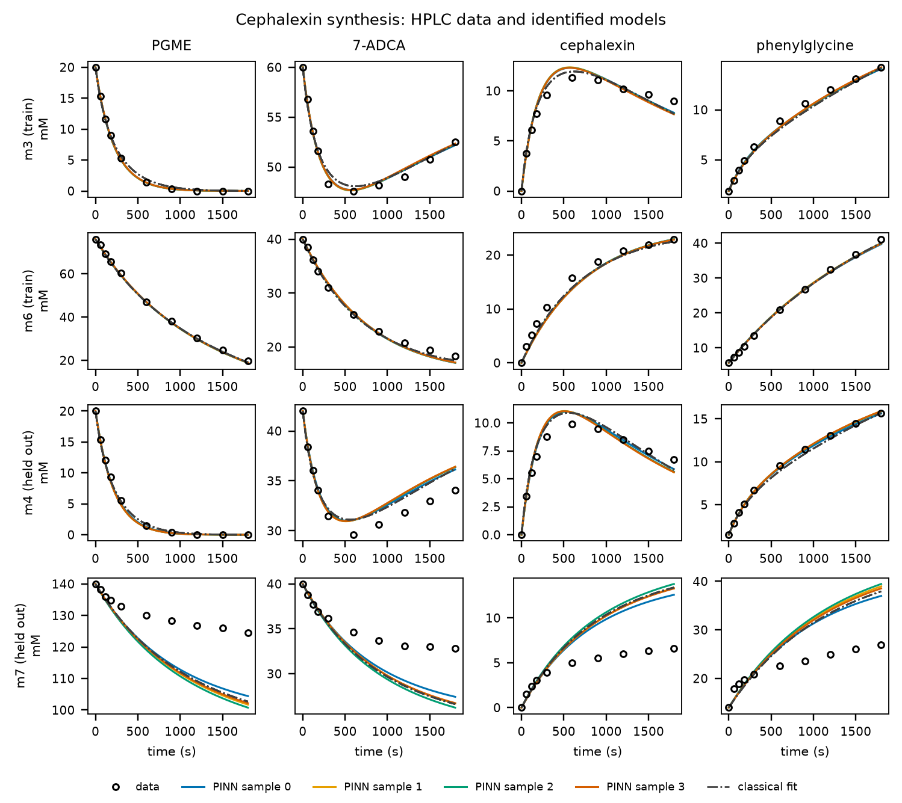

**그림 속 영어 풀이**

| 그림 속 글자 | 읽는 소리 | 낱말 풀이 | 우리말 | 그림의 어디에 / 뜻 |
|---|---|---|---|---|
| Cephalexin synthesis: HPLC data and identified models | 세팔렉신 신서시스: 에이치피엘시 데이터 앤드 아이덴티파이드 모델즈 | synthesis: 합성. identified: 식별된, 찾아낸 | 세팔렉신 합성: HPLC 데이터와 찾아낸 모델 | 맨 위 제목 |
| PGME, 7-ADCA, cephalexin, phenylglycine | 피지엠이, 세븐 에이디시에이, 세팔렉신, 페닐글라이신 | | 네 물질 | 열 제목 |
| m3 (train), m6 (train) | 엠쓰리 (트레인) | train: 학습 | 연습 문제 m3, m6 | 줄 이름 |
| m4 (held out), m7 (held out) | 엠포 (헬드 아웃) | held out: 떼어 둔 | 시험 문제 m4, m7 | 줄 이름 |
| mM | 밀리몰 | | 농도 단위 | 세로축 |
| time (s) | 타임 (세컨즈) | | 시간(초) | 가로축 |
| data | 데이터 | | HPLC 측정값 | 검은 빈 동그라미 |
| PINN sample 0 … 3 | 핀 샘플 제로 … 쓰리 | | PINN 표본 0~3번 | 색 실선 |
| classical fit | 클래시컬 핏 | classical: 고전적인 | 고전 피팅 | 검은 점-선 |

**그림 보는 순서**

1. **칸을 셉니다.** 줄은 실험 넷, 열은 물질 넷이라 16칸입니다. 칸마다 세로축 눈금이 다릅니다. PGME 칸 하나는 20에서, 다른 하나는 140에서 시작합니다. 칸끼리 높이를 비교하지 말고 칸 안에서 점과 선을 비교합니다.
2. **첫 줄 m3(연습 문제)를 읽습니다.** PGME는 20 mM에서 10분쯤 만에 거의 0이 됩니다. 7-ADCA는 60에서 47.6까지 내려갔다가 52.5로 다시 올라갑니다. 세팔렉신이 만들어질 때 7-ADCA를 쓰고, 세팔렉신이 쪼개질 때 7-ADCA가 돌아오기 때문입니다. 세팔렉신 칸은 600초쯤 11.3 mM로 가장 높고, 30분에 9.0 mM로 내려옵니다. 페닐글라이신은 계속 늘어납니다.
3. **선을 봅니다.** 색 실선 넷과 점-선이 거의 겹칩니다. 2부처럼 표본들이 연습 문제에서는 같은 말을 합니다. 자세히 보면 세팔렉신 꼭대기는 측정보다 조금 높고(12.3 대 11.3 mM), 30분 값은 조금 낮습니다(7.7 대 9.0 mM).
4. **둘째 줄 m6(연습 문제, PGME 76 mM):** 네 물질 모두 측정점 위를 지나갑니다.
5. **셋째 줄 m4(시험 문제, 조건 사이):** 공부에 쓰지 않았는데도 잘 맞습니다. 7-ADCA의 뒷부분만 측정보다 약 2 mM 높습니다.
6. **넷째 줄 m7(시험 문제, PGME 140 mM):** 여기서 크게 어긋납니다. 측정한 PGME는 5분 뒤부터 거의 줄지 않아 30분에 124.6 mM인데, 모델은 계속 줄어 101~104 mM까지 갑니다. 세팔렉신은 측정 6.6 mM인데 모델은 12.6~13.8 mM, 페닐글라이신은 측정 26.9 mM인데 모델은 37~39.5 mM입니다. 측정에서는 반응이 5분쯤 뒤에 거의 멈췄는데, 모델은 멈추지 않습니다.
7. **m7에서 선들의 퍼짐을 봅니다.** 색 실선 넷이 서로 가깝게 붙은 채 **함께** 빗나갑니다. 표본끼리의 차이(PGME 101~104 mM)는 빗나간 크기(20 mM 넘음)보다 훨씬 작습니다.

**숫자로 본 결과**

RMSE는 "빗나감의 평균 제곱근"(1부 8절)입니다. "÷σ"는 잡음(0.5 mM) 몇 개만큼 빗나갔는지입니다.

| 모델 | 연습 문제 6개 | m4 (조건 사이) | m7 (조건 바깥) |
|---|---|---|---|
| PINN 표본 4개, PGME만 (mM) | 0.67~0.70 | 0.32~0.44 | 11.7~13.6 |
| PINN 표본 4개, 네 물질 (÷σ) | 1.52~1.53σ | 1.46~1.66σ | 13.7~16.1σ |
| 고전 피팅 4번, 네 물질 (÷σ) | 1.42σ | 1.49σ | 14.6σ |
| 대조(단계 5를 한쪽으로), 네 물질 (÷σ) | 3.43σ | 3.16~3.19σ | 13.0~16.1σ |

- 표본 4개가 모두 남았습니다. 3σ를 넘어 버려진 표본이 없습니다.
- 단계 13(ESS → ED)의 빠르기 k₊₁₃은 표본마다 0.0020~0.0025 /s입니다.

**대조 모델과 이름표**

2부의 비교 그림에는 "WR"(약가역 모델)과 "nonWR"(일부러 한쪽으로만 가게 만든 대조)이 나왔습니다. 이 반응식은 처음부터 약가역이 아니라서 그 이름이 맞지 않습니다. 그래서 도구는 이런 반응식에서 이름을 바꿉니다(`3_fit/`의 그림 3a~3f).

| 그림의 이름 | 뜻 |
|---|---|
| identified | 적어 둔 반응식으로 찾은 모델(PINN 표본) |
| control: step 5 one-way | 대조. 단계 5(EAN ⇌ EP)를 한쪽으로만 가게 바꾼 반응식으로 찾은 모델 |
| excluded | 3σ를 넘어 버려진 표본(이번에는 없음) |
| classical | 고전 피팅 |

- 대조는 단계 5를 한쪽으로 만들어 **세팔렉신을 쪼개는 길을 없앤** 반응식입니다. 그러면 세팔렉신이 올라간 뒤 내려오지 않습니다. 그래서 연습 문제부터 3.43σ로 잘 맞지 않습니다. "세팔렉신이 다시 쪼개진다"는 단계 5의 거꾸로 방향을 데이터가 필요로 한다는 뜻입니다. 대조는 이렇게 "이 단계가 정말 필요한가"를 확인하는 비교입니다.
- 신호가 여럿이면 그림 3d(시험 문제 오차 표)가 네 물질 모두로 계산한 값을 쓰고(제목 끝의 "(all signals)"), 그림 3f(`fig3f_signals`)가 모든 실험과 모든 물질을 그립니다. 신호가 하나뿐인 2부의 예제에서는 그림 3d가 예전과 같고 3f는 없습니다.

**헷갈리기 쉬운 점**

- **m7은 "PGME가 조금 더 많은" 실험이 아닙니다.** 연습 문제 가운데 가장 많은 m6(76 mM)의 1.8배입니다. 공부할 때 한 번도 본 적 없는 영역입니다.
- **표본들이 서로 가깝다고 믿을 수 있는 것이 아닙니다.** 2-8절의 "함께 틀림"입니다. 2-8절에서는 원인이 효소량의 8% 오차였는데, 여기서는 원인이 **반응식 자체**일 가능성이 큽니다. 모든 표본이 같은 반응식으로 공부했으므로, 반응식에 빠진 것이 있으면 모두 같은 쪽으로 틀립니다. 표본을 늘려도, 강건 설계를 해도 이 오차는 드러나지 않습니다.
- **연습 문제 오차 1.5σ는 2부(1.0σ)보다 큽니다.** 실제 데이터에는 잡음 말고도 작은 어긋남(측정 쪽의 오차, 반응식의 작은 차이)이 섞여 있기 때문입니다. 도구의 기준(전체 2σ 안, 세트마다 3σ 안)에는 들어서 "연습 문제는 설명된다"고 봅니다.
- **"PGME만"과 "네 물질"은 다른 숫자입니다.** PINN은 PGME를 주 신호로 쓰고 나머지 셋을 추가 신호로 씁니다. 표의 mM 값은 PGME 하나의 빗나감이고, σ 값은 네 물질을 함께 본 것입니다.

**만약 ~라면?**

- **만약 실활 단계 13이 없었다면?** 같은 방법으로 해 보면 m7의 PGME 오차가 PINN 표본에서 22.7 mM로, 지금의 두 배 가까이 됩니다(프로젝트 `README.md`의 표). 단계 13은 3-3절의 비교로 고른 단계이고, m7의 오차를 절반으로 줄였습니다. 그래도 아직 다 맞히지는 못합니다.
- **만약 m7을 연습 문제에 넣는다면?** 지금 반응식으로는 표본 4개가 모두 3σ를 넘어 버려집니다(PGME 1.65~1.76 mM, 문턱 1.5 mM). 여덟 실험을 한꺼번에 잡음 수준으로 맞출 수 없다는 뜻이고, 반응식에 빠진 것이 있다는 또 하나의 신호입니다. 3-3절에서 이어집니다.

**숫자 따라 계산해 보기**

1. **m7의 30분 PGME 빗나감**
   - 측정 124.6 mM, 표본 3의 예측 102.2 mM이므로 차이는 22.4 mM입니다.
   - 22.4 ÷ 0.5 = 44.8이므로 잡음의 약 45배입니다.
   - 그런데 표의 RMSE는 이보다 작은 11.7~13.6 mM입니다. 처음 몇 점(0~3분)은 잘 맞아서, 10개 점의 평균 제곱근을 내면 작아지기 때문입니다.
2. **mM를 σ로 바꾸기**
   - 연습 문제의 PGME 오차 0.67 mM ÷ 0.5 = 1.34σ입니다(PGME만).
   - 네 물질을 함께 보면 1.52σ입니다. 7-ADCA와 세팔렉신 쪽 어긋남이 조금 더 커서입니다.
3. **실활 빠르기 0.002 /s 읽기**
   - ESS 모습으로 있는 효소는 1초마다 0.2%씩 망가집니다.
   - 계속 ESS로 있다면 평균 1 ÷ 0.002 = 500초(약 8분)를 버팁니다.
   - PGME가 많을수록 ESS로 있는 효소가 많아지므로 효소 전체가 빨리 망가집니다. PGME 140 mM인 m7에서 반응이 일찍 멈추는 모습을 이 단계가 설명하려는 것입니다.

**스스로 확인하기**

**문제 1.** 그림 10의 m3 줄에서 7-ADCA가 내려갔다가 다시 올라가는 이유는 무엇인가요?

답: 세팔렉신이 만들어질 때 7-ADCA를 쓰고, 같은 효소가 세팔렉신을 다시 쪼갤 때 7-ADCA가 돌아오기 때문입니다.

**문제 2.** m7에서 PINN 표본 4개가 서로 가까운데도 믿을 수 없는 이유는 무엇인가요?

답: 넷이 함께 같은 쪽으로 빗나가기 때문입니다(함께 틀림). 모두 같은 반응식으로 공부했으므로, 반응식에 빠진 것이 있으면 모두 같이 틀립니다. 표본끼리의 퍼짐으로는 이것을 알 수 없습니다.

**문제 3.** 대조 "control: step 5 one-way"가 연습 문제부터 잘 맞지 않는 것은 무엇을 뜻하나요?

답: 단계 5가 거꾸로 갈 수 없으면 세팔렉신이 쪼개지지 않아, 올라갔다 내려오는 측정 모양을 그릴 수 없습니다. 데이터가 단계 5의 거꾸로 방향(세팔렉신 쪼개기)을 필요로 한다는 뜻입니다.

**새로 나온 말**

- **identified / control:** 약가역이 아닌 반응식에서 비교 그림이 쓰는 이름입니다. "찾아낸 모델 / 대조 모델"입니다.
- **주 신호 / 추가 신호:** PINN이 반응 진행도를 그릴 때 기준으로 삼는 측정(여기서는 PGME)과, 함께 맞추는 나머지 측정(7-ADCA, 세팔렉신, 페닐글라이신)입니다.

> **한 줄 정리:** 연습 문제와 조건 사이의 시험 문제(m4)는 잘 맞았지만, PGME가 훨씬 많은 m7에서는 표본 넷이 함께 크게 빗나갔습니다. 표본의 퍼짐으로는 보이지 않는, 반응식에 빠진 것이 있다는 신호입니다.

### 3-3. 반응식에 빠진 것 찾기

**알고 싶은 것:** m7에서 반응이 일찍 멈추는 까닭을 반응식에서 찾을 수 있을까? 여러 가설을 데이터로 어떻게 가르나?

2-1절에서 "반응식은 데이터에서 저절로 나오지 않고 사람이 정해 준다"고 했습니다. 지금도 그렇습니다. 다만 사람이 "이런 단계가 더 있지 않을까" 하는 **가설**을 여럿 세우면, 도구가 가설마다 반응식을 고쳐 데이터에 다시 맞추고 어느 쪽이 데이터를 더 잘 설명하는지 비교해 줍니다. 이 일을 하는 명령이 `enzopt suggest`입니다.

**도구가 하는 일 (`enzopt suggest`)**

1. **후보를 만듭니다.** 적어 둔 반응식의 구조에서 저절로 만듭니다. 효소 모습마다 아직 붙지 않는 작은 분자가 붙는 막다른 결합, 효소 모습마다 실활(X → ED), 효소 없이 일어나는 반응, 다른 결합 순서, 한쪽 단계를 양쪽으로 바꾸기입니다. 사람이 직접 가설을 적을 수도 있습니다(`--candidate`). 거꾸로 효소 모습 하나와 그 단계를 빼 볼 수도 있습니다(`--kinds remove`).
2. **다시 맞춥니다.** 후보마다 그 단계를 넣은 반응식을 고전 피팅(2-4절의 최소제곱)으로 다시 맞춥니다. 출발점은 이미 끝난 실행의 고전 피팅 값이라 몇 분이면 끝납니다. 맞추기 하나가 15분을 넘으면 그때까지 가장 잘 맞은 값으로 멈춥니다.
3. **판정합니다.** 적어 둔 반응식이 연습 문제를 전체 2σ 안, 세트마다 3σ 안으로 맞추면 "설명된다"입니다. 아니면 가장 잘 맞는 후보가 어긋난 세트의 오차를 절반 이하로 줄이고 전체 오차를 늘리지 않을 때 그 단계를 제안합니다. 옆에 **ΔAIC**와 시험 문제 오차를 함께 적습니다.

**ΔAIC란.** 단계를 더하면 속도 상수가 늘어나서 맞춤은 거의 언제나 조금 좋아집니다. 그래서 "상수를 늘린 값을 치르고도 나아졌나"를 봐야 합니다. AIC(아카이케 정보 기준)는 "맞춤의 나쁨 + 상수 개수만큼의 벌점"이고, ΔAIC는 적어 둔 반응식과의 차이입니다. **음수이면 상수를 늘린 값보다 맞춤이 더 좋아졌다**는 뜻입니다. 몇 정도의 차이는 비슷하다고 보고, 수십 이상이면 뚜렷한 차이입니다.

> **비유:** 시험 점수를 올리려고 참고서를 한 권 더 사는 것과 같습니다. 점수가 조금 오르는 것은 당연하니, 책값(상수 하나)을 치르고도 남을 만큼 올랐는지를 봅니다.

**첫 시도: 도구가 만든 후보 40개**

단계 13을 넣기 전의 반응식(12단계)에 `enzopt suggest`를 돌렸습니다(약 13분). 결과는 둘로 나뉘었습니다.

- **연습 문제만 보면 "적어 둔 반응식으로 설명됨"(1.66σ)** 이었습니다. 연습 문제만으로는 단계를 더할 근거가 없다는 뜻입니다.
- **시험 문제 오차(20.3σ)를 가장 크게 줄인 후보 둘**은 모두 "PGME가 둘 붙은 효소(ESS)에 무언가 일어난다"는 것이었습니다. ESS → ED(실활, 10.4σ)와 ESS + PG ⇌ ESS_PG(페닐글라이신이 ESS를 붙잡음, 9.9σ)입니다.

그래서 ESS → ED를 단계 13으로 넣었습니다. 손으로 고른 실활 가설 여섯 개의 비교(프로젝트 `README.md`)에서도 같은 단계가 가장 나았습니다. 3-2절의 결과가 이 반응식입니다.

**둘째 시도: 사람이 세운 가설 다섯**

단계 13을 넣어도 m7은 아직 빗나갑니다. "PGME가 많을 때 무엇이 더 일어나나"를 다섯 가지로 적었습니다.

| 그림의 이름 | 가설 (`--candidate`로 준 식) | 쉬운 뜻 |
|---|---|---|
| ESSS -> ED | `ESS + PGME <=> ESSS; ESSS -> ED` | PGME가 셋째로 붙은 효소가 망가짐. PGME가 많을수록 더 가파르게 망가짐 |
| ESS + PG | `ESS + PG <=> ESS_PG` | 페닐글라이신이 ESS를 붙잡음 |
| MeOH binds E | `2: ES -> EA + MeOH; E + MeOH <=> E_MeOH` | 쌓인 메탄올이 효소를 붙잡음 |
| MeOH kills E | `2: ES -> EA + MeOH; E + MeOH -> ED` | 쌓인 메탄올이 효소를 망가뜨림 |
| EG -> ED | `EG -> ED` | 페닐글라이신이 붙은 효소가 망가짐 |

```
uv run enzopt suggest projects/aeh_cephalexin_lagerman2021 --kinds "" \
  --candidate "ESS + PGME <=> ESSS; ESSS -> ED" --candidate "ESS + PG <=> ESS_PG" \
  --candidate "2: ES -> EA + MeOH; E + MeOH <=> E_MeOH" --candidate "2: ES -> EA + MeOH; E + MeOH -> ED" \
  --candidate "EG -> ED"
```

- `--kinds ""`: 도구가 만드는 후보는 빼고, 적은 가설만 비교합니다.
- `"2: ES -> EA + MeOH; …"`: 앞의 `2:`는 "단계 2를 이 식으로 바꾼다"는 뜻입니다. 메탄올을 반응식에 넣으려면 메탄올이 나오는 단계 2부터 고쳐야 하기 때문입니다. `;` 뒤는 새로 더하는 단계입니다.
- 같은 명령 끝에 `--all-train`을 붙이면 시험 문제(m4, m7)까지 연습 문제에 넣어 맞춥니다. "이 반응식으로 여덟 실험을 한꺼번에 설명할 수 있는가"를 보는 시험입니다.

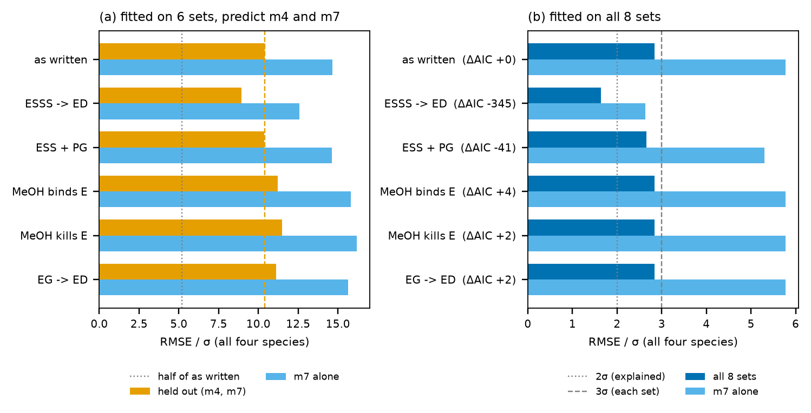

**그림 속 영어 풀이**

| 그림 속 글자 | 읽는 소리 | 낱말 풀이 | 우리말 | 그림의 어디에 / 뜻 |
|---|---|---|---|---|
| (a) fitted on 6 sets, predict m4 and m7 | 피티드 온 식스 세츠, 프리딕트 | fitted on: ~로 맞춘. predict: 예측하다 | (a) 6세트로 맞추고 m4·m7을 예측 | 왼쪽 칸 제목 |
| (b) fitted on all 8 sets | 피티드 온 올 에잇 세츠 | all: 모든 | (b) 8세트를 모두 맞춤 | 오른쪽 칸 제목 |
| as written | 애즈 리튼 | written: 적힌 | 적어 둔 반응식(지금 반응식) | 맨 위 줄 |
| RMSE / σ (all four species) | 알엠에스이 퍼 시그마 (올 포 스피시즈) | species: 화학종, 물질 | 빗나감 ÷ σ(네 물질 모두) | 가로축 |
| held out (m4, m7) | 헬드 아웃 | | 시험 문제 오차 | 주황 막대 |
| m7 alone | 엠세븐 얼론 | alone: 혼자 | m7만의 오차 | 하늘색 막대 |
| half of as written | 하프 오브 애즈 리튼 | half: 절반 | 지금 반응식 오차의 절반 | 회색 점선(a) |
| all 8 sets | 올 에잇 세츠 | | 8세트 전체 오차 | 파란 막대(b) |
| 2σ (explained), 3σ (each set) | 투 시그마 (익스플레인드), 쓰리 시그마 (이치 세트) | explained: 설명된. each: 각각의 | 문턱: 전체 2σ 안이면 설명됨, 세트마다 3σ 안 | 회색 점선·파선(b) |
| ΔAIC +0, −345 … | 델타 에이아이시 | Δ(델타): 차이 | 지금 반응식과의 AIC 차이 | 이름 옆 괄호 |

**그림 보는 순서**

**(a) 연습 문제 6개로 맞추고 예측하기**

1. **맨 위 줄(as written)을 기준으로 삼습니다.** 주황 막대가 10.4σ, 하늘색 막대(m7)가 14.6σ입니다. 주황 파선이 10.4σ 자리에 서 있습니다.
2. **회색 점선(5.2σ)을 봅니다.** 도구가 "시험 문제 오차를 절반 이하로 줄였다"고 인정하는 자리입니다.
3. **가설마다 주황 막대 끝을 읽습니다.** ESSS -> ED 8.95σ, ESS + PG 10.38σ, MeOH binds E 11.22σ, MeOH kills E 11.50σ, EG -> ED 11.11σ입니다. 회색 점선까지 내려온 막대가 없습니다.
4. **결론:** 연습 문제만으로 맞추면 어느 가설도 m7을 크게 낫게 예측하지 못합니다. ESSS -> ED가 가장 낫지만(10.4 → 8.95σ), 절반에는 멀었습니다.

**(b) 여덟 실험을 모두 맞추기**

1. **맨 위 줄(as written):** 파란 막대 2.84σ, 하늘색 막대(m7) 5.77σ입니다. 둘 다 회색 선(2σ, 3σ) 오른쪽에 있습니다. 지금 반응식으로는 여덟 실험을 한꺼번에 맞출 수 없다는 뜻입니다. 도구의 판정도 "설명되지 않음"이고, m6(3.36σ)과 m7(5.77σ)이 세트 문턱 3σ를 넘습니다.
2. **둘째 줄(ESSS -> ED):** 파란 막대 1.64σ로 2σ 점선 왼쪽, 하늘색 막대 2.64σ로 3σ 파선 왼쪽입니다. 다른 세트도 모두 3σ 안입니다(m6 1.71σ). 이 가설 하나로 여덟 실험이 모두 설명됩니다. ΔAIC는 −345로, 상수 두 개를 더한 값을 치르고도 크게 나아졌습니다. 도구는 이 단계를 제안합니다.
3. **셋째 줄(ESS + PG):** 2.65σ, m7 5.30σ로 조금 나아질 뿐입니다(ΔAIC −41).
4. **아래 세 줄(메탄올 둘, EG -> ED):** 막대가 맨 위 줄과 같습니다(ΔAIC +2~+4). 상수만 늘고 맞춤은 그대로입니다. 메탄올이 효소를 망가뜨린다는 가설의 빠르기는 거의 0(3 × 10⁻⁷)으로 맞춰졌습니다. 데이터가 이 가설들을 지지하지 않습니다.

**(a)와 (b)를 함께 읽기**

- **ESSS는 m7을 보고서야 보입니다.** 맞춘 값으로 보면, ESSS는 PGME가 수백 mM 근처는 되어야 많이 생깁니다(해리 상수 약 210 mM). 연습 문제의 PGME는 76 mM까지라서 ESSS가 거의 생기지 않고, 그래서 연습 문제만으로는 이 단계가 있는지 없는지 가릴 수 없습니다. (a)에서 맞춘 값(해리 상수 약 175 mM, ESSS → ED 0.0009 /s)은 (b)의 값(약 210 mM, 0.009 /s)과 실활 빠르기가 10배 다릅니다. 연습 문제에서는 ESSS가 거의 생기지 않으니 그 빠르기가 얼마이든 맞춤이 같아서, 연습 문제가 이 값을 정해 주지 못한 것입니다.
- **이것은 LDH 시험에서 본 교훈과 같습니다.** "어떤 분자의 농도를 바꾼 실험이 없으면, 그 분자가 관여하는 단계는 보이지 않는다"(`docs/suggest/README.md`). 여기서는 "PGME가 아주 많은 실험이 없으면, PGME가 아주 많을 때만 일어나는 일은 보이지 않는다"입니다.
- **2-8절의 고리와도 같습니다.** 예측이 갈리거나 틀리는 조건(m7)을 재서 공부에 넣자, 무엇이 빠졌는지가 보였습니다.

**도구 전체로 다시 확인하기 (그림 13)**

고전 피팅으로 고른 가설이 PINN에서도 통하는지 보려고, 프로젝트의 사본을 만들어 반응식에 단계 둘(ESS + PGME ⇌ ESSS, ESSS → ED)을 더하고 m7을 연습 문제로 옮겨 `enzopt run`을 처음부터 돌렸습니다. m4는 시험 문제로 남겼습니다.

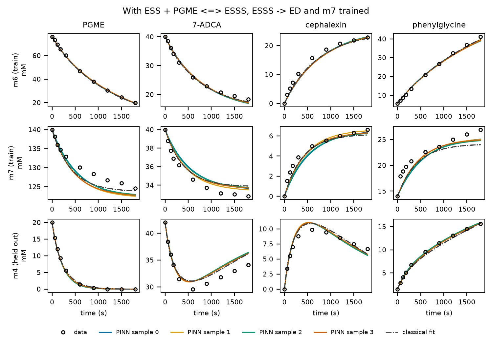

**결과**

| 모델 | 연습 문제 7개(m7 포함) | m7 (이번에는 연습 문제) | m4 (시험 문제, 처음 봄) |
|---|---|---|---|
| PINN 표본 4개, PGME만 (mM) | 0.94~1.07 | 1.76~2.19 | 0.23~0.32 |
| PINN 표본 4개, 네 물질 (÷σ) | 1.78~1.81σ | 2.73~2.83σ | 1.47~1.58σ |
| 고전 피팅 4번, 네 물질 (÷σ) | 1.67σ | 2.64σ | 1.44σ |

- **표본 4개가 모두 남았습니다.** 지금 반응식으로 m7을 연습 문제에 넣었을 때는 넷 다 3σ를 넘어 버려졌습니다(3-2절 "만약 ~라면?").
- **m7의 측정점을 따라갑니다.** 30분의 PGME를 모델은 122~124 mM로 그립니다(측정 124.6 mM). 그림 10의 101~104 mM에서 크게 가까워졌습니다.
- **처음 보는 m4는 그대로 잘 맞습니다**(PGME 0.23~0.32 mM). 새 단계가 조건 사이의 예측을 망가뜨리지 않았습니다.
- **실활을 ESS와 ESSS에 어떻게 나누는지는 정해지지 않습니다.** 고전 피팅 4번은 모두 실활을 거의 ESSS에만 두었습니다(ESSS → ED 0.0098 /s, ESS → ED 0.00005 /s, ESSS 해리 상수 약 250 mM). PINN 표본 넷은 제각각입니다(ESS → ED 0.0009~0.016 /s, ESSS 해리 상수 2.7~25 mM). 곡선은 모두 같은데 상수가 다릅니다. 2-6절의 "정해지지 않는 것"과 같은 모습입니다. 이 데이터가 정하는 것은 "PGME가 많을수록 효소가 얼마나 가파르게 망가지는가"라는 전체 모양이지, 그것을 두 단계에 나누는 방식이 아닙니다.
- **설계는 거의 그대로입니다.** 이 반응식으로 3-4절의 설계를 하면 강건 멈춤 597초, 가장 나쁜 표본의 수율 61%(멈출 구간 402~840초)로, 지금 반응식(561초, 61%)과 비슷합니다. 설계 조건(PGME 20 mM)에서는 두 반응식의 차이가 작기 때문입니다.
- 사본 프로젝트의 실행은 ③ 단계에 약 28분 걸렸습니다(상수가 늘고 PGME 140 mM 실험이 들어가 고전 피팅이 느려짐).

**거꾸로: 빼도 되는 단계**

단계를 더하는 것과 반대로, 효소 모습 하나와 그것을 거치는 단계를 빼 보면 "데이터가 필요로 하지 않는 단계"를 찾을 수 있습니다(`uv run enzopt suggest projects/aeh_cephalexin_lagerman2021 --kinds remove`, 약 2.5분).

| 뺀 것 | 상수 개수 | 연습 문제 | 시험 문제 | ΔAIC | 판정 |
|---|---|---|---|---|---|
| 없음(지금 반응식) | 21 | 1.42σ | 10.4σ | 0 | |
| EN과 EG 함께(단계 8, 9) | 17 | 1.43σ | 9.9σ | −6.1 | 빼도 됨 |
| ESS(단계 10, 13) | 18 | 1.66σ | 20.3σ | +67 | 필요 |
| EAS(단계 11, 12) | 18 | 2.25σ | 12.9σ | +214 | 필요 |
| EAN(단계 4, 5, 7) | 16 | 15.0σ | 15.4σ | +1122 | 꼭 필요(세팔렉신 합성 자체) |

- 7-ADCA의 막다른 결합(단계 8)과 페닐글라이신의 생성물 저해(단계 9)는 빼도 맞춤이 그대로입니다. 맞춘 해리 상수가 63 mM과 105 mM으로, 실험 농도에서 효소를 거의 붙잡지 않기 때문입니다.
- 그렇다고 "이 단계가 없다"는 증거는 아닙니다. "이 데이터의 농도 범위에서는 없어도 된다"는 뜻입니다. 7-ADCA나 페닐글라이신을 훨씬 많이 넣으면 보일 수도 있습니다.

**헷갈리기 쉬운 점**

- **"여덟 실험을 모두 맞췄다"는 시험이 아닙니다.** (b)와 그림 13은 m7을 보고 맞춘 결과입니다. 공부한 문제를 맞힌 것이지, 처음 보는 문제를 맞힌 것이 아닙니다. 이 가설을 믿으려면 PGME가 많은 조건(예: 100 mM, 200 mM)을 새로 재서 **새 시험 문제**로 확인해야 합니다.
- **다른 설명이 없다는 뜻도 아닙니다.** 이번에 시험한 것은 다섯 가설뿐입니다. PGME가 많을수록 가파르게 효소가 망가지는 다른 길(예: pH 변화, 메탄올 말고 다른 물질)이 있다면, 그것도 비슷하게 맞을 수 있습니다.
- **그래서 프로젝트의 반응식은 아직 바꾸지 않았습니다.** 어느 반응식을 기본으로 삼을지는 과학적 판단이라 사람이 정할 일로 남겨 두었습니다(`evals/QUESTIONS.md`의 Q-05).

**만약 ~라면?**

- **만약 PGME 200 mM 실험을 하나 더 잰다면?** ESSS 가설과 지금 반응식은 m7보다 더 크게 갈릴 것입니다. 그 실험을 시험 문제로 두면, 어느 쪽이 맞는지 처음 보는 문제로 가를 수 있습니다.
- **만약 효소를 PGME에 미리 담가 두었다가 7-ADCA를 넣는다면?** 실활 가설(ESSS → ED, ESS → ED)이 맞다면 담가 둔 시간만큼 효소가 줄어 반응이 느려집니다. 붙잡기만 하는 가설(ESS + PG ⇌ ESS_PG 같은 막다른 결합)이라면 희석하면 효소가 돌아옵니다. 이렇게 가설마다 다른 예측을 내는 실험이 가설을 가르는 가장 확실한 방법입니다.

**숫자 따라 계산해 보기**

1. **(a)에서 "절반"의 자리**
   - 지금 반응식의 시험 문제 오차 10.41σ ÷ 2 = 5.2σ입니다.
   - 가장 나은 ESSS도 8.95σ라 5.2σ에 못 미칩니다.
2. **(b)에서 ESSS가 줄인 정도**
   - 전체: 2.84σ → 1.64σ, 1.64 ÷ 2.84 ≈ 0.58이므로 약 42% 줄었습니다.
   - m7: 5.77σ → 2.64σ, 2.64 ÷ 5.77 ≈ 0.46이므로 절반 아래로 줄었습니다.
3. **ESSS가 생기는 정도(맞춘 해리 상수 약 210 mM)**
   - ESSS의 양은 대략 ESS의 양 × (PGME 농도 ÷ 해리 상수)입니다.
   - PGME 20 mM: 20 ÷ 210 ≈ 0.1이므로 ESS의 10분의 1쯤입니다.
   - PGME 140 mM(m7): 140 ÷ 210 ≈ 0.67이므로 ESS의 3분의 2쯤입니다. 거기에 ESS 자체도 PGME가 많을수록 많아지므로, m7에서는 망가지는 효소가 훨씬 많아집니다.

**스스로 확인하기**

**문제 1.** 단계를 하나 더했더니 연습 문제 오차가 조금 줄었습니다. 이것만으로 그 단계가 있다고 할 수 있나요?

답: 아닙니다. 상수가 늘면 맞춤은 거의 언제나 조금 좋아집니다. ΔAIC로 상수를 늘린 값을 치르고도 나아졌는지 보고, 시험 문제(처음 보는 조건)로도 확인해야 합니다.

**문제 2.** ESSS 가설이 (a)에서는 크게 낫지 않은데 (b)에서는 크게 나은 이유는 무엇인가요?

답: ESSS는 PGME가 아주 많을 때만 많이 생깁니다. 연습 문제 6개는 PGME가 76 mM까지라 이 단계가 보이지 않았고, PGME 140 mM인 m7을 넣자 비로소 보였습니다.

**문제 3.** (b)의 결과로 ESSS 가설이 맞다고 결론 내려도 되나요?

답: 아직 아닙니다. m7을 보고 맞춘 결과라 시험이 아닙니다. PGME가 많은 조건을 새로 재서 시험 문제로 확인하거나, 가설마다 다른 예측을 내는 실험(미리 담가 두기 등)을 해야 합니다.

**문제 4.** "빼도 됨"으로 나온 단계 8, 9는 반응에 없는 단계인가요?

답: 아닙니다. 이 데이터의 농도 범위에서는 없어도 맞춤이 그대로라는 뜻입니다. 농도를 크게 바꾼 실험에서는 필요할 수 있습니다.

**새로 나온 말**

- **가설:** "이런 단계가 있지 않을까" 하는 짐작입니다. 데이터로 비교하기 전까지는 짐작일 뿐입니다.
- **후보:** `enzopt suggest`가 비교하는 반응식 하나하나입니다. 도구가 구조에서 만들기도 하고(막다른 결합, 실활 …), 사람이 적어 주기도 합니다(`--candidate`).
- **AIC, ΔAIC:** 맞춤의 나쁨에 상수 개수만큼 벌점을 더한 점수와, 그 점수의 차이입니다. 음수일수록 상수를 늘린 값을 치르고도 나아졌다는 뜻입니다.
- **빼도 됨(가지치기):** 효소 모습과 단계를 빼도 ΔAIC가 음수이고 시험 문제 오차가 나빠지지 않는 것입니다.

> **한 줄 정리:** 도구는 가설마다 반응식을 고쳐 다시 맞추고 비교해 줍니다. PGME가 셋째로 붙은 효소가 망가진다는 가설 하나가 여덟 실험을 모두 설명했지만, 그 단계는 PGME가 많은 m7을 보고서야 보였습니다. 믿으려면 새 조건으로 다시 시험해야 합니다.

### 3-4. 언제 멈추나: 최고 수율 설계

**알고 싶은 것:** 세팔렉신이 올라갔다가 다시 내려간다면, 7-ADCA를 얼마나 넣고 언제 반응을 멈춰야 가장 많이 남을까?

2-7절의 설계는 "효소를 얼마나 넣어야 300초 안에 끝나나"였습니다. 이 반응에서는 그 질문이 맞지 않습니다. 효소를 많이 넣으면 세팔렉신이 빨리 생기지만 빨리 쪼개지기도 해서, 효소량을 늘린다고 결과가 늘 좋아지지 않기 때문입니다. 대신 효소량은 실험값(200 nM)으로 정해 두고 **"언제 멈추나"** 를 묻습니다. 도구의 설계 목표 `target: peak`가 이 질문입니다.

**무엇을 했나**

- PGME 20 mM, 효소 200 nM에서 ρ(= 7-ADCA ÷ PGME)를 1, 1.5, 2, 3으로 바꾸어 가며, PINN 표본 4개 각각으로 세팔렉신 수율 곡선을 1시간까지 계산했습니다. 수율은 "넣은 PGME 가운데 세팔렉신이 된 몫"입니다.
- ρ마다 **강건 멈춤 시각**을 찾았습니다. 그 시각에 멈추면, 네 표본 가운데 가장 나쁜 표본의 수율이 가장 높아지는 시각입니다(2-7절의 강건 설계와 같은 생각: 가장 비관적인 표본에 맞춘다).
- 그 수율의 95% 이상을 지키는 시간 범위(**멈출 구간**)도 계산했습니다. 실험할 때 정확히 그 초에 멈추지 못해도 되는 여유입니다.

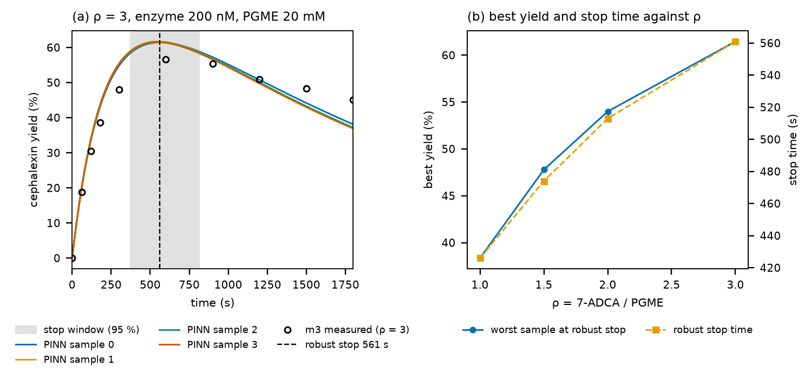

**그림 속 영어 풀이**

| 그림 속 글자 | 읽는 소리 | 낱말 풀이 | 우리말 | 그림의 어디에 / 뜻 |
|---|---|---|---|---|
| (a) ρ = 3, enzyme 200 nM, PGME 20 mM | 로 이퀄 쓰리, 엔자임 | | (a) ρ = 3, 효소 200 nM, PGME 20 mM | 왼쪽 칸 제목 |
| cephalexin yield (%) | 세팔렉신 일드 | yield: 수율, 얻은 몫 | 세팔렉신 수율(%) | 왼쪽 세로축 |
| stop window (95 %) | 스톱 윈도우 | stop: 멈춤. window: 창, 구간 | 멈출 구간(최고의 95% 이상) | 회색 띠 |
| robust stop 561 s | 로버스트 스톱 | robust: 튼튼한, 강건한 | 강건 멈춤 시각 561초 | 검은 파선 |
| m3 measured (ρ = 3) | 엠쓰리 메저드 | measured: 측정된 | 실험 m3의 측정값(ρ = 3) | 검은 빈 동그라미 |
| (b) best yield and stop time against ρ | 베스트 일드 앤드 스톱 타임 어게인스트 로 | against: ~에 대해 | (b) ρ에 따른 최고 수율과 멈출 시각 | 오른쪽 칸 제목 |
| worst sample at robust stop | 워스트 샘플 앳 로버스트 스톱 | worst: 가장 나쁜 | 강건 멈춤 시각에서 가장 나쁜 표본의 수율 | 파란 실선(왼쪽 축) |
| robust stop time | 로버스트 스톱 타임 | | 강건 멈춤 시각 | 주황 파선(오른쪽 축) |
| ρ = 7-ADCA / PGME | | | 7-ADCA ÷ PGME | (b) 가로축 |

**그림 보는 순서**

**(a) ρ = 3의 수율 곡선**

1. **곡선의 모양을 봅니다.** 수율이 0에서 빠르게 올라 550초 근처에서 꼭대기(약 61%)에 닿고, 그 뒤로 천천히 내려가 30분(1800초)에 약 37~38%가 됩니다.
2. **색 실선 넷이 거의 겹칩니다.** 표본마다의 꼭대기 시각은 546~564초, 꼭대기 수율은 61.5~61.7%입니다. 표본끼리는 같은 말을 합니다.
3. **검은 파선(561초)과 회색 띠(375~810초)를 봅니다.** 561초에 멈추는 것이 가장 좋고, 375초에서 810초 사이 아무 때나 멈춰도 그 수율의 95% 이상은 얻습니다.
4. **검은 동그라미(실험 m3)를 봅니다.** m3는 ρ = 3, PGME 20 mM으로 이 설계와 거의 같은 조건입니다(처음 페닐글라이신 1.9 mM만 다름). 측정은 300초 48%, 600초 57%, 900초 55%이고, 실제 꼭대기는 600초 근처입니다.
5. **곡선과 동그라미를 비교합니다.** 곡선이 동그라미보다 처음에 조금 빨리 오르고 꼭대기가 약 4%p 높습니다. 30분 쪽에서는 곡선이 동그라미보다 낮습니다(37% 대 45%). 모델이 세팔렉신을 조금 빨리 만들고 조금 빨리 쪼갠다고 보는 것입니다.

**(b) ρ에 따른 변화**

1. **파란 실선(왼쪽 축):** ρ = 1에서 38%, 1.5에서 48%, 2에서 54%, 3에서 61%입니다. 7-ADCA를 많이 넣을수록 수율이 오릅니다.
2. **주황 파선(오른쪽 축):** 멈출 시각은 426초, 474초, 513초, 561초로 ρ가 클수록 조금 늦어집니다.
3. **이유:** 아실 효소(EA)가 조각을 물에 버리기 전에 7-ADCA가 먼저 받아 갈 기회가 많아지기 때문입니다(3-1절의 택배 비유에서 고객이 더 많이 기다리고 있는 셈).
4. **시험한 범위 안에서는 ρ = 3이 가장 좋습니다.** 그래서 도구는 ρ* = 3을 고릅니다. ρ를 더 키우면 더 오를 수도 있지만, 실험한 범위(7-ADCA ÷ PGME가 0.5~3) 밖이라 계산하지 않았습니다.

**피펫 표**

도구는 `5_design/pipette.csv`에 다음 두 줄을 씁니다(최종 1000 µL, 원액 PGME·7-ADCA 각 200 mM, 효소 10 µL).

| 세트 | 목적 | ρ | 완충액 | 효소 최종 | 기록할 것 | 예측 |
|---|---|---|---|---|---|---|
| D1 | 최고 수율에서 멈춤(강건) | 3 | 590 µL | 200 nM | 375~810초 사이에 멈춤(가장 좋은 561초) | 표본 최악 수율 61% |
| Z | 효소 없음(대조) | 3 | 600 µL | 0 | 561초 | 변화 없음 |

PGME 원액 100 µL(20 mM × 1000 ÷ 200), 7-ADCA 원액 300 µL(60 mM × 1000 ÷ 200), 효소 10 µL에 완충액을 채워 1000 µL를 만듭니다. Z는 효소 대신 완충액 10 µL를 더 넣습니다.

**헷갈리기 쉬운 점**

- **"표본 최악 수율 61%"는 실제로도 61%라는 뜻이 아닙니다.** 표본 넷이 같은 말을 하는 것은 이번에도 "함께 틀림"을 막아 주지 못합니다. 같은 조건의 m3 측정은 57%였으므로, 이 설계는 약 4%p 낙관적입니다. 다행히 멈출 구간(375~810초)은 실제 꼭대기(600초 근처)를 품습니다.
- **수율은 "넣은 PGME" 기준입니다.** 7-ADCA를 3배 넣었으므로 7-ADCA 기준으로 보면 세팔렉신이 된 몫은 3분의 1쯤입니다. 남은 7-ADCA를 다시 쓸 수 있는지는 이 계산 밖의 문제입니다.
- **효소량은 고정입니다.** 2-7절처럼 효소량을 찾지 않습니다. 효소량을 바꾸면 곡선 전체가 시간축을 따라 늘어나거나 줄어듭니다(효소가 두 배면 대략 두 배 빨리 꼭대기에 닿음). 효소가 망가지는 빠르기는 효소량과 상관없어서 아주 정확히 비례하지는 않습니다.
- **PGME를 많이 쓰는 설계에는 쓰지 마세요.** 3-2·3-3절에서 본 것처럼, 이 반응식은 PGME 140 mM에서 틀렸습니다. 설계는 연습 문제와 같은 PGME 20 mM에서만 했습니다.

**만약 ~라면?**

- **만약 30분까지 그냥 둔다면?** ρ = 3에서 수율이 약 37~38%로 떨어집니다. 꼭대기의 60% 정도입니다. 측정(m3)으로는 45%입니다. 어느 쪽이든 멈추는 시각이 수율을 크게 바꿉니다.
- **만약 ρ = 1로 한다면?** 꼭대기가 38%로 낮고, 더 일찍(426초) 멈춰야 합니다.

**숫자 따라 계산해 보기**

1. **수율을 농도로 바꾸기**
   - 61% × 20 mM = 12.2 mM의 세팔렉신입니다.
   - m3의 측정 꼭대기 11.3 mM ÷ 20 mM = 57%입니다.
2. **멈출 구간의 폭**
   - 810 − 375 = 435초, 약 7분입니다. 이 안에서 멈추면 꼭대기의 95% 이상(61% × 0.95 ≈ 58%)을 얻습니다.
3. **피펫 부피**
   - PGME: 20 mM × 1000 µL ÷ 200 mM = 100 µL.
   - 7-ADCA: 3 × 20 mM × 1000 µL ÷ 200 mM = 300 µL.
   - 완충액: 1000 − 100 − 300 − 10 = 590 µL.

**스스로 확인하기**

**문제 1.** 이 반응에서 효소량을 늘리는 대신 "언제 멈추나"를 묻는 이유는 무엇인가요?

답: 같은 효소가 세팔렉신을 만들기도 하고 쪼개기도 해서, 효소를 늘리면 꼭대기에 빨리 닿을 뿐 꼭대기가 높아지지는 않기 때문입니다. 멈추는 시각이 얻는 양을 정합니다.

**문제 2.** 강건 멈춤 시각은 어떻게 정하나요?

답: 시각마다 네 표본 가운데 가장 나쁜 수율을 보고, 그것이 가장 높은 시각을 고릅니다.

**문제 3.** 설계가 61%를 예측했는데 m3는 57%였습니다. 무엇을 뜻하나요?

답: 모델 전체가 조금 낙관적이라는 뜻입니다(표본 넷이 함께 틀림). 그래서 예측 수율보다 멈출 구간을 더 믿고, 확인 실험으로 실제 수율을 잽니다.

**새로 나온 말**

- **수율(yield):** 넣은 재료 가운데 원하는 생성물이 된 몫입니다.
- **강건 멈춤 시각:** 가장 나쁜 표본의 수율이 가장 높아지는 멈춤 시각입니다.
- **멈출 구간(stop window):** 최고 수율의 95% 이상을 지키는 시간 범위입니다.
- **`target: peak`:** `project.yaml`의 설계 목표 가운데 "효소량 고정, 언제 멈추나"입니다. 다른 목표는 `assay`(2-7절, 분석 대상을 다 쓰는 최소 효소량), `yield`·`selectivity`(수율·선택도 목표의 최소 효소량), `time`(효소량 상한에서 가장 빨리 끝나는 조건)입니다.

> **한 줄 정리:** 만들고 다시 쪼개는 반응에서는 "언제 멈추나"가 설계의 답입니다. 이 데이터로는 7-ADCA를 PGME의 3배 넣고 약 9분(561초)에 멈추면 세팔렉신이 가장 많이 남는다고 예측하고, 같은 조건의 실험은 600초 근처에서 꼭대기에 닿았습니다.

### 3-5. 3부에서 배운 것

1. **실제 데이터에는 정답이 없습니다.** 그래서 시험 문제가 더 중요합니다. 연습 문제에 잘 맞는 것(1.5σ)은 시작일 뿐이고, 조건 사이(m4)와 바깥(m7)을 따로 확인해야 합니다.
2. **표본이 모두 같이 틀릴 때가 가장 위험합니다.** 2-8절에서는 효소량 오차 때문이었고, 3부에서는 반응식에 빠진 것 때문이었습니다. 표본의 퍼짐도, 강건 설계도 이것을 드러내지 못합니다. 드러내는 것은 시험 문제뿐입니다.
3. **반응식도 데이터로 따져 봅니다.** 가설을 세우고, 가설마다 다시 맞추고, ΔAIC와 시험 문제 오차로 비교합니다(`enzopt suggest`). 빼도 되는 단계도 같은 방법으로 찾습니다.
4. **어떤 단계는 그 단계가 일하는 조건을 재야 보입니다.** PGME가 아주 많을 때만 일하는 단계는 PGME가 아주 많은 실험이 있어야 보입니다. 가설을 믿으려면 그 조건을 새로 재서 시험 문제로 확인합니다.
5. **설계의 질문은 반응에 맞춰 고릅니다.** 끝까지 가는 반응은 "얼마나 빨리"(2-7절), 만들고 다시 쪼개는 반응은 "언제 멈추나"(3-4절)입니다.
6. **도구가 실제 데이터를 위해 다루는 것:** 신호 여럿, 효소 실활(망가진 효소 모습), 약가역이 아닌 반응식의 검증(보존량·음수 없음), 비교 그림의 이름표(identified / control), 가설 비교(`enzopt suggest`), 최고 수율 설계(`target: peak`).

---

## 4부. 정리

전체 과정을 한 번에 정리하면 이렇습니다.

1. 반응식은 효소가 일하는 순서를 적은 것이고, 단계마다 속도 상수가 있습니다.
2. 속도 상수를 알면 곡선을 계산할 수 있지만(정문제), 곡선에서 속도 상수를 알아내는 것(역문제)은 어렵습니다.
3. 곡선 하나에는 정보가 적어서, 데이터에 똑같이 맞는 상수 묶음이 여럿 있습니다. 이미 빠른 단계는 얼마나 빠른지 보이지 않고, 여러 상수가 함께 움직이면 효과가 상쇄됩니다.
4. 도구는 그래서 답을 하나만 내지 않고 여러 표본을 냅니다. 표본들이 같은 말을 하는 조건은 믿을 수 있고, 다른 말을 하는 조건은 불확실합니다.
5. 설계는 모든 표본에서 성공하도록 정합니다(강건 설계). 표본들이 많이 갈리면 효소를 많이 쓰게 됩니다.
6. 표본이 갈리는 조건은 직접 재서 학습에 넣으면 좁아집니다. 다만 모든 표본이 같이 틀리는 오차(효소량 오차 등)는 남으니 여유를 둡니다. 또 다시 학습하면 상수들이 움직여 다른 조건의 예측이 흔들릴 수 있으니(이 예제에서는 표본 둘이 시험 문제 D′를 크게 빗나가게 됨), 시험 문제로 다시 확인합니다.
7. 실제 데이터에서는 반응식 자체가 틀릴 수 있습니다. 반응식에 빠진 것이 있으면 모든 표본이 같은 쪽으로 틀리므로(3-2절의 m7), 표본의 퍼짐이 아니라 시험 문제로만 드러납니다. 그때는 가설을 세우고 가설마다 다시 맞춰 비교합니다(`enzopt suggest`, 3-3절). 어떤 단계는 그 단계가 일하는 조건(예: PGME가 아주 많을 때)을 재야 보입니다.
8. 설계의 질문은 반응에 맞춰 고릅니다. 끝까지 가는 반응은 "효소를 얼마나 넣으면 제때 끝나나"(2-7절), 만들고 다시 쪼개는 반응은 "언제 멈추나"(3-4절)입니다.

**실제 실험에 주는 교훈**

- **설계에 쓸 조건(이 예제에서는 젖산 0)은 미리 재서 연습 문제에 넣으세요.** 그래야 표본이 그 조건에서 좁아지고, 효소를 낭비하지 않습니다.
- **연습 문제에 잘 맞는다고 다 맞는 것은 아닙니다.** 시험 문제(홀드아웃)와 실전(설계 확인)으로 꼭 확인하세요.
- **강건 설계에도 효소량 오차만큼의 여유를 두세요.**
- **설계할 조건 바깥(예: 훨씬 진한 재료)은 따로 재서 확인하세요.** 연습 문제 바깥에서는 표본들이 함께 틀릴 수 있습니다(3-2절).
- **반응식이 의심스러우면 가설마다 다른 예측을 내는 실험을 설계하세요.** 예: 효소를 재료에 미리 담가 두기(실활이면 활성이 줄고, 붙잡기만 하는 결합이면 희석하면 돌아옴, 3-3절).

---

## 용어 사전

| 용어 | 쉬운 뜻 |
|---|---|
| 분자 | 물질을 이루는 아주 작은 알갱이 |
| 농도 (mM, µM, nM) | 같은 양의 물에 분자가 얼마나 많은지. mM = 1000 µM = 1,000,000 nM |
| 화학 반응 | 분자끼리 만나 다른 분자로 바뀌는 일 |
| 효소 | 반응을 빠르게 해 주는 단백질 일꾼. 쓰여 없어지지 않고 계속 일함 |
| NADH / NAD⁺ | 수소를 실은 배달 트럭 / 빈 트럭. NADH만 340 nm 빛을 빨아들임 |
| 피루브산(Pyr) / 젖산(Lac) | 반응에서 수소를 받는 물질 / 받고 나서 된 물질 |
| 반응식(반응 고리) | 효소가 무엇을 어떤 순서로 붙잡고 놓는지 적은 순서표 |
| 반응 속도 | 1초 동안 물질이 얼마나 바뀌는지 |
| 속도 상수 (k₊, k₋) | 각 단계가 얼마나 잘 일어나는지 나타내는 숫자. 클수록 빠름 |
| 평형 / 평형 상수 K′ | 앞으로·거꾸로 가는 속도가 같아져 양이 더 안 바뀌는 상태 / 그때의 오른쪽:왼쪽 비율 |
| 흡광도 A340 | 340 nm 빛이 얼마나 막혔는지. A340 = 6.22 × NADH(mM) |
| 진행 곡선 | 시간에 따라 A340이 바뀌는 모습을 그린 그래프 |
| 잡음, σ | 측정할 때마다 생기는 흔들림, 그 보통 크기(예제 0.003) |
| RMSE | 곡선이 측정점에서 평균 얼마나 빗나가는지. ÷ σ가 1 근처면 잡음 수준으로 잘 맞음 |
| 시뮬레이션 / 미분방정식 | 지금 속도로 조금 뒤를 계산하기를 되풀이해 미래를 그리는 것 / 그 규칙을 적은 수식 |
| 정문제 / 역문제 | 상수 → 곡선 / 곡선 → 상수 |
| 식별 | 곡선에서 속도 상수를 알아내는 일(역문제) |
| 식별 불가능 | 데이터에 똑같이 맞는 답이 여럿이라 하나로 정할 수 없음 |
| 맞추기(피팅) | 상수를 조금씩 바꿔 가며 빗나감을 줄이는 방법 |
| 지역 최소 / 재시작 | 가장 낮지 않은데 갇히는 골짜기 / 여러 곳에서 출발해 가장 낮은 곳을 고르기 |
| 사전분포 | 상수가 보통 어느 정도인지에 대한 상식. 너무 벗어나면 작은 벌점 |
| 자릿수 | 10배 차이를 1로 세는 방법. 2자릿수 = 100배 |
| 신경망 | 손잡이가 수천 개 달려 어떤 곡선이든 그릴 수 있는 계산 장치 |
| PINN | 곡선이 측정점과 반응 규칙을 함께 지키도록 학습하는 신경망 |
| 표본 | 데이터에 맞는 답(속도 상수 묶음) 하나. 여러 개를 남김 |
| 불확실성 | 표본들이 서로 다르게 예측하는 정도 |
| 학습 / 홀드아웃 / 설계 확인 세트 | 연습 문제 / 시험 문제 / 실전 |
| 공칭 설계 / 강건 설계 | 표본 하나만 믿고 정한 조건 / 모든 표본에서 성공하도록 정한 조건 |
| 세트 | 실험 한 번. 처음 농도와 효소량이 정해진 측정 하나 |
| 명목값 | 실험 노트에 "이만큼 넣었다"고 적어 둔 값. 실제 들어간 양과 조금 다를 수 있음 |
| 피펫 | 액체를 정해진 양만큼 덜어 옮기는 실험 도구 |
| 반응 절반 시간 | 반응이 결국 변할 양의 절반만큼 변하는 데 걸리는 시간. 곡선 모양을 숫자 하나로 줄인 것 |
| 고전 피팅 / 최소제곱 | 상수를 바꿀 때마다 시뮬레이션을 다시 해 빗나감을 줄이는 예전 방법 / 빗나감의 제곱 합을 가장 작게 하는 기준 |
| 손실(채점 벌점) | PINN이 줄이려는 점수. 데이터·물리·출발점·상식 항목의 합 |
| 잔차 | 남은 차이. 물리 잔차는 곡선의 기울기와 반응 규칙이 주는 속도의 차이 |
| Adam / L-BFGS | 손잡이를 조금씩 돌려 점수를 낮추는 방법의 이름 / 마무리에 더 정밀하게 바닥을 찾는 방법의 이름 |
| 씨앗 번호(seed) | 무작위 출발점을 정하는 번호. 이 글에서는 표본 번호 |
| ODE | 미분방정식의 영어 줄임말. ODE를 푼다 = 시뮬레이션한다 |
| GPU(그래픽 카드) | 같은 계산을 동시에 많이 하는 데 뛰어난 컴퓨터 부품 |
| ρ(로) | 피루브산 농도 ÷ NADH 농도 |
| 로그 눈금(10배 눈금) | 눈금 한 칸마다 10배가 되는 축 |
| 10⁴, 10⁻², 1.3e-04 | 10000, 0.01, 0.00013 (10의 거듭제곱 표기) |
| log10 | 어떤 수가 10의 몇 제곱인지. log10(찾은 값 ÷ 정답)이 1이면 10배 |
| 칸 / 캡션 | 그림 하나 속의 작은 그림 하나, (a)(b)(c)(d)로 부름 / 그림 아래의 설명 글 |
| 축 이름 / 단위 | 축 옆에 적힌 그 축의 이름 / 이름 뒤 괄호 속 글자. (s)는 초 |
| 눈금 / 작은 눈금 | 축에 붙은 짧은 막대와 그 숫자 / 10배 눈금에서 숫자 없이 2, 3, …, 9 자리를 표시하는 짧은 막대 |
| 범례 | 칸 귀퉁이의 작은 표. "이 색, 이 모양은 무엇"을 알려 줌 |
| 기준선 | 그래프 안에 쭉 그어진 비교용 선. 정답(0), 잡음 수준(1), 목표선 등 |
| 실선 / 파선 / 점선 | 끊김 없는 선 / 짧은 막대가 띄엄띄엄 이어진 선 / 작은 점이 이어진 선 |
| 두 번째 세로축 | 칸 오른쪽에 붙은 세로축. 크기가 전혀 다른 값을 같은 칸에 그릴 때 씀 |
| m, µ, n (앞 글자) | 단위 앞에 붙어 1000분의 1, 100만분의 1, 10억분의 1을 뜻함 |
| nm(나노미터) / 파장 | 1 m의 10억분의 1인 길이 단위. nM(나노몰)과 다름 / 빛의 물결 하나의 길이. 빛의 색을 정함 |
| 지수 / e 표기 | 10ⁿ에서 오른쪽 위의 n / 1.3e-04 = 1.3 × 10⁻⁴처럼 컴퓨터가 10의 거듭제곱을 적는 방법 |
| 반올림 / ≈ | 끝자리를 정리해 숫자를 짧게 만드는 것 / "약, 거의 같다" |
| ≤ / ± | 작거나 같다(이하) / 위아래로 그만큼 |
| 프라임(′) | D′, K′처럼 비슷한 것을 구별하려고 붙이는 작은 표시 |
| 합성 데이터 | 정답 상수를 정해 놓고 컴퓨터로 만든 데이터. 찾은 답을 정답과 비교할 수 있음 |
| LDH | 이 글의 효소 이름. 젖산 탈수소효소(lactate dehydrogenase)의 줄임말 |
| 효소의 모습(E, EN, ENP, EQL, EQ) | 같은 효소가 무엇을 붙잡고 있느냐에 따라 부르는 이름. 빈 효소, NADH를 붙잡음, NADH와 피루브산을 붙잡음, NAD⁺와 젖산을 붙잡음, NAD⁺만 붙잡음 |
| 도식 | 수치 대신 모양과 화살표로 순서나 관계를 보여 주는 그림. 지하철 노선도처럼 순서만 정확함 |
| 아래 첨자 | 글자 오른쪽 아래에 작게 붙인 번호표. k₊₁의 "+1" |
| Haldane 관계 | 다섯 단계의 "앞으로 ÷ 거꾸로" 비율을 모두 곱하면 평형 상수 K′가 된다는 규칙. 그래서 k₋₅는 계산으로 정해짐 |
| 속도 상수의 단위 1/s, 1/(mM·s) | 혼자 일어나는 단계는 "1초에 몇 번 꼴", 상대 분자를 만나야 하는 단계는 "상대 1 mM당 1초에 몇 번 꼴" |
| 정답 값 | 예제 데이터를 만들 때 컴퓨터에 넣은 속도 상수. 도구는 모르고, 찾은 답을 비교할 때만 씀 |
| 효소 전체량 Et | 컵에 넣은 효소의 전체 농도(enzyme total). 다섯 모습을 모두 더한 값 |
| 처음 조건(초기 조건) | 시뮬레이션을 시작하는 0초에 각 물질이 얼마나 있었는지 |
| 준정상 | 효소의 모습 비율이 아주 빨리(이 예제에서는 0.01초 만에) 자리 잡은 뒤 거의 그대로 유지되는 상태 |
| 보존 | 모양은 바뀌어도 전체 양은 그대로인 것. NADH + NAD⁺ = 0.2 mM, 효소 다섯 모습의 합 = Et |
| 분광광도계 | 시료에 빛을 비추고 통과한 빛의 양을 재는 기계(영어 spectrophotometer). A340을 잼 |
| 가우스 잡음(정규분포 잡음) | 작은 흔들림은 자주, 큰 흔들림은 드물게 생기는 잡음. 약 68%가 ±1σ 안, 약 95%가 ±2σ 안 |
| 시작 시각 어긋남 | 측정 기록의 0초와 반응이 실제로 시작된 순간의 차이. 예제에서는 세트마다 1초 안쪽 |
| 눈금 흐름(기준선 표류) | 기계의 영점이 시간이 지나며 조금씩 한쪽으로 움직이는 것. 예제에서는 900초에 최대 ±0.002 |
| 첫 측정 전 시간(혼합 시간) | 효소를 넣고 섞어 첫 숫자를 읽기까지의 시간. 예제에서는 5초. 그동안의 반응은 데이터에 없음 |
| 평형 높이 | 아주 오래 기다렸을 때 곡선이 멈추는 A340. 재료와 K′로 정해지고 효소량과는 상관없음 |
| 계산 1번(evaluation) | 지금의 상수로 연습 문제를 한 번씩 시뮬레이션해 빗나감을 재는 일. 내리막 방향을 살피는 계산도 셈 |
| 살펴보기(기울기 재기) | 손잡이 하나를 아주 조금 돌려 점수가 오르는지 내리는지 보는 계산. 손잡이 10개면 한 번에 10번 |
| 멈춤 조건 | 컴퓨터가 맞추기를 그만두는 규칙. 예: 점수가 거의 줄지 않으면 멈춤 |
| 모델(모형) | 반응식과 속도 상수를 넣으면 곡선을 계산해 주는 계산 장치 |
| 제곱 / 제곱근 | 같은 수를 두 번 곱하기(3² = 9) / 제곱해서 그 수가 되는 수(√9 = 3) |
| 평균 | 여러 수를 모두 더해 개수로 나눈 값 |
| 반응 진행도 ξ(크시) | 반응이 처음부터 지금까지 얼마나 진행되었는지 나타내는 숫자 하나. 이 예제에서는 자유 NADH가 처음보다 얼마나 바뀌었는지. PINN의 신경망이 그리는 것 |
| τ(타우) | 시간을 그 세트의 마지막 측정 시각(895초)으로 나눠 0~1로 줄인 값. 신경망의 입력 |
| 시그모이드 | 어떤 수든 0과 1 사이로 바꿔 주는 S자 모양 함수. 곡선이 가능한 범위를 벗어나지 않게 함 |
| 범위 여유(range margin) | 곡선이 그려질 수 있는 범위를 양쪽으로 넓혀 둔 몫. 이 예제는 5% |
| 물리 검사 시각(collocation point) | 곡선이 반응 규칙을 지키는지 확인하는 시각. 세트마다 360개 |
| 무게(weight) | 채점 항목에 곱하는 수. 클수록 그 항목을 중하게 봄. 물리 1 → 10,000, 출발점 1, 상식 0.01 |
| 기울기(곡선 / 점수) | 곡선의 기울기는 1초에 얼마나 바뀌는지, 점수의 기울기(gradient)는 손잡이를 조금 돌릴 때 점수가 얼마나·어느 쪽으로 바뀌는지 |
| 자동 미분 | 점수가 손잡이마다 얼마나 바뀌는지를 수천 개 손잡이에 대해 한 번에 계산하는 방법 |
| 보폭(학습률) | 한 걸음에 손잡이를 얼마나 돌리는지. 이 예제는 상수 0.02자릿수, 신경망 0.003이고 1000걸음째부터 절반 |
| 반복(iteration) | 걸음 한 번. 채점 → 기울기 계산 → 손잡이 돌리기 |
| 다시 시뮬레이션(ODE re-solve) | PINN이 찾은 상수만 가지고 신경망 없이 시뮬레이션을 처음부터 다시 하는 것. 표본을 고르고 빼는 심판 |
| 3σ 규칙 | 고른 학습의 다시 시뮬레이션한 연습 문제 빗나감이 3σ(0.009)를 넘으면 그 표본을 뺌 |
| 병렬 계산(한꺼번에 계산) | 여러 계산을 차례로 하지 않고 동시에 하는 것. 그래픽 카드가 잘함 |
| 조합(상수의 조합) | 여러 상수가 함께 만들어 내는 하나의 결과. 상수 하나하나는 몰라도 데이터로 정해지는 양 |
| 상쇄 | 한쪽의 효과를 다른 쪽이 반대로 되돌려, 합쳐 보면 변화가 없어 보이는 것 |
| 병목 | 여러 단계 가운데 가장 느려서 전체 빠르기를 정하는 단계 |
| decade(데케이드) | 보통은 10년. 과학 그림에서는 10배 차이 한 칸, 곧 자릿수 하나 |
| 별표(*) | 그림의 세트 이름 옆에 붙어 "학습에 쓴 세트"임을 나타냄 |
| 함께 틀림(공통 치우침, 공통 편향) | 표본들이 모두 같은 방향으로 같은 만큼 틀리는 것. 표본끼리 비교해서는 보이지 않음 |
| 최소 효소량 | 목표(300초 뒤 NADH 1 µM 이하)를 이루는 가장 적은 효소량. 그림 8에서 곡선이 목표선을 지나는 자리 |
| 평형 바닥 | 효소를 아무리 넣어도 그보다 적게 남길 수 없는 양. 평형 상수와 처음 농도가 정함(ρ = 12에서 약 0.39 µM) |
| ρ_min(로 민) | 평형 바닥이 딱 목표(1 µM)가 되는 ρ. 이보다 작은 ρ로는 목표를 이룰 수 없음(예제 5.25) |
| 막다른 단계 / Ki | 효소가 들어가면 앞으로 못 가고 되돌아 나와야 하는 단계(예제: EQ + Pyr ⇌ EQP) / 그 세기. 작을수록 효소가 많이 묶임(예제는 5 mM로 가정) |
| U자 곡선 | 양쪽이 높고 가운데가 낮은 모양. ρ에 따른 강건 설계 효소량이 이 모양이고, 가장 낮은 곳(ρ = 12)을 고름 |
| 반씩 좁혀 찾기(이분법) | 답이 있는 범위를 가운데에서 둘로 나눠 답이 있는 쪽만 남기기를 되풀이하는 방법. 업다운 게임과 같음 |
| 원액 / 완충액 / 작업 용액 | 미리 진하게 만들어 둔 용액 / pH를 일정하게 지켜 주는 바탕 액체 / 실험 직전에 알맞게 묽혀 둔 용액 |
| 피펫 표 | 컵 하나에 무엇을 몇 µL씩 넣을지 적은 표. 도구가 설계 결과를 바꿔 줌 |
| 고리 닫기 | 예측 → 측정 → 다시 학습 → 다시 예측으로 돌아오는 것. 돌 때마다 모르는 곳이 줄어듦 |
| 확인 실험 | 설계대로 했을 때 정말 목표를 이루는지 실제로 재 보는 실험 |
| 낙관적 / 비관적 | 실제보다 좋게(빨리 끝난다고) 봄 / 실제보다 나쁘게(늦게 끝난다고) 봄 |
| 여유(margin) | 계산한 값보다 일부러 조금 더 넣는 양. "10% 여유"는 계산값의 1.1배 |
| YAML / project.yaml | "이름: 값"으로 설정을 적는 글자 파일 형식 / enzopt 프로젝트의 설정 파일(반응식·실험·설계 조건) |
| role(역할) | 설정 파일에서 세트마다 붙이는 역할. train(연습 문제), holdout(시험 문제), design-check(실전) |
| 세팔렉신(CEX) / PGME / 7-ADCA / 페닐글라이신(PG) | 3부의 항생제 / 조각을 들고 오는 재료(아실 주개) / 조각을 받는 몸통(친핵체) / 조각이 물에 버려져 생기는 부산물 |
| 아실 효소(EA) | 효소가 PGME에서 뗀 조각을 자기 몸에 붙이고 있는 상태 |
| HPLC | 섞인 물질을 가는 관에 흘려 갈라 놓고 하나씩 양을 재는 기계. 물질마다 따로 잼 |
| 주 신호 / 추가 신호 | PINN이 기준으로 삼는 측정(3부: PGME) / 함께 맞추는 나머지 측정 |
| 실활 / 망가진 효소(ED) | 효소가 망가져 영영 일을 못 하게 되는 것 / 반응식에서 어떤 단계로도 빠져나가지 못하는 효소 모습 |
| 내삽 / 외삽 | 이미 본 조건들의 사이를 예측 / 바깥을 예측. 외삽이 더 어려움 |
| 약가역 아님, 멸종 | 한쪽으로만 가는 단계가 있어 149 보장을 쓸 수 없는 반응식 / 어떤 물질이 끝내 0이 되는 것. 이때 ④ 검증은 보존량과 음수 없음으로 판정 |
| identified / control | 약가역이 아닌 반응식에서 비교 그림이 쓰는 이름. 찾아낸 모델 / 단계를 한쪽으로 바꾼 대조 모델 |
| 가설 / 후보 | "이런 단계가 있지 않을까" 하는 짐작 / `enzopt suggest`가 비교하는 반응식 하나하나 |
| AIC, ΔAIC | 맞춤의 나쁨에 상수 개수만큼 벌점을 더한 점수 / 적어 둔 반응식과의 차이. 음수일수록 상수를 늘린 값을 치르고도 나아짐 |
| 빼도 됨(가지치기) | 효소 모습과 단계를 빼도 ΔAIC가 음수이고 시험 문제 오차가 나빠지지 않는 것. "없다"가 아니라 "이 데이터로는 없어도 된다" |
| 수율 | 넣은 재료 가운데 원하는 생성물이 된 몫 |
| 강건 멈춤 시각 / 멈출 구간 | 가장 나쁜 표본의 수율이 가장 높아지는 멈춤 시각 / 최고 수율의 95% 이상을 지키는 시간 범위 |

---

## 부록: 더 알고 싶은 사람을 위해

### 수식

다섯 단계의 속도(대괄호는 농도):

```
1  E   + NADH ⇌ EN          v₁ = k₊₁[E][NADH] − k₋₁[EN]
2  EN  + Pyr  ⇌ ENP         v₂ = k₊₂[EN][Pyr] − k₋₂[ENP]
3  ENP        ⇌ EQL         v₃ = k₊₃[ENP]     − k₋₃[EQL]
4  EQL        ⇌ EQ  + Lac   v₄ = k₊₄[EQL]     − k₋₄[EQ][Lac]
5  EQ         ⇌ E   + NAD   v₅ = k₊₅[EQ]      − k₋₅[E][NAD]
```

- **농도 변화:** 각 물질의 농도 변화는 단계 속도의 합입니다. 예를 들어 d[NADH]/dt = −v₁, d[EN]/dt = v₁ − v₂, d[E]/dt = v₅ − v₁입니다.
- **Haldane 관계:** k₋₅ = k₊₁k₊₂k₊₃k₊₄k₊₅ / (k₋₁k₋₂k₋₃k₋₄ · K′)
- **관측식:** A340 = 6.22 × ([NADH] + [EN] + [ENP])
- **PINN의 손실:** 데이터 항 + w × 물리 항 + 초기 조건 항 + 사전분포 항입니다.
  - w는 Adam 2000회 가운데 처음 70% 동안 1에서 10⁴로 올리고, 이어서 L-BFGS 300회를 돌립니다.
  - 신경망은 실험마다 하나(폭 32, 깊이 3)이고 반응 진행도 ξ(t)를 그립니다. 작은 분자 농도 = 처음 농도 + 화학량론 × ξ입니다.

### 코드 위치

| 내용 | 코드 |
|---|---|
| 반응망, 질량 작용 시뮬레이션 | `src/enzopt/core/network.py`, `core/massaction.py` (`simulate`) |
| 열역학 제약(Haldane) | `core/thermo.py` |
| 고전 피팅 | `pipeline/compare.py` (`classical_fit`) |
| PINN | `pinn/general.py` (`GeneralPinn.loss`, `train_pinn`) |
| 재시작에서 가장 좋은 해 고르기 | `pipeline/fit.py` (`best_restarts`) |
| 설계(최소 효소량) | `core/design.py` (`AssayDesign`, `min_Et`), `pipeline/design.py` |
| 실활 단계(망가진 효소 모습) | `core/qss.py`(준정상 계산에서 빼기), `pinn/general.py`(실험마다 남은 활성) |
| 약가역 아닌 반응식의 ④ 검증 | `core/validate.py`(`validate_closed`의 `guarantee`) |
| 빠진 단계 제안·가설 비교 | `pipeline/suggest_general.py`, 명령 `enzopt suggest`(설명: `docs/suggest/README.md`) |
| 최고 수율 설계(언제 멈추나) | `core/design.py` (`run_peak_design`), `pipeline/design.py` |
| 이 글의 그림 | `scripts/identification_figures.py`(1·2부), `scripts/identification_real_figures.py`(3부) |
| 이 글의 HTML 만들기 | `scripts/build_guide_html.py --page identification` |

### 그림 다시 그리기

```
uv run enzopt run projects/example_ldh_synth
uv run python scripts/identification_figures.py --run runs/example_ldh_synth/<실행 폴더>
uv run python scripts/build_guide_html.py --page identification
```

- **첫 줄:** 예제를 실행합니다(약 3분).
- **둘째 줄:** 그림 18장을 그립니다. 그림 4는 맞추기를 한 번 다시 하고(약 1분), 그림 9는 PINN을 한 번 더 학습합니다(그래픽 카드로 약 10초).
- **셋째 줄:** 그림을 넣은 HTML 파일 `docs/IDENTIFICATION.html`을 만듭니다.
- **일부만 그리기:** `--only inverse loop`처럼 이름을 주면 일부만 그립니다.

3부의 그림 10~13은 세팔렉신 프로젝트의 실행과 `enzopt suggest` 결과에서 그립니다.

```
uv run enzopt run projects/aeh_cephalexin_lagerman2021
uv run enzopt suggest projects/aeh_cephalexin_lagerman2021 --kinds "" --candidate "..."   # 3-3절의 가설 다섯
uv run enzopt suggest projects/aeh_cephalexin_lagerman2021 --kinds "" --candidate "..." --all-train
uv run python scripts/identification_real_figures.py --run runs/aeh_cephalexin_lagerman2021/<실행 폴더> \n    --holdout-test runs/aeh_cephalexin_lagerman2021/<suggest 폴더> --all-test runs/aeh_cephalexin_lagerman2021/<--all-train suggest 폴더> \n    --esss-run <ESSS 단계를 넣고 m7을 연습 문제로 옮긴 사본 프로젝트의 실행 폴더>
```

- **실행:** 약 11분입니다. `enzopt suggest` 두 번은 각각 약 3분입니다.
- **그림 13:** 프로젝트를 복사해 `project.yaml`의 반응식 끝에 `ESS + PGME <=> ESSS`, `ESSS -> ED`를 더하고(효소 모습에 ESSS, 관측식에 `ESSS: 3`, 사전분포에 결합·실활 자릿수를 더함), m7의 `role`을 `train`으로 바꾸어 실행한 폴더입니다(약 30분). 이 사본은 저장소에 넣지 않았습니다.
- 3부의 숫자는 2026-10-11의 실행(`2026-10-11_2149`, `2026-10-11_2226_suggest`, `2026-10-11_2228_suggest`)에서 읽었습니다.

같은 그래픽 카드에서는 다시 실행해도 숫자가 같았습니다. 다른 장치에서는 표본이 달라질 수 있고, 그러면 2부의 숫자도 달라집니다.

더 자세한 사용법과 그림 읽는 법은 안내서 `docs/GUIDE.html`에 있습니다.
