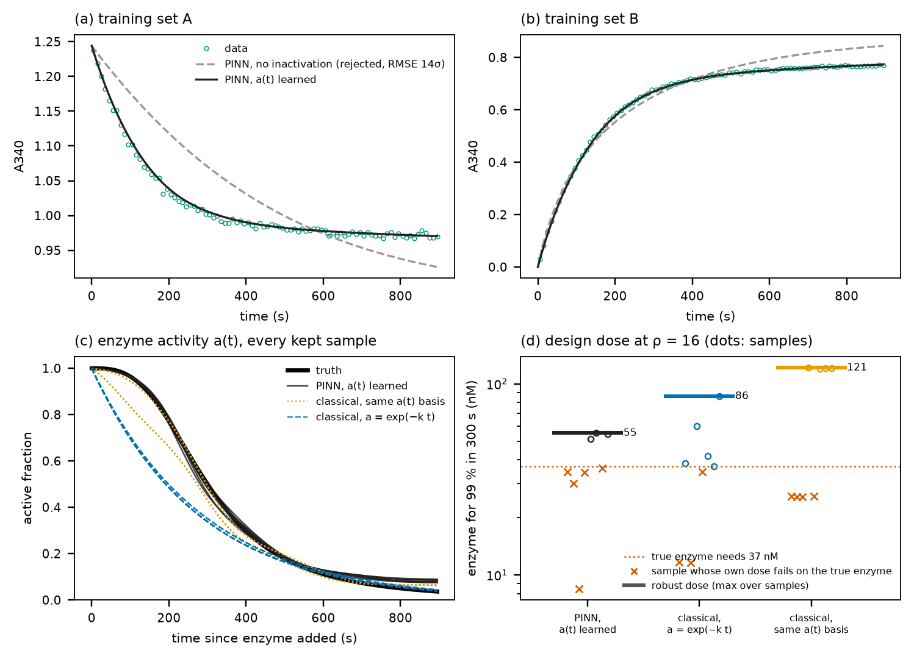

# 효소 실활 a(t): PINN이 실용적으로 혼자 하는 일

질문: "PINN만 할 수 있는 일이 있는가?" 상미분방정식 크기의 문제에서 수학적으로 PINN만 풀 수 있는 것은 없다. PINN이 맞추는 함수는 같은 기저를 쓰는 고전 피팅으로도 맞출 수 있다. 그래서 이 시험은 "모양을 모르는 함수를 속도 상수와 함께 추정하는 일"을 두 방법에 똑같이 시키고, 비용과 결과를 쟀다.

재현: `uv run python scripts/inactivation_demo.py` (결과 `results.json`, 그림 `fig_inactivation.png`, 이 PC에서 약 13분. 그림만 다시: `--figure-only`)

## 설정

- **정답:** 합성 예제와 같은 LDH 속도 상수(`evals/synthetic.yaml`, K′ = 23)에 효소 실활을 더했다. 실활은 처음에는 거의 없다가 급히 떨어지는 모양 a(t) = 1/(1 + (t/300 s)³)이다. 150 s에 0.89, 300 s에 0.50, 600 s에 0.11이 남는다. 잡음은 σ = 0.003 A340이다.
- **데이터:** 학습 세트 A·B·C, 홀드아웃 D′(피루브산 0.5 mM), 5~895 s.
- **실활의 흔적:** 같은 적합류인 A·B·C가 평형(0.924)에 닿지 못한다. A는 0.971에서, B는 0.768에서 멈춘다. 반대 방향에서 출발한 두 곡선이 다른 값에서 서므로, K′ 하나로는 설명할 수 없다(CRNT의 "같은 적합류 → 같은 평형").
- **a(t)의 표현:** PINN과 고전 피팅에 같은 것을 썼다. a = exp(−h), h는 시그모이드 계단 12개의 음이 아닌 합이다. 그래서 a(0) = 1이고 a는 다시 오르지 않으며, 그 밖의 모양은 정하지 않았다. 모든 실험이 같은 a(t)를 공유한다(같은 효소 저장액·완충액, t = 효소를 넣은 뒤 시간).
- **비교한 다섯 가지 식별:**

| 이름 | 방법 | a(t) |
|---|---|---|
| PINN, 실활 없음 | 지금의 enzopt (시드 8 × 재시작 8) | 1 |
| PINN, a(t) 학습 | `inactivation: shared` (시드 8 × 재시작 8) | 12계단, 모양 자유 |
| 고전, 실활 없음 | ODE 최소제곱, 시작점 8 | 1 |
| 고전, 지수 감소 | 시작점 8 | exp(−k_i t), 흔히 쓰는 가정 |
| 고전, 같은 기저 | 시작점 8 | PINN과 같은 12계단 |

모든 결과를 같은 방식으로 검증했다. 식별된 상수와 a(t)로 ODE를 다시 풀고, 학습 RMSE가 3σ를 넘으면 뺐다(SC5-3).

## 결과

| | PINN 실활 없음 | **PINN a(t)** | 고전 실활 없음 | 고전 지수 | 고전 같은 기저 |
|---|---|---|---|---|---|
| 걸린 시간 | 64회 12 s | **64회 10 s** (GPU) | 1회 49 s | 1회 231 s | **1회 659 s** (ODE 풀이 약 3,100번) |
| 남은 표본 | 0/8 (최선 14σ) | 8/8 | 0/8 (최선 12σ) | 8/8 | 8/8 |
| 학습 RMSE (중앙) | — | 0.0048 | — | 0.0060 | 0.0033 |
| a(t) 오차 (RMSE) | — | **0.018~0.027, 8개 모두** | — | 0.14 (모양 틀림) | 4개 0.014 · 4개 0.064 |
| 홀드아웃 D′ RMSE (중앙) | — | 0.035 | — | 0.010 | 0.078 (해 두 무리: 0.009 · 0.147) |
| 강건 설계 효소량 (ρ = 16, 300 s 99%) | — | **55 nM** | — | 86 nM | 121 nM |
| 그 효소량을 실제 효소에 넣으면 | — | 99.6% | — | 99.7% | 99.7% |

실제 효소가 필요로 하는 양은 37 nM이다.



## 읽는 법

1. **실활을 모델에 넣지 않으면 두 방법 모두 데이터를 설명하지 못한다.** 모든 표본이 3σ 검증에서 빠지므로, 지금의 enzopt는 설계 단계에서 멈춘다. 틀린 설계를 내지 않는다는 점은 옳지만, 답도 없다.
2. **모양을 모르는 a(t)를 PINN은 10초 만에 찾았다.** 64회 학습으로 표본 8개를 만들었고, 8개 모두 정답 a(t)의 지연 후 급락 모양을 따라갔다(그림 c).
3. **같은 일을 고전 피팅으로 하면 시작점 하나에 11분이 걸렸다.** 변수 22개(상수 10 + 계단 12)의 야코비안을 매번 ODE로 다시 풀기 때문이다. 시작점 8개를 22코어에 나눠도 12.5분이다. 가장 좋은 해는 PINN보다 정확했다(a(t) 오차 0.014, D′ 0.009). 그러나 시작점 절반은 지연이 없는 틀린 a(t)에 빠졌다. 그 표본으로 정한 효소량(26 nM)은 실제로 96.7%에서 멈춘다.
4. **흔히 쓰는 지수 감소 가정은 모양이 틀렸다.** 처음부터 활성이 떨어진다고 본다. 학습 데이터에는 2σ로 맞고 D′ 예측도 좋았지만, a(t) 자체는 틀렸다.
5. **설계:** 세 방법의 강건 효소량은 모두 실제 효소에서 99%를 넘었다. 그중 PINN이 정답 필요량(37 nM)에 가장 가까워서, 효소를 가장 적게 낭비한다(정답의 1.5배, 지수 2.3배, 같은 기저 3.3배). 표본 하나로 정한 효소량(공칭)은 세 방법 모두 일부 표본에서 실패한다(그림 d의 ×). 강건 설계가 필요한 이유와 같다.

## 정직하게 말할 수 있는 것

> 모양을 모르는 효소 실활 곡선을 속도 상수와 함께 추정하는 일을, PINN은 GPU 한 장으로 10초에 표본 8개를 내며 해냈다. 같은 함수를 고전 피팅으로 배우면 시작점 하나에 11분(ODE 풀이 약 3,100번)이 들었고, 시작점의 절반은 틀린 곡선에 빠졌다. 측정하는 날 그 자리에서 "실활이 있는가, 있다면 효소를 얼마나 더 넣어야 하는가"에 답할 수 있는 것은 PINN 쪽이다.

"PINN만 할 수 있다"가 아니라 "PINN만 실용적인 시간 안에 한다"이다. 고전 피팅도 감도 방정식이나 더 적은 기저로 빨라질 수 있다. 다만 기저를 줄이면 모양을 미리 정하는 셈이 된다.

## 한계

- **데이터:** 합성 데이터이고, 잡음 말고는 기기 효과(효소량 ±10%, 표류)를 넣지 않았다.
- **같은 a(t)를 공유한다는 가정:** 모든 실험이 같은 a(t)를 공유한다고 가정했다. 기질이 효소를 보호해 실활 속도가 조건마다 다르면 이 가정이 깨진다.
- **홀드아웃 D′:** PINN 표본은 a(t)를 맞혔어도, 학습 범위 밖인 D′ 예측(0.035, 12σ)이 가장 좋은 고전 해(0.009)보다 나빴다. a(t)를 아는 것과 학습 범위 밖의 속도 상수를 아는 것은 다른 문제다.
- **실데이터에서:** 실활을 의심할 근거부터 측정한다. 효소를 추가로 넣었을 때 반응이 다시 진행하는지, 같은 적합류의 끝값이 서로 다른지를 본다(`projects/ldh_ph10/README.md`의 측정 기록지).

## `enzopt run`에서 쓰기

`project.yaml`의 `identification.pinn.inactivation: shared`로 켠다(기본 `none`). 예제는 `projects/example_ldh_inactivation`이다. 데이터는 이 시험과 같고, `make_data.py`로 다시 만들 수 있다.

```
uv run enzopt run projects/example_ldh_inactivation
```

| 단계 | 실활 옵션을 켜면 |
|---|---|
| ③ 식별 | PINN이 표본마다 a(t)를 함께 학습하고, 표본 파일에 `activity`로 저장한다. 재시작 선택·3σ 검증·그림 3a·3b의 곡선은 a(t)를 넣은 ODE로 다시 푼다. 그림 3e에 표본별 a(t)를 그린다. 비약가역 대조 PINN도 a(t)를 함께 학습한다. 고전 피팅 기준선은 실활을 넣지 않는다(무시하면 어떻게 되는지 보여 주는 비교) |
| ④ 해석·검증 | CRNT 검증은 반응망 자체에 대해 한다(활성 효소 일정). 실활은 측정 조건이지 반응망의 성질이 아니다. 효소가 사라지면 평형에 닿지 않으므로 "같은 적합류 → 같은 평형" 시험의 대상이 아니다 |
| ⑤ 설계 | 표본마다 자기 a(t)를 넣고 최소 효소량을 구한다. 설계 시간이 a(t)를 학습한 실험 길이보다 길면 경고한다. 설계 조건의 Hopsan 대조는 생략한다(Hopsan 모델에는 a(t)가 없다) |

예제 결과(전체 모드):

| 표본 수 | 남은 표본 | 강건 효소량 (ρ* = 16) | 실제 효소에 넣으면 |
|---|---|---|---|
| 4 | 4/4 | 33.5 nM | **98.6%, 목표 미달** |
| 8 (예제 기본값) | 8/8 | 57.6 nM | 99.7% |

실제 효소가 필요로 하는 양은 36.9 nM이다. 표본 4개는 a(t)를 모두 맞혔지만(300 s에서 0.46~0.50, 정답 0.50) 속도 상수가 비슷한 곳에 모여 있었다. 그래서 강건 효소량이 실제 필요량보다 작았다. a(t)까지 추정하면 불확실성이 커지므로, 예제는 표본 8개를 쓴다. 표본 수와 설계 실패 위험의 관계(약 1/(N+1))는 실활이 없을 때도 같다.
