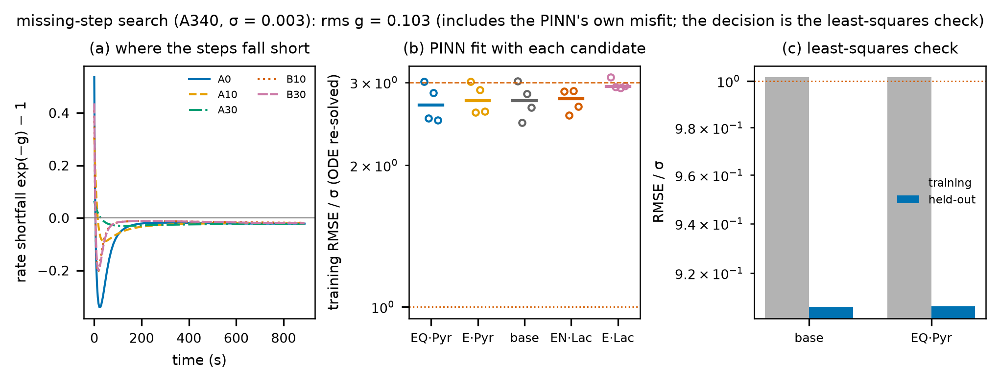
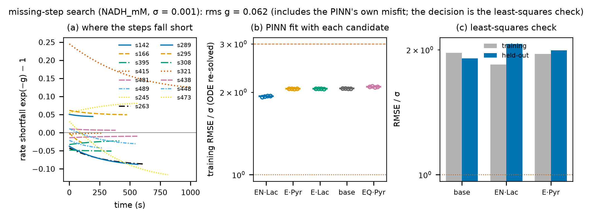

# 빠진 반응 단계 제안 (`enzopt suggest`)

사람이 적은 반응식이 데이터를 설명하지 못할 때, 어떤 단계가 빠졌는지 후보를 제안한다. 방식이 둘이다.

```
uv run enzopt suggest projects/<이름>                       # 기본(일반 방식): 모든 반응망
uv run enzopt suggest projects/<이름> --kinds dead_end,order # 후보 종류 고르기
uv run enzopt suggest projects/<이름> --run runs/<이름>/<실행> # 출발점으로 쓸 실행(기본: 반응망이 같은 가장 최근 완료 실행)
uv run enzopt suggest projects/<이름> --method pinn          # LDH 순차 bi-bi 전용 PINN 방식(아래 "PINN 방식")
uv run enzopt suggest projects/<이름> --kinds remove         # 거꾸로: 효소 모습 하나와 그 단계를 빼 보기(가지치기)
uv run enzopt suggest projects/<이름> --kinds "" --candidate "ESS + PG <=> ESS_PG" --candidate "EG -> ED"
                                                            # 내가 의심하는 단계만 시험(여러 번 줄 수 있음)
uv run enzopt suggest projects/<이름> --all-train             # 홀드아웃 세트도 맞추기에 넣기(외삽 대신 "다 맞출 수 있나")
```

`--candidate`의 형식: 단계 여럿은 `;`로 잇는다. `"2: ES -> EA + MeOH; E + MeOH <=> E_MeOH"`처럼 앞에 `N:`을 붙이면 적어 둔 반응식의 단계 N을 그 단계로 바꾼다(나머지는 새 단계로 더함). 새 화학종이 효소 모습의 반대편에 혼자 있으면 효소 모습으로 보고(`ESS + PG <=> ESS_PG`의 ESS_PG), 그 밖의 새 화학종은 처음 0인 작은 분자로 본다(메탄올 MeOH). 어떤 단계도 떠나지 않는 효소 모습은 망가진 효소다(`EG -> ED`의 ED). 새 상수의 사전분포 중심은 단계 모양(결합·방출·실활·효소 없는 반응)을 따른다.

결과: `runs/<이름>/<날짜_시각>_suggest/`(`suggest.json`, `candidates.csv`, 그림).

## 일반 방식 (기본, 2026-10-11부터)

1. **후보를 반응망 구조에서 만든다.** 목록을 적을 필요가 없다.

   | 종류(`--kinds`) | 후보 | 예(LDH) |
   |---|---|---|
   | `dead_end` | 효소 모습 X가 아직 붙잡지 않는 작은 분자 Y마다 막다른 결합 X + Y ⇌ X_Y | EN + Lac ⇌ EN_Lac |
   | `inactivation` | 효소 모습마다 실활 X → ED(망가진 형태 하나) | EQ → ED |
   | `background` | 전체 반응마다 효소 없이 일어나는 반응(K′가 있으면 가역) | Pyr + NADH ⇌ Lac + NAD |
   | `order` | 가역 결합 둘이 이어진 곳(W = X·Y, X = X0·Z)의 다른 결합 순서: X0 + Y ⇌ X0_Y, X0_Y + Z ⇌ W | E + Pyr ⇌ E_Pyr, E_Pyr + NADH ⇌ ENP |
   | `reverse` | 한 방향 단계를 가역으로 | (LDH는 모두 가역이라 없음) |
   | `remove` | 효소 모습 하나와 그것을 거치는 단계를 뺌(남은 반응망이 여전히 준정상 그래프를 이룰 때만). 기본 목록에는 없고 `--kinds remove`로 부른다 | (세팔렉신: EAN·EN·EG·ESS·EAS) |
   | `user` | `--candidate`로 준 단계 | |

   K′가 없는 전체 반응에 가역 순환을 만드는 후보는 뺀다(열역학적으로 정할 수 없음). 새 상수의 사전분포 중심: 결합 10³ /(mM·s)·K_i 5 mM, 실활 10⁻² /s, 효소 없는 반응 10⁻⁴ /s, 역반응 10² /s(생성물 하나)·10³ /(mM·s)(둘).
2. **적어 둔 반응식과 후보마다 넣은 반응식을 최소제곱으로 맞춘다.** 전체 ODE, 모든 측정 신호를 σ 단위로, ③과 같은 사전분포 항. 출발점은 같은 반응식으로 끝난 가장 최근 실행의 고전 피팅(없으면 새로 다중 시작점 맞춤). 후보는 병렬로 맞춘다.
3. **판정.** PINN 방식과 같은 문턱: 학습 RMSE가 2σ 안이고 세트마다 3σ 안이면 "설명됨". 아니면 학습 RMSE가 가장 낮은 후보가 놓친 세트의 RMSE를 절반 이하로 줄이고 전체 학습 RMSE를 늘리지 않을 때 제안한다. 옆에 ΔAIC(단계를 늘린 값을 치른 맞춤 점수)와 홀드아웃 기준(홀드아웃 RMSE를 절반 이하로 줄이는 후보)을 적는다. `remove` 후보는 더하는 제안에서 빠지고 따로 판정한다: ΔAIC < 0(뺀 반응망이 매개변수를 덜 쓰고도 비슷하게 맞음)이고 홀드아웃이 나빠지지 않으면 "빼도 됨"(`verdict.prunable`). 맞추기가 실패한 후보는 로그와 `suggest.json`의 `failed`에 이유와 함께 남는다. 맞추기 하나는 15분(`FIT_BUDGET_S`)을 넘으면 그때까지 가장 잘 맞은 값으로 멈추고 `timed_out`으로 표시된다(어떤 후보에서 미분방정식이 아주 뻣뻣해져 전체 비교가 끝나지 않던 것을 막음).

### 두 방식 비교

| 데이터 | PINN 방식 | 일반 방식 |
|---|---|---|
| 숨은 E·NADH·Lac (`example_ldh_missing_step`) | EN + Lac 제안, 학습 23σ → 1.0σ, 홀드아웃 2.5σ → 0.9σ, K_i 4.1 mM | 같음: EN + Lac 제안, 학습 23.1σ → 1.00σ, 홀드아웃 2.46σ → 0.92σ, K_i 4.2 mM (후보 24개, 약 3.5분) |
| 숨은 단계 없음(음성 대조) | 설명됨, 제안 없음 | 같음: 설명됨(1.00σ), 제안 없음, 홀드아웃을 절반으로 줄이는 후보 없음 (약 3.5분) |
| Holmes 1988 | 설명 안 됨(s321 5.8σ), 맞는 후보 없음 | 같음: 설명 안 됨(1.97σ, s321 5.76σ), 절반으로 줄이는 후보 없음. EN + Lac은 학습만 조금 낫고 홀드아웃은 나빠짐(1.91σ → 2.08σ). NADH가 붙는 막다른 결합(ENP·NADH, EQL·NADH)이 홀드아웃을 1.91σ → 1.66σ로 가장 줄임 — 앞서 본 "NADH가 많은 세트에서 어긋남"과 같은 방향 (약 3.5분) |
| 세팔렉신(`aeh_cephalexin_lagerman2021`, 단계 13 전) | (LDH 전용이라 못 씀) | 설명됨(1.66σ). 홀드아웃 20.3σ를 ESS + PG ⇌ ESS_PG가 9.9σ(절반 이하), ESS → ED가 10.4σ로 줄임 (후보 40개, 약 13분) |

- 일반 방식은 PINN 방식이 내던 결론을 세 시험 모두에서 그대로 냈고, 후보 목록을 미리 알 필요가 없으며 신호가 여럿인 반응망도 다룬다. 그래서 기본을 일반 방식으로 바꿨다.
- 일반 방식에 없는 것: "어디서 어긋나는가"를 그리는 PINN 보정 항(아래 1단계). 대신 실험별 RMSE(`suggest.json`의 `per_experiment`)로 어느 세트가 어긋나는지 본다.
- 한계: 후보를 한 번에 하나씩만 넣는다(조합은 보지 않음). 출발점 근처의 국소 맞춤이라 출발점이 나쁘면 놓칠 수 있다. 후보가 많으면 느리다(CPU 병렬).

## PINN 방식 (`--method pinn`, LDH 순차 bi-bi 전용)

### 하는 일

| 단계 | 내용 | 비용(이 PC) |
|---|---|---|
| 1. 어디서 어긋나나 | PINN의 물리 항을 dNADH/dt = −r₁·exp(g)로 바꾼다. g는 농도(NADH, Pyr, Lac, NAD)의 작은 신경망이고, 시드마다 하나씩 두어 모든 실험이 공유한다. g를 0 쪽으로 당겨 두므로, g는 다섯 단계가 설명하지 못하는 몫만 가져간다. 그림 (a)는 실험별 exp(−g) − 1, 곧 반응 속도가 몇 % 모자라거나 남는지를 보여 준다 | 시드 16회 약 10 s |
| 2. 어느 후보인가 | 후보마다 그 단계를 PINN에 직접 넣는다. 막다른 복합체 X·Y가 빠르게 평형을 이룬다고 보고, 반응 속도를 1/(1 + φ_X·[Y]/K_i)로 바꾸며, K_i도 함께 학습한다. 기준으로 다섯 단계만으로도 학습한다. 학습된 상수로 확장 반응망의 미분방정식을 다시 풀고, 학습 RMSE로 순위를 매긴다(그림 b) | 후보당 약 7~20 s |
| 3. 확인과 판단 | 다섯 단계와 상위 후보를 고전 피팅(다중 시작점)으로 다시 맞춘다(그림 c). 두 조건을 모두 만족하면 다섯 단계로 설명된다고 본다: 학습 RMSE 전체가 2σ 안, 그리고 학습 세트 하나하나가 3σ 안. 그렇지 않으면 다음 두 조건을 만족하는 후보를 제안한다: 다섯 단계가 놓친 세트의 RMSE를 절반 이하로 줄이고, 전체 학습 RMSE를 늘리지 않을 것. 홀드아웃 기준을 나란히 적는다: 그 후보가 홀드아웃 RMSE도 다섯 단계보다 줄여야 홀드아웃 기준으로도 제안이다(학습 세트에만 맞추는 단계를 거르려는 것). K_i는 고전 피팅 값을 쓴다 | 반응망당 약 1~3분 |

후보는 지금 네 개다. LDH의 빈 기질 자리에 피루브산이나 젖산이 잘못 붙어 생기는 막다른 복합체다.

| 후보 | 단계 | 뜻 |
|---|---|---|
| EN·Lac | `EN + Lac <=> ENL` | NADH가 붙은 효소에 젖산이 붙음(E·NADH·Lac) |
| EQ·Pyr | `EQ + Pyr <=> EQP` | NAD⁺가 붙은 효소에 피루브산이 붙음(기질 저해, 설계용 반응망의 단계) |
| E·Pyr | `E + Pyr <=> EPy` | 빈 효소에 피루브산이 먼저 붙음 |
| E·Lac | `E + Lac <=> ELa` | 빈 효소에 젖산이 먼저 붙음 |

### 시험 결과 (PINN 방식)

`projects/example_ldh_missing_step`은 데이터를 만든 진짜 메커니즘에 `EN + Lac <=> ENL`(K_i 5 mM)이 더 있는 예제다. 젖산을 0·10·30 mM로 바꿨다. 같은 조건을 다섯 단계만으로 만든 음성 대조는 `make_data.py --without-step <폴더>`로 만든다.

| 데이터 | 다섯 단계만 (고전 피팅) | PINN 순위 1위 | 결론 |
|---|---|---|---|
| **숨은 단계 있음** | 학습 23σ, 최악 B10 38σ | EN·Lac 1.7σ (나머지 25σ, 다섯 단계와 같음) | **EN + Lac <=> ENL 제안, K_i ≈ 4.1 mM** (정답 5 mM). 넣으면 학습 1.0σ, 홀드아웃 0.9σ |
| **숨은 단계 없음** (음성 대조) | 학습 1.0σ, 최악 1.1σ | 차이 없음 (모두 2.7~2.9σ) | 다섯 단계로 설명됨: 제안 없음 |
| **Holmes 1988** (σ = 0.001 mM) | 학습 2.0σ, 최악 s321 5.8σ | EN·Lac 1.9σ (다섯 단계 2.1σ) | 다섯 단계로는 s321을 설명 못 함. 후보 중 맞는 단계 없음 |






#### Holmes에서 읽을 것

- 앞서 세트 321·473의 어긋남을 E·NADH·Lac 복합체로 의심했다. 이 시험으로는 지지되지 않는다. EN·Lac을 넣어도 s321은 5.8σ에서 5.2σ로 줄어들 뿐이고, 홀드아웃 RMSE는 오히려 나빠졌다(1.9σ → 2.1σ). 맞춘 K_i는 82 mM로, 거의 결합하지 않는다는 뜻이다.
- 어긋나는 세트는 NADH가 많은 쪽에 몰려 있다. NADH 0.8~1.4 mM인 321(5.8σ), 251(홀드아웃 4.5σ), 289(2.6σ), 457(2.4σ), 263(2.2σ), 473(2.0σ)이다. 후보 목록 밖의 원인일 수 있다. 예를 들면 NADH가 관여하는 다른 단계, 또는 고농도 세트를 0.2 cm 큐벳으로 잰 측정 쪽 문제, 또는 Holmes 적분식으로 복원한 곡선의 범위 문제다. 지금 데이터로는 가를 수 없다.

## 어떤 실험이 빠진 단계를 드러내나

같은 숨은 단계(K_i 5 mM)를 세 가지 실험 계획으로 재고, `enzopt suggest`가 찾아내는지 봤다. 재현: `uv run python scripts/suggest_design_test.py`(약 20분).

| 숨은 단계 | 지금 계획 (A·B·C·D′, 젖산 ≈ 10 mM 일정) | + R30·F0·P16 (젖산 0·30 mM, 피루브산 1.6 mM) | + R30·F0·P50·P100 (피루브산 5·10 mM) |
|---|---|---|---|
| EN·Lac (NADH 효소 + 젖산) | **놓침**: 다섯 단계가 1.0σ로 맞고 홀드아웃도 맞음 | **찾음**: 다섯 단계 23σ → EN·Lac, K_i 4.8 mM | (R30·F0이 같으므로 생략) |
| EQ·Pyr (NAD⁺ 효소 + 피루브산) | **놓침** (1.0σ) | **놓침**: P16까지 1.0σ로 흡수 | **찾음**: 최악 P100 5.7σ → EQ·Pyr, K_i 4.9 mM |

세트 이름: R30 = NAD⁺ 0.2 + 젖산 30 mM(역방향), F0 = NADH 0.2 + 피루브산 0.2(젖산 없음), P16·P50·P100 = NADH 0.1 + 피루브산 1.6·5·10 mM(젖산 없음).

- **리간드 농도가 일정하면 그 리간드가 관여하는 단계는 보이지 않는다.** 다섯 단계의 속도 상수가 그 효과를 흡수한다. 지금 계획은 젖산이 모든 세트에서 약 10 mM이라, 젖산 복합체가 있어도 모른다.
- **효과가 크다고 보이는 것도 아니다.** EQ·Pyr는 피루브산 1.6 mM에서, 같은 속도 상수로 비교하면 12σ 차이를 낸다. 하지만 다섯 단계 모델이 상수를 바꿔 따라온다. 5·10 mM(32·52σ)에서야 흡수하지 못한다.
- **이 결론은 설계와도 직접 관련된다.** 설계용 반응망은 EQ·Pyr 막다른 복합체를 K_i 5 mM으로 가정하고 피루브산을 10 mM까지 쓴다. 피루브산 5·10 mM 세트를 재면 이 가정값을 데이터로 확인하거나 맞출 수 있다.
- 실험 하나의 최적 조건을 계산하는 방식은 시도했다가 넣지 않았다. 후보의 K_i를 고정해도 효과의 크기는 데이터로 정해지지 않는 속도 상수에 달려 있다. 그래서 지금 데이터에 맞춘 후보는 효과가 약한 쪽을 고르고, 계산된 "최적 조건"이 실제로는 아무것도 가려내지 못했다. 위처럼 숨은 단계를 넣은 데이터로 계획 전체를 시험하는 것이 더 믿을 만하다.

## 한계

- **후보 목록 밖은 찾지 못한다.** 네 후보는 모두 막다른 복합체다. 평형 상수를 바꾸지 않고 효소만 붙잡는 단계다. 비효소 반응이나 효소 실활처럼 다른 종류의 빠진 것은 그림 (a)의 어긋남으로만 보이고, 이름이 붙지 않는다. 실활은 `inactivation: shared`로 따로 시험한다.
- **K_i는 고전 피팅 값을 쓴다.** PINN만으로는 φ_X/K_i의 비만 정해진다. φ_X가 데이터로 정해지지 않는 속도 상수에 달려 있어서, PINN의 K_i(예제에서 0.027 mM)는 맞음과 상관없이 몇 자릿수 틀릴 수 있다.
- **보정 크기 rms g는 참고용이다.** PINN 자체가 고전 피팅보다 조금 덜 맞아서(예제 음성 대조 2.7σ 대 1.0σ), g는 빠진 단계가 없어도 0이 아니다(음성 대조 0.10). 판단은 3단계의 고전 피팅으로 한다.
- **판정 문턱.** 2σ, 3σ, 절반은 2026-10-10 보완 인터뷰(Q-02)에서 그대로 쓰기로 했고, 홀드아웃 RMSE가 줄었는지를 결론에 함께 적는다. σ 단위라 읽기 쉽지만, σ를 사용자가 정하므로 문턱의 뜻도 σ에 달려 있다.
- **LDH만 된다.** PINN이 LDH 다섯 단계만 지원한다(F-13).
- **데이터 설계가 먼저다.** 젖산을 바꾸지 않으면 젖산 복합체는 보이지 않는다. 그런 조건이면 다섯 단계의 상수가 그 효과를 흡수한다. 의심하는 단계가 있으면, 그 리간드의 농도를 바꾼 실험을 학습에 넣어야 한다.
