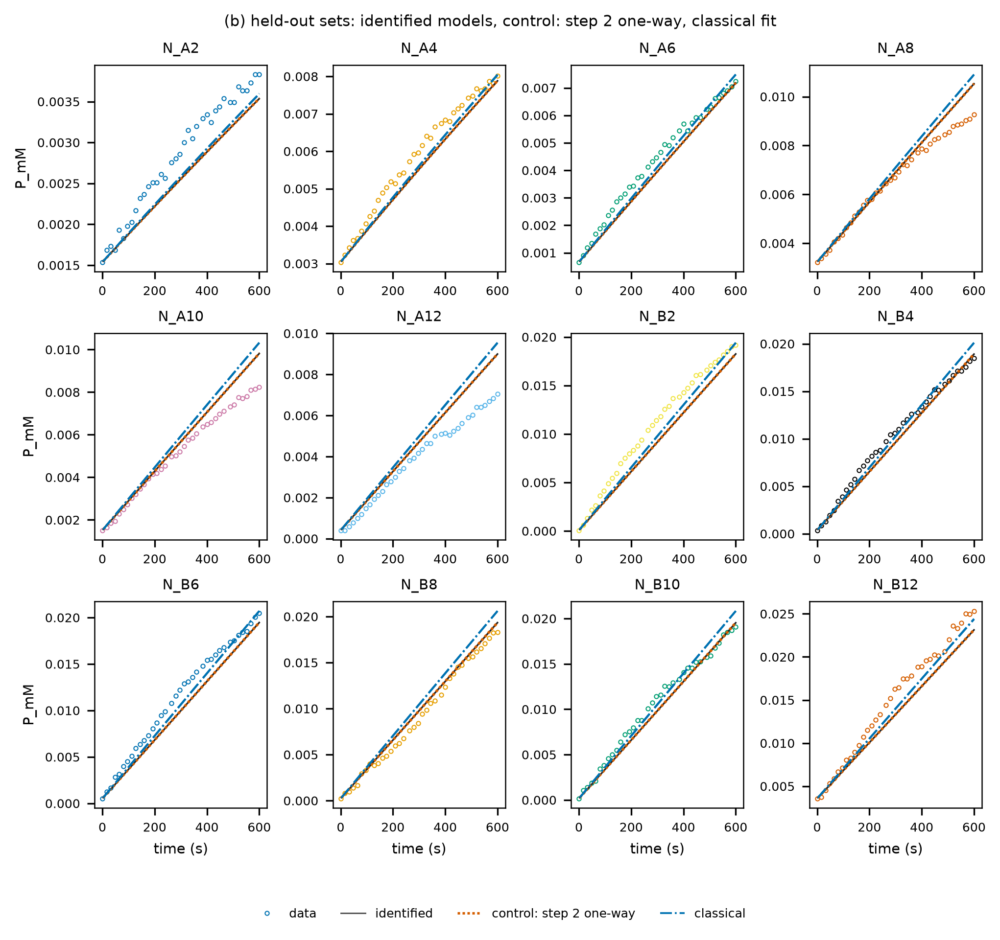

# aar_chimera5_olavarria2021 — 공개 문헌 데이터: 아세토아세틸-CoA 환원효소와 NADH, 360 nm 진행 곡선

## 출처와 라이선스

- 데이터: Olavarria, K. (2021). *Kinetic data from different acetoacetyl-CoA reductases*. Mendeley Data, V1, doi:10.17632/tspycdy2rm.1 (Technische Universiteit Delft), **CC BY 4.0**.
- CC BY 4.0이라 출처를 밝히면 허락 없이 쓸 수 있다. `raw/`에 이 프로젝트가 쓴 파일만 받아 두었다(Chimera 5 + NADH의 작업 파일 둘, 진행 곡선 txt, DYNAFIT 스크립트, 설명 파일). 바꾼 것은 아래 "데이터 처리"에 적었다.

## 실험

- 효소: *Cupriavidus necator* PhaB1에서 만든 아세토아세틸-CoA 환원효소(AAR) 키메라 "Chimera 5", 1~4 nM
- 반응: 아세토아세틸-CoA(AcAcCoA) + NADH → (R)-3-히드록시부티릴-CoA(HB) + NAD⁺
- 측정: Synergy HTX 플레이트 리더, 360 nm(NADH ε 4075 + AcAcCoA ε 23 M⁻¹cm⁻¹, 0.5 cm), 8초 간격 1시간, 30 ℃, MOPS pH 7.0. 생성물(µM)은 저자가 흡광에서 계산해 작업 파일에 둔 값.
- 두 묶음(기질 둘을 각각 바꿈):
  - N_*: NADH 12~600 µM 24개, AcAcCoA 1.6 mM, 효소 1·2·4 nM
  - A_*: AcAcCoA 24~200 µM 12개, NADH 약 1 mM, 효소 1 nM
- 온도: 30 ℃ 조건값만 있다(작업 파일에 온도 열 없음).

## 데이터 처리 (`make_data.py`)

```
uv run --with openpyxl python -I projects/aar_chimera5_olavarria2021/make_data.py   # data/ 다시 만들기(이미 있음)
uv run enzopt run projects/aar_chimera5_olavarria2021
```

- 웰마다 생성물 시계열을 µM → mM으로 바꿔 `data/<묶음>_<웰>.csv`로 썼다. 값은 바꾸지 않았다.
- **저자의 맞춤 시간 창만 쓴다:** NADH 묶음 0~600 s, AcAcCoA 묶음 0~1200 s(저자 DYNAFIT 스크립트의 `maximum 600`·`1200`), 16초 간격(두 점마다 하나). 그 뒤에는 기질이 남았는데도 반응이 느려지거나 멈춘다(아래 "남은 문제").
- 처음 조건은 첫 읽기(t = 0)다: 생성물 = 첫 데이터 점, 기질 = 명목 농도 − 그 생성물. 작업 파일의 "t = 0 생성물" 계산값(10행)은 일부 웰에서 첫 데이터 점과 달라(예: B11 1.3 대 4.7 µM) 쓰지 않았다.
- 잡음: 웰마다 2차 차분으로 잼(σ ≈ sd(Δ²y)/√6). 중앙값 NADH 묶음 0.17 µM, AcAcCoA 묶음 0.43 µM(NADH 1 mM이라 흡광 2.1로 높아 더 흔들림). σ = 0.4 µM로 둠.

## 반응식

| 단계 | 반응 | 뜻 |
|---|---|---|
| 1 | E + AcAc ⇌ EA | AcAcCoA가 먼저 붙음 |
| 2 | EA + NADH ⇌ EAN | NADH가 붙음 |
| 3 | EAN → E + NAD + HB | 환원과 두 생성물 방출(한 방향) |
| 4 | EAN + AcAc ⇌ EAAN | AcAcCoA가 하나 더 붙는 기질 저해(막다른) |

- 저자 모델(`simple_model_AARs`: 빠른 평형, AcAcCoA 먼저, 기질 저해)을 질량 작용으로 옮겼다. 한 방향 단계가 있어 약가역이 아니다(K′ 없음).
- 사전분포: 일반 자릿수(결합 10³ /(mM·s), 해리 10² /s, 단계 3 10² /s, 표준편차 1.5 자릿수). 저자 값은 쓰지 않았다.
- 대조: 단계 2를 한 방향으로(NADH가 다시 떨어지지 않음). 2026-10-13부터 설정에서 뺌: 조건만 필요해 대조를 돌리지 않음(사용자 결정). 아래의 대조 결과는 그 전 실행의 기록.

## 결과 (2026-10-12, 실행 2026-10-12_1045)

```
uv run enzopt run projects/aar_chimera5_olavarria2021    # 약 2분
```

- **학습·홀드아웃은 NADH 묶음만:** 학습 12웰(12~553 µM, 번갈아), 홀드아웃 12웰(가장 높은 600 µM 포함).
- **AcAcCoA 묶음(A_*)은 예측만 한다(`design-check`).** 이 묶음은 웰마다 처음 속도가 같은 농도에서도 2배까지 달라, 어떤 반응식으로도 잡음 수준으로 맞출 수 없다(저자 작업 파일의 처음 속도: AcAcCoA 24 µM은 24, 26 µM은 51, 32 µM 두 웰은 101과 71 /s). 효소 1 nM을 아주 적은 부피로 넣는 데서 오는 웰별 효소량 차이로 보인다. 두 묶음을 함께 학습하면 고전 피팅도 학습 7.4σ(AcAcCoA 묶음 4~22σ)였다(실행 2026-10-12_1042).

| 모델 | 학습 | 홀드아웃 | AcAcCoA 묶음(예측) |
|---|---|---|---|
| PINN 표본 4개(4/4 남음) | 2.9σ (0.3~6.7) | 2.7σ (0.8~5.0) | 29σ (6~58) |
| 고전 피팅 | 2.6σ (0.3~5.2) | 2.4σ (0.7~3.5) | 58σ (26~93) |

σ = 0.4 µM. 괄호는 웰별 범위.



- **NADH 쪽은 정해진다.** PINN 표본 4개가 거의 같은 상수로 모였다: 단계 3(kcat) 94~98 /s, NADH의 Km((k₋₂ + k₃)/k₊₂) 276~288 µM, AcAcCoA의 기질 저해 해리 상수 약 160 µM.
- **AcAcCoA 쪽은 정해지지 않는다.** 학습 묶음은 AcAcCoA가 모두 1.6 mM이라 AcAcCoA 결합 상수가 표본 125 µM, 고전 피팅 9.5 mM처럼 제멋대로다. 그래서 AcAcCoA 농도가 크게 다른 A_* 묶음을 맞히지 못한다(29σ). 저자 값(KM_AcAcCoA 47 µM, KM_NADH 42 µM, kcat 140 /s)과도 직접 비교하기 어렵다. 저자는 묶음마다 단일 기질 Michaelis–Menten으로 따로 맞췄고, 처음 농도도 맞춤 변수로 두었다(`?`).
- **처음 속도 영역이라 대조와 구별되지 않는다.** 600초 안의 곡선이 거의 직선이라 NADH 결합의 가역성(대조)은 데이터로 가를 수 없다(대조도 학습 2.9σ).
- **설계(⑤, 참고용):** "AcAcCoA 0.1 mM을 10분 안에 99 %"의 강건 효소량 15 nM, ρ*(NADH ÷ AcAcCoA) 10. 다만 AcAcCoA 쪽 상수가 정해지지 않았으니 믿기 어렵다.

## 남은 문제

- **1시간 데이터의 늦은 멈춤:** AcAcCoA 묶음은 AcAcCoA가 많을수록 오히려 덜 만들고 일찍 멈춘다(100 µM은 61 µM에서, 200 µM은 48 µM에서). `enzopt suggest --kinds inactivation,dead_end`(1시간 전체 32초 간격, 두 묶음 학습, 실행 2026-10-12_1021_suggest, 약 15분)에서 "AcAcCoA가 둘 붙은 효소가 망가짐(EAAN → ED)"이 가장 나았다(ΔAIC −1675, 학습 17.8σ → 11.7σ). 후보 17개 중 하나만 15분 상한에 걸렸으니 대부분 수렴한 값이다. 그래도 가장 나은 후보가 11.7σ라 1시간 전체는 설명하지 못한다(웰별 효소량 차이가 함께 들어 있음). 그래서 이 프로젝트는 저자 시간 창을 쓴다.
- **웰별 효소량 차이:** 도구는 실험마다 적어 둔 효소량을 그대로 믿는다. 실험별 효소 활성 계수를 식별 변수로 두는 기능은 아직 없다(PROGRESS "제안").
- 온도는 30 ℃ 조건값뿐이다(작업 파일에 온도 열 없음).
