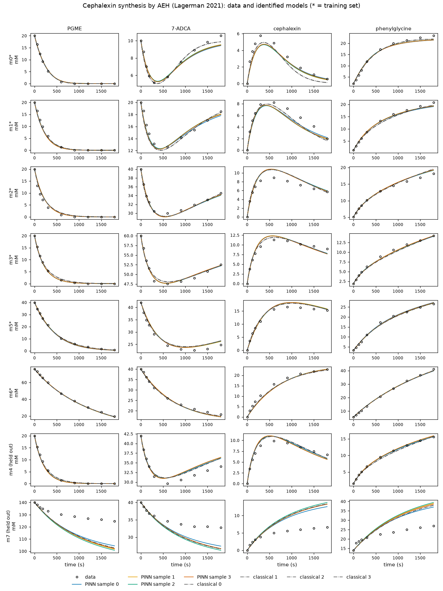

# aeh_cephalexin_lagerman2021 — 실측 문헌 데이터: 효소로 항생제(세팔렉신) 만들기

## 출처

- 논문: Lagerman, C. E., Grover, M. A., Rousseau, R. W., & Bommarius, A. S. (2021). Kinetic model development for α-amino ester hydrolase (AEH)-catalyzed synthesis of β-lactam antibiotics. *Chemical Engineering Journal*, 426, 131816. doi:10.1016/j.cej.2021.131816
- 데이터: Lagerman, C. (2022). *Synthesis and Hydrolysis of Cephalexin*. DaRUS (University of Stuttgart), doi:10.18419/DARUS-2468, **CC BY 4.0**. 파일 `EnzymeML_Lagerman.omex`(EnzymeML 형식)를 그대로 `raw/`에 두었다.
- 같은 데이터를 쓴 뒤 논문: Lauterbach et al. (2023). EnzymeML: seamless data flow and modeling of enzymatic data. *Nature Methods*, 20, 400–402. doi:10.1038/s41592-022-01763-1. 지원 자료(github.com/EnzymeML/Lauterbach_2022, Scenario 5)에 저자 미세 동역학 모델 "Model 4"의 단계 목록이 있다.

## 실험

- 효소: α-아미노 에스터 가수분해효소(AEH), 0.2 µM(모든 실험 같음)
- 조건: pH 7.0, 25 ℃(EnzymeML 기록). 완충액·효소 출처의 자세한 내용은 원 논문
- 반응: PGME(페닐글라이신 메틸 에스터, 아실 주개) + 7-ADCA(친핵체) → 세팔렉신(CEX) + 메탄올. 같은 효소가 PGME와 세팔렉신을 물로 가수분해해 페닐글라이신(PG)도 만든다. 그래서 세팔렉신은 올라갔다가 다시 내려간다.
- 측정: HPLC로 네 물질 농도(mM)를 0, 1, 2, 3, 5, 10, 15, 20, 25, 30분에 잼(실험마다 10점, 반복 없음)

| 실험 | PGME | 7-ADCA | PG(처음부터 있음) | 역할 |
|---|---|---|---|---|
| m0 | 20 | 10 | 2.0 | 학습 |
| m1 | 20 | 20 | 1.3 | 학습 |
| m2 | 20 | 40 | 5.1 | 학습 |
| m3 | 20 | 60 | 1.9 | 학습 |
| m5 | 40 | 42 | 3.3 | 학습 |
| m6 | 76 | 40 | 5.7 | 학습 |
| m4 | 20 | 42 | 1.5 | 홀드아웃(학습 조건 사이) |
| m7 | 140 | 40 | 14.0 | 홀드아웃(PGME가 학습 최대의 1.8배) |

농도는 mM, 세팔렉신은 모두 0에서 시작. PG가 처음부터 있는 것은 PGME 원액에 섞인 가수분해 산물로 보인다(실험마다 측정된 t = 0 값을 그대로 씀).

## 이 폴더의 데이터

`make_data.py`가 omex 안의 `data/m0.csv` … `m7.csv`(열: 시간 분, PGME, 7-ADCA, CEX, PG mM)를 `data/m*.csv`(열: `time_s`, `PGME_mM`, `ADCA_mM`, `CEX_mM`, `PG_mM`)로 옮긴다. 값은 바꾸지 않고 시간만 초로 바꿨다.

- m6("Cephalexin synthesis 7")은 메타데이터의 처음 7-ADCA가 50 mM인데 t = 0 측정 행은 40 mM다. 30분 뒤 7-ADCA + 세팔렉신 = 41.2 mM로 40 쪽과 맞아서 측정 행을 썼다.
- 물질 수지: 반복 측정이 없어 잡음을 직접 잴 수 없다. PGME·PG·세팔렉신 합(페닐글라이신 고리 보존)과 7-ADCA·세팔렉신 합(7-ADCA 고리 보존)이 처음 값에서 1~2 mM(수 %) 어긋나는 것을 보고 σ = 0.5 mM로 두었다.

## 반응식(project.yaml)

저자 모델 4(Lauterbach 2022 Scenario 5)의 단계를 질량 작용으로 옮기고, 효소 실활 단계 하나(13)를 더했다. 아실 효소(EA)를 거치는 핑퐁형이고, 가수분해와 실활은 한 방향이다.

| 단계 | 반응 | 뜻 |
|---|---|---|
| 1 | E + PGME ⇌ ES | PGME 결합 |
| 2 | ES → EA | 아실화(메탄올이 나감) |
| 3 | EA → E + PG | 아실 효소 가수분해 |
| 4 | EA + ADCA ⇌ EAN | 친핵체 결합 |
| 5 | EAN ⇌ EP | 아미노 분해(거꾸로 가면 세팔렉신 가수분해) |
| 6 | EP ⇌ E + CEX | 세팔렉신이 떠남 |
| 7 | EAN → E + PG + ADCA | 친핵체가 붙은 채 가수분해 |
| 8 | E + ADCA ⇌ EN | 막다른 결합 |
| 9 | E + PG ⇌ EG | 생성물 저해 |
| 10 | ES + PGME ⇌ ESS | 기질 저해 |
| 11 | EA + PGME ⇌ EAS | 기질 저해(아실 효소) |
| 12 | EAS → E + PG + PGME | PGME가 붙은 채 가수분해 |
| 13 | ESS → ED | PGME가 둘 붙은 효소의 실활(아래 "실활 단계 고르기") |

저자 모델과 다른 점:

- 저자는 결합 단계를 빠른 평형(해리 상수 하나)으로 두었다. 여기서는 kf·kr를 모두 식별한다.
- 저자 노트북의 단계 6(`EA·PGME -> E + PG`)은 PGME 하나가 사라지는 식이라, 물질 수지가 맞도록 `EAS -> E + PG + PGME`로 고쳤다.
- 저자의 실활은 자유 효소 E → ED다. 여기서는 데이터로 비교해 ESS → ED를 골랐다(자유 효소 실활은 데이터를 거의 더 설명하지 못함).
- 가수분해가 한 방향이라 가역 순환이 없고 K′가 필요 없다. CRNT 판정은 "약가역 아님, 결핍 2 → 149 보장 없음"이다(반응이 끝까지 가는 반응망이라 자연스러운 결과).

실활 단계는 도구가 2026-10-11부터 다룬다(`core/qss.py`, `pinn/general.py`): 아무 단계도 빠져나가지 않는 효소 형태(ED)를 준정상 계산에서 빼고, 실험마다 남은 활성 a(t)를 PINN의 출력 하나로 두어 d ln a/dt = −k₁₃·φ_ESS를 지키게 한다. 해석·고전 피팅·설계는 반응식을 그대로 풀므로 따로 할 일이 없다.

### 사전분포

문헌 값을 쓰지 않은 일반 자릿수다. 결합 kf 10³ /(mM·s)(= 10⁶ /(M·s)), 해리 kr 10⁴ /s(해리 상수 약 10 mM), 아실화 10³ /s, 가수분해 10² /s, 아미노 분해 10³ /s·거꾸로 10² /s, 세팔렉신 해리 10⁴ /s·결합 10³ /(mM·s), 실활 10⁻² /s. 표준편차 1.5 자릿수. 같은 데이터로 맞춘 저자 값을 사전분포로 쓰면 같은 정보를 두 번 쓰게 되어 피했다.

## 실행

```
uv run python projects/aeh_cephalexin_lagerman2021/make_data.py   # data/ 다시 만들기(이미 있음)
uv run enzopt check projects/aeh_cephalexin_lagerman2021
uv run enzopt run projects/aeh_cephalexin_lagerman2021
uv run python projects/aeh_cephalexin_lagerman2021/plot_species.py runs/aeh_cephalexin_lagerman2021/<실행 폴더>
```

`plot_species.py`는 네 물질을 모두 그린다(③ 단계 그림은 주 신호 PGME만 그림). 결과는 `figures/`에 쓴다. 전체 실행은 약 15분(대부분 고전 피팅 4개 시작점)이다.

## 결과 (2026-10-11, PINN 시드 4 × 재시작 8, 고전 피팅 시작점 4)

RMSE는 mM(σ = 0.5 mM). "학습"은 6실험·4물질 평균, m4·m7은 4물질 평균이다. 아래 세 줄은 실활만 다르고 나머지는 같다.

| 실활 | 학습 PINN | 학습 고전 | m4 PINN | m7 PINN | m7 PGME(PINN) | 강건 설계(ρ* = 3) | 실행 폴더 |
|---|---|---|---|---|---|---|---|
| 없음 | 0.86 | 0.78 | 0.79 | 12.4 | 22.7 | 42.9 nM | 2026-10-11_1649(설계 1706) |
| 공유 a(t)(`inactivation: shared`) | 0.68 | 0.78 | 0.66 | 10.8 | 20.1 | 60.7 nM | 2026-10-11_1707 |
| **단계 13 ESS → ED (기본)** | 0.70 | 0.66 | 0.66 | **6.5** | **12.7** | 55.3 nM | 2026-10-11_1758 |



- **식별:** 세 설정 모두 표본 4/4 남음(3σ 제외 없음). PINN 표본끼리는 곡선이 거의 겹치고, 고전 피팅 4개도 같은 곳으로 모였다. 그런데 속도 상수 몇 개(실활 없는 설정에서 k₊₂, k₊₄, k₋₄, k₋₆ 등)는 표본과 고전 피팅 사이에서 1~2 자릿수 차이가 나는데도 곡선은 같다(③ 그림 c "not identifiable"). 합성 예제에서 본 것과 같은 상쇄다.
- **학습 조건 사이(m4):** 네 물질 모두 잘 예측한다(PGME 0.3~0.4, 7-ADCA 1.3, 세팔렉신 0.7, PG 0.1 mM 안팎).
- **학습 조건 바깥(m7, PGME 140 mM):** 실험에서는 5분 뒤 반응이 거의 멈춘다(30분에 PGME 124.6 mM). 실활이 없으면 모델은 계속 진행해 30분에 80 mM까지 내려가고, 공유 a(t)도 86 mM 근처로 크게 다르지 않다(실험마다 같은 활성 곡선이라 PGME가 많은 m7만 빨리 망가지는 것을 나타내지 못함). 단계 13을 넣으면 m7을 보지 않고도 102 mM 근처까지 다가가고 오차가 절반이 된다. 그래도 아직 실측보다 빠르다. 그리고 네 표본이 **모두 같은 방향으로** 빗나가 표본 퍼짐으로는 경고가 나오지 않는다(안내서 2-8의 "함께 틀림").
- **CRNT 검증(④):** 52/52 통과(실행 2026-10-11_1836). 이 반응망은 약가역이 아니라(① "149 보장 없음: 멸종 가능" — 판정 안내라 실행마다 표시됨) 기질이 다 쓰이고 한 방향 단계가 가역 단계를 평형에서 떼어 놓는다. 그래서 149 보장에 기댄 검사(양수성·평형 관계·리아푸노프 감소)는 기록만 하고, 보존량 표류(1e-6)와 음수 없음(같은 상대 허용치)으로 판정한다. 2026-10-11 이전 도구는 이 검사들까지 판정에 넣어 52/52 "실패"와 "수치 오류 의심" 재계산을 냈다.
- **설계(⑤, 참고용) — 언제 멈추나(`target: peak`, 2026-10-11부터 기본):** 세팔렉신은 같은 효소가 만들고 다시 분해하므로, 효소량(실험값 200 nM)을 정해 두고 "7-ADCA를 얼마나 넣고 언제 멈추면 가장 많이 남나"를 묻는다. PGME 20 mM에서 표본 4개의 수율 곡선을 1시간까지 풀었다(실행 2026-10-11_2149, 그림 `5_design/fig5a_peak.png`).

  | ρ = 7-ADCA ÷ PGME | 1 | 1.5 | 2 | **3** |
  |---|---|---|---|---|
  | 멈출 시각(강건) | 426 s | 474 s | 513 s | **561 s** |
  | 최악 표본 수율 | 38 % | 48 % | 54 % | **61 %** |
  | 95 % 이상 유지 구간 | 303~570 s | 327~645 s | 348~708 s | 375~810 s |

  7-ADCA가 많을수록 아실 효소를 물로 잃기 전에 붙잡아 수율이 오른다(시험한 범위 안에서는 ρ = 3이 최고). 표본 4개의 최고점 시각은 546~564 s로 거의 같아(그림 a의 네 곡선이 겹침), 표본 퍼짐보다 모델 자체의 오차가 더 중요하다. 실측과 견주면 같은 조건의 m3(ρ = 3, 페닐글라이신 1.9 mM로 시작)은 600 s에 11.3 mM(57 %)로 가장 높았고 모델은 같은 시각 12.3 mM이다. 곧 **설계 수율 61 %는 4 %p쯤 낙관적**이고, 멈출 구간 375~810 s는 실측 최고점(600 s 근처, 300·600·900 s에서 9.6·11.3·11.1 mM)을 담는다. 30분 뒤에는 모델(7.7 mM)이 실측(9.0 mM)보다 빨리 분해한다.
- 예전 목표(`target: yield`, "10분 안에 수율 40 % 이상"인 최소 효소량)는 ρ* = 3 · 55.3 nM이었다(실행 2026-10-11_1836). 효소가 많으면 세팔렉신이 다시 분해되어 수율이 효소량에 단조롭지 않아, 효소량 상한을 실험값 0.2 µM로 두어야 했다 — 이 반응에는 "멈출 시각"이 더 맞는 질문이라 목표를 바꿨다.

### 실활 단계 고르기

`compare_inactivation.py`(단계 13 없는 실행 2026-10-11_1649를 출발점으로, 전체 ODE 최소제곱)로 "효소의 어느 모습이 망가지나"를 비교했다. 결과는 `figures/inactivation_hypotheses.json`. RMSE는 4물질 평균(mM).

| 실활 단계 | 학습 6개로 맞춤: m7 예측 | 8개 모두 맞춤: 비용 | 8개: m6 | 8개: m7 |
|---|---|---|---|---|
| 없음 | 12.7 | 11.0 | 3.8 | 3.7 |
| E → ED(자유 효소, 저자 모델) | 12.6 | 13.1 | 3.8 | 4.3 |
| ES → ED | 10.1 | 13.0 | 3.6 | 4.4 |
| **ESS → ED** | **6.4** | **4.5** | **1.6** | **2.3** |
| EA → ED | 12.7 | 10.9 | 3.7 | 3.7 |
| EAS → ED | 9.5 | 8.0 | 1.7 | 3.3 |
| EAN → ED | 12.3 | 13.0 | 3.6 | 4.4 |

ESS → ED만 두 시험 모두에서 크게 낫다. PGME가 많을수록 ESS가 많아져 효소가 빨리 망가지므로, PGME 140 mM인 m7에서만 반응이 일찍 멈추는 모습과 맞는다(k₁₃: 이 표에서 0.0020 /s, 기본 실행의 PINN 표본 0.0020~0.0025 /s · 고전 피팅 0.0020 /s). ESS와 다른 단계(E, ES, EAS)를 함께 넣으면 두 번째 상수가 0 쪽으로 가고 나아지지 않았다. "8개 모두 맞춤" 비용이 줄었다는 것은 m7을 보고 맞춘 결과이고, 반응식을 고른 근거는 "학습 6개로 맞춤: m7 예측" 쪽이다.

### m7을 학습에 넣으면

| 반응식 | PINN 학습 RMSE(3σ = 1.5) | PINN m7 PGME | 고전 피팅 비용 | 고전 m6 · m7 PGME | 실행 폴더 |
|---|---|---|---|---|---|
| 공유 a(t) | 1.87~1.98 → 전부 제외 | 7~8 | 10.99(실활 없음) | 5.6 · 6.8 | 2026-10-11_1725 |
| 단계 13 | 1.65~1.76 → 전부 제외 | 6.5~6.9 | 4.55 | 1.9 · 5.2 | 2026-10-11_1811 |

단계 13으로 많이 가까워졌지만, 여덟 실험을 한꺼번에 잡음 수준(학습 RMSE 1.5 mM 안)으로 맞추지는 못한다. PGME 140 mM의 m7에는 아직 설명하지 못한 것이 남아 있다(예: 메탄올·pH, 실활의 PGME 의존이 2차보다 셈, HPLC의 고농도 오차).

### 도구의 자동 후보 비교로 다시 보기 (`enzopt suggest`, 2026-10-11)

위의 실활 가설 6개는 손으로 골랐다. `enzopt suggest`의 일반 방식(반응망 구조에서 후보를 만들어 최소제곱으로 비교, 지금의 기본)을 단계 13을 넣기 전의 반응식에 돌려, 도구가 스스로 같은 결론에 닿는지 봤다.

```
uv run enzopt suggest runs/aeh_cephalexin_lagerman2021/2026-10-11_1649/inputs --run runs/aeh_cephalexin_lagerman2021/2026-10-11_1649
```

후보 40개(막다른 결합 29, 실활 9, 효소 없는 반응 2), 맞추기 약 13분(24코어). RMSE는 네 물질 σ 단위.

| 반응식 | 학습 | 홀드아웃(m4·m7) | m7 | ΔAIC |
|---|---|---|---|---|
| 적어 둔 반응식 | 1.66σ | 20.3σ | 28.6σ | 0 |
| ES → ED | 1.41σ | 16.3σ | | −76 |
| EAS → ED | 1.42σ | 15.4σ | | −72 |
| **ESS → ED** | 1.42σ | **10.4σ** | 14.6σ | −71 |
| **ESS + PG ⇌ ESS_PG** | 1.56σ | **9.9σ** | 14.0σ | −26 |

- 도구의 판정: "적어 둔 반응식으로 학습 데이터가 설명됨"(1.66σ, 최악 m5 2.04σ로 문턱 2σ·3σ 안). 학습 데이터만으로는 단계를 더할 근거가 없다는 뜻이다.
- 학습만 보면(ΔAIC) 실활 후보 셋이 비슷하게 앞선다. 홀드아웃(특히 m7)까지 보면 **PGME가 둘 붙은 효소(ESS)에 무언가 일어나는 두 후보**가 오차를 절반 가까이 줄인다(20.3σ → 9.9σ·10.4σ, 도구의 "절반 이하" 기준에는 ESS + PG만 듦): 실활(ESS → ED, k ≈ 0.002 /s, 손으로 고른 것과 같음)과 페닐글라이신이 단단히 붙는 막다른 복합체(ESS + PG ⇌ ESS_PG, 해리 상수 ≈ 0.12 mM).
- 이 데이터로는 둘을 가를 수 없다. 실활이면 효소를 PGME에 미리 담가 두기만 해도 활성이 줄고, 막다른 결합이면 페닐글라이신이 함께 있어야 줄고 희석하면 돌아온다. 결과는 `runs/aeh_cephalexin_lagerman2021/2026-10-11_1939_suggest/`.

### m7에 남은 차이: 가설 다섯 개 (`enzopt suggest --candidate`, 2026-10-11)

단계 13을 넣어도 m7(PGME 140 mM)은 아직 실측보다 빨리 진행한다. "PGME가 많을 때 무엇이 더 일어나나"를 다섯 가지로 적어 같은 방식(출발점: 실행 2026-10-11_2149의 고전 피팅)으로 비교했다. 두 시험을 했다: 학습 6개로 맞추고 m4·m7을 예측(외삽), 그리고 8개를 모두 맞춤(`--all-train`, 반응식이 8개를 한꺼번에 설명할 수 있는가).

```
H=(--candidate "2: ES -> EA + MeOH; E + MeOH <=> E_MeOH" --candidate "2: ES -> EA + MeOH; E + MeOH -> ED"
   --candidate "ESS + PGME <=> ESSS; ESSS -> ED" --candidate "ESS + PG <=> ESS_PG" --candidate "EG -> ED")
uv run enzopt suggest projects/aeh_cephalexin_lagerman2021 --kinds "" "${H[@]}"              # 외삽(약 3.5분)
uv run enzopt suggest projects/aeh_cephalexin_lagerman2021 --kinds "" "${H[@]}" --all-train  # 8개 모두(약 3분)
```

| 가설 | 뜻 | 외삽: 홀드아웃 · m7 | 8개 모두: 전체 · m7 · ΔAIC |
|---|---|---|---|
| (지금 반응식) | | 10.4σ · 14.6σ | 2.84σ · 5.77σ · 0 |
| **ESS + PGME ⇌ ESSS, ESSS → ED** | PGME가 셋째로 붙은 효소가 망가짐(실활이 PGME에 더 세게 의존) | **8.95σ · 12.6σ** | **1.64σ · 2.64σ · −345** |
| ESS + PG ⇌ ESS_PG | 페닐글라이신이 ESS를 붙잡음 | 10.4σ · 14.6σ | 2.65σ · 5.30σ · −41 |
| 메탄올 막다른 결합 (단계 2가 메탄올을 내놓고 E + MeOH ⇌ E_MeOH) | 쌓인 메탄올이 효소를 붙잡음 | 11.2σ · 15.8σ | 2.84σ · 5.77σ · +4 |
| 메탄올 실활 (E + MeOH → ED) | 쌓인 메탄올이 효소를 망가뜨림 | 11.5σ · 16.2σ | 2.84σ · 5.77σ · +2 |
| EG → ED | 페닐글라이신이 붙은 효소가 망가짐 | 11.1σ · 15.6σ | 2.84σ · 5.77σ · +2 |

- **8개를 한꺼번에 설명하는 것은 ESSS 하나뿐이다.** 지금 반응식은 8개를 함께 맞추면 2.84σ(m5 2.95σ, m6 3.36σ, m7 5.77σ)로, 도구의 판정이 "설명되지 않음"이다. ESSS를 넣으면 1.64σ로 문턱 2σ 안이 되고 모든 실험이 3σ 안이다(m7 2.64σ, m6 1.71σ). 도구가 이 단계를 제안한다. 맞춘 값: ESSS 해리 상수 ≈ 210 mM, ESSS → ED 0.009 /s. PGME 20 mM 실험에서는 ESSS가 거의 없고, 140 mM의 m7에서만 크게 생긴다. 그래서 PGME가 많아질수록 실활이 ESS → ED 하나일 때(PGME의 제곱에 비례)보다 더 가파르게 빨라진다.
- **하지만 학습 6개만으로는 이 단계를 정할 수 없다.** 외삽 시험에서 ESSS는 학습 RMSE가 같고(ΔAIC +6.5, 매개변수만 둘 늘어남) 홀드아웃을 10.4σ → 8.95σ로 조금 줄일 뿐이다. 상수가 사전분포 근처에 머문다(해리 ≈ 175 mM, 0.0009 /s). 학습 실험의 PGME가 76 mM까지라, 그보다 높은 PGME에서만 드러나는 효과는 보이지 않는다. 이것은 LDH 시험에서 본 "리간드 농도를 바꾸지 않으면 그 리간드의 단계는 보이지 않는다"(`docs/suggest/README.md`)와 같은 이야기다.
- **메탄올 가설 둘과 EG 실활은 지지되지 않는다.** 두 시험 모두에서 나아지지 않았고, 새 상수가 0 쪽으로 가거나(메탄올 실활 3 × 10⁻⁷) 아무 값이나 된다.
- 단계 13 전의 반응식에서 홀드아웃을 절반 가까이 줄이던 ESS + PG ⇌ ESS_PG는, 단계 13이 들어간 뒤에는 거의 아무것도 바꾸지 않는다. 두 단계가 같은 몫(m7에서 효소를 잃는 것)을 설명했다는 뜻이다.
- 결과: `runs/aeh_cephalexin_lagerman2021/2026-10-11_2226_suggest/`(외삽), `2026-10-11_2228_suggest/`(8개 모두).

### 저해 단계를 덜어내 보기 (`enzopt suggest --kinds remove`, 2026-10-11)

거꾸로, 적어 둔 반응식(단계 13 포함)에서 효소 모습 하나와 그것을 거치는 단계를 빼고 다시 맞췄다. 출발점은 실행 2026-10-11_1836의 고전 피팅, 맞추기 약 2.5분.

```
uv run enzopt suggest projects/aeh_cephalexin_lagerman2021 --kinds remove
```

| 뺀 것 | 매개변수 | 학습 | 홀드아웃(m4·m7) | m7 | ΔAIC |
|---|---|---|---|---|---|
| 없음(적어 둔 반응식) | 21 | 1.42σ | 10.4σ | 14.6σ | 0 |
| EG: 단계 9 E + PG ⇌ EG(생성물 저해) | 19 | 1.42σ | 10.2σ | 14.3σ | −4.1 |
| EN: 단계 8 E + ADCA ⇌ EN(막다른 결합) | 19 | 1.43σ | 10.0σ | 14.0σ | −1.9 |
| **EN과 EG 함께** | 17 | 1.43σ | 9.9σ | 13.9σ | **−6.1** |
| ESS: 단계 10·13(기질 저해와 실활) | 18 | 1.66σ | 20.3σ | 28.7σ | +67 |
| EAS: 단계 11·12(아실 효소의 기질 저해) | 18 | 2.25σ | 12.9σ | 18.1σ | +214 |
| EAN: 단계 4·5·7(친핵체 결합, 세팔렉신 합성 자체) | 16 | 15.0σ | 15.4σ | 17.9σ | +1122 |

- 도구의 판정: EG와 EN은 "빼도 됨"(ΔAIC < 0이고 홀드아웃이 나빠지지 않음). 둘을 함께 빼는 것은 도구가 한 번에 하나씩만 보므로 따로 맞췄다(`suggest_general`의 함수로 같은 방식, 결과 ΔAIC −6.1).
- 맞춘 해리 상수가 EN 63 mM, EG 105 mM로, 실험 농도(7-ADCA 10~60 mM, 페닐글라이신 최대 14~41 mM)에서 효소를 거의 붙잡지 않는다. 그래서 빼도 다른 상수가 조금 움직일 뿐(단계 13의 k 0.0020 → 0.0019 /s) 곡선이 그대로다.
- 반대로 PGME가 둘 붙는 ESS와 아실 효소에 PGME가 붙는 EAS는 데이터가 필요로 한다. 특히 ESS를 빼면 m7이 단계 13 넣기 전(28.6σ)으로 돌아간다.
- 반응식은 저자 모델 그대로 둔다(단계 8·9는 이 데이터가 "없어도 된다"고 할 뿐 "없다"는 근거는 아니고, 7-ADCA나 페닐글라이신을 더 많이 넣은 조건이면 보일 수 있다). 바꿀지는 Q-05에 적었다. 결과는 `runs/aeh_cephalexin_lagerman2021/2026-10-11_2148_suggest/`.
