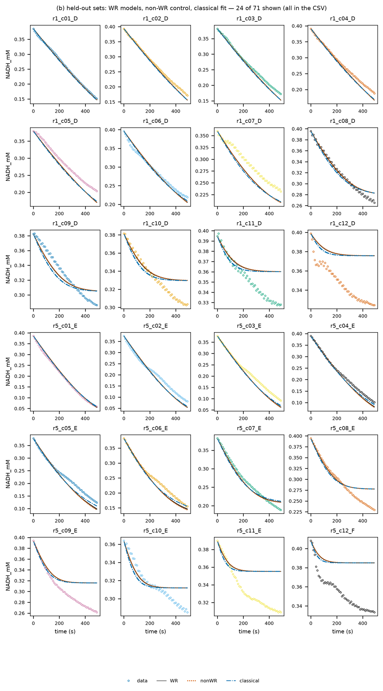

# ldh_wang2025 — 공개 문헌 데이터: 토끼 근육 LDH, 피루브산 + NADH, 340 nm 플레이트 진행 곡선

## 출처와 라이선스

- 논문: Wang, T. Y., Dhillon, P., Krylova, S. M., Bijlani, A., Schreiber, S., Golemi-Kotra, D., Jose, J., Krylov, S. N. (2025). *Introducing Quantitative Assessment of Michaelis Constant (K_m) Accuracy*. ChemBioChem 26(24), e202500660, doi:10.1002/cbic.202500660 (PMC12703444).
- 논문의 내용(Europe PMC 초록 기준): Km에 "정확도 신뢰구간"(ACI-Km)을 붙이는 방법. 효소·기질 농도의 불확실성이 계산된 Km으로 어떻게 퍼지는지에서 정확한 값이 들어 있을 구간을 구하고, 새 실험 없이 기존 데이터에 쓸 수 있으며, 비선형 회귀의 표준오차가 실제 불확실성을 크게 과소평가할 수 있다고 보고한다(무료 웹 앱 제공). LDH 데이터는 그 예다.
- 데이터: figshare doi:10.6084/m9.figshare.26961733, **CC BY 4.0**. 이 프로젝트는 그중 `Experimental_data.xlsx`(LDH 실험의 원 흡광)만 `raw/`에 그대로 두었다(sha256 7bc82d4a…).
- CC BY 4.0이라 출처를 밝히면 허락 없이 쓸 수 있다. 바꾼 것은 아래 "데이터 처리"에 적었다.

## 실험

- 효소: 토끼 근육 젖산 탈수소효소(LDH, Merck), 반응: 피루브산 + NADH → 젖산 + NAD⁺. 논문 방법: PBS, 23 ℃, 피루브산을 넣어 시작하고 곧바로 플레이트 리더에 넣음.
- 측정: 340 nm 흡광, 10초 간격 50번(0~490초). 작업 파일의 분석 시트는 부피 100 µL, 광로 0.3118 cm, ε 6300 M⁻¹cm⁻¹로 계산한다(논문 본문은 200 µL로 적었으나 처음 흡광이 100 µL와 맞음).
- 실행 5번(시트 `Kinetik 1~5`), 각각 피루브산 12농도(2 mM부터 1.5배씩 묽힘, 0.023 mM까지) × 3반복:

  | 실행 | NADH(명목) | 효소 | 역할 |
  |---|---|---|---|
  | 1 | 0.5 mM | 0.0001 mg/mL | 홀드아웃(효소 적게) |
  | 2 | 0.5 mM | 0.000125 mg/mL | 학습(중심) |
  | 3 | 0.4 mM | 0.000125 mg/mL | 학습(NADH 적게) |
  | 4 | 0.6 mM | 0.000125 mg/mL | 학습(NADH 많이) |
  | 5 | 0.5 mM | 0.00015625 mg/mL | 홀드아웃(효소 많이) |

- 실행 2(NADH 0.5 mM, 효소 0.85 nM 사량체 = 3.42 nM 활성 자리)가 중심 조건이고, 나머지는 효소량이나 NADH를 한 가지씩 바꾼 실험으로 보인다. 논문 본문의 Km 68 ± 4 µM은 저자 요약 시트의 실행 3 값과 같다(아래 결과).

## 데이터 처리 (`make_data.py`)

```
uv run --with openpyxl python -I projects/ldh_wang2025/make_data.py   # data/ 다시 만들기(이미 있음)
uv run enzopt run projects/ldh_wang2025
```

- 웰마다 `data/r<실행>_c<열>_<행>.csv`(time_s, NADH_mM). NADH = (A340 − 배경) ÷ (6.3 × 0.3118). 배경은 빈 웰(G·H 행)의 첫 읽기 평균(0.134~0.135).
- 처음 조건: NADH = 그 웰의 첫 읽기, 피루브산 = 명목값, 젖산·NAD⁺ = 0. 첫 읽기 NADH는 명목보다 약 20 % 낮다(0.5 mM → 0.37~0.40 mM). 저장액 순도나 광로 차이로 보이며, 첫 읽기를 그대로 쓴다.
- 효소량: 단백 농도를 활성 자리 36.6 kDa로 나눔(ldh_holmes1988와 같음). 실행 3의 분석 시트는 효소를 0.125 mg/mL로 적었는데, 다른 실행이 0.0001~0.00016 mg/mL이고 실행 3은 NADH만 바꾼 실험이라 0.000125 mg/mL의 오타로 보고 고쳐 읽었다. 작업 파일의 저자 요약 시트(`Summary_Fits_Prism`)도 실행 3을 "0.4 mM NADH/0.12"(µg/mL, 실행 2·4와 같음)로 적어 이를 뒷받침한다.
- 잡음: 웰별 2차 차분으로 잰 읽기 잡음 중앙값 1.2 µM(90 % 3.0 µM). 처음에는 이것으로 σ = 2 µM를 뒀으나, 3반복 웰끼리의 곡선 차이(중앙값 8.8 µM) 때문에 σ = 9 µM로 바꿨다(아래 결과).
- 웰 179개(실행 5의 0.023 mM 하나는 시트에 없음). 학습 108개, 홀드아웃 71개.

## 반응식

ldh_holmes1988와 같은 순서형 bi-bi(NADH 먼저)다.

| 단계 | 반응 |
|---|---|
| 1 | E + NADH ⇌ EN |
| 2 | EN + Pyr ⇌ ENP |
| 3 | ENP ⇌ EQL |
| 4 | EQL ⇌ EQ + Lac |
| 5 | EQ ⇌ E + NAD |

- 모든 단계가 가역이라 **약가역, 결핍 0 → 149 보장**(멸종·발산 없음, 적합류마다 평형 하나).
- K′ = 9.2×10³: PBS를 pH 7.4로 보고, pH 7.0의 2.3×10⁴(ldh_holmes1988)에서 pH 1당 10배로 옮겼다. 이 데이터는 정방향만 재서(생성물을 넣지 않음, 평형에서 멂) K′와 역반응은 데이터로 시험되지 않는다.
- 대조: 단계 5(NAD⁺ 방출)를 한 방향으로. 2026-10-13부터 설정에서 뺌: 조건만 필요해 대조를 돌리지 않음(사용자 결정). 아래의 대조 결과는 그 전 실행의 기록.

## 결과

### 첫 실행: σ = 2 µM(읽기 잡음 기준), 실행 2026-10-12_1627

- ③ 식별 18분(PINN 3분, 고전 피팅 12분). **PINN 표본 4개 모두 학습 RMSE 18.2 µM > 3σ = 6 µM로 빠져** ④부터 멈춤.
- 고전 피팅(시작점 4개 모두 같은 곳): 학습 17.6 µM, 홀드아웃 18.5 µM. 대조(단계 5 한 방향): 학습 18.4, 홀드아웃 18.3 µM.
- 열별로 보면 피루브산이 많은 열(1~7)은 8~13 µM, 적은 열(9~12)은 23~29 µM. 아래 "데이터에서 본 문제"의 모습 그대로다.
- **같은 조건의 3반복 웰끼리도 곡선 모양이 중앙값 8.8 µM(90 % 18 µM) 다르다**(각 웰의 첫 읽기를 맞춘 뒤 비교). 웰마다 다른 효소량·피펫 오차는 모든 웰이 같은 상수를 쓰는 모델로 맞출 수 없으므로, σ는 읽기 잡음(1.2 µM)이 아니라 이 차이로 정해야 한다. 그래서 σ = 9 µM로 바꿔 다시 돌렸다.

### 표본 기준 선정(기본, 2026-10-15부터, 실행 2026-10-15_1650 · KIMM-SYS)

`identification.pinn: {restarts: 8, selection: criteria}`: 시드 4 × 재시작 8 = 32번을 난수가 아닌 고정 시작점(사전분포 중심 ± 1 자릿수를 고르게 덮는 Sobol 점, 신경망 초깃값은 모두 같음)에서 학습하고, 학습 ODE RMSE가 최솟값과 우도비 검정(χ²(1) 95 %, 웰 108개 = 독립 자료 108개)으로 구별되지 않는 결과를 전부 표본으로 쓴다(사용자 요청 "난수로 고르지 말고 기준을", "몇 개를 고르지 말고 전체를"). 대회 보고서의 기준본.

- 표본 31/32(최적 17.89 µM, 문턱 18.21 µM, 빠진 1개 18.48 µM). 학습 17.9~18.0 µM, 홀드아웃 18.4 µM(표본마다 18.36~18.40, 웰별 중앙값 15.1~15.4). 같은 설정을 다시 돌려도 표본 상수가 그대로(사본 실행 2026-10-15_1613과 차이 0).
- 상수 퍼짐이 표본 4개 때보다 넓다: k₊₄ 0.76, k₋₂ 0.66, k₋₄ 0.62, k₋₅ 1.37 자릿수, K′ 8.70×10³~3.09×10⁴. 겉보기 상수는 여전히 좁다: kcat 232~248 /s, Km(NADH) 53~85 µM, Km(피루브산) 포화 6.4~9.6 µM, NADH 0.39 mM 겉보기 35.4~38.3 µM.
- ④ 검증 403/403(표본 31 × 초기 상태 13). 대표 표본 0(최적 적합)의 완전 메커니즘 KIMM-SYS: λ 8.75×10⁴ /s, Δt 2.28×10⁻⁶ s, 단계 상한에서 274.2 s, 29.3 s. 1단계 k₁ 8.69×10⁻⁴ /(mM·s).
- ⑤ ρ 9: 공칭(표본 0) 1.63 · 강건(31개) 1.65 nM(+1.4 %). ρ* 100: 강건 1.057 nM, 공칭 1.017 nM은 31개 중 6개 미달(최저 98.4 %).
- ⑤ ρ 기준(2026-10-15 사용자 결정, `design.rho_max: train`, 실행 `runs/ldh_wang2025/2026-10-15_2333`): 학습 웰 최대 NADH 0.458 mM를 넘지 않게 ρ ≤ 4.58 → ρ* 4.58, 강건 2.44 nM(표본별 2.29~2.44), 공칭 2.40 nM(1개 미달). KIMM-SYS 설계 확인 600 s까지 99.1 %. 위의 ρ 9 값은 이전 기준(CADKIMM 격자에서 이어진 값)
- 민감도(피루브산 +0.03 mM, 같은 기준 선정, 고전 피팅 뺌, 실행 `runs/ldh_wang2025_pyr003c/2026-10-15_1657`): 표본 29/32, 학습 11.3 · 홀드아웃 12.8 µM — 시드 4개 때와 같음.
- 아래 "σ = 9 µM" 절은 이전 기본(시드마다 재시작 8번 중 최적 하나, 표본 4개)의 기록이다.

### σ = 9 µM (이전 기본: 시드 4개, 실행 2026-10-12_1647 · ④⑤는 2026-10-12_1720 · 설계 그림 이름표를 고친 뒤 같은 결과로 2026-10-12_1738)

탭과 그림을 읽는 법은 [`docs/dashboard/README.md`](../../docs/dashboard/README.md)(대시보드 레퍼런스)에 이 실행으로 정리했다.

```
uv run enzopt run projects/ldh_wang2025    # 약 15분(③ 14분: PINN 3분, 고전 피팅 학습 웰 108개라 대부분)
```

| 모델 | 학습(108) | 홀드아웃(71, 효소량 바깥) |
|---|---|---|
| PINN 표본 4개(4/4 남음) | 17.9 µM (2.0σ) | 18.4 µM |
| 고전 피팅 | 17.6~17.8 µM | 18.5~18.6 µM |
| 대조(단계 5 한 방향) | 18.0 µM | 18.4 µM |

- **약가역·결핍 0이라 149 보장**이 있고, ④ 해석 52번이 모두 통과했다(보존량·양수·평형 관계·리아푸노프).
- **Hopsan(④, 기본 켬):** 겉보기 1단계 적합류 배치 13번이 모두 평형에 닿아 통과(|ln Q/K| 최대 5×10⁻⁷). 1시간으로는 겉보기 k₁(8.7×10⁻⁴ /(mM·s))이 느려 평형에 못 닿아 0/13이었고, 해석 시간을 12시간(`simulation.t_long_s: 43200`)으로 늘렸다. 대표 표본의 완전 메커니즘은 뻣뻣해(Δt 2×10⁻⁶ s) 처음 239초만 풀고, 그 구간의 scipy와 차이는 1.3×10⁻⁷ mM다.
- **효소량 외삽은 학습만큼 맞는다.** 홀드아웃(효소 2.73·4.27 nM, 학습은 3.42 nM)이 학습과 같은 수준이다.
- **피루브산이 많은 열은 잘 맞고, 적은 열(9~12)은 틀린다.** 모델은 넣은 피루브산을 다 쓰면 멈추는데, 데이터는 그 뒤에도 NADH가 계속 준다(아래 그림의 r1_c09~c12, r5_c08~c12).



- 상수(활성 자리당):

  | | kcat | Km(NADH) | Km(피루브산) |
  |---|---|---|---|
  | PINN 표본 4개 | 234~244 /s | 57~79 µM | 6.8~7.8 µM |
  | 고전 피팅 4개 | 218~251 /s | 20~78 µM | 3.4~7.1 µM |
  | 저자(처음 속도, Michaelis–Menten) | — | — | 68 ± 4 µM |
  | 저자 요약 시트, 실행 1~5 각각 | — | — | 55, 79, 68, 74, 98 µM |

  - 저자 요약 시트(Prism, 실행마다 처음 속도 Michaelis–Menten)의 Km은 실행마다 55~98 µM(R² 0.75~0.97)이고, 논문 본문의 68 ± 4 µM은 실행 3(NADH 0.4 mM)의 값과 같다.
  - kcat은 비활성도 330 U/mg(ldh_holmes1988의 같은 효소, 25 ℃)를 활성 자리로 바꾼 약 200 /s와 맞는다.
  - **Km(피루브산)은 저자 값보다 10배 작다.** 피루브산이 적은 웰이 넣은 양보다 NADH를 더 쓰는 것을, 모델은 "피루브산이 아주 적어도 최대 속도로 쓴다"로 맞추려 하기 때문으로 보인다(아래 민감도 시험).
- **대조와 구별되지 않는다.** 생성물을 넣지 않은 정방향 데이터라 NAD⁺ 방출의 가역성을 데이터가 가르지 못한다(ldh_holmes1988은 NAD⁺·젖산을 넣은 조건이 있어 가른다).
- **설계(⑤, 참고용):** "피루브산 0.1 mM을 10분 안에 99 %"의 강건 효소량 1.01 nM(활성 자리), ρ*(NADH ÷ 피루브산) 100. 피펫 표는 NADH 저장액 5 mM로는 부피가 넘쳐 더 진한 저장액이 필요하다고 표시한다. Km(피루브산)이 위처럼 치우쳐 있으니 믿기 어렵다.

### 민감도 시험: 모든 웰에 피루브산 +0.03 mM

프로젝트를 복사해 `Pyr`만 0.03 mM씩 올리고 이름을 `ldh_wang2025_pyr003`로 바꿔 같은 설정으로 돌렸다(실행 `runs/ldh_wang2025_pyr003/2026-10-12_1704`, 프로젝트 폴더는 저장소에 넣지 않음).

| | 명목 피루브산(기본) | +0.03 mM |
|---|---|---|
| 학습 RMSE (PINN · 고전) | 17.9 · 17.6 µM | **11.3 · 11.3 µM** |
| 홀드아웃 RMSE (PINN · 고전) | 18.4 · 18.5 µM | **12.8 · 12.9 µM** |
| 열별 RMSE(고전) | 열 1~7: 8~13, 열 9~12: 23~29 µM | 모든 열 10~15 µM |
| kcat | 234~244 /s | 243~244 /s |
| Km(NADH) | 57~79 µM | 57~60 µM |
| Km(피루브산), NADH 포화 | 6.8~7.8 µM | 16~20 µM |
| 겉보기 Km(피루브산), NADH 0.39~0.5 mM | 30~37 µM | **48~57 µM** |

- 더하면 피루브산이 적은 열의 어긋남이 사라지고, 모든 열이 3반복 웰끼리의 차이(중앙값 8.8 µM) 근처까지 맞는다.
- 저자의 Km 68 ± 4 µM은 NADH 0.5 mM(명목)에서 처음 속도로 잰 겉보기 값이다. 같은 조건의 겉보기 Km으로 비교하면, 더한 쪽(48~57 µM)이 더 가깝다.
- 그래도 기본은 저자가 적은 명목 피루브산으로 둔다. 무엇이 더 들어 있는지(피루브산인지, 어느 시약인지)는 데이터로 확인할 수 없는 추정이기 때문이다. 바꾸려면 `make_data.py`가 쓰는 피루브산에 0.03 mM을 더하면 된다.

### 시드 시험: 표본 16개, 시작 퍼짐 ±1 · ±2 자릿수

표본 4개가 상수의 불확실성을 충분히 덮는지 보려고 프로젝트를 복사해 `identification.seeds: 16`으로 두 번 돌렸다. 시작값 퍼짐(`init_jitter_decades`)은 기본 1.0과 2.0이다(실행 `runs/ldh_wang2025_s16/2026-10-12_1820`, `runs/ldh_wang2025_s16w/2026-10-12_1851`, 고전 피팅·대조·Hopsan은 끔, 프로젝트 폴더는 저장소에 넣지 않음). PINN은 실행마다 22분(기본 4개는 3분)이 걸렸다.

| | 기본(4개, ±1) | 16개, ±1 | 16개, ±2 |
|---|---|---|---|
| 남은 표본 | 4/4 | 16/16 | 16/16 |
| 학습 RMSE | 17.9~18.0 µM | 17.9~18.0 µM | 17.9 µM |
| 상수 퍼짐(log10 최대−최소), k₋₅ 뺌 | 0.05~0.23 | 0.13~0.28 | 0.10~**0.73**(k₊₄) |
| kcat | 234~244 /s | 234~245 /s | 232~246 /s |
| Km(NADH) | 57~79 µM | 56~80 µM | 51~80 µM |
| 겉보기 Km(피루브산), NADH 0.39 mM | 35.6~37.4 µM | 34.9~37.7 µM | 34.9~37.7 µM |
| 강건 효소량(ρ* 100) | 1.013 nM | 1.056 nM | **1.093 nM** |
| 명목 효소량에서 목표를 못 맞추는 표본 | 1/4 | 4/16 | 6/16 |

- 표본을 늘리고 시작을 넓힐수록 강건 효소량이 커졌다(+4 %, +8 %). 퍼짐이 커진 상수는 주로 단계 3·4(k₊₄, k₋₄, k₋₃)다. 다만 kcat과 Km 같은 겉보기 상수는 거의 그대로다.
- **±2 자릿수에서 시작해도 16개가 모두 한 골짜기로 돌아왔다.** k₊₃의 시작값이 0~4 자릿수에 고르게 퍼졌는데, 모두 2.8~3.1로 모였다.
- **고전 피팅은 다른 골짜기를 하나 찾았다.** 기본 실행의 고전 피팅 시작 4개 가운데 3개는 PINN 근처(차이 0.6 자릿수 이내)에 모였다. 나머지 시작 2는 k₊₃·k₊₄·k₋₂·k₋₃·k₋₄가 PINN보다 1.2~2.3 자릿수 큰 곳에 닿았다. 그런데도 잔차 제곱합은 0.6 % 더 작았다(학습 RMSE 18.0 µM으로 사실상 같음).
- **그 골짜기의 상수로는 PINN 설계가 모자란다.** 그 상수 그대로면 ρ 100에서 효소 1.114 nM이 있어야 99 %에 닿는다. 세 설계의 효소량에서 10분 전환율은 1.013 nM이면 97.6 %, 1.056 nM이면 98.4 %, 1.093 nM이면 98.8 %로 모두 99 %에 못 미친다. 다른 고전 시작 3개의 상수로는 1 nM에서도 99.9 %다.
- 그러니 PINN 표본은 "한 골짜기 안에서 잘 맞는 점들"이다. 데이터가 똑같이 받아 주는 다른 골짜기는 시드를 늘려도 표본에 들어오지 않는다. 덮으려면 고전 피팅의 해를 표본에 더하거나, 사후분포를 직접 표본화해야 한다(라플라스 근사는 골짜기 하나만 보므로 이 문제를 풀지 못함).
- 설계 탐색의 효소량 하한은 1 nM(`Et_bounds_mM` 기본 1×10⁻⁶ mM)이다. 세 실행 모두 명목 효소량 1.000 nM이 이 하한에 걸려 있어, 실제 명목값은 1 nM보다 작을 수 있다.

## 데이터에서 본 문제: 피루브산보다 NADH가 더 쓰임

피루브산이 적은 웰에서 NADH가 넣은 피루브산보다 많이 줄고, 490초에도 계속 줄어든다(예: 피루브산 0.023 mM 웰에서 NADH 약 0.06 mM 감소). LDH는 피루브산 하나에 NADH 하나를 쓰므로 반응식만으로는 설명되지 않는다.

- 행 A~C는 다음 실행의 시트에서 10분 뒤에도 읽혀(실행 2·4), 18분까지 이어 볼 수 있다. 피루브산이 적은 열에서 그때까지 쓰인 NADH는 명목 피루브산보다 0.03~0.1 mM 많다.
- 실행 1의 시트에 함께 읽힌 앞 실험의 웰(A~C, 이미 멈춘 것)은 피루브산이 바닥난 열에서 "쓰인 NADH − 명목 피루브산"이 약 +0.04 mM로 거의 일정하고, 멈춘 뒤에는 NADH가 줄지 않는다. 피루브산과 상관없이 NADH가 저절로 사라지는 것이 아니라, 모든 웰에 공통으로 피루브산(또는 LDH가 쓰는 다른 기질)이 조금 더 들어 있는 모습이다.
- 간단한 겉보기 모델로 비교(실행별 3반복 평균, scipy): 명목 피루브산 그대로 RMSE 9.5 µM, 피루브산 2.3배 6.4 µM, 피루브산과 무관한 NADH 감소 5.5 µM, **모든 웰에 피루브산 0.028 mM을 더함 5.2 µM**(가장 나음).
- 2026-10-15 다시 확인(보고서 저장소 `scripts/lowpyr_evidence.py` → `figures/lowpyr_evidence.json`, 원자료에서 직접): 490 s 동안 열 9~12의 초과 소비(쓰인 NADH − 명목 피루브산)는 0.022~0.055 mM(열 12는 0.045~0.068 mM 소비). 실행 1 시트에 함께 읽힌, 반응이 끝난 이전 판의 웰 24개(열 5~12, NADH 0.077~0.33 mM 남음)는 490 s 동안 줄지 않았다(+0.5~+11.7 µM) → NADH가 반응 없이 사라진다는 가설은 기각. 다만 실행 2·4를 다음 시트로 약 18분까지 이어 보면 소비가 계속되어 넣은 피루브산의 2.1~3.1배에 이르고 피루브산이 많은 열일수록 초과량이 크다(열 9 0.08~0.10 mM, 열 12 0.03~0.05 mM). 그러니 '모든 웰에 일정량 0.028 mM'은 490 s 구간의 근사이며, 추가 기질의 양과 형태(일정량인지, 피루브산에 비례하는지)는 이 데이터로 정해지지 않는다. 위의 '앞 실험 웰의 초과 +0.04 mM 일정'은 그 판의 처음 NADH를 다른 실행과 같다고 가정한 값이다.
- 이 프로젝트는 저자가 적은 명목 피루브산을 그대로 쓴다. 0.03 mM을 더한 결과는 위 "민감도 시험"에 있다.

## 한계

- 정방향만 쟀다(생성물 없음, 평형에서 멂). 반응식은 약가역이지만 역반응과 K′는 데이터로 시험되지 않고, 대조(NAD⁺ 방출 한 방향)와도 구별되지 않는다.
- 웰마다 곡선 모양이 꽤 다르다(3반복 차이 중앙값 8.8 µM). 일부 웰은 처음 몇 읽기에 계단·튐이 있다(예: r1_c12_D). 웰별 효소 활성 계수가 없는 지금 도구로는 σ에 넣을 수밖에 없다.
- NADH는 명목 0.4~0.6 mM 세 가지뿐이라 Km(NADH)는 넓게 정해진다.
- 처음 NADH가 명목보다 약 20 % 낮다. 저장액 순도나 메니스커스에 따른 광로 차이일 수 있으며, 첫 읽기를 그대로 써서 식별에는 영향이 없지만 절대 농도에는 그만큼 불확실성이 있다.
- 온도는 23 ℃ 조건값뿐(읽기마다 기록 없음), pH는 PBS를 7.4로 가정했다(K′에만 쓰임).
- 논문 본문(200 µL, Tecan Infinite M200Pro)과 작업 파일(100 µL, Sunrise)이 다르다. 처음 흡광이 100 µL와 맞아 작업 파일을 따랐다.
