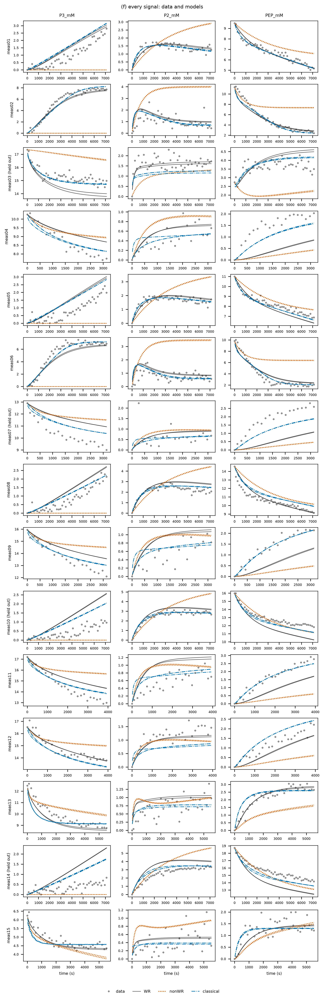

# pgm_eno_giess2026 — 공개 문헌 데이터: 효소 둘의 연쇄 반응(PGM → 에놀레이스), ³¹P NMR

## 출처와 라이선스

- 데이터: GitHub [EnzymeML/Giess_2026](https://github.com/EnzymeML/Giess_2026), Scenario 2 "³¹P-NMR kinetic analysis of an enzymatic cascade reaction"(FAIR NMR 데이터 처리 논문의 지원 자료, 2026). 파일 `Scenario2/data/output/pgm-eno.json`(EnzymeML v2)과 맞춤 노트북 `cascade_fit.ipynb`.
- 라이선스: **BSD-3-Clause**(저장소 `LICENSE`, "Copyright (c) 2026, EnzymeML"; 노트북에는 Johann Rohwer). 저작권 표시와 조건을 함께 두면 허락 없이 쓰고 다시 나눌 수 있다. `raw/LICENSE_BSD-3-Clause.txt`에 원문을 두었다.

## 실험

- 효모 용해액(*S. cerevisiae*)의 포스포글리세르산 뮤테이스(PGM)와 에놀레이스(ENO): 3-포스포글리세르산(3PG) ⇌ 2-포스포글리세르산(2PG) ⇌ 포스포엔올피루브산(PEP)
- ³¹P NMR로 세 물질을 내부 표준(트리에틸인산 TEP, 약 5 mM)에 견주어 잼, 약 2.7분 간격 52~119분, 25 ℃, pH 7
- 15실험: 3PG에서 시작 7개(6~17 mM), PEP에서 시작 7개(9.5~18.7 mM), 둘 다 1개
- 효소량: 용해액 단백(0.199~1.09 mg/mL)만 기록. 측정 날짜가 다섯 날(용해액이 다를 수 있음)

## 데이터 처리 (`make_data.py`)

```
uv run python -I projects/pgm_eno_giess2026/make_data.py   # data/ 다시 만들기(이미 있음)
uv run enzopt run projects/pgm_eno_giess2026
```

- 실험마다 `data/<id>.csv`(time_s, P3_mM, P2_mM, PEP_mM). 분 → 초, 값은 그대로(처음 값의 1e−10 자리표시는 0).
- 잡음: 내부 표준의 실험별 흔들림 0.11~0.18 mM(중앙값 0.13). 세 물질 합(물질 수지)의 흔들림은 0.21~0.52 mM, 물질마다 독립이면 그 1/√3 ≈ 0.2 mM. 세 물질 모두 σ = 0.2 mM로 둠.
- 물질 수지: 세 물질 합이 시간당 0.2~0.6 mM씩 조금 줄어든다(곁반응이 조금 있음). 반응식에는 넣지 않았다(아래 비교에서 효과가 작음).

## 효소가 둘인 반응식 (도구 확장, 2026-10-12)

enzopt의 PINN은 효소 모습의 분포를 준정상으로 계산한다. 이 데이터를 위해 **효소 그래프가 여럿**인 반응망을 다루도록 넓혔다(`core/qss.py`, `pinn/general.py`, 테스트 `tests/test_multi_enzyme.py`).

- 서로 단계로 이어지지 않는 효소 모습의 묶음 하나가 효소 하나다(여기서는 PGM: E·EX·EX_PEP, ENO: F·FY).
- 효소마다 양을 따로 받는다: 첫 효소는 `Et_nM`, 나머지는 그 효소의 자유 형태 이름으로 실험에 적은 처음 값(mM, 여기서는 `F`).
- 준정상 분포를 효소마다 풀고 효소 양의 몫으로 가중한다. 효소가 하나면 예전과 똑같이 계산한다.
- 효소가 여럿이면 실활 단계와 PINN 보정 항(`discrepancy`)은 아직 못 쓴다. ⑤ 설계도 첫 효소의 양만 바꾸므로 이 프로젝트에서는 끔.

효소량은 모르므로 **두 효소 모두 용해액 단백 1 mg/mL당 1 µM**로 가정했다. kcat의 절대값은 이 가정에 대한 상대값이고, 결합·해리의 비와 K′는 영향을 받지 않는다.

## 반응식

| 단계 | 반응 | 뜻 |
|---|---|---|
| 1 | E + P3 ⇌ EX | PGM에 3PG 결합 |
| 2 | EX ⇌ E + P2 | 2PG로 바뀌어 떨어짐 |
| 3 | F + P2 ⇌ FY | 에놀레이스에 2PG 결합 |
| 4 | FY ⇌ F + PEP | PEP로 바뀌어 떨어짐 |
| 5 | EX + PEP ⇌ EX_PEP | PEP가 PGM 복합체를 붙잡음(저자 모델에 없음, 아래 비교로 넣음) |

- 단계 1~4는 저자 모델(효소마다 생성물 경쟁이 있는 가역 Michaelis–Menten)을 질량 작용으로 옮긴 것이다. 두 효소의 순환이 모두 가역이라 반응망은 **약가역, 결핍 0**이다. ①이 149 보장을 주고, ④는 보존량·양수·평형 관계·리아푸노프 감소를 모두 판정에 쓴다.
- K′(평형 상수)는 문헌 자릿수(평형에서 3PG:2PG ≈ 6:1이라 0.17, PEP:2PG ≈ 5)를 사전분포 중심으로 두고 데이터로 학습한다.
- 사전분포는 일반 자릿수(결합 10³ /(mM·s), 해리 10³ /s, 변환 10 /s, 표준편차 1.5 자릿수)다.
- 대조: 단계 2를 한 방향으로(PEP 쪽에서 3PG로 돌아갈 수 없음).
- 학습 11실험. 홀드아웃은 4실험: 혼합 시작 meas03, 3PG 12.9 mM meas07, PEP 16.0 mM meas10, PEP 18.7 mM meas14(학습 최대 바깥).

## 결과 (2026-10-12)

### 저자 모델 그대로(단계 1~4)

```
uv run enzopt run projects/pgm_eno_giess2026          # (단계 5를 빼고 σ 0.15로 돌린 실행 2026-10-12_0948)
```

- 고전 피팅(시작점 4개가 모두 같은 곳): 학습 4.0σ, 홀드아웃 5.7~8.8σ(σ = 0.15 mM). PINN 표본 4개 모두 3σ 초과로 빠짐. 이 반응식으로는 15실험을 잡음 수준으로 설명하지 못한다.
- 대조(단계 2 한 방향): 학습 13.8σ. PEP에서 시작한 실험이 3PG까지 가는 것을 데이터가 분명히 요구한다.

### 빠진 단계 찾기 (`enzopt suggest`, 약 3분)

```
uv run enzopt suggest projects/pgm_eno_giess2026 --candidate "PEP -> X" --candidate "P3 -> X" --candidate "P2 -> X"
```

도구가 만든 후보 14개(막다른 결합 8, 실활 4, 효소 없는 반응 2)와 물질 수지가 조금씩 줄어드는 것을 보고 넣은 곁반응 3개(PEP·3PG·2PG → X)를 비교했다(σ = 0.15).

| 후보 | 학습 | 홀드아웃 | ΔAIC |
|---|---|---|---|
| (단계 1~4) | 4.02σ | 7.51σ | 0 |
| **EX + PEP ⇌ EX_PEP** | 2.88σ | **3.77σ** | **−809** |
| E + PEP ⇌ E_PEP | 2.96σ | 4.42σ | −735 |
| E → ED(PGM 실활) | 3.70σ | 6.01σ | −174 |
| P3 → X(3PG 곁반응) | 3.98σ | 7.51σ | −31 |
| PEP → X(PEP 곁반응) | 3.99σ | 7.59σ | −13 |

- **PEP가 PGM을 붙잡는 단계**(복합체에 붙든 자유 효소에 붙든)가 다른 후보보다 크게 앞선다. 홀드아웃을 7.51σ → 3.77σ로 거의 절반(도구의 "절반 이하" 기준 3.76σ에 0.01 모자람)으로 줄인다.
- 곁반응(물질 수지가 시간당 0.2~0.6 mM 줄어드는 것)은 맞춤을 거의 바꾸지 않는다.
- 이 단계를 반응식 5로 넣었다. 저자 모델에는 없는 가설이라 README의 "한계"에 적었다.

### 단계 5를 넣은 반응식 (기본, 실행 2026-10-12_1009)

σ = 0.2 mM(물질 수지 기준). 반응이 둘(느린 변수 둘)이라 PINN 재시작을 16번으로 늘렸다(8번이면 표본 1개만 남음).

| 모델 | 학습 | 홀드아웃 (meas03 · 07 · 10 · 14) |
|---|---|---|
| 고전 피팅 | 2.17σ | 2.11 · 3.61 · 2.46 · 2.89σ |
| PINN 표본 2개(4개 중) | 2.89σ | 평균 5.0σ |
| 대조(단계 2 한 방향) | 9.95σ | 5.8σ |



- **고전 피팅은 대부분 실험을 따라간다**(학습 1.5~2.8σ, 홀드아웃 2.1~3.6σ). 맞춘 K′는 PGM 0.085, 에놀레이스 3.3이다(PINN 표본 0.12, 2.7~2.8). PEP의 PGM 복합체 해리 상수는 0.1~0.19 mM이다.
- **PINN은 고전 피팅보다 덜 맞는다.** 재시작 16번 중 최선이 학습 2.9σ이고, 표본 4개 중 2개만 3σ 안에 든다. 느린 변수가 둘인 반응망에서 PINN이 고전 피팅의 최솟값까지 못 가는 것은 합성 연쇄 반응 시험(효소 하나든 둘이든 2.5σ 안팎)에서도 같았다.
- **PGM은 포화되지 않는다.** 6~19 mM에서 맞춘 Km이 수천 mM로 나온다. 결합 단계의 2차 속도 상수(효소량당)만 정해지고 Km·kcat 하나하나는 정해지지 않는다.
- **④ 검증:** 남은 표본 2개로 해석 2번, 모두 통과(149 보장 검사 포함, 평형 |ln Q/K| 0.0005~0.0006).
- **설계(⑤)는 껐다.** 효소 둘의 양을 함께 정하는 설계가 아직 없다.

## 한계

- **PEP에서 시작한 실험의 3PG 지연:** 3PG가 처음 30~50분 동안 거의 생기지 않다가 늦게 오른다. 2PG는 15분 안에 이미 1.5 mM까지 쌓였다. 단계 5가 이 방향(PEP가 많을 때 PGM이 느림)을 일부 설명하지만 지연을 다 따라가지는 못한다. 다른 원인(용해액의 PGM 보조인자 2,3-비스포스포글리세르산의 변화, 효소의 느린 활성화 등)은 시험하지 않았다.
- **단계 5는 가설이다.** 데이터가 강하게 고르지만(ΔAIC −809), 같은 방향의 다른 기전(자유 PGM에 PEP가 붙는 E_PEP도 비슷)과 가르려면 PEP를 더 많이 넣고 시작하는 3PG 실험(meas03은 PEP 2.7 mM뿐) 같은 새 실험이 필요하다.
- **효소량 가정:** 단백 1 mg/mL당 두 효소 모두 1 µM. 용해액이 날마다 다르면(측정 날짜 다섯) 효소 비율도 다를 수 있는데 반영하지 않았다.
- σ = 0.2 mM은 물질 수지에서 정했다. 내부 표준만 보면 0.13 mM이다.
