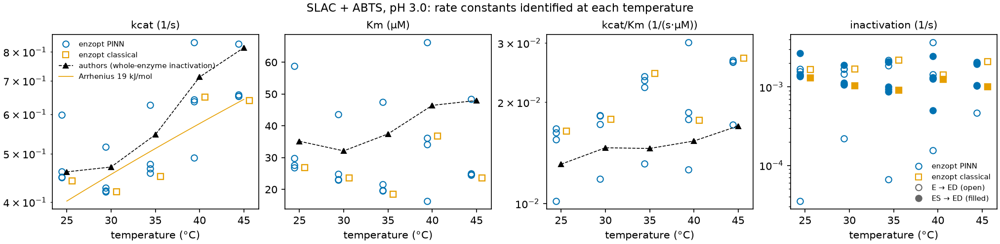

# slac_abts_haussler2023 — 공개 문헌 데이터: 라카아제의 ABTS 산화, 온도 다섯 가지

## 출처와 라이선스

- 데이터: Häußler, M. (2023). *From raw data to kinetic parameters: an EnzymeML-based workflow for reproducible enzyme kinetics* (석사 논문 JupyterBook과 원자료). DaRUS (University of Stuttgart), doi:10.18419/DARUS-3337, **CC BY 4.0**. 연락처: Max Häußler, Jürgen Pleiss.
- 같은 실험의 pH 3 부분은 DaRUS doi:10.18419/DARUS-3867(2024)로도 공개되어 있다.
- CC BY 4.0이라 출처를 밝히면 허락 없이 쓸 수 있다. 이 폴더는 원자료를 바꾸지 않고 `raw/`에 두었고, 바꾼 것은 아래 "데이터 처리"에 적었다.

## 실험

- 효소: 작은 라카아제 SLAC(*Streptomyces coelicolor*), 0.0739 µM(저자 템플릿)
- 반응: ABTS + O₂ → ABTS 라디칼(4 ABTS + O₂ → 4 ABTS•⁺ + 2 H₂O). O₂는 재지 않았다.
- 측정: SpectraMax 플레이트 리더, 340 nm(ABTS)와 420 nm(라디칼), 15분 동안 11번(약 90 s 간격). 읽을 때마다 **플레이트 칸 온도**가 함께 기록된다.
- 조건: pH 3.0 하나를 골랐다(저자의 ChemCatChem 2024 부분과 같음). 온도 25·30·35·40·45 ℃ 다섯 가지, 온도마다 플레이트 하나.
- 플레이트: 열 1~10이 ABTS 0, 5, 10, 15, 25, 50, 75, 100, 150, 200 µM, 행 A~C가 효소(3반복), 행 D~F가 효소 없는 대조.
- 표준 곡선: 온도마다 ABTS 0~200 µM 12단계 × 3반복(340 nm).

## 데이터 처리 (`make_data.py`, `make_projects.py`)

온도마다 프로젝트 하나다: `projects/slac_abts_haussler2023_25C`, `_30C`, `_35C`, `_40C`, `_45C`(대시보드 목록에도 나옴). 이 폴더(`projects/slac_abts_haussler2023/`)에는 다섯 프로젝트가 함께 쓰는 원자료·변환 스크립트·정리 그림만 있다.

```
uv run python -I projects/slac_abts_haussler2023/make_data.py       # 다섯 프로젝트의 data/ 만들기
uv run python -I projects/slac_abts_haussler2023/make_projects.py   # 다섯 프로젝트의 project.yaml 만들기
uv run enzopt run projects/slac_abts_haussler2023_35C               # 온도 하나 실행(약 1분 30초)
uv run python projects/slac_abts_haussler2023/temperature_summary.py   # 다섯 온도의 상수 모으기, 그림
```

- 340 nm 흡광을 같은 온도의 표준 곡선으로 ABTS 농도로 바꿨다(저자와 같은 방법). 흡광 3.2 이상은 버렸다(저자의 `cutoff_absorption=3.2`).
- 표준 곡선은 0~100 µM 표준으로 그은 **직선**이다(잔차 0.005~0.008 A, 약 0.4 µM). 125 µM 표준이 모든 온도에서 직선보다 0.085 A 높고 150 µM은 0.07 A 낮아(피펫 오차로 보임) 2·3차식이 오히려 나빴다.
- 200 µM 열은 처음 흡광이 3.2를 넘어 뺐다. 그래서 우물은 온도마다 ABTS 5~150 µM 8단계 × 3반복 = 24개다.
- 각 우물의 처음 ABTS는 그 우물의 첫 읽기다. 같은 열이라도 우물마다 몇 % 다르고, 표준 곡선과 플레이트 사이에도 몇 % 차이가 있어서다(예: 50 µM 대조 우물이 표준보다 약 4 % 낮게 읽힘).
- 측정마다의 플레이트 온도를 데이터 파일의 `T_C` 열에 넣었다. enzopt ② 단계가 이것으로 등온 전제(변동 0.2 ℃ 미만)를 확인한다. 35 ℃ 플레이트는 첫 읽기만 35.5 ℃라 "온도 변동 0.50 ℃" 경고가 나온다(기록 해상도가 0.5 ℃).
- 대조 우물(효소 없음): 읽기 잡음 0.02~0.05 µM, 15분 표류 −0.1~+0.3 µM. 효소 없는 ABTS 변화는 무시할 만하다.

## 반응식

| 단계 | 반응 | 뜻 |
|---|---|---|
| 1 | E + ABTS ⇌ ES | ABTS 결합 |
| 2 | ES → E + P | 산화와 방출(P = 라디칼) |
| 3 | E → ED | 자유 효소의 실활 |
| 4 | ES → ED | ABTS가 붙은 효소의 실활 |

- 저자 모델은 "비가역 Michaelis–Menten + 효소 전체의 1차 실활"이다. 질량 작용으로 옮기면 E와 ES 둘 다 망가지는 단계 3·4가 된다.
- 처음에는 단계 3만 두었다. 35 ℃에서 `enzopt suggest --candidate "ES -> ED"`로 비교하니 단계 4를 더하면 ΔAIC −40, 홀드아웃 1.62σ → 1.50σ라서 넣었다(단계 3을 4로 바꾸는 것은 ΔAIC −20).
- 사전분포: 일반 자릿수(결합 10³ /(mM·s), 해리 10² /s, 산화 10² /s, 실활 10⁻² /s, 표준편차 1.5 자릿수). 저자 값은 쓰지 않았다.
- 잡음 σ = 0.5 µM(표준 곡선 직선의 잔차 근처).
- 학습: 5, 15, 50, 100 µM(3반복씩 12개). 홀드아웃: 10, 25, 75 µM(학습 범위 안)과 150 µM(바깥) 12개.

## 결과

실행 2026-10-12(온도마다 PINN 시드 4 × 재시작 8, 고전 피팅 시작점 4, 각 약 1분 30초). RMSE는 σ = 0.5 µM 단위.

| 온도 | 표본 | 학습 PINN · 고전 | 홀드아웃 PINN · 고전 | 대조(단계 1 한 방향) 홀드아웃 |
|---|---|---|---|---|
| 25 ℃ | 4/4 | 0.71 · 0.69σ | 0.72 · 0.63σ | 1.67σ |
| 30 ℃ | 4/4 | 0.68 · 0.66σ | 0.86 · 0.81σ | 2.20σ |
| 35 ℃ | 4/4 | 0.98 · 0.95σ | 1.50 · 1.50σ | 2.24σ |
| 40 ℃ | 4/4 | 1.31 · 1.27σ | 1.50 · 1.37σ | 1.66σ |
| 45 ℃ | 4/4 | 0.86 · 0.84σ | 1.61 · 1.64σ | 1.81σ |



| 온도 | kcat (1/s) | Km (µM) | 실활 E → ED · ES → ED (1/s) | 저자 kcat · Km |
|---|---|---|---|---|
| 25 ℃ | 0.44~0.60 | 27~59 | 0.0000~0.0017 · 0.0013~0.0027 | 0.46 · 35 |
| 30 ℃ | 0.42~0.52 | 23~44 | 0.0002~0.0017 · 0.0010~0.0019 | 0.47 · 32 |
| 35 ℃ | 0.45~0.63 | 19~48 | 0.0001~0.0022 · 0.0009~0.0021 | 0.55 · 37 |
| 40 ℃ | 0.49~0.84 | 16~66 | 0.0002~0.0037 · 0.0005~0.0025 | 0.71 · 46 |
| 45 ℃ | 0.64~0.83 | 24~49 | 0.0005~0.0021 · 0.0010~0.0020 | 0.82 · 48 |

(범위 = PINN 표본 4개와 고전 피팅 4개, `figures/temperature_table.csv`)

- **모든 온도에서 식별이 잘 됐다.** 표본 4개가 모두 남고, 학습과 홀드아웃(학습 범위 바깥 150 µM 포함)이 1.6σ 안이다. 대조(ABTS 결합을 한 방향으로)는 홀드아웃이 1.7~2.2σ로 더 나빠, 결합이 가역이라는 쪽을 데이터가 지지한다.
- **kcat은 온도와 함께 오른다.** 고전 피팅으로 그은 Arrhenius 직선의 활성화 에너지는 18.5 kJ/mol, 저자 값으로 그으면 24.5 kJ/mol이다. 표본 범위가 넓어(특히 40 ℃) 두 값의 차이는 이 데이터로 가르기 어렵다.
- **저자 값과 같은 범위다.** kcat·Km 모두 표본 범위가 저자 값을 대개 품는다. 처음 모델(실활을 자유 효소에만, 단계 4 없음)은 kcat 0.28~0.47 /s, Km 7~15 µM로 저자 값과 체계적으로 달랐다. 실활을 어느 효소 모습에 두느냐가 kcat·Km 추정을 바꾼다는 뜻이다.
- **kcat·Km 하나하나는 넓게 퍼진다.** 15분 동안 기질이 다 쓰이지 않는 짧은 곡선이라 kcat/Km은 잘 정해지지만, 포화 쪽(kcat)과 실활의 나눔(E·ES)은 서로 맞바꿀 수 있다(같은 곡선, 다른 상수: 식별 안내 2-6절과 같은 모습).
- **설계(⑤, 참고용):** "ABTS 0.1 mM의 90 %를 15분 안에" 필요한 최소 효소량(강건)은 25 ℃ 693 nM → 45 ℃ 443 nM로 온도가 오를수록 줄어든다(실험의 74 nM로는 15분에 90 %에 못 미침).
- **온도 기록:** ② 단계가 측정마다의 플레이트 온도를 읽어 35 ℃ 플레이트에 "온도 변동 0.50 ℃" 경고를 낸다(첫 읽기 35.5 ℃, 해상도 0.5 ℃). 다른 온도는 변동 0이다. 1초 간격 큐벳 온도 같은 정밀한 기록은 아니다.

## 한계

- O₂를 재지 않았고 넉넉하다고 보았다(150 µM ABTS를 다 산화해도 O₂ 약 40 µM).
- 420 nm(라디칼) 신호는 표준 곡선이 없어 쓰지 않았다(저자도 340 nm만으로 맞춤). 라디칼이 340 nm에서 조금 흡수하면 ABTS 감소가 작게 읽힌다.
- 표준 곡선과 플레이트 사이에 몇 % 차이가 있어(같은 명목 농도에서 대조 우물이 표준보다 약 4 % 낮음) 절대 농도, 그래서 Km에 몇 % 불확실성이 있다.
- pH는 3.0 하나만 썼다. 다른 pH(3.5~5.5)는 같은 `raw/` 형식이라 `make_data.py`의 파일 이름만 바꾸면 된다(pH 4.5 이상은 저자도 효소가 거의 활성이 없다고 봄).
